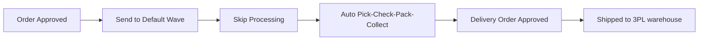
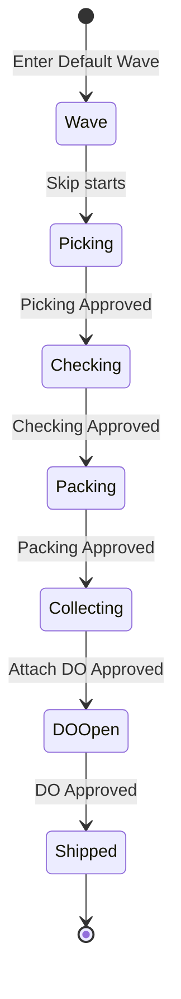
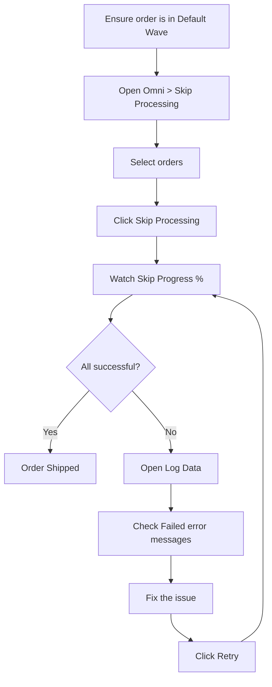
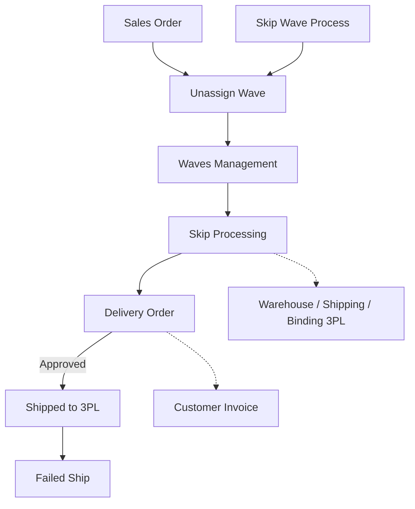

### 🚀 Skip Processing

**Skip Processing** is a bulk action from the order list that *bypasses* manual warehouse work (Picking → Checking → Packing → Collecting) through to **Shipped** automatically. It is for **Warehouse Operation** or **Fulfillment Lead** teams that need to speed up many orders already in the **Default Wave**.

**Target Audience:**

| Persona | Typical Use | Where to Begin |
| :---- | :---- | :---- |
| **Warehouse Operation / Fulfillment Lead** | Bulk fulfill orders already in Default Wave through Shipped | Select orders on the list → click **Skip Processing** |

**UI & System Legend:**

* **Grey:** Not started / draft
* **Yellow / orange:** In progress
* **Green:** Done / approved

---

### 🔑 Key Terms

| Term | Definition |
| :---- | :---- |
| **Default Wave** | Order has been released to warehouse processing — required for the order to appear here. |
| **Batch Code** | Code for one Skip run (format: `SP-{time}-{sequence}`). |
| **Shipped** | Goods have left for the courier warehouse (3PL); the only outcome counted as success. |
| **Skip Progress** | Column with a real-time percentage *progress bar* per order. |
| **Retry** | Re-run only for failed orders, continuing from the last successful stage. |
| **Resume** | Continue from the next unfinished stage (not from the start) for partially processed orders. |
| **Lock / duplicate** | System holds the same order so it is not processed twice at once. |
| **Delivery Order (DO)** | Shipping document; an *approved* DO means the order is Shipped. |
| **3PL** | Third-party courier warehouse as the final destination. |
| **Processing Date (readonly)** | Base date/time for documents or stock; display-only here — set in Unassign Wave or Skip Wave Process. |

---

### 🎯 When & Why to Use

| ✅ Use when | ❌ Do not expect when |
| :---- | :---- |
| Order already **Send to Default Wave**. | Order still in Unassign Wave (not sent to wave) — it will not appear. |
| You want to skip manual warehouse stages for many orders at once. | Manual picking/checking/packing is still running for that order. |
| You want to monitor progress or *retry* failed orders via the log. | Order is already Shipped or the button shows Not Authorized. |

---

### 📋 Prerequisites

| Prerequisite | Source | Notes |
| :---- | :---- | :---- |
| Sales Order is *approved* and ready to process. | Sales Order | — |
| Order already **sent to Default Wave**. | Unassign Wave / Skip Wave Process | **Required** — otherwise the order does not appear. |
| Process warehouse location structure is complete (temp locations for wave, pick, check, pack, ship, and 3PL warehouse). | Warehouse Structure | Missing structure fails related stages. |
| Shipper is bound to a 3PL warehouse. | Warehouse Binding 3PL | Required for Shipping DO. |
| Order is not Void. | Sales Order | Void is rejected at initial validation. |
| No manual Pick/Check/Pack still running for that order. | Pick/Check/Packing List | Skip is rejected if manual process is in progress. |
| Logged in to the order’s **owning company**. | Account | Other company’s orders → Not Authorized. |
| Company Processing Date is appropriate. | Unassign Wave / Skip Wave Process | Display-only (*readonly*) here. |

---

### 🔄 Position in the Business Flow

**Step notes:** An approved order is sent to Default Wave. Skip Processing then automatically runs *picking*, *checking*, *packing*, and *collecting*, creates and approves the Delivery Order, and moves the order to Shipped at the 3PL warehouse.

**Text fallback:** Order Approved → Send to Default Wave → Skip Processing → Auto Pick/Check/Pack/Collect → Delivery Order Approved → Shipped to 3PL.

---

### 📍 Menu Location & Page Layout

* **Navigation:** OmniChannel → **Skip Processing**
* **UI route:** `/omni/skip-processing`

> 🖼️ **[IMAGE PLACEHOLDER]** — Skip Processing page: order list with Skip Progress and Pick/Check/Pack/Collect icons, top toolbar (readonly Processing Date, Skip Processing, Log Data, Export), and status cards.

This menu only lists orders already in Default Wave. Orders are selected by **checking rows on the list**, not by *file upload*.

---

### 📊 Order Stage Cycle

| Stage | Condition | Manually editable? | Skip button |
| :---- | :---- | :---- | :---- |
| Wave | Not yet picking. | — | Active. |
| Pick / Check / Pack | Draft → auto-approved. | No. | Active if stage not finished. |
| Collecting | Approved when order is linked to DO. | No. | Active if no DO yet. |
| DO / Shipped | Final. | No. | Hidden / Not Authorized. |

---

### 📝 How to Use

**Step notes:**

1. Ensure the order is already **Send to Default Wave** (via Unassign Wave or Skip Wave Process).
2. Open **Omni → Skip Processing**.
3. (Optional) Adjust *filters*; default Data Owner is your company.
4. Select one or many orders on the list.

> 🖼️ **[IMAGE PLACEHOLDER]** — Several orders selected and Skip Processing button on the top toolbar.

5. Click **Skip Processing** on the top *toolbar*.
6. Watch **Skip Progress** until 100% and icons turn green (*realtime*).

> 🖼️ **[IMAGE PLACEHOLDER]** — Order row with Skip Progress bar and stage icons (grey, yellow/orange, green).

7. Open **Log Data** for *batch* status (Success vs Failed).
8. For failed orders: open **Failed** detail, read the *error*, fix the cause, then click **Retry**.

---

### 📑 Complete Field & Element Reference

| Element / Column | Default visible? | Notes |
| :---- | :---- | :---- |
| **Checkbox** | Yes | Select one or many orders. |
| **Trx Code / Platform Order** | Yes | Internal transaction code and platform order number. |
| **Order Date** | Yes | Order date. |
| **Store / Buyer** | Yes | Store and buyer names. |
| **Status icon Pick / Check / Pack / Collect** | Yes | Stage indicators (grey, yellow/orange, green). |
| **Skip Progress** | Yes | Percentage *progress bar* per order. |
| **Action — Skip Processing** | Yes | Disabled / *Not Authorized* if already Shipped or not the user’s company. |
| **Picking List Reference** | **Hidden** | One order can have more than one *picking list* reference. |
| **Other columns** | — | Follow Order Process *baseline*. |
| **Skip Processing button (Toolbar)** | — | Runs bulk *skip* for selected orders. |
| **Processing Date (Toolbar)** | — | **Readonly**; company-*shared*; cannot change here. |
| **Advanced Filter — Data Owner** | — | Defaults to logged-in company; other companies still rejected even if reset. |
| **Global Search & Advanced Filter** | — | Standard search and filters. |
| **Export** | — | Skip-specific export path. |
| **Log Data** | — | Opens processing *batch* history. |
| **Status cards** | — | All, Pick, Check, Pack, Outbound, Shipping Ready, Complete (Complete still a *placeholder*). |

---

### ✅ Business Rules & Validation

* **If** you click Skip with no orders selected, **then** the system shows "No Sales Orders selected…".
* **If** you select an order that is locked (double-click / another *user*), **then** the system rejects with a duplicate message ("…prevented a duplicate processing attempt…") without creating duplicate documents.
* **If** you select another company’s order, **then** the system rejects with "…does not have permission to process skip orders".
* **If** you select an order that has not passed *stock mutation* or whose *wave* is not processed, **then** the system rejects it (wording similar to the other-company error).
* **If** you process a Void transaction, **then** the system rejects with "…transaction status is Void".
* **If** you process an order whose manual Pick/Check/Pack is still running, **then** the system rejects with "Skip not allowed while {stage} is in progress".
* **If** you process an order grouped in a Delivery Order with many other orders, **then** the system logs it as *Failed* ("Order grouped in {DO}…").
* **If** you process an order already Shipped or failed at final shipping, **then** the system shows "…no further process needed".
* **If** a fatal *error* occurs, **then** the system shows "A fatal error occurred".

---

### 🔁 Resume from Last Position

The system continues from the last position without redoing finished work:

| Last order position | Stages run |
| :---- | :---- |
| Just in Wave | Pick → Check → Pack → Collect. |
| Picking already Approved | Check → Pack → Collect. |
| Checking still Open/Draft | Pack → Collect. |
| Packing still Open/Draft | Collect. |
| Collecting Open/Draft/Approved | Continue to DO. |
| Already Shipped / done | No action ("Completed or no further process needed"). |

---

### 📦 Stock Movement per Stage

Stock moves between temporary locations when a stage is *approved*:

| Stage | From → To | When |
| :---- | :---- | :---- |
| Wave | Process rack/warehouse → temp wave location | Initial holding. |
| Picking | wave → pick | When creating Checking. |
| Checking | pick → check | When creating Packing. |
| Packing | check → pack | When creating Collecting. |
| Collecting | pack → ship | When order is linked to DO. |
| Shipping DO | ship → shipper’s 3PL warehouse | When DO is approved. |

> **Note:** When an order is linked to a DO, the *draft* Customer Invoice is auto-*approved*.

---

### ⚠️ "Success" = Already Shipped, and Every Order Must Be Success or Failed

> **Warning:** The **Success** column in the log only counts orders that reached **Shipped** (DO *approved*). Finishing *picking*, *checking*, or *packing* alone is not success. Processed order count must equal **Success + Failed**. If an order is "missing" from the count, report it as a *bug*.

---

### ⚠️ Double-Click Protection — Order Locked While Processing

> **Warning:** The system locks the order as soon as the request is accepted. A second click by the same or another *user* is rejected with a duplicate message. If **even one** selected order is already locked, the system rejects the **entire** request and releases all locks. Do not *spam*-click.

---

### ⚠️ Processing Date: Display-Only Here; Document Dates Depend on Entry Path

> **Warning:**

1. **Processing Date** on the *toolbar* is **readonly** here. Change it in **Unassign Wave** or **Skip Wave Process**.
2. The value is company-*shared* with those two menus.
3. If empty at the source, the system uses **current time** (date + time, not end of day).
4. Orders from **Skip Wave Process** use the upload *batch* "snapshot" date. Orders from **Skip Processing** use the company *Processing Date* (or current time if empty).
5. Time gap between sequential documents in one *skip* chain is **+10 seconds**. The old "+10 minutes from transaction" rule **does not apply**.

> 🖼️ **[IMAGE PLACEHOLDER]** — Readonly Processing Date field on the toolbar (not clickable/editable).

---

### 🔀 Two Entry Paths: Skip Processing vs Skip Wave Process

| Aspect | Skip Processing (This Menu) | Skip Wave Process |
| :---- | :---- | :---- |
| How orders are chosen | **Check rows on the list**. | **Upload Excel** of Order No. |
| Starting requirement | Already in **Default Wave**. | Not yet in a wave. |
| What it does | *Skip* pipeline through Shipped. | Send to Default Wave **then** *skip* through Shipped. |
| Processing Date | *Readonly* (display only). | Editable and "snapshotted" at *upload*. |

---

### 📂 Log Data & Retry

Open history via **Log Data** on the *toolbar*.

**Batch table:** Batch Code, Total SO Processed, Success, Failed, Executed/Ended, Duration, By/Company.

> 🖼️ **[IMAGE PLACEHOLDER]** — Log Data panel with batch table (Batch Code, Total, Success, Failed, Duration).

**Detail & Retry:** Click a count to open the detail modal:

* **Success:** SO number, DO link, stage, and time.
* **Failed:** Error message and **Retry** button.
* **Retry** continues from the last successful stage — not from the start. Fix the issue before *Retry*.

> 🖼️ **[IMAGE PLACEHOLDER]** — Failed detail modal with error message and Retry button.

---

### 📌 If Some Orders Fail — What Happens to the Others

Other orders in the same *batch* **keep processing**. One failure does not stop the whole *batch*. On process collision (*deadlock*), the system auto-retries before marking *Failed*; failed orders can still be Retried manually.

---

### 📌 Things to Note / Known Limitations

* Orders **not** yet sent to Default Wave do not appear.
* Do not *spam*-click or locks will reject the request.
* Log *Success* counts only **Shipped** orders.
* Orders in a multi-order DO can be rejected.
* Large *batches* take a reasonable amount of time.
* This menu is not for manual *Generate Pick List* or airway-bill printing.
* Rejection messages for "other company" and "wave not processed" have similar wording.
* "Auto-completed via Skip Processing" is not consistently shown on all document trails.
* The **Complete** status card is still a *placeholder*.
* Locks on orders that fail mid-process may last until the end process finishes (TTL unconfirmed) — `[NEEDS SOURCE — ask QA]`.

---

### 🔗 Related Menus

| Menu | Role |
| :---- | :---- |
| **Unassign Wave / Skip Wave Process** | Upstream — send to Default Wave; share *Processing Date*. |
| **Waves Management** | Wave distribution before *picking*. |
| **Pick/Check/Packing List** | Stages Skip Processing runs automatically. |
| **Delivery Order** | Downstream — success marker through Shipped. |
| **Warehouse / Binding 3PL** | Master prerequisites for shipping. |
| **Customer Invoice** | *Draft* auto-approved when order links to DO. |
| **Failed Ship** | Handle issues after Shipped. |
| **Order Process** | Monitoring, airway bill, manual *pick list* (not automatic *skip*). |

---

### 🛠️ Troubleshooting

| Symptom | Cause | Solution |
| :---- | :---- | :---- |
| Order not on the list. | Not yet *Send to Default Wave*. | Send via Unassign Wave or Skip Wave Process. |
| Skip click fails ("in progress"). | Manual process still running. | Finish in Pick/Check/Packing List. |
| Not Authorized message. | Different company. | Log in to the owning company. |
| Fails mid-process. | Incomplete warehouse locations / no 3PL *binding*. | Check Failed log, complete *master data*, then Retry. |
| Duplicate message. | Repeated click / another *user*. | Wait for process to finish; do not *spam*-click. |
| Slow progress. | Large *batch*. | Watch Skip Progress % (expected). |
| Failed due to multi-order DO. | Order is in a DO with other orders. | Coordinate with the DO team. |
| Cannot change Processing Date. | Field is *readonly*. | Change in Unassign Wave / Skip Wave Process. |
| Processed but neither Success nor Failed. | Should not happen. | Report as a *bug*. |

---

### ❓ FAQ

**How is Skip Processing different from Skip Wave Process?**  
Skip Processing works on orders **already** in Default Wave by **checking the list**. Skip Wave Process sends orders to Default Wave via **Excel upload**, then processes them automatically.

**Can I skip an order that was partly done manually?**  
Yes. The system *resumes* from the next unfinished stage.

**How is this different from Order Process?**  
Order Process is for airway bills and monitoring; Skip Processing accelerates automatic stages through *Shipped*.

**What do stage icon colors mean?**  
Grey (draft/not started), yellow/orange (in progress), green (done/approved).

**How does Retry work?**  
Use Failed detail in Log Data; processing continues from the last successful stage.

---

### 📚 See Also / References

* **Unassign Wave** — Default Wave prerequisite; shared Processing Date
* **Skip Wave Process** — alternate entry via Excel upload
* **Waves Management** — wave distribution before picking
* **Order Process** — monitor, airway bill, manual pick list
* **Delivery Order** — downstream through Shipped
* **Failed Ship** — handle issues after Shipped
* **Horizon Jobs** — technical job-queue docs for **Support/DevOps only** (not day-to-day ops reading)
