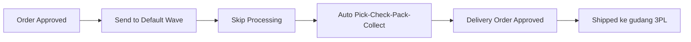
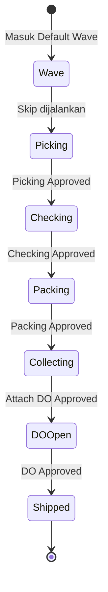
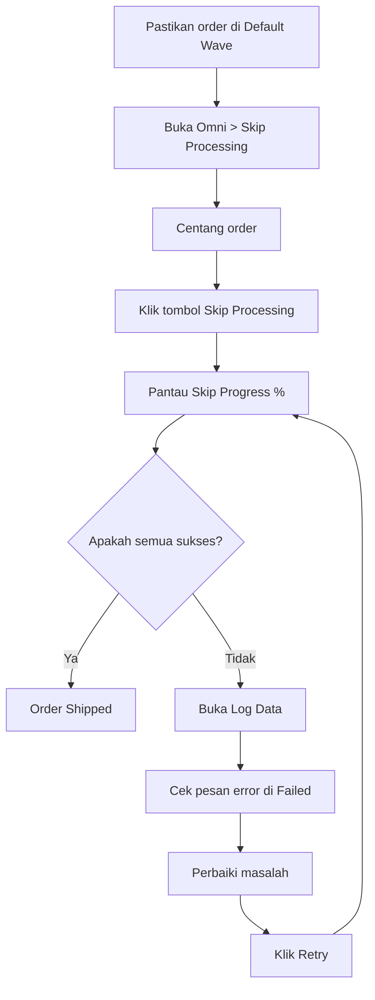
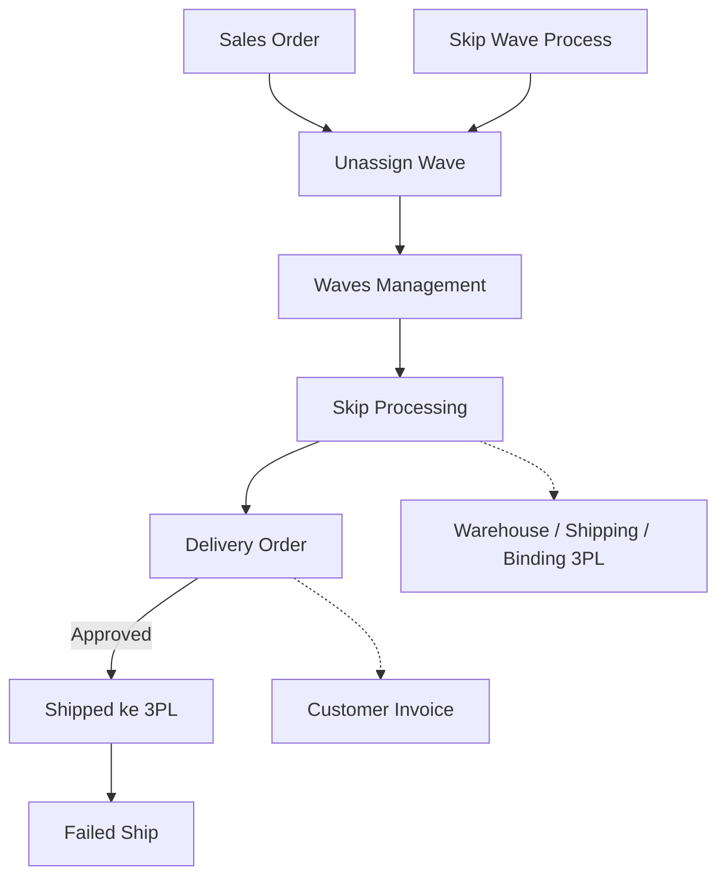

### 🚀 Skip Processing

**Skip Processing** adalah tombol aksi massal dari daftar order yang berfungsi untuk mem-*bypass* pengerjaan manual gudang (Picking → Checking → Packing → Collecting) hingga mencapai status **Shipped** secara otomatis. Menu ini ditujukan bagi **Warehouse Operation** atau **Fulfillment Lead** untuk mempercepat pemrosesan banyak order yang sudah berada di **Default Wave**.

**Target Audience:**

| Persona | Typical Use | Where to Begin |
| :---- | :---- | :---- |
| **Warehouse Operation / Fulfillment Lead** | Aksi massal pemenuhan order yang sudah di Default Wave sampai Shipped | Centang order di daftar → klik **Skip Processing** |

**UI & System Legend:**

* **Abu-abu:** Belum / draft
* **Kuning / oranye:** Sedang dikerjakan
* **Hijau:** Selesai / approved

---

### 🔑 Istilah Kunci

| Istilah | Definisi |
| :---- | :---- |
| **Default Wave** | Order sudah "dilepas" ke proses gudang — syarat wajib agar order muncul di menu ini. |
| **Batch Code** | Kode satu kali eksekusi Skip (format: `SP-{waktu}-{urutan}`). |
| **Shipped** | Barang sudah keluar menuju gudang kurir (3PL); satu-satunya hasil yang dihitung sukses. |
| **Skip Progress** | Kolom berisi *progress bar* persentase *realtime* kemajuan skip per order. |
| **Retry** | Mengulang kembali khusus untuk order yang gagal, dilanjutkan dari tahap terakhir yang berhasil. |
| **Resume** | Melanjutkan pemrosesan dari tahap berikutnya yang belum selesai (bukan dari awal) untuk order yang sudah dikerjakan sebagian. |
| **Lock / duplicate** | Sistem menahan order yang sama agar tidak diproses dua kali pada saat bersamaan. |
| **Delivery Order (DO)** | Dokumen pengiriman barang; DO yang disetujui (*approved*) berarti order berstatus Shipped. |
| **3PL** | Gudang kurir pihak ketiga yang menjadi tujuan akhir barang. |
| **Processing Date (readonly)** | Tanggal dan jam dasar dokumen atau stok; di menu ini hanya sebagai tampilan, diatur di Unassign Wave atau Skip Wave Process. |

---

### 🎯 Kapan & Kenapa Dipakai

| ✅ Pakai kalau | ❌ Jangan berharap kalau |
| :---- | :---- |
| Order sudah **Send to Default Wave**. | Order masih di Unassign Wave (belum dikirim ke wave) — order tidak akan muncul. |
| Mau melewati tahap manual gudang untuk banyak order sekaligus. | Masih ada proses picking/checking/packing **manual** yang sedang berjalan untuk order tersebut. |
| Mau memantau progres atau meng-*retry* order yang gagal lewat log. | Order sudah Shipped atau tombol berubah jadi Not Authorized. |

---

### 📋 Prasyarat

| Prasyarat | Sumber | Catatan |
| :---- | :---- | :---- |
| Sales Order sudah *approved* dan siap diproses. | Sales Order | — |
| Order sudah **dikirim ke Default Wave**. | Unassign Wave / Skip Wave Process | **Wajib** — tanpa ini order tidak muncul di daftar. |
| Struktur lokasi gudang proses lengkap (lokasi sementara untuk wave, pick, check, pack, ship, dan gudang 3PL). | Warehouse Structure | Jika kurang, pembuatan tahap terkait akan gagal. |
| Shipper sudah terikat ke gudang 3PL. | Warehouse Binding 3PL | Wajib untuk tahap pengiriman (Shipping DO). |
| Order tidak berstatus Void. | Sales Order | Status Void akan ditolak di validasi awal. |
| Tidak ada proses manual (Pick/Check/Pack) yang masih berjalan untuk order itu. | Pick/Check/Packing List | Skip ditolak jika proses manual sedang berjalan. |
| Login di **perusahaan pemilik** order. | Akun | Order milik perusahaan lain ditolak (Not Authorized). |
| Processing Date perusahaan sudah sesuai. | Unassign Wave / Skip Wave Process | Di menu ini hanya tampil *readonly*. |

---

### 🔄 Posisi dalam Alur Bisnis

**Keterangan langkah:** Order yang sudah disetujui dikirim ke Default Wave. Melalui Skip Processing, sistem secara otomatis mengerjakan *picking*, *checking*, *packing*, dan *collecting* hingga menerbitkan dan menyetujui Delivery Order, yang mengubah status order menjadi Shipped ke gudang 3PL.

**Fallback teks:** Order Approved → Send to Default Wave → Skip Processing → Auto Pick/Check/Pack/Collect → Delivery Order Approved → Shipped ke 3PL.

---

### 📍 Lokasi Menu & Tampilan Halaman

* **Navigasi:** OmniChannel → **Skip Processing**
* **Route UI:** `/omni/skip-processing`

> 🖼️ **[PLACEHOLDER GAMBAR]** — Halaman Skip Processing: daftar order dengan kolom Skip Progress dan ikon Pick/Check/Pack/Collect, toolbar atas (Processing Date readonly, Skip Processing, Log Data, Export), dan kartu status.

Menu ini khusus menampilkan order yang sudah berada di Default Wave. Order dipilih dengan cara **mencentang dari daftar**, bukan dengan *upload file*.

---

### 📊 Siklus Tahap Order

| Tahap | Kondisi | Bisa diedit manual? | Tombol Skip |
| :---- | :---- | :---- | :---- |
| Wave | Belum picking. | — | Aktif. |
| Pick / Check / Pack | Draft → di-approve otomatis. | Tidak. | Aktif jika tahap belum selesai. |
| Collecting | Di-approve saat order dihubungkan ke DO. | Tidak. | Aktif jika belum ada DO. |
| DO / Shipped | Final. | Tidak. | Hilang / Not Authorized. |

---

### 📝 Langkah-Langkah Penggunaan

**Keterangan langkah:**

1. Pastikan order sudah **Send to Default Wave** (melalui Unassign Wave atau Skip Wave Process).
2. Buka menu **Omni → Skip Processing**.
3. (Opsional) Sesuaikan *filter*; *default* Data Owner adalah perusahaan Anda.
4. Centang satu atau banyak order pada daftar.

> 🖼️ **[PLACEHOLDER GAMBAR]** — Beberapa order tercentang dan tombol Skip Processing di toolbar atas.

5. Klik tombol **Skip Processing** di *toolbar* atas.
6. Pantau kolom **Skip Progress** hingga mencapai 100% dan ikon berubah hijau (*realtime*).

> 🖼️ **[PLACEHOLDER GAMBAR]** — Baris order dengan Skip Progress bar dan ikon tahap berwarna (abu-abu, kuning/oranye, hijau).

7. Buka **Log Data** untuk melihat status *batch* (Success vs Failed).
8. Untuk order yang gagal: buka detail **Failed**, baca pesan *error*, perbaiki penyebabnya, lalu klik **Retry**.

---

### 📑 Referensi Elemen & Kolom Lengkap (Field Reference)

| Elemen / Kolom | Tampil Default? | Keterangan |
| :---- | :---- | :---- |
| **Checkbox** | Ya | Memilih satu atau banyak order. |
| **Trx Code / Platform Order** | Ya | Kode transaksi internal dan nomor order platform. |
| **Order Date** | Ya | Tanggal order. |
| **Store / Buyer** | Ya | Nama toko dan pembeli. |
| **Status icon Pick / Check / Pack / Collect** | Ya | Indikator tahap (abu-abu, kuning/oranye, hijau). |
| **Skip Progress** | Ya | *Progress bar* persentase kemajuan *skip* per order. |
| **Action — Skip Processing** | Ya | Nonaktif / *Not Authorized* jika sudah Shipped atau bukan milik perusahaan pengguna. |
| **Picking List Reference** | **Tersembunyi** | Satu order dapat memiliki lebih dari satu referensi *picking list*. |
| **Kolom Lain** | — | Mengikuti *baseline* menu Order Process. |
| **Tombol Skip Processing (Toolbar)** | — | Menjalankan *skip* secara massal untuk order yang dipilih. |
| **Processing Date (Toolbar)** | — | **Readonly**; *shared* dengan perusahaan, tidak bisa diubah di sini. |
| **Advanced Filter — Data Owner** | — | *Default* perusahaan yang login; *skip* perusahaan lain tetap ditolak walau di-reset. |
| **Global Search & Advanced Filter** | — | Pencarian dan filter standar. |
| **Export** | — | Jalur ekspor khusus *skip*. |
| **Log Data** | — | Membuka riwayat *batch* pemrosesan. |
| **Kartu Status** | — | All, Pick, Check, Pack, Outbound, Shipping Ready, Complete (Complete masih *placeholder*). |

---

### ✅ Aturan Bisnis & Validasi

* **Kalau kamu** tidak memilih order satupun saat klik Skip, **maka sistem** menampilkan pesan "No Sales Orders selected…".
* **Kalau kamu** memilih order yang sedang terkunci (klik ganda / diproses *user* lain), **maka sistem** menolak dengan pesan duplikat ("…prevented a duplicate processing attempt…") tanpa membuat dokumen ganda.
* **Kalau kamu** memilih order milik perusahaan lain, **maka sistem** menolak dengan pesan "…does not have permission to process skip orders".
* **Kalau kamu** memilih order yang belum melewati *stock mutation* atau *wave* belum diproses, **maka sistem** menolaknya (pesan mirip dengan error perusahaan lain).
* **Kalau kamu** memproses transaksi berstatus Void, **maka sistem** menolak dengan pesan "…transaction status is Void".
* **Kalau kamu** memproses order yang tahap Pick/Check/Pack manualnya masih berjalan, **maka sistem** menolak dengan pesan "Skip not allowed while {tahap} is in progress".
* **Kalau kamu** memproses order yang tergabung dalam Delivery Order dengan banyak order lain, **maka sistem** mencatatnya sebagai *Failed* di log ("Order grouped in {DO}…").
* **Kalau kamu** memproses order yang sudah Shipped atau gagal di pengiriman akhir, **maka sistem** memberi pesan "…no further process needed".
* **Kalau kamu** menghadapi *error* fatal, **maka sistem** menampilkan pesan "A fatal error occurred".

---

### 🔁 Cara Sistem Melanjutkan dari Posisi Terakhir (Resume)

Sistem otomatis melanjutkan dari posisi terakhir tanpa mengulang pekerjaan yang sudah selesai:

| Posisi Terakhir Order | Tahap yang Dijalankan |
| :---- | :---- |
| Baru di Wave | Pick → Check → Pack → Collect. |
| Picking sudah Approved | Check → Pack → Collect. |
| Checking masih Open/Draft | Pack → Collect. |
| Packing masih Open/Draft | Collect. |
| Collecting Open/Draft/Approved | Lanjut ke DO. |
| Sudah Shipped / selesai | Tidak ada aksi ("Completed atau tidak perlu proses lanjutan"). |

---

### 📦 Pergerakan Stok di Tiap Tahap

Stok berpindah antar lokasi sementara saat tahap di-*approve*:

| Tahap | Dari → Ke | Terjadi Saat |
| :---- | :---- | :---- |
| Wave | Rak/gudang proses → lokasi sementara wave | Tampungan awal. |
| Picking | wave → pick | Saat menghasilkan Checking. |
| Checking | pick → check | Saat menghasilkan Packing. |
| Packing | check → pack | Saat menghasilkan Collecting. |
| Collecting | pack → ship | Saat order dihubungkan ke DO. |
| Shipping DO | ship → gudang 3PL milik shipper | Saat DO di-approve. |

> **Catatan:** Saat order dihubungkan ke DO, *draft* Customer Invoice otomatis di-*approve*.

---

### ⚠️ "Sukses" = Sudah Shipped, dan Setiap Order Harus Masuk Success atau Failed

> **Warning:** Kolom **Success** di log hanya menghitung order yang sudah mencapai status **Shipped** (DO *approved*). Selesai *picking*, *checking*, atau *packing* belum dihitung sukses. Jumlah order yang diproses harus sama dengan total **Success + Failed**. Jika ada order yang "hilang" dari hitungan, hal ini harus dilaporkan sebagai *bug*.

---

### ⚠️ Proteksi Klik Ganda — Order Terkunci Selama Diproses

> **Warning:** Sistem mengunci order begitu permintaan diterima. Klik ulang oleh *user* yang sama atau *user* lain akan ditolak dengan pesan duplikat. Jika **satu saja** order dalam pilihan sudah terkunci, sistem akan menolak **seluruh** permintaan dan melepas semua kunci. Jangan melakukan *spam* klik.

---

### ⚠️ Processing Date: Hanya Tampil di Sini, dan Dasar Tanggal Dokumen Tergantung Jalur Masuk

> **Warning:**

1. Field **Processing Date** di *toolbar* bersifat **readonly** (tidak bisa diubah di menu ini). Ubah nilainya di menu **Unassign Wave** atau **Skip Wave Process**.
2. Nilainya dibagikan (*shared*) per perusahaan dengan kedua menu tersebut.
3. Jika nilainya kosong di sumber, sistem akan menggunakan **waktu saat itu juga** (tanggal + jam, bukan akhir hari).
4. Order dari **Skip Wave Process** menggunakan tanggal "foto" (*snapshot*) *batch* unggahan. Order dari menu **Skip Processing** menggunakan pengaturan *Processing Date* perusahaan (atau waktu saat itu jika kosong).
5. Selisih waktu antar dokumen berurutan dalam satu rantai *skip* adalah **+10 detik**. Aturan lama "+10 menit dari transaksi" **tidak berlaku**.

> 🖼️ **[PLACEHOLDER GAMBAR]** — Field Processing Date di toolbar dalam kondisi readonly (tidak bisa diklik/diubah).

---

### 🔀 Dua Pintu Masuk: Skip Processing vs Skip Wave Process

| Aspek | Skip Processing (Menu Ini) | Skip Wave Process |
| :---- | :---- | :---- |
| Cara memilih order | **Centang langsung dari daftar**. | **Upload file Excel** daftar Order No. |
| Syarat awal order | Sudah di **Default Wave**. | Belum di wave. |
| Yang dilakukan | Pipeline *skip* sampai Shipped. | Kirim ke Default Wave **lalu** *skip* sampai Shipped. |
| Processing Date | *Readonly* (tampilan saja). | Bisa diatur dan "difoto" saat *upload*. |

---

### 📂 Log Data & Retry

Akses riwayat pemrosesan melalui tombol **Log Data** di *toolbar*.

**Tabel Batch:** Batch Code, Total SO Processed, Success, Failed, Executed/Ended, Duration, By/Company.

> 🖼️ **[PLACEHOLDER GAMBAR]** — Panel Log Data dengan tabel batch (Batch Code, Total, Success, Failed, Duration).

**Detail Log & Retry:** Klik angka pada tabel untuk melihat modal detail:

* **Success:** Nomor SO, link DO, tahap, dan waktu.
* **Failed:** Pesan error dan tombol **Retry**.
* **Retry** hanya melanjutkan dari tahap terakhir yang berhasil, bukan mengulang dari awal. Perbaiki dulu kendalanya sebelum melakukan *Retry*.

> 🖼️ **[PLACEHOLDER GAMBAR]** — Modal detail Failed dengan pesan error dan tombol Retry.

---

### 📌 Kalau Sebagian Order Gagal — Apa yang Terjadi dengan Order Lain

Order lain dalam *batch* yang sama **tetap lanjut** berproses. Kegagalan pada satu order tidak menghentikan keseluruhan *batch*. Jika terjadi tabrakan proses (*deadlock*), sistem akan otomatis mencoba ulang sebelum menyatakannya gagal (*Failed*), dan order yang gagal tetap bisa di-Retry secara manual.

---

### 📌 Yang Perlu Diperhatikan / Keterbatasan yang Diketahui

* Order yang **belum** dikirim ke Default Wave tidak akan muncul.
* Dilarang melakukan *spam* klik agar order tidak ditolak akibat penguncian ganda.
* Status *Success* di log dihitung hanya jika sudah **Shipped**.
* Order dalam DO yang berisi banyak order lain bisa ditolak.
* Proses memakan waktu wajar untuk *batch* besar.
* Menu ini bukan untuk melakukan *Generate Pick List* manual atau cetak resi.
* Pesan penolakan "order perusahaan lain" dan "wave belum diproses" memiliki redaksi yang mirip.
* Keterangan "Auto-completed via Skip Processing" belum konsisten muncul di semua jejak dokumen.
* Kartu status **Complete** masih merupakan *placeholder*.
* Kunci order yang gagal di tengah proses bisa bertahan hingga proses akhir selesai (batas waktu tidak terkonfirmasi) — `[NEEDS SOURCE — tanyakan ke tim QA]`.

---

### 🔗 Hubungan dengan Menu Lain

| Menu | Perannya |
| :---- | :---- |
| **Unassign Wave / Skip Wave Process** | Hulu — mengirim order ke Default Wave dan berbagi pengaturan *Processing Date*. |
| **Waves Management** | Distribusi *wave* sebelum *picking*. |
| **Pick/Check/Packing List** | Tahap yang dikerjakan otomatis oleh Skip Processing. |
| **Delivery Order** | Hilir — tanda kesuksesan proses hingga Shipped. |
| **Warehouse / Binding 3PL** | Prasyarat master untuk tahap pengiriman. |
| **Customer Invoice** | *Draft* disetujui otomatis saat order terhubung ke DO. |
| **Failed Ship** | Penanganan kendala setelah order Shipped. |
| **Order Process** | Menu pemantauan, cetak resi, dan *pick list* manual (bukan aksi otomatis *skip*). |

---

### 🛠️ Troubleshooting

| Gejala | Penyebab | Solusi |
| :---- | :---- | :---- |
| Order tidak muncul di daftar. | Belum *Send to Default Wave*. | Kirim melalui Unassign Wave atau Skip Wave Process. |
| Klik Skip tidak jalan ("in progress"). | Proses manual masih berjalan. | Selesaikan di menu Pick/Check/Packing List. |
| Pesan Not Authorized. | Beda perusahaan. | Login ke entitas pemilik order. |
| Gagal di tengah proses. | Lokasi gudang kurang lengkap / belum *binding* 3PL. | Cek log Failed, lengkapi *master data*, lalu Retry. |
| Pesan duplikat. | Klik berulang / diproses *user* lain. | Tunggu proses selesai, jangan *spam* klik. |
| Progress lama. | *Batch* besar. | Pantau Skip Progress % (kondisi wajar). |
| Gagal karena DO banyak order. | Order ada dalam DO berisi order lain. | Koordinasi dengan tim DO. |
| Tidak bisa ubah Processing Date. | Field *readonly*. | Ubah di Unassign Wave / Skip Wave Process. |
| Order diproses tapi tidak ada di Success maupun Failed. | Seharusnya tidak terjadi. | Laporkan sebagai *bug*. |

---

### ❓ FAQ

**Apa bedanya Skip Processing dengan Skip Wave Process?**  
Skip Processing bekerja untuk order yang **sudah** ada di Default Wave dengan cara **mencentang dari daftar**. Skip Wave Process mengirim order ke Default Wave melalui **upload file Excel**, baru kemudian memprosesnya secara otomatis.

**Order sudah dikerjakan manual sebagian, masih bisa di-skip?**  
Bisa. Sistem melakukan *resume* dari tahap selanjutnya yang belum selesai.

**Apa bedanya dengan Order Process?**  
Order Process untuk cetak resi dan pantauan; Skip Processing untuk mempercepat tahapan otomatis hingga *Shipped*.

**Arti warna ikon tahap?**  
Abu-abu (draft/belum), kuning/oranye (sedang dikerjakan), hijau (selesai/approved).

**Bagaimana cara kerjanya Retry?**  
Klik melalui detail Failed di Log Data; pemrosesan akan lanjut dari tahap terakhir yang berhasil.

---

### 📚 Lihat Juga / Referensi

* **Unassign Wave** — prasyarat Default Wave; shared Processing Date
* **Skip Wave Process** — pintu masuk alternatif via upload Excel
* **Waves Management** — distribusi wave sebelum picking
* **Order Process** — pantau, cetak resi, pick list manual
* **Delivery Order** — hilir sampai Shipped
* **Failed Ship** — penanganan setelah Shipped
* **Horizon Jobs** — rujukan teknis antrean *job* **khusus Support/DevOps** (bukan referensi operasional harian)
