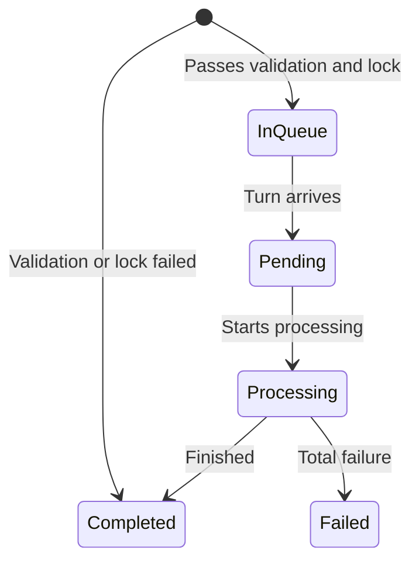
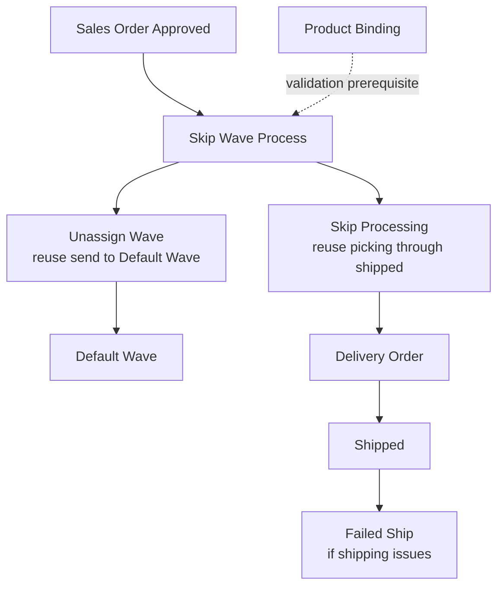

### 🚀 Skip Wave Process

**Skip Wave Process** is a **bulk upload** menu for uploading a list of orders via Excel so the system automatically: (1) sends those orders to the **Default Wave**, then (2) continues warehouse processing through **Shipped** (picking → checking → packing → collecting → Delivery Order). It is used by **Warehouse Operation / Fulfillment Lead** teams that process hundreds or thousands of orders at once — **not** one-by-one transactions and **not** a place to pick orders from a list.

**Target Audience:**

| Persona | Typical Use | Where to Begin |
| :---- | :---- | :---- |
| **Warehouse Operation / Fulfillment Lead** | Upload large batches of approved orders not yet in Default Wave through to Shipped | `/omni/skip-wave-process` |

---

### 🔑 Key Terms

| Term | Meaning |
| :---- | :---- |
| **Batch Code** | Code for one upload run (starts with `SW-`) |
| **Processing Date** | Date & time used by the system for the entire process in one batch (send to wave, picking, checking, packing, collecting, shipping, including stock movements) |
| **All-or-nothing** | If one row in the file fails, the entire file fails validation — nothing continues |
| **In Queue / Pending / Processing / Completed / Failed** | Batch status stages: waiting turn · selected to run · running · finished · permanent failure |
| **Wave Progress** | How many orders in the batch have successfully entered Default Wave |
| **Skip Processing** (column) | How many orders in the batch have successfully reached Shipped |
| **Import Failed vs Wave Failed** | Failure at file check (Import) differs from failure when sending to wave (Wave) — can happen at different stages |
| **Lock** | Mechanism that prevents the same order from being processed by two batches at once |
| **Redispatch** | Action to continue a stuck batch (does not restart from scratch) |

---

### 🎯 When & Why to Use

| ✅ Use when | ❌ Do not expect when |
| :---- | :---- |
| Many approved orders are not yet in Default Wave | Orders already in a wave / already shipped |
| You want to process through shipped in one large batch | One bad row in the file — **the entire file fails** at import (fix first) |
| You can wait in queue if another batch is running | You want to pick orders one by one from a list (this menu is bulk upload only) |

---

### 📋 Prerequisites

| Prerequisite | Notes |
| :---- | :---- |
| Excel file with **Order No** header column | One column only; download from Import template |
| Order status approved or processed | Other statuses are rejected per row |
| Order has never been sent to Default Wave | Already processed orders no longer qualify |
| Order belongs to the logged-in company | — |
| Order numbers are not duplicated in the same file | Duplicates are rejected |
| Warehouse structure & courier-3PL links are complete | Prerequisite for Skip Processing stage (after entering wave) |
| No other Skip Wave Process batch still waiting/running | New batch will wait its turn — see global queue section |

---

### 🔄 Position in the Business Flow

Approved orders are uploaded here, validated, enter Default Wave, then process automatically through Shipped.

**Step notes:**

1. Orders are approved/processed and not yet in Default Wave.
2. Operator uploads Order No list via Excel in Skip Wave Process.
3. System validates the file (all-or-nothing) then locks related orders.
4. Orders are sent to Default Wave; picking → checking → packing → collecting runs automatically.
5. Delivery Order is created; orders reach Shipped.

**Text fallback:** Sales Order Approved → Upload in Skip Wave Process → Validation → Default Wave → Automatic Skip Processing (picking → checking → packing → collecting) → Delivery Order → Shipped.

---

### 📍 Menu Location

**Navigation:** Omni Channel → **Skip Wave Process**  
**Route:** `/omni/skip-wave-process`

This page is **not** an order list for one-by-one selection. The only way to process orders here is via **file upload**.

> 🖼️ **[IMAGE PLACEHOLDER]** — Skip Wave Process page with Processing Date field at top-left and Import button.

---

### 📊 Batch Status Cycle

After the file passes validation and lock, the batch enters the queue. The system processes only **one** active batch at a time across the entire system.

| Status | Condition | What you see on screen |
| :---- | :---- | :---- |
| **In Queue** | File validation passed and all related orders locked; waiting to run | No manual action available |
| **Pending** | Just selected by the system (no other active batch) | — |
| **Processing** | Running — orders being sent to wave and/or processed through shipped | Progress counts + ETA update in real time |
| **Completed** | Finished (full success, partial success, or early validation failure) | Shows "Completed at [time]" |
| **Failed** | Permanent failure — no orders could be sent to wave | Check Log Data for details |

**Note:** Success/Failed per Order No in the detail modal is a row-level result — not the overall batch status. If validation/lock fails (all-or-nothing), the batch goes straight to **Completed** without further stages and **does not appear on the main list** — only in Log Data.

---

### 📝 How to Use

1. **Set Processing Date** (top-left) — match the process date you want, or leave empty so the system uses current time. Important details are in the Processing Date section below.
2. Click **Import** → download the template.
3. Fill the **Order No** column — one order per row; internal or marketplace codes are allowed.

> 🖼️ **[IMAGE PLACEHOLDER]** — Excel template with one Order No column filled.

4. Upload the file (`xlsx`, `xls`, or `csv`).
5. Check notifications or open **Log Data** to confirm import succeeded.
6. On the main list, watch **Wave Progress** and **Skip Processing** until the batch is **Completed**.

> 🖼️ **[IMAGE PLACEHOLDER]** — Datalist row with Batch Code, Wave Progress, and Skip Processing showing progress.

7. If import failed: open **Log Data** → click "Total Order Processed" count → read per-row messages → fix the file → re-upload the **entire** file.
8. If orders failed at Wave due to date: adjust Processing Date, then re-upload.

---

### 📑 Complete Field Reference

| Field | Required? | Notes |
| :---- | :---- | :---- |
| **Processing Date** | Optional (may be left empty) | Date & time; cannot be in the future; cannot be saved if that date's accounting period is closed. **If empty**, system uses upload time |
| **File Import** | Yes | `xlsx` / `xls` / `csv`; must have **Order No** header; at least 1 data row; **max 1,000** data rows. File size follows server limits |
| **Order No** (inside file) | Yes (per row) | Must exist in the system (internal or marketplace code), not duplicated in the file, same company, approved/processed status, and never sent to wave |

---

### ✅ Business Rules & Validation

#### File validation

| If you … | then the system … |
| :---- | :---- |
| Upload an empty or invalid-format file | **Rejects** the whole upload |
| Upload a file whose header is not "Order No" | **Rejects** the whole upload |
| Upload a file with no data rows | **Rejects** the whole upload |
| Upload more than 1,000 data rows | **Rejects** the whole upload |

#### Per-row validation (all must pass — see All-or-Nothing)

| If you … | then the system … |
| :---- | :---- |
| Enter an Order No not found in the system | Marks that row as failed |
| Enter an Order No more than once in the same file | Marks that row as failed (duplicate) |
| Enter an Order No from another company | Marks that row as failed |
| Enter an order whose status is not approved or processed | Marks that row as failed |
| Enter an order already sent to wave | Marks that row as failed |

#### Queue validation

| If you … | then the system … |
| :---- | :---- |
| Upload while another batch (any company) is still Pending or Processing | Places the new batch in **In Queue** until its turn |
| Upload when no other batch is active | Processes the oldest waiting batch that already passed validation |

#### Processing Date validation

| If you … | then the system … |
| :---- | :---- |
| Save a Processing Date in a closed accounting period, or a future date | **Rejects** — previous value stays |
| Start wave/shipping for a batch | Uses the Processing Date stored on that batch (from upload settings, or current time if empty) |
| Include an order whose transaction date is **newer** than the batch Processing Date | May treat import as **success**, but the order **fails when sending to wave** — see Processing Date section |

---

### ⚠️ All-or-Nothing

> **Warning:** If **even one** row in the file is bad (order not found, duplicate, other company, wrong transaction status, or already sent to wave), the **entire file** fails — no rows continue, even valid ones.

**Failed batches like this do not appear on the main list** — only in **Log Data**. There is **no** "continue with successful rows" or Retry button. The only fix:

1. Open Log Data; see which rows failed and why.
2. Fix the file (remove/correct bad rows).
3. **Re-upload the entire file** (not only the previously failed rows).

---

### ⚠️ Global Cross-Company Queue — Why a Batch Can Wait a Long Time

> **Warning:** The system processes only **one batch at a time** across the **entire system** — not per company. Your company's batch can wait a long time in **In Queue** if another company's batch is Pending or Processing.

This does **not** mean your upload is wrong. Wait until your turn arrives.

You **may** upload many files at once — the system processes them **one after another**, not in parallel.

---

### ⚠️ Processing Date: Locked to the Batch at Upload, and Why Orders Can Fail Later

> **Warning:** This is the most important section before using this menu.

- **One date for the whole batch.** Processing Date is **not** set per Order No in the file — one value applies to **all** orders in the batch (wave, picking, checking, packing, collecting, shipping, including stock movements).
- **Empty field = current time.** If left empty, the system uses **date and time of the upload** — not 23:59:59 that day.
- **Value is snapshotted onto the batch at upload.** Changing Processing Date **after** a batch is uploaded does **not** affect that batch — only future uploads.
- **Shared with Unassign Wave.** Changing Processing Date here also changes it in **Unassign Wave** (same company), and vice versa.
- **Orders newer than Processing Date can "succeed" at import but fail later.** Such orders are **not** rejected at file check. Import may show success, then the order **fails when sending to Default Wave**, with a message that Processing Date must be on or after the order transaction date. This failure shows in **Wave Progress**, not Import results.

**Example (stock ready late):** order transaction date 27 July, stock ready 28 July → set Processing Date to 28 July (or later) → upload → batch can continue normally.

**Example (order newer than Processing Date):** Processing Date 20 September 10:00, but an Order No has transaction date 28 September → import **can succeed**, order **fails at Wave**. Fix: raise Processing Date to on or after 28 September, then re-upload.

---

### 🔁 Progress Nearly Full but Status Stuck — Redispatch

If **Wave Progress** or **Skip Processing** looks nearly full, but batch status stays **Processing** and does not move for **more than 60 minutes**, automatic batch close likely did not run as expected.

**Fix:** use **Redispatch** on that batch. It continues unfinished stages — it does **not** restart from scratch. If the batch still does not move after Redispatch, escalate to Support/DevOps.

> 🖼️ **[IMAGE PLACEHOLDER]** — Redispatch button on a batch stuck for a long time.

---

### ⏳ After Status "Completed", the System May Still Be Busy in the Background

When batch status shows **Completed**, related work is not necessarily 100% finished. The system may still run background tasks — for example stock recalculation or marketplace sync — that are not immediately visible on screen.

**This is normal**, not a failure. Pause briefly before uploading the next large batch in a row.

---

### 📂 Log Data & History

#### Import Logs

- **Total Order Processed**: shows `{validated count}` of `{total rows in file}` — clickable for per Order No detail (Success/Failed + message).
- **Success status**: all rows passed checks → batch appears on the main list.
- **Failed status**: some rows failed → batch **does not** appear on the main list; fix the file (see All-or-Nothing).
- **File name** can be re-downloaded for up to **24 hours** after upload.
- Example messages: order not found, duplicate, other company, invalid transaction status, invalid wave status, or conflict with another batch locking the same order.

> 🖼️ **[IMAGE PLACEHOLDER]** — Log Data panel with per Order No detail modal (Success/Failed + message).

#### Audit Log

Stores history of user data changes, including Processing Date changes.

---

### 📌 Things to Note / Known Limitations

Current system behavior as-is — not a promise to change:

- **No "continue partial" option** for files that fail validation — all-or-nothing is fully applied.
- **Batch processing queue is global**, covering all companies, not split per company.
- **Waves Management is skipped** in this flow — once orders enter Default Wave, the system continues warehouse processing without manual distribution in Waves Management.
- **Uploaded files can be re-downloaded for only 24 hours** from Log Data — keep your own copy if you need longer archive.

---

### 🔗 Related Menus

**Step notes:** Skip Wave Process reuses Unassign Wave (send to Default Wave, shared Processing Date) and Skip Processing (picking through shipped). Waves Management is skipped. Product Binding is a validation prerequisite at send-to-wave.

| Menu | Role relative to Skip Wave Process |
| :---- | :---- |
| **Unassign Wave** | First stage (send to Default Wave) reused; **shares the same Processing Date setting** |
| **Skip Processing** | Second stage (picking through shipped) reused; Processing Date is read-only info there |
| **Waves Management** | Fully skipped in this flow |
| **Product Binding** | Validation prerequisite at send-to-wave |
| **Delivery Order** | Document created automatically before Shipped |
| **Failed Ship** | Follow up if shipping issues after Shipped |
| **Order Process** | Monitor packing list & airway bill — not for skip-wave upload |

---

### 🛠️ Troubleshooting

| Symptom | Cause | Solution |
| :---- | :---- | :---- |
| Entire batch fails though only one Order No is wrong | All-or-nothing behavior | Open Log Data, fix bad rows, re-upload entire file |
| Import succeeds but some orders fail at Wave with a date message | Order transaction date newer than batch Processing Date | Raise Processing Date to on or after that order date, then re-upload |
| Total Order Processed still less than file total | Validation still running | Wait until the count matches file total |
| Batch stuck long in In Queue or Pending | Another batch (possibly another company) still running | Wait for the active batch to finish |
| Progress nearly full but status stays Processing for a long time | Automatic batch close did not run | After 60+ minutes idle, use **Redispatch**; if still stuck, escalate to Support/DevOps |
| Status Completed but system feels slow | Background work (stock calc/sync) still running | Pause before uploading the next large batch |
| File can no longer be downloaded from Log Data | More than 24 hours since upload | Keep your own file copy from the start |
| Cannot change/save Processing Date | Accounting period for that date is closed, or date is in the future | Pick a date in an open period and not in the future |
| Older order fails though stock is now available | Processing Date still set before stock-available date | Set Processing Date to stock-available date, then re-upload |

---

### ❓ FAQ

**How is this different from Skip Processing?**  
Skip Processing is for orders **already** in Default Wave, selected from a list. Skip Wave Process **uploads** orders not yet in a wave, then processes them automatically through shipped.

**How is this different from Unassign Wave?**  
Unassign Wave only processes until orders enter Default Wave. This menu continues automatically through shipped. Both share the same Processing Date setting.

**Is Waves Management used?**  
No — after Default Wave, the system continues warehouse processing directly.

**Why did a colleague's Processing Date change affect my account?**  
The setting is per company, not per user.

**If Processing Date is left empty, what time is used?**  
Current time at upload (date and time) — not 23:59:59.

**Progress is full but batch status is not Completed yet?**  
Try **Redispatch** after the batch has been idle more than 60 minutes.

**If one Order No is wrong, does only that row fail?**  
No — the entire file fails (all-or-nothing).

**Can I upload many files at once?**  
Yes, but the system processes them one after another.

**Is there queue/job documentation for Support/DevOps?**  
Yes — separate technical docs (**Horizon Jobs**). Not required for day-to-day use of this menu.

---

### 📚 See Also / References

- **Unassign Wave** — send to Default Wave; shared Processing Date
- **Skip Processing** — picking through shipped (reuse)
- **Order Process** — monitor packing list & airway bill
- **Delivery Order** — automatic document before Shipped
- **Failed Ship** — follow up shipping issues
- **Horizon Jobs** — **Support/DevOps only** reference for job-queue detail (not required reading for operators)
