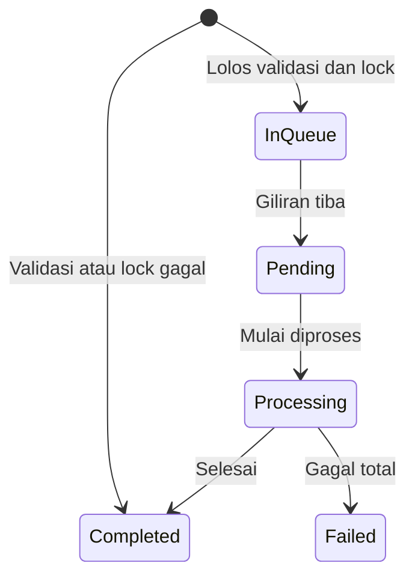
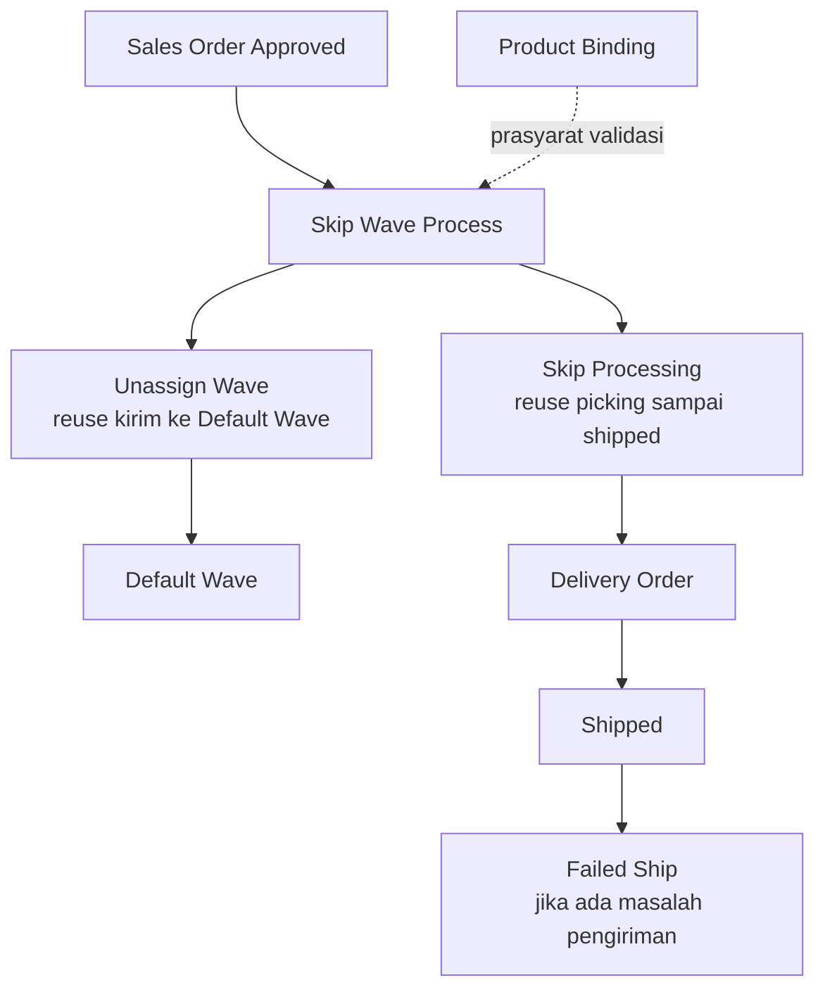

### 🚀 Skip Wave Process

**Skip Wave Process** adalah menu **upload massal** untuk mengunggah daftar order lewat file Excel supaya sistem otomatis: (1) mengirim order ke **Default Wave**, lalu (2) melanjutkan proses gudang sampai **Shipped** (picking → checking → packing → collecting → Delivery Order). Menu ini dipakai oleh **Warehouse Operation / Fulfillment Lead** yang memproses ratusan atau ribuan order sekaligus — **bukan** transaksi satu-per-satu dan **bukan** tempat memilih order dari daftar.

**Target Audience:**

| Persona | Typical Use | Where to Begin |
| :---- | :---- | :---- |
| **Warehouse Operation / Fulfillment Lead** | Upload batch besar order approved yang belum masuk Default Wave sampai Shipped | `/omni/skip-wave-process` |

---

### 🔑 Istilah Kunci

| Istilah | Artinya |
| :---- | :---- |
| **Batch Code** | Kode untuk satu kali proses upload (diawali `SW-`) |
| **Processing Date** | Tanggal & jam yang dipakai sistem untuk seluruh proses dalam satu batch (kirim ke wave, picking, checking, packing, collecting, pengiriman, termasuk pergerakan stok) |
| **All-or-nothing** | Kalau satu data di file bermasalah, seluruh file dianggap gagal validasi — tidak ada yang lanjut diproses |
| **In Queue / Pending / Processing / Completed / Failed** | Tahapan status batch: menunggu giliran · dipilih sistem untuk diproses · sedang berjalan · selesai · gagal permanen |
| **Wave Progress** | Berapa banyak order dalam batch yang sudah berhasil masuk ke Default Wave |
| **Skip Processing** (kolom) | Berapa banyak order dalam batch yang sudah berhasil sampai status Shipped |
| **Import Failed vs Wave Failed** | Gagal saat pemeriksaan file (Import) berbeda penyebab dari gagal saat pengiriman ke wave (Wave) — bisa terjadi di tahap yang berbeda |
| **Lock** | Mekanisme yang mencegah order yang sama diproses oleh dua batch sekaligus |
| **Redispatch** | Aksi untuk melanjutkan proses batch yang macet (bukan mengulang dari awal) |

---

### 🎯 Kapan & Kenapa Dipakai

| ✅ Pakai kalau | ❌ Jangan berharap kalau |
| :---- | :---- |
| Ada banyak order approved yang belum masuk Default Wave | Order sudah di-wave / sudah shipped |
| Mau memproses sampai shipped dalam satu batch besar | Ada satu baris salah di file — **seluruh file gagal** di tahap impor (harus diperbaiki dulu) |
| Siap menunggu antrean kalau ada batch lain sedang berjalan | Mau memilih order satu-satu dari daftar (menu ini khusus untuk upload massal) |

---

### 📋 Prasyarat

| Prasyarat | Catatan |
| :---- | :---- |
| File Excel dengan header kolom **Order No** | Hanya satu kolom; unduh dari template Import |
| Order berstatus disetujui (approved) atau processed | Status lain akan ditolak per baris |
| Order belum pernah dikirim ke Default Wave | Order yang sudah diproses tidak lagi memenuhi syarat |
| Order milik perusahaan yang sedang login | — |
| Nomor order tidak duplikat dalam satu file | Duplikat akan ditolak |
| Struktur gudang & hubungan kurir-3PL sudah lengkap | Prasyarat untuk tahap Skip Processing (setelah masuk wave) |
| Tidak ada batch Skip Wave Process lain yang masih menunggu/berjalan | Batch baru akan menunggu giliran — lihat bagian antrean global |

---

### 🔄 Posisi dalam Alur Bisnis

Order yang sudah disetujui diunggah di menu ini, divalidasi, masuk Default Wave, lalu diproses otomatis sampai Shipped.

**Keterangan langkah:**

1. Order berstatus approved/processed dan belum masuk Default Wave.
2. Operator mengunggah daftar Order No lewat file Excel di Skip Wave Process.
3. Sistem memvalidasi file (all-or-nothing) lalu mengunci order terkait.
4. Order dikirim ke Default Wave, lalu picking → checking → packing → collecting berjalan otomatis.
5. Delivery Order terbentuk; order berstatus Shipped.

**Fallback teks:** Sales Order Approved → Upload di Skip Wave Process → Validasi → Default Wave → Skip Processing otomatis (picking → checking → packing → collecting) → Delivery Order → Shipped.

---

### 📍 Lokasi Menu

**Navigasi:** Omni Channel → **Skip Wave Process**  
**Route:** `/omni/skip-wave-process`

Halaman ini **bukan** daftar order untuk dipilih satu-satu. Satu-satunya cara memproses order di sini adalah lewat **upload file**.

> 🖼️ **[PLACEHOLDER GAMBAR]** — Halaman Skip Wave Process dengan field Processing Date di pojok kiri atas dan tombol Import.

---

### 📊 Siklus Status Batch

Setelah file lolos validasi dan lock, batch masuk antrean. Sistem hanya memproses **satu** batch aktif dalam satu waktu di seluruh sistem.

| Status | Kondisi | Yang terlihat di layar |
| :---- | :---- | :---- |
| **In Queue** | Sudah lolos validasi file dan berhasil mengunci semua order terkait; menunggu giliran diproses | Tidak ada aksi manual yang bisa dilakukan |
| **Pending** | Baru saja dipilih sistem untuk diproses (karena tidak ada batch lain yang sedang aktif) | — |
| **Processing** | Sedang berjalan — order sedang dikirim ke wave dan/atau diproses sampai shipped | Angka progres + estimasi waktu selesai berjalan real-time |
| **Completed** | Selesai (bisa berarti sukses penuh, sukses sebagian, atau gagal validasi di awal) | Muncul keterangan "Completed at [waktu]" |
| **Failed** | Gagal permanen — sistem tidak menemukan order yang bisa diproses ke wave | Cek Log Data untuk detail |

**Catatan:** status per Order No di modal detail (Success/Failed) adalah label hasil untuk baris itu saja — bukan status keseluruhan batch. Kalau validasi/lock gagal (all-or-nothing), batch langsung **Completed** tanpa lanjut ke tahap berikutnya dan **tidak muncul di daftar utama** — hanya tercatat di Log Data.

---

### 📝 Langkah-Langkah Penggunaan

1. **Atur Processing Date** (pojok kiri atas) — sesuaikan dengan tanggal proses yang diinginkan, atau biarkan kosong supaya sistem memakai waktu saat ini. Detail penting ada di bagian Processing Date di bawah.
2. Klik **Import** → unduh template.
3. Isi kolom **Order No** di template — satu order per baris; boleh memakai kode internal atau kode dari marketplace.

> 🖼️ **[PLACEHOLDER GAMBAR]** — Template Excel dengan satu kolom Order No terisi.

4. Unggah file (format `xlsx`, `xls`, atau `csv`).
5. Cek notifikasi atau buka **Log Data** untuk memastikan proses impor berhasil.
6. Di daftar utama, pantau kolom **Wave Progress** dan **Skip Processing** sampai batch berstatus **Completed**.

> 🖼️ **[PLACEHOLDER GAMBAR]** — Baris datalist dengan kolom Batch Code, Wave Progress, dan Skip Processing menunjukkan progres.

7. Kalau ada kegagalan impor: buka **Log Data** → klik jumlah "Total Order Processed" → baca pesan per baris → perbaiki file → unggah ulang **seluruh** file.
8. Kalau ada order yang gagal di tahap Wave karena masalah tanggal: sesuaikan Processing Date, lalu unggah ulang.

---

### 📑 Referensi Field Lengkap (Field Reference)

| Field | Wajib? | Catatan |
| :---- | :---- | :---- |
| **Processing Date** | Tidak wajib (boleh dikosongkan) | Tanggal & jam; tidak boleh di masa depan; tidak bisa disimpan kalau periode akuntansi tanggal itu sudah ditutup. **Kalau kosong**, sistem memakai waktu saat upload dilakukan |
| **File Import** | Ya | Format `xlsx` / `xls` / `csv`; harus ada header **Order No**; minimal 1 baris data; **maksimal 1.000 baris** data. Ukuran file mengikuti batas server |
| **Order No** (isi di dalam file) | Ya (per baris) | Harus ditemukan di sistem (kode internal atau marketplace), tidak duplikat dalam file, milik perusahaan yang sama, status approved/processed, dan belum pernah dikirim ke wave |

---

### ✅ Aturan Bisnis & Validasi

#### Validasi file

| Kalau kamu … | maka sistem … |
| :---- | :---- |
| Mengunggah file kosong atau format tidak valid | **Menolak** seluruh upload |
| Mengunggah file yang header kolomnya bukan "Order No" | **Menolak** seluruh upload |
| Mengunggah file tanpa baris data sama sekali | **Menolak** seluruh upload |
| Mengunggah lebih dari 1.000 baris data | **Menolak** seluruh upload |

#### Validasi per baris (semua harus lolos — lihat All-or-Nothing)

| Kalau kamu … | maka sistem … |
| :---- | :---- |
| Memasukkan Order No yang tidak ditemukan di sistem | Menganggap baris itu gagal |
| Memasukkan Order No yang muncul lebih dari sekali dalam file yang sama | Menganggap baris itu gagal (duplikat) |
| Memasukkan Order No milik perusahaan lain | Menganggap baris itu gagal |
| Memasukkan order yang statusnya bukan approved atau processed | Menganggap baris itu gagal |
| Memasukkan order yang sudah pernah dikirim ke wave | Menganggap baris itu gagal |

#### Validasi antrean

| Kalau kamu … | maka sistem … |
| :---- | :---- |
| Mengunggah saat ada batch lain (dari perusahaan manapun) yang masih Pending atau Processing | Menempatkan batch baru di **In Queue** sampai giliran tiba |
| Mengunggah saat tidak ada batch lain yang aktif | Memproses batch yang paling lama menunggu (dan sudah lolos validasi) |

#### Validasi Processing Date

| Kalau kamu … | maka sistem … |
| :---- | :---- |
| Menyimpan Processing Date di periode akuntansi yang sudah ditutup, atau tanggal di masa depan | **Menolak** — nilai lama tetap dipakai |
| Memulai tahap wave/pengiriman untuk sebuah batch | Memakai Processing Date yang tersimpan di batch tersebut (dari pengaturan saat upload, atau waktu saat itu kalau kosong) |
| Memasukkan order yang tanggal transaksinya **lebih baru** dari Processing Date batch | Bisa menganggap impor **sukses**, tapi order **gagal saat pengiriman ke wave** — lihat bagian Processing Date |

---

### ⚠️ Semua-atau-Tidak-Sama-Sekali (All-or-Nothing)

> **Warning:** Kalau **satu saja** baris di file bermasalah (order tidak ditemukan, duplikat, dari perusahaan lain, status transaksi tidak sesuai, atau sudah pernah dikirim ke wave), **seluruh file** dianggap gagal — tidak ada baris yang lanjut diproses, bahkan yang sebenarnya valid.

**Batch yang gagal seperti ini tidak muncul di daftar utama** — hanya tercatat di **Log Data**. **Tidak ada** tombol "lanjutkan yang berhasil saja" atau Retry. Satu-satunya cara memperbaiki:

1. Buka Log Data, lihat baris mana saja yang bermasalah dan kenapa.
2. Perbaiki file (hapus/perbaiki baris bermasalah).
3. **Unggah ulang seluruh file** (bukan cuma baris yang tadinya gagal).

---

### ⚠️ Antrean Global Lintas Perusahaan — Kenapa Batch Bisa Menunggu Lama

> **Warning:** Sistem hanya memproses **satu batch dalam satu waktu** di **seluruh sistem** — bukan per perusahaan. Batch milik perusahaanmu bisa menunggu lama di **In Queue** kalau ada batch dari **perusahaan lain** yang sedang Pending atau Processing.

Ini **bukan** berarti ada yang salah dengan upload kamu. Cukup tunggu sampai giliran tiba.

Kamu **boleh** mengunggah banyak file sekaligus — sistem akan memprosesnya **satu per satu secara berurutan**, bukan bersamaan.

---

### ⚠️ Processing Date: Terkunci ke Batch Saat Upload, dan Kenapa Order Bisa Gagal Belakangan

> **Warning:** Ini bagian paling penting sebelum memakai menu ini.

- **Satu tanggal untuk seluruh batch.** Processing Date **tidak** diatur per Order No di dalam file — satu nilai dipakai untuk **semua** order dalam satu batch (wave, picking, checking, packing, collecting, pengiriman, termasuk pergerakan stok).
- **Field kosong = waktu sekarang.** Kalau dikosongkan, sistem memakai **tanggal dan jam saat upload dilakukan** — bukan pukul 23:59:59 di hari itu.
- **Nilai "difoto" ke batch saat upload.** Perubahan Processing Date **setelah** batch diunggah **tidak** memengaruhi batch yang sudah terlanjur diunggah — hanya berlaku untuk upload berikutnya.
- **Shared dengan Unassign Wave.** Mengubah Processing Date di menu ini juga mengubahnya di **Unassign Wave** (untuk perusahaan yang sama), dan sebaliknya.
- **Order lebih baru dari Processing Date bisa "sukses" saat impor, tapi gagal belakangan.** Order semacam ini **tidak** ditolak saat pemeriksaan file. Impor bisa menunjukkan sukses, lalu order **gagal saat pengiriman ke Default Wave**, dengan pesan bahwa Processing Date harus sama dengan atau setelah tanggal transaksi order. Kegagalan ini terlihat di kolom **Wave Progress**, bukan di hasil Import.

**Contoh (stok terlambat siap):** order tanggal transaksi 27 Juli, stok baru siap 28 Juli → atur Processing Date ke 28 Juli (atau setelahnya) → upload → batch bisa lanjut normal.

**Contoh (order lebih baru dari Processing Date):** Processing Date 20 September pukul 10:00, tapi ada Order No tanggal transaksi 28 September → impor **bisa sukses**, order **gagal di tahap Wave**. Solusi: naikkan Processing Date supaya sama dengan atau setelah 28 September, lalu unggah ulang.

---

### 🔁 Progres Hampir Penuh Tapi Status Belum Berubah — Redispatch

Kalau angka di kolom **Wave Progress** atau **Skip Processing** sudah hampir penuh, tapi status batch masih **Processing** dan tidak bergerak selama **lebih dari 60 menit**, proses penutupan batch otomatis kemungkinan tidak berjalan sebagaimana mestinya.

**Solusi:** gunakan tombol **Redispatch** pada batch tersebut. Ini melanjutkan tahap yang belum selesai — **bukan** mengulang seluruh proses dari awal. Kalau setelah Redispatch batch tetap tidak bergerak, eskalasikan ke tim Support/DevOps.

> 🖼️ **[PLACEHOLDER GAMBAR]** — Tombol Redispatch pada batch yang statusnya diam lama.

---

### ⏳ Setelah Status "Completed", Sistem Masih Bisa Sibuk di Belakang Layar

Begitu status batch menunjukkan **Completed**, itu tidak berarti seluruh pekerjaan terkait sudah selesai 100%. Sistem masih bisa memproses hal lain di latar belakang — misalnya menghitung ulang stok atau menyinkronkan data ke marketplace — yang belum tentu langsung terlihat di layar.

**Ini kondisi normal**, bukan tanda kegagalan. Beri sedikit jeda sebelum mengunggah batch besar berikutnya secara beruntun.

---

### 📂 Log Data & Riwayat

#### Import Logs

- **Total Order Processed**: menampilkan `{jumlah sudah divalidasi}` dari `{total baris di file}` — bisa diklik untuk detail per Order No (Success/Failed + pesan).
- **Status Success**: semua baris lolos pemeriksaan → batch muncul di daftar utama.
- **Status Failed**: ada baris bermasalah → batch **tidak** muncul di daftar utama; file perlu diperbaiki (lihat All-or-Nothing).
- **Nama file** bisa diunduh ulang maksimal **24 jam** sejak diunggah.
- Contoh pesan: order tidak ditemukan, duplikat, beda perusahaan, status transaksi tidak valid, status wave tidak valid, atau konflik dengan batch lain yang sedang mengunci order yang sama.

> 🖼️ **[PLACEHOLDER GAMBAR]** — Panel Log Data dengan modal detail per Order No (Success/Failed + pesan).

#### Audit Log

Menyimpan riwayat perubahan data yang dilakukan user, termasuk perubahan pada Processing Date.

---

### 📌 Yang Perlu Diperhatikan / Keterbatasan yang Diketahui

Kondisi sistem saat ini, apa adanya — bukan janji perbaikan:

- **Tidak ada opsi "lanjutkan sebagian"** untuk file yang gagal validasi — sistem menerapkan all-or-nothing sepenuhnya.
- **Antrean pemrosesan batch bersifat global**, mencakup semua perusahaan sekaligus, bukan dipisah per perusahaan.
- **Menu Waves Management tidak dilalui** dalam alur ini — begitu order masuk Default Wave, sistem langsung lanjut ke pemrosesan gudang tanpa distribusi manual di Waves Management.
- **File yang diunggah hanya bisa diunduh ulang selama 24 jam** dari Log Data — simpan salinan sendiri kalau perlu arsip lebih lama.

---

### 🔗 Hubungan dengan Menu Lain

**Keterangan langkah:** Skip Wave Process mereuse tahap Unassign Wave (kirim ke Default Wave, berbagi Processing Date) dan tahap Skip Processing (picking sampai shipped). Waves Management dilewati. Product Binding adalah prasyarat validasi di tahap pengiriman ke wave.

| Menu | Perannya terhadap Skip Wave Process |
| :---- | :---- |
| **Unassign Wave** | Tahap pertama (kirim ke Default Wave) di-reuse; **berbagi pengaturan Processing Date yang sama** |
| **Skip Processing** | Tahap kedua (picking sampai shipped) di-reuse; Processing Date tampil sebagai info saja (read-only) di menu itu |
| **Waves Management** | Dilewati sepenuhnya dalam alur ini |
| **Product Binding** | Prasyarat validasi di tahap pengiriman ke wave |
| **Delivery Order** | Dokumen yang terbentuk otomatis di tahap akhir sebelum Shipped |
| **Failed Ship** | Tempat menindaklanjuti kalau ada masalah pengiriman setelah status Shipped |
| **Order Process** | Untuk memantau/lihat packing list & resi — bukan tempat upload skip wave |

---

### 🛠️ Troubleshooting

| Gejala | Penyebab | Solusi |
| :---- | :---- | :---- |
| Seluruh batch gagal padahal cuma satu Order No yang salah | Perilaku all-or-nothing | Buka Log Data, perbaiki baris bermasalah, unggah ulang seluruh file |
| Import sukses tapi ada order gagal di Wave dengan pesan soal tanggal | Tanggal transaksi order lebih baru dari Processing Date batch | Naikkan Processing Date supaya sama dengan atau setelah tanggal order, lalu unggah ulang |
| Angka Total Order Processed masih lebih kecil dari total file | Proses validasi masih berjalan | Tunggu sampai angkanya sama dengan total file |
| Batch lama sekali di status In Queue atau Pending | Ada batch lain (mungkin dari perusahaan lain) yang masih diproses | Tunggu batch aktif tersebut selesai |
| Progres hampir penuh tapi status masih Processing dalam waktu lama | Proses penutupan batch otomatis tidak berjalan | Kalau sudah diam lebih dari 60 menit, gunakan **Redispatch**; kalau masih gagal, eskalasi ke Support/DevOps |
| Status sudah Completed tapi sistem terasa lambat | Pekerjaan latar belakang (hitung stok/sinkronisasi) masih berjalan | Beri jeda sebelum mengunggah batch besar berikutnya |
| File tidak bisa diunduh lagi dari Log Data | Sudah lewat 24 jam sejak diunggah | Simpan salinan file sendiri sejak awal |
| Tidak bisa mengubah/menyimpan Processing Date | Periode akuntansi untuk tanggal itu sudah ditutup, atau tanggalnya di masa depan | Pilih tanggal di periode yang masih terbuka dan tidak di masa depan |
| Order lama gagal padahal stoknya baru tersedia | Processing Date masih diatur sebelum tanggal stok tersedia | Atur Processing Date ke tanggal stok tersedia, lalu unggah ulang |

---

### ❓ FAQ

**Apa beda dengan menu Skip Processing?**  
Skip Processing dipakai untuk order yang **sudah** ada di Default Wave, dipilih dari daftar. Skip Wave Process adalah **upload** order yang belum di-wave, lalu otomatis diproses sampai shipped.

**Apa beda dengan menu Unassign Wave?**  
Unassign Wave hanya memproses sampai order masuk Default Wave. Menu ini melanjutkan secara otomatis sampai shipped. Keduanya berbagi pengaturan Processing Date yang sama.

**Apakah Waves Management dilalui?**  
Tidak — setelah masuk Default Wave, sistem langsung lanjut ke pemrosesan gudang.

**Kenapa Processing Date yang diubah kolega ikut berubah di akun saya?**  
Karena pengaturan ini berlaku per perusahaan, bukan per user.

**Kalau field Processing Date dikosongkan, jamnya jadi apa?**  
Sistem memakai waktu saat itu juga (tanggal dan jam upload) — bukan pukul 23:59:59.

**Progres sudah penuh tapi status batch belum Completed?**  
Coba **Redispatch** setelah batch diam lebih dari 60 menit.

**Ada satu Order No salah, apakah cuma baris itu yang gagal?**  
Tidak — seluruh file dianggap gagal (all-or-nothing).

**Bisa mengunggah banyak file sekaligus?**  
Boleh, tapi sistem memprosesnya satu per satu secara berurutan.

**Ada dokumentasi soal antrean job untuk tim Support/DevOps?**  
Ada dokumentasi teknis terpisah (**Horizon Jobs**) — tidak diperlukan untuk pemakaian sehari-hari menu ini.

---

### 📚 Lihat Juga / Referensi

- **Unassign Wave** — tahap kirim ke Default Wave; berbagi Processing Date
- **Skip Processing** — tahap picking sampai shipped (reuse)
- **Order Process** — pantau packing list & resi
- **Delivery Order** — dokumen otomatis sebelum Shipped
- **Failed Ship** — tindak lanjut masalah pengiriman
- **Horizon Jobs** — rujukan **khusus tim Support/DevOps** untuk detail antrean job (bukan bacaan wajib operator)
