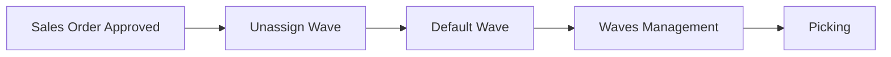
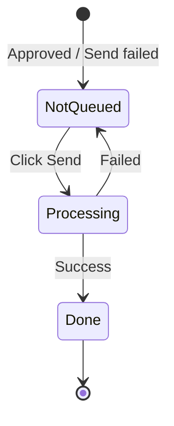
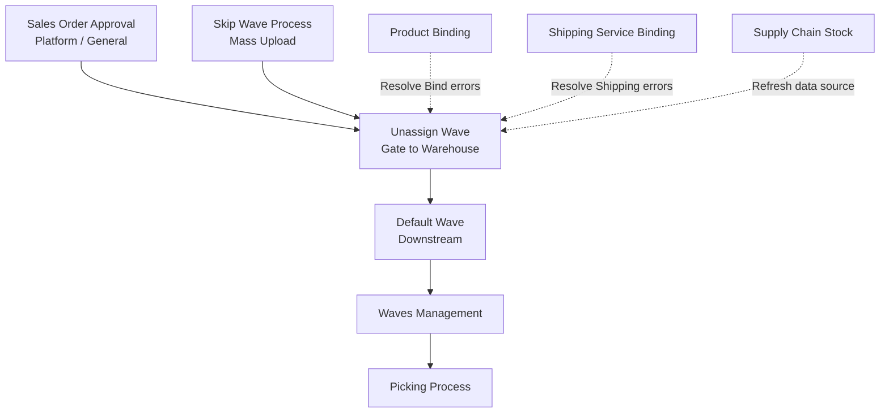

### 🚀 Unassign Wave

**Unassign Wave** is the queue of orders that are already *approved* but not yet sent to warehouse processing (Default Wave). This menu is a required gate operated by the **Warehouse Operation (Fulfillment)** team before orders can enter the warehouse *fulfillment* chain. Operators can view individual orders, check issues, and send them one by one or in bulk so stock is *reserved* and orders are ready for *picking*. Without this menu, orders never enter warehouse processing.

**Target Audience:**

| Persona | Typical Use | Where to Begin |
| :---- | :---- | :---- |
| **Warehouse Operation / Fulfillment** | Review approved-order queue, fix Error Flags, send to Default Wave (single or bulk) | `/omni/unassign-wave` |

---

### 🔑 Key Terms

| Term | Definition & Role |
| :---- | :---- |
| **Send to Default Waves** | Action that sends an order from this queue to Default Wave so the warehouse can start processing it. |
| **Error Flag** | Warning icon showing a problem that must be fixed before send. There are nine flag types. |
| **Failed Process** | Pill/filter for orders that have problems and need review before send. |
| **On Process to Default Waves** | Pill/filter for orders currently being sent to the warehouse. |
| **Processing Date** | Date and time the system uses to process the order (send to *wave*) **and** to check stock availability. |
| **Refresh Availability Stock** | Button to re-check stock availability and clear the "insufficient stock" flag when stock is enough. |
| **Send Wave Logs** | History of every attempt to send an order to Default Wave. |
| **Last Checked** | Timestamp shown in the stock-flag *tooltip* for when the system last wrote that flag. |

---

### 🎯 When & Why to Use

| ✅ Use when | ❌ Do not expect when |
| :---- | :---- |
| Platform or General orders are already *approved*. | Orders are still *draft* or *open*. |
| Orders have never successfully been sent to Default Wave. | Orders already sent successfully — they disappear from the list. |
| You need to review *Failed Process* orders or ones currently processing. | Product *qty* on the order has already left the warehouse. |

---

### 📋 Prerequisites

| Prerequisite | Source | Notes |
| :---- | :---- | :---- |
| Order is approved, or *processed* with no qty already shipped out. | Sales Order Platform/General. | *Draft* or *open* orders do not appear. |
| Order has no qty already leaving the warehouse. | Sales Order detail. | If qty has left, the order no longer qualifies. |
| "Process to wave" setting is still on (General orders only). | Order Process settings. | If off, General orders do not appear at all. |

---

### 🔄 Position in the Business Flow

Approved orders enter the Unassign Wave queue, then are sent to Default Wave before Waves Management and Picking.

**Step notes:** Approved Sales Orders enter the Unassign Wave queue. From here they are sent to Default Wave, then Waves Management, then Picking (plus *checking*, *packing*, and *shipping* per warehouse flow).

**Text fallback:** Sales Order Approved → Unassign Wave → Default Wave → Waves Management → Picking.

---

### 📍 Menu Location

* **Navigation:** SCM / OmniChannel → **Unassign Wave**
* **UI route:** `/omni/unassign-wave`

> 🖼️ **[IMAGE PLACEHOLDER]** — Unassign Wave page with Processing Date, Failed Process/On Process pills, and order list.

---

### 📊 Order Status Cycle

| Status | Condition | Still on the list? |
| :---- | :---- | :---- |
| **Not queued (Belum Antri)** | New eligible order, or previously failed send. | **Yes** — Send is available. |
| **Processing (Sedang Diproses)** | Being sent to Default Wave (single or bulk). | **Yes** — appears under *On Process*; send actions temporarily disabled. |
| **Done (Selesai)** | Successfully sent to Default Wave. | **No** — leaves the list; continues to Waves Management/Picking. |

---

### 📝 How to Use

1. **Set Processing Date:** Adjust the process date left of *Refresh Availability Stock*, or leave empty so the system uses current time.
2. **Check the order list:** Confirm the order appears. If not, check approval status or whether it was already sent successfully.
3. **Check Error Flags:** Hover icons in the Error Flag column to see what blocks send.

> 🖼️ **[IMAGE PLACEHOLDER]** — Error Flag column with several icon types and a tooltip on hover.

4. **Use Refresh Availability Stock:** For stock issues (and physical stock already added), click this to re-check availability.
5. **Send orders:** For one order, click **Send** in the Action column. For bulk, select rows then click **Send to Default Waves** on the *toolbar*.

> 🖼️ **[IMAGE PLACEHOLDER]** — Per-row Send to Default Waves and bulk toolbar after selecting rows.

6. **Monitor progress:** Watch the "On Process to Default Waves" pill. Successful orders leave the list.
7. **Check failure logs:** If the order stays on the list, open **Send Wave Logs**, read the *error*, fix the issue, then retry send.

---

### 📑 Complete Field Reference

#### Main list columns

| Field Name | Description |
| :---- | :---- |
| **Trx Code / Platform Order** | Internal code and marketplace unique code. |
| **Error Flag** | Icons for problems that block send. |
| **Store Name / Buyer Name** | Store and buyer names. |
| **Shipper / Tracking Number** | Courier service and tracking number. |
| **Pre-sale Time / Trx Date** | Pre-sale time (if any) and order transaction date. |
| **Payment Time / Deadline Time** | Payment completion time and process deadline. |
| **Trx Status / Platform Status** | Internal order status and marketplace status. |
| **Process** | Current *wave* stage (successful orders do not show). |
| **Total SKU / Total Qty Products** | Product variant count and total units. |
| **Created by / Created at** | Audit creator and creation time. |
| **Action** | Per-row Send to Default Waves button. |

#### Send Wave Logs columns

| Field Name | Description |
| :---- | :---- |
| **Trx Code / Platform Order** | Order in that send attempt. |
| **Store** | Owning store. |
| **Status** | Success, failed, or running. |
| **Error Message** | Technical reason for send failure. |
| **Started at** | When the send process started. |
| **Completed at** | When it finished (success or failure). |
| **Processed by** | User who ran the send. |
| **Notes** | One row = one order per attempt. |

#### Processing Date

| Field Name | Description |
| :---- | :---- |
| **Processing Date** | Process date and time. Optional. Cannot be in the future; cannot be saved if that date's accounting period is closed. |

---

### 🚩 Nine Error Flag Types

| Flag | Meaning | Usually fixed in |
| :---- | :---- | :---- |
| **Shipping** | Shipping service not bound, or product dimension/weight issues. | Shipping service *binding*, or product master. |
| **Bind** | Platform product on the order not linked to internal product. | Product Binding menu. |
| **COA** | Product account (COA) setup incomplete. | Product COA Group settings. |
| **Stock / Unavailable Stock** | Warehouse stock insufficient **as of Processing Date** (or current time if empty). | Add/transfer stock, **or** change Processing Date to when stock is available then *Refresh*. |
| **Price** | Selling price empty or invalid. | Edit order manually, or re-sync from platform. |
| **Bundle** | Bundle component contents incomplete. | Bundle setup in System Product. |
| **Warehouse** | Process warehouse for the store is not set. | Store settings or default warehouse settings. |
| **Cancelled** | Order cancelled on the marketplace. | Applicable cancellation procedure. |
| **Broken data** | Order data pulled from platform is damaged or incomplete. | Fix order data manually. |

---

### ✅ Business Rules & Validation

* **If** an order has never been successfully sent to Default Wave, **then** the system shows it in the queue.
* **If** an order is approved or *processed* with no qty out, **then** the system shows it.
* **If** you look for an order that already has qty leaving the warehouse, **then** the system does not show it.
* **If** you turn off "process to wave" for General orders, **then** the system excludes those orders from the list.
* **If** you try to send an order that is already "processing" or already successful, **then** the system rejects with a warning.
* **If** you try to send an order with incomplete *bundle* components, **then** the system rejects it before processing starts.
* **If** you send an order with validation issues (stock, price, COA, etc.), **then** the system fails the send, shows the related Error Flag, and logs it.
* **If** you send an order for an inactive/deleted store, **then** the system fails the send and logs it.
* **If** you send many orders to the same process warehouse at once, **then** the system queues them and may *timeout* if too long.
* **If** you send a General order while "process to wave" is off, **then** the system rejects with a message that the setting is inactive.
* **If** you save a Processing Date in a closed accounting period or in the future, **then** the system rejects it and keeps the previous value.
* **If** you send an order or refresh stock availability, **then** the system uses the stored Processing Date (or current time if empty).
* **If** you run a bulk send and one order fails mid-process, **then** the system continues processing other orders in that queue.
* **If** an order is stuck as Processing after a bulk *batch* finishes, **then** the system automatically returns it to Not queued.
* **If** you bulk-send and a *bundle* is incomplete, **then** the system may cancel the entire bulk send request before it starts.

---

### ⚠️ Processing Date: One Date for Send AND for Live Stock Check

> **Warning:** **Processing Date** is not only the send-to-Default-Wave process date — the system **also uses it for real-time stock checks** when showing Error Flags and when *Refresh Availability Stock* is clicked.

* The setting is **per company** and *shared* with **Skip Wave Process**.
* If left empty, the system uses **current time** (date and time).
* **Stock that arrived today does NOT automatically clear the Error Flag** if Processing Date is still stuck on an old date. Align Processing Date to when stock is available before *Refresh* or *Send*.

---

### ⚠️ "Last Checked" in the Tooltip Can Be Misleading

> **Warning:** The **"Last Checked"** time on the *Unavailable Stock* tooltip is often **misleading** — it is not the date the system used to calculate stock. It only records when the system last *wrote* that error flag.

**Example:**

* SKU: SKU-PPL-RET-001
* Order transaction date & stock in: 1 September 2026
* Active Processing Date: 21 April 2026
* **Result:** System marks *Unavailable Stock* because as of 21 April stock did not exist. The *Last Checked* tooltip may show "8 September 2026" (when the flag was written), so operators wrongly think calculation ran today.
* **Fix:** Trust the system's error result, not the tooltip date text. Adjust Processing Date if physical stock is confirmed enough.

> 🖼️ **[IMAGE PLACEHOLDER]** — Unavailable Stock tooltip showing Last Checked, WH Process, and FIFO message.

---

### 🔄 Refresh Availability Stock Only Clears Stock Flags

**Refresh Availability Stock** has a specific, limited role. It only re-checks stock sufficiency against *Processing Date*. If stock is enough, the "insufficient stock" icon clears. Other warnings (*Bind*, *Shipping*, *COA*, *Price*, *Bundle*, etc.) **do not clear** and must be fixed manually.

---

### ⚠️ Single Send vs Bulk Send: Different Failure Modes

Two failure modes you must understand:

1. **Failure after process started:** If failure (e.g. insufficient stock or unbound product) happens during a running bulk send, **other orders in the queue continue normally**.
2. **Bundle validation failure before start:** Bundle component validation runs *before* send starts. If any selected order has a bad *bundle*, the system can **cancel the entire bulk send request immediately** (including valid orders).

---

### 📂 Send Wave Logs (Send History)

This log panel audits all send attempts to Default Wave. Each log row is **one order in one send attempt**. Because Unassign Wave and Skip Wave Process share the same infrastructure, Skip Wave Process success/failure history also appears in this panel.

> 🖼️ **[IMAGE PLACEHOLDER]** — Send Wave Logs panel with Status, Error Message, and Processed by.

---

### 📌 Things to Note / Known Limitations

* Orders can enter the *Failed Process* filter **without any Error Flag icon**. This usually means the store has no process warehouse (*warehouse binding*) configured.
* The *Failed Process* count can have a minor *discrepancy* vs the actual table row count when the filter is on, due to different backend calculation methods.
* Some *disabled button* states currently show no *tooltip* or explicit UI explanation (e.g. when send-to-*wave* is turned off system-wide).

---

### 🔗 Related Menus

| Menu | Role relative to Unassign Wave |
| :---- | :---- |
| **Sales Order Approval** | Upstream module that feeds newly approved orders into this queue. |
| **Skip Wave Process** | Bulk *shortcut* that shares send mechanism, *log* history, and *Processing Date* with this menu. |
| **Default Wave / Waves Management** | Downstream chain that receives orders after a successful send. |
| **Product / Shipping Service Binding** | Where to resolve *Bind* and *Shipping* Error Flags. |
| **Supply Chain Stock** | Reference for availability calculation on *Refresh Availability Stock*. |

---

### 🛠️ Troubleshooting

| Symptom | Cause | Solution |
| :---- | :---- | :---- |
| Approved order does not appear. | Not fully approved, already sent successfully, or wave process is off. | Check approval finality or *wave process* configuration. |
| Red icons in Error Flag column. | Master or transaction data does not meet requirements. | Hover the icon, fix master data, then retry *Send*. |
| In *Failed Process* with no Error Flag. | Store has no process warehouse configured. | Open store config and complete process warehouse reference. |
| Send button locked (grey/disabled). | Order is queued/processing, or send-to-*wave* is off. | Wait for background process, or review *wave* settings. |
| Stock flag remains after stock added. | *Processing Date* still points before stock arrived. | Move *Processing Date* to stock-available date, then *Refresh*. |
| *Last Checked* far from *Processing Date*. | Tooltip shows error write timestamp, not actual stock evaluation date. | Ignore *Last Checked* text; evaluate against *Processing Date* only. |
| *Failed Process* count differs from table rows. | Backend vs UI calculation disparity. | Trust the factual rows after applying the filter. |

---

### ❓ FAQ

**How is Unassign Wave different from Skip Wave Process?**  
Unassign Wave only sends through the Default Wave gate. Skip Wave Process is a bulk *upload* automation that continues through *shipped*. Both share the same *log* path and *Processing Date* setting.

**Must I fix every Error Flag before Send?**  
Yes for data issues. For stock only, try *Refresh* first if physical stock is reported in on the *Processing Date* range.

**Why don't General orders show on my screen?**  
Confirm the automated process-to-*wave* setting for that entity is turned on.

**Why did Processing Date change by itself?**  
The setting is shared company-wide. If a colleague changes it, your screen updates too.

---

### 📚 See Also / References

* **Skip Wave Process** — bulk upload shortcut; shared Processing Date & Send Wave Logs
* **Waves Management** — downstream after successful send to Default Wave
* **Product Binding** — resolve Bind Error Flags
* **Shipping Service Binding** — resolve Shipping Error Flags
* **Supply Chain Stock** — stock reference for Refresh Availability Stock
* **Sales Order Approval** (Platform / General) — upstream orders entering the queue
