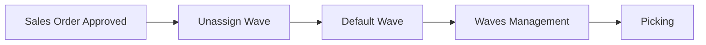
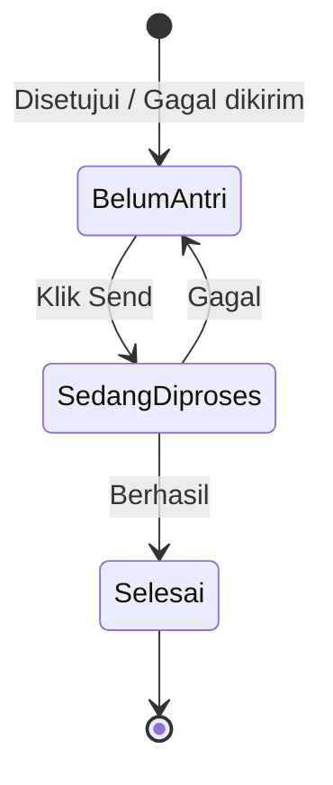
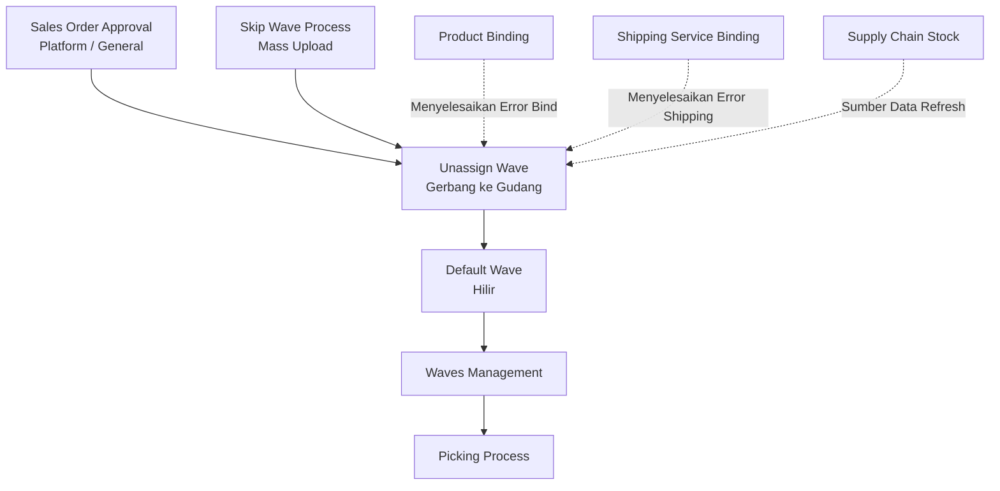

### 🚀 Unassign Wave

**Unassign Wave** adalah antrean order yang sudah disetujui (*approved*) tetapi belum dikirim ke proses gudang (Default Wave). Menu ini merupakan gerbang wajib yang dioperasikan oleh tim **Warehouse Operation (Fulfillment)** sebelum order dapat masuk ke rantai *fulfillment* gudang. Melalui menu ini, operator dapat melihat daftar order individual, memeriksa kendala, dan mengirimkannya satu per satu atau secara massal agar stok di-*reserve* dan order siap masuk ke tahap *picking*. Tanpa melewati proses di menu ini, order tidak akan pernah masuk ke proses pergudangan.

**Target Audience:**

| Persona | Typical Use | Where to Begin |
| :---- | :---- | :---- |
| **Warehouse Operation / Fulfillment** | Memeriksa antrean order approved, perbaiki Error Flag, kirim ke Default Wave (satu atau massal) | `/omni/unassign-wave` |

---

### 🔑 Istilah Kunci

| Istilah | Definisi & Fungsi |
| :---- | :---- |
| **Send to Default Waves** | Aksi mengirim order dari antrean ini ke Default Wave agar gudang mulai memprosesnya. |
| **Error Flag** | Tanda atau ikon peringatan yang menunjukkan bahwa order memiliki masalah yang harus diperbaiki sebelum bisa dikirim. Terdapat sembilan jenis tanda ini. |
| **Failed Process** | *Pill* atau filter untuk menyaring order yang bermasalah dan perlu diperiksa sebelum dapat dikirim. |
| **On Process to Default Waves** | *Pill* atau filter untuk menyaring order yang sedang dalam proses pengiriman ke gudang. |
| **Processing Date** | Tanggal dan jam yang dipakai sistem untuk memproses order (kirim ke *wave*) **dan** untuk mengecek ketersediaan stok. |
| **Refresh Availability Stock** | Tombol untuk mengecek ulang ketersediaan stok dan membersihkan tanda "stok kurang" jika stok sudah tercukupi. |
| **Send Wave Logs** | Riwayat pencatatan setiap percobaan pengiriman order ke Default Wave. |
| **Last Checked** | Keterangan waktu yang muncul di *tooltip* pada tanda stok, yang menunjukkan waktu saat sistem terakhir menuliskan tanda tersebut. |

---

### 🎯 Kapan & Kenapa Dipakai

| ✅ Pakai kalau | ❌ Jangan berharap kalau |
| :---- | :---- |
| Order Platform atau General sudah berstatus disetujui (*approved*). | Order masih berstatus *draft* atau *open*. |
| Order belum pernah berhasil dikirim ke Default Wave. | Order sudah sukses dikirim, karena otomatis akan hilang dari daftar. |
| Ingin memeriksa order yang mengalami masalah (*Failed Process*) atau sedang diproses. | Kuantitas (*qty*) barang di dalam order sudah mulai keluar dari gudang. |

---

### 📋 Prasyarat

| Prasyarat | Sumber | Catatan |
| :---- | :---- | :---- |
| Order berstatus disetujui, atau *processed* selama belum ada kuantitas barang yang keluar. | Sales Order Platform/General. | Order berstatus *draft* atau *open* tidak akan muncul di daftar. |
| Order belum memiliki kuantitas barang yang sudah keluar dari gudang. | Detail Sales Order. | Jika sudah ada kuantitas yang keluar, order tidak lagi memenuhi syarat. |
| Pengaturan "proses ke wave" masih aktif (khusus untuk order bertipe General). | Pengaturan Proses Order. | Jika pengaturan ini dimatikan, order tipe General tidak akan muncul sama sekali. |

---

### 🔄 Posisi dalam Alur Bisnis

Order yang sudah disetujui masuk ke antrean Unassign Wave, lalu dikirim ke Default Wave sebelum masuk Waves Management dan Picking.

**Keterangan langkah:** Order yang sudah disetujui (Sales Order Approved) akan masuk ke antrean Unassign Wave. Dari sini, order dikirim ke Default Wave, dilanjutkan ke menu Waves Management, lalu masuk ke proses Picking (serta *checking*, *packing*, dan *shipping* sesuai alur gudang).

**Fallback teks:** Sales Order Approved → Unassign Wave → Default Wave → Waves Management → Picking.

---

### 📍 Lokasi Menu

* **Navigasi:** SCM / OmniChannel → **Unassign Wave**
* **Route UI:** `/omni/unassign-wave`

> 🖼️ **[PLACEHOLDER GAMBAR]** — Halaman Unassign Wave dengan Processing Date, pill Failed Process/On Process, dan daftar order.

---

### 📊 Siklus Status Order

| Status | Kondisi | Masih Tampil di Daftar? |
| :---- | :---- | :---- |
| **Belum Antri** | Order baru yang memenuhi syarat, atau sebelumnya gagal dikirim. | **Ya** — bisa diklik Send. |
| **Sedang Diproses** | Sedang dalam proses pengiriman ke Default Wave (individu atau massal). | **Ya** — muncul di filter *On Process*; aksi pengiriman untuk order ini dinonaktifkan sementara. |
| **Selesai** | Berhasil dikirim ke Default Wave. | **Tidak** — hilang dari daftar, dan berlanjut ke Waves Management/Picking. |

---

### 📝 Langkah-Langkah Penggunaan

1. **Atur Processing Date:** Sesuaikan tanggal proses yang diinginkan di sebelah kiri tombol *Refresh Availability Stock*, atau biarkan kosong agar sistem menggunakan waktu saat ini.
2. **Periksa Daftar Order:** Pastikan order yang dimaksud muncul di daftar. Jika tidak, periksa status persetujuannya atau apakah order sudah pernah sukses dikirim.
3. **Periksa Tanda Error Flag:** Arahkan kursor (*hover*) ke ikon di kolom Error Flag untuk mengetahui jenis masalah yang menghalangi pengiriman.

> 🖼️ **[PLACEHOLDER GAMBAR]** — Kolom Error Flag dengan beberapa jenis ikon tanda, dan tooltip yang muncul saat hover salah satunya.

4. **Gunakan Refresh Availability Stock:** Jika masalah terkait stok (dan stok fisik sudah ditambah), klik tombol ini untuk mengecek ulang ketersediaan.
5. **Kirim Order:** Untuk satu order, klik tombol **Send** di kolom Action. Untuk kirim massal, centang beberapa baris lalu klik **Send to Default Waves** di *toolbar*.

> 🖼️ **[PLACEHOLDER GAMBAR]** — Tombol Send to Default Waves per baris, dan toolbar bulk Send to Default Waves setelah beberapa baris dicentang.

6. **Pantau Proses:** Awasi *pill* "On Process to Default Waves". Order yang berhasil akan hilang dari daftar.
7. **Periksa Log Kegagalan:** Jika order tetap ada di daftar, buka panel **Send Wave Logs** untuk membaca pesan *error*, perbaiki kendala, lalu ulangi pengiriman.

---

### 📑 Referensi Field Lengkap (Field Reference)

#### Kolom Daftar Utama

| Field Name | Keterangan |
| :---- | :---- |
| **Trx Code / Platform Order** | Kode internal dan kode unik dari *marketplace*. |
| **Error Flag** | Ikon tanda masalah yang menghambat proses pengiriman. |
| **Store Name / Buyer Name** | Nama toko dan nama pembeli pemesan. |
| **Shipper / Tracking Number** | Informasi layanan jasa kirim dan nomor resi. |
| **Pre-sale Time / Trx Date** | Waktu *pre-sale* (jika ada) dan tanggal transaksi order. |
| **Payment Time / Deadline Time** | Waktu pembayaran diselesaikan dan tenggat waktu proses. |
| **Trx Status / Platform Status** | Status order di sistem internal dan status di platform *marketplace*. |
| **Process** | Menunjukkan tahap *wave* saat ini (order sukses tidak tampil). |
| **Total SKU / Total Qty Products** | Ringkasan jumlah varian produk dan total unit produk. |
| **Created by / Created at** | Informasi audit pembuat dan waktu pembuatan record. |
| **Action** | Tombol Send to Default Waves khusus untuk baris tersebut. |

#### Kolom Send Wave Logs

| Field Name | Keterangan |
| :---- | :---- |
| **Trx Code / Platform Order** | Order yang bersangkutan dalam percobaan pengiriman. |
| **Store** | Toko pemilik order. |
| **Status** | Berhasil, gagal, atau sedang berjalan. |
| **Error Message** | Pesan teknis penyebab kegagalan pengiriman. |
| **Started at** | Waktu mulai proses pengiriman dijalankan. |
| **Completed at** | Waktu proses selesai, baik dalam kondisi sukses maupun gagal. |
| **Processed by** | User yang melakukan eksekusi pengiriman. |
| **Notes** | Satu baris mewakili satu order per percobaan. |

#### Processing Date

| Field Name | Keterangan |
| :---- | :---- |
| **Processing Date** | Tanggal dan jam proses. Boleh dikosongkan. Tidak boleh di masa depan, dan tidak bisa disimpan jika periode akuntansi tanggal tersebut sudah ditutup. |

---

### 🚩 Sembilan Jenis Error Flag

| Tanda (Error Flag) | Artinya | Biasanya Diperbaiki Di |
| :---- | :---- | :---- |
| **Shipping** | Layanan pengiriman belum terhubung (*binding*), atau dimensi/berat produk bermasalah. | Pengaturan *binding* jasa kirim, atau master data produk. |
| **Bind** | Produk platform pada order belum terhubung ke produk internal. | Menu Product Binding. |
| **COA** | Pengaturan akun (COA) untuk produk belum lengkap. | Pengaturan akun produk (Product COA Group). |
| **Stock / Unavailable Stock** | Stok di gudang tidak mencukupi **pada tanggal Processing Date** (atau waktu saat ini jika kosong). | Tambah/transfer stok, **atau** ubah Processing Date ke tanggal stok tersedia lalu *Refresh*. |
| **Price** | Harga jual produk kosong atau tidak valid. | Edit order secara manual, atau sinkronkan ulang dari platform. |
| **Bundle** | Isi komponen *bundle* produk tidak lengkap. | Pengaturan Bundle di System Product. |
| **Warehouse** | Gudang proses untuk toko yang bersangkutan belum diatur. | Pengaturan toko atau pengaturan gudang bawaan. |
| **Cancelled** | Order sudah dibatalkan di platform *marketplace*. | Prosedur pembatalan order yang berlaku. |
| **Broken data** | Data order yang ditarik dari platform rusak atau tidak lengkap. | Perbaiki data order secara manual. |

---

### ✅ Aturan Bisnis & Validasi

* **Kalau kamu** memiliki order yang belum pernah sukses dikirim ke Default Wave, **maka sistem** akan menampilkannya di daftar antrean.
* **Kalau kamu** memiliki order dengan status disetujui atau *processed* tanpa *qty* keluar, **maka sistem** akan menampilkannya.
* **Kalau kamu** mencari order yang sudah memiliki *qty* barang keluar dari gudang, **maka sistem** tidak akan menampilkannya di daftar.
* **Kalau kamu** mematikan pengaturan "proses ke wave" untuk order tipe General, **maka sistem** akan mengecualikan order tersebut dari daftar.
* **Kalau kamu** mencoba mengirim order yang sudah "sedang diproses" atau sudah sukses, **maka sistem** akan menolak dengan pesan peringatan.
* **Kalau kamu** mencoba mengirim order yang komponen *bundle*-nya tidak lengkap, **maka sistem** akan menolaknya sebelum proses dimulai.
* **Kalau kamu** mengirim order dengan masalah validasi (stok, harga, COA, dll.), **maka sistem** akan menggagalkan pengiriman, memunculkan Error Flag terkait, dan mencatatnya di log.
* **Kalau kamu** mengirim order milik toko yang sudah tidak aktif/dihapus, **maka sistem** akan menggagalkan pengiriman dan mencatatnya di log.
* **Kalau kamu** mengirim banyak order ke gudang proses yang sama secara bersamaan, **maka sistem** akan mengantrekannya, yang berpotensi gagal *timeout* jika terlalu lama.
* **Kalau kamu** mengirim order General padahal pengaturan "proses ke wave" dimatikan, **maka sistem** akan menolaknya dengan pesan bahwa pengaturan tidak aktif.
* **Kalau kamu** menyimpan Processing Date pada periode akuntansi yang tertutup atau di masa depan, **maka sistem** akan menolaknya dan mempertahankan nilai lama.
* **Kalau kamu** mengirim order atau mengecek ketersediaan stok, **maka sistem** akan menggunakan Processing Date yang tersimpan (atau waktu saat ini jika kosong).
* **Kalau kamu** menjalankan pengiriman massal dan satu order gagal di tengah proses, **maka sistem** akan tetap melanjutkan proses untuk order lain dalam antrean tersebut.
* **Kalau kamu** mendapati order yang "nyangkut" berstatus Sedang Diproses setelah *batch* massal selesai, **maka sistem** otomatis mengembalikannya ke Belum Antri.
* **Kalau kamu** mengirim order massal di mana ada *bundle* yang tidak lengkap, **maka sistem** bisa membatalkan seluruh permintaan pengiriman massal tersebut sebelum dimulai.

---

### ⚠️ Processing Date: Satu Tanggal untuk Kirim DAN untuk Cek Stok Secara Langsung

> **Warning:** Parameter **Processing Date** bukan hanya digunakan sebagai tanggal proses pengiriman ke Default Wave, tetapi **juga digunakan sistem untuk mengecek ketersediaan stok secara *real-time*** saat menampilkan Error Flag dan saat tombol *Refresh Availability Stock* diklik.

* Pengaturan ini berlaku **per perusahaan** dan dibagikan (*shared*) dengan menu **Skip Wave Process**.
* Jika dikosongkan, sistem memakai **waktu saat ini** (tanggal dan jam).
* **Stok fisik yang masuk hari ini TIDAK otomatis membersihkan Error Flag** jika Processing Date masih tertinggal di tanggal lama. Pastikan Processing Date disesuaikan ke tanggal di mana stok sudah tersedia sebelum menekan *Refresh* atau *Send*.

---

### ⚠️ "Last Checked" di Tooltip Bisa Menampilkan Waktu yang Menyesatkan

> **Warning:** Angka waktu **"Last Checked"** pada tooltip ikon *Unavailable Stock* seringkali **menyesatkan** karena tidak mewakili tanggal yang sebenarnya dipakai sistem untuk menghitung stok. Tooltip tersebut hanya mencatat waktu kapan sistem terakhir kali "menuliskan" tanda *error* tersebut.

**Contoh kasus:**

* SKU: SKU-PPL-RET-001
* Tanggal transaksi order & stok masuk: 1 September 2026
* Processing Date berjalan: 21 April 2026
* **Hasil:** Sistem menandai *Unavailable Stock* karena pada acuan 21 April stok belum ada. Namun, tooltip *Last Checked* dapat menampilkan "8 September 2026" (waktu sistem menulis tanda), membuat operator salah mengira perhitungan dilakukan hari ini.
* **Solusi:** Percayai hasil perhitungan *error* sistem, bukan teks tanggal di tooltip. Sesuaikan Processing Date jika stok fisik dipastikan cukup.

> 🖼️ **[PLACEHOLDER GAMBAR]** — Tooltip Unavailable Stock yang menampilkan Last Checked, WH Process, dan pesan FIFO.

---

### 🔄 Refresh Availability Stock Hanya Membersihkan Tanda Stok

Tombol **Refresh Availability Stock** memiliki fungsi spesifik dan sangat terbatas. Tombol ini hanya bertugas mengecek ulang kecukupan stok berdasarkan tanggal *Processing Date*. Jika stok cukup, ikon "stok kurang" akan hilang. Namun, peringatan jenis lain (seperti *Bind*, *Shipping*, *COA*, *Price*, *Bundle*, dll.) **tidak akan hilang** dan wajib diselesaikan secara manual.

---

### ⚠️ Kirim Satu vs Kirim Banyak Sekaligus: Beda Cara Gagalnya

Terdapat dua mekanisme kegagalan pengiriman yang wajib dipahami:

1. **Gagal Setelah Proses Dimulai:** Jika kegagalan (misalnya karena stok kurang atau produk belum terhubung) terjadi saat pengiriman massal sedang berjalan, **order lain dalam antrean akan tetap diproses dengan normal** dan tidak ikut gagal.
2. **Gagal Validasi *Bundle* Sebelum Mulai:** Validasi komponen *bundle* terjadi *sebelum* pengiriman dimulai. Jika terdapat order dengan komponen *bundle* bermasalah dalam pilihan massal, sistem dapat **membatalkan seluruh permintaan pengiriman massal tersebut seketika** (termasuk order yang valid).

---

### 📂 Send Wave Logs (Riwayat Pengiriman)

Panel log ini merekam jejak audit semua upaya pengiriman menuju Default Wave. Setiap baris log mewakili **satu order dalam satu percobaan pengiriman**. Karena Unassign Wave dan Skip Wave Process menggunakan infrastruktur yang identik, riwayat kegagalan atau kesuksesan dari menu Skip Wave Process juga akan tergabung dan dapat dipantau dari panel log ini.

> 🖼️ **[PLACEHOLDER GAMBAR]** — Panel Send Wave Logs dengan kolom Status, Error Message, dan Processed by.

---

### 📌 Yang Perlu Diperhatikan / Keterbatasan yang Diketahui

* Order dapat masuk ke saringan filter *Failed Process* **tanpa memunculkan satupun ikon Error Flag**. Hal ini umumnya terjadi karena toko pemilik order belum memiliki pengaturan gudang proses (*warehouse binding*).
* Angka jumlah (*count*) pada label *Failed Process* dapat memiliki perbedaan hitungan (*discrepancy*) minor dengan jumlah baris faktual yang tampil di tabel saat filter diaktifkan akibat metode kalkulasi belakang layar yang berbeda.
* Terdapat beberapa kondisi penonaktifan tombol (*disabled button*) yang saat ini tidak menampilkan *tooltip* atau penjelasan eksplisit di UI (misalnya saat fitur pengiriman ke *wave* sedang dimatikan secara sistem).

---

### 🔗 Hubungan dengan Menu Lain

| Menu | Perannya terhadap Unassign Wave |
| :---- | :---- |
| **Sales Order Approval** | Modul hulu yang mengalirkan order yang baru disetujui masuk ke antrean menu ini. |
| **Skip Wave Process** | Modul *shortcut* massal yang berbagi mekanisme pengiriman, riwayat *log*, dan pengaturan *Processing Date* dengan menu ini. |
| **Default Wave / Waves Management** | Rantai hilir yang akan menerima order setelah pengiriman dinyatakan sukses. |
| **Product / Shipping Service Binding** | Ruang kerja untuk menuntaskan masalah *Error Flag* jenis *Bind* dan *Shipping*. |
| **Supply Chain Stock** | Acuan untuk kalkulasi ketersediaan saat menekan *Refresh Availability Stock*. |

---

### 🛠️ Troubleshooting

| Gejala | Penyebab | Solusi |
| :---- | :---- | :---- |
| Order disetujui tidak muncul di daftar. | Belum disetujui penuh, sudah sukses dikirim sebelumnya, atau proses *wave* dimatikan. | Cek finalitas status persetujuan atau konfigurasi *wave process*. |
| Terdapat ikon merah pada kolom Error Flag. | Order memiliki data master atau transaksi yang tidak memenuhi syarat. | *Hover* pada ikon untuk membaca detail, selesaikan di master data, lalu coba *Send* ulang. |
| Order masuk *Failed Process* tanpa Error Flag. | Profil toko pesanan tersebut belum dikonfigurasi gudang prosesnya. | Buka konfigurasi toko dan lengkapi rujukan gudang pemrosesan. |
| Tombol kirim terkunci (warna abu-abu/nonaktif). | Order sedang diproses dalam antrean, atau fitur pengiriman *wave* dimatikan. | Tunggu proses latar selesai, atau tinjau pengaturan *wave*. |
| Tanda stok masih muncul walau stok ditambah. | Parameter *Processing Date* masih merujuk ke tanggal masa lalu sebelum stok masuk. | Majukan *Processing Date* ke tanggal ketersediaan stok, lalu klik *Refresh*. |
| *Last Checked* beda jauh dari *Processing Date*. | Tooltip hanya menampilkan stempel waktu pencatatan *error*, bukan evaluasi stok faktual. | Abaikan teks *Last Checked*, evaluasi murni berbasis *Processing Date*. |
| Angka *Failed Process* berbeda dari jumlah baris tabel. | Disparitas metode kalkulasi di belakang layar dan antarmuka. | Percayakan pada data baris faktual yang muncul setelah filter ditekan. |

---

### ❓ FAQ

**Apa beda Unassign Wave dengan Skip Wave Process?**  
Unassign Wave hanya memproses pengiriman sampai masuk batas pintu Default Wave. Sedangkan Skip Wave Process adalah alat otomasi *upload* massal yang melanjutkannya hingga status *shipped*. Namun, keduanya berbagi jalur *log* dan setelan *Processing Date* yang identik.

**Apakah saya harus memperbaiki semua Error Flag dulu sebelum menekan Send?**  
Ya, untuk kendala data wajib. Namun khusus untuk kendala stok, Anda bisa mencoba fitur *Refresh* lebih dahulu jika fisik barang telah dilaporkan masuk pada rentang *Processing Date*.

**Mengapa order General tidak tampil di layar saya?**  
Anda harus memastikan setelan otomasi proses ke *wave* untuk entitas tersebut sedang dihidupkan.

**Mengapa Processing Date berubah sendiri?**  
Konfigurasi ini dibagikan secara global dalam satu entitas perusahaan. Apabila kolega Anda mengubahnya, maka nilai di layar Anda juga akan bergeser.

---

### 📚 Lihat Juga / Referensi

* **Skip Wave Process** — shortcut upload massal; berbagi Processing Date & Send Wave Logs
* **Waves Management** — hilir setelah sukses ke Default Wave
* **Product Binding** — selesaikan Error Flag jenis Bind
* **Shipping Service Binding** — selesaikan Error Flag jenis Shipping
* **Supply Chain Stock** — acuan stok untuk Refresh Availability Stock
* **Sales Order Approval** (Platform / General) — hulu order yang masuk antrean
