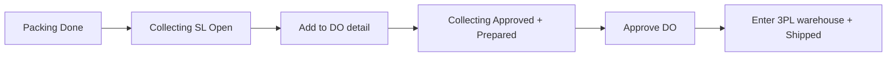
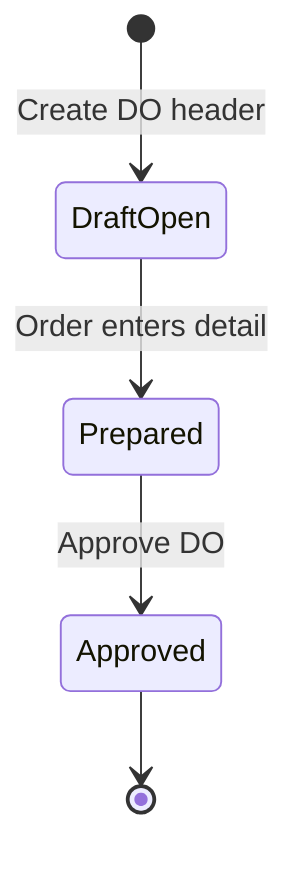
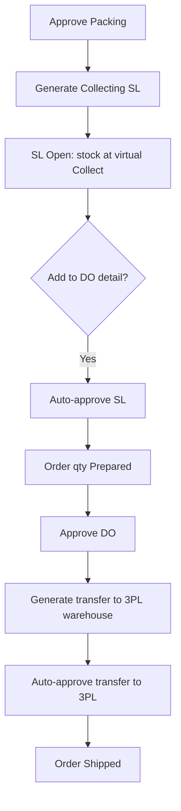
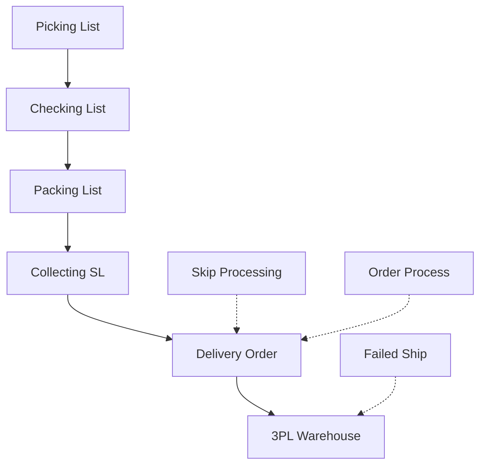

### 🚀 Delivery Order

**Delivery Order (DO)** is the shipping *handover* document issued after *Collecting* is done. It closes the *fulfillment* chain by handing a set of orders to a *Shipper* or third-party courier warehouse (3PL).

This menu serves two order flows at once: **internal** (shipping and tracking managed in-house) and **platform** (marketplace courier). Orders can be mixed in one Delivery Order as long as they use the same *Shipper*.

> **Most important:** stock officially moves to the 3PL warehouse when the DO is **approved**, not when the order is added to the detail list.

---

### 🔑 Key Terms

| Term | Definition |
| :---- | :---- |
| **Delivery Order (DO)** | List of orders handed to a *shipper* or 3PL warehouse; the shipping *handover* document. |
| **Collecting (SL-...)** | Collection document after *packing*; created when *packing* is *approved* (*Open*), and becomes *Approved* when the order enters DO detail. |
| **Shipper** | Courier/sender chosen on the DO *header*; determines the destination 3PL warehouse. |
| **3PL warehouse** | Courier/*shipper* warehouse — final stock destination when the DO is *approved*. |
| **Virtual collect/ship location** | Internal location inside the process warehouse where goods sit after *packing* — **not** the courier warehouse. |
| **Prepared** | Order is listed on the DO but not yet officially sent to the courier warehouse. |
| **Processed** | Quantity officially processed on the DO — happens exactly when the DO is *approved*. |
| **Shipped** | Order has officially left for the courier warehouse after DO *approve*. |
| **Available to Delivery Order** | Modal listing orders or *Collecting* documents available to add to the DO. |
| **Transfer Internal (Mode)** | Insert mode based on *Collecting* documents (SL-...), not per order. |
| **Instant Settlement** | Marketplace fund settlement that requires the order to already be *Shipped*. |

---

### 🎯 When & Why to Use

| ✅ Use when | ❌ Do not expect when |
| :---- | :---- |
| Order finished *Pick* → *Check* → *Pack* and already has a **Collecting** document. | Order not yet in *Collecting* (*packing* incomplete) — it will not appear in *Available to Delivery Order*. |
| You want to hand many orders at once to one *shipper* / 3PL warehouse. | DO *header* *shipper* is not bound to a 3PL warehouse — *approve* will fail. |
| You want the order to become *Shipped* with stock officially at the courier warehouse. | Assuming stock is already at the courier warehouse once the order is added to DO detail — **not yet**; stock moves on DO *approve*. |

---

### 📋 Prerequisites

| Prerequisite | Source | Notes |
| :---- | :---- | :---- |
| *Pick* → *check* → *pack* chain is finished. | Warehouse process | *Approving* *packing* creates a *Collecting* document. |
| **Collecting** document (SL-\*) exists. | Internal transfer of type *shipping* | Moves from *pack* warehouse to *virtual collect/ship*; starts as **Open**. |
| DO *header* **Shipper** is bound to a 3PL warehouse. | Shipper ↔ 3PL binding | Without *binding*, transfer to 3PL fails on *approve*. |
| Order is not *void*. | Sales Order | *Voided* orders are rejected when you try to add them. |
| Order transaction date must not be later than the DO date. | DO header vs Sales Order | If later, the order cannot be added. |
| *Collecting* document date must not be later than the DO date. | Collecting vs DO | If later, the order cannot be used on that DO. |
| Remaining order qty is not fully *Prepared*. | Sales Order | Fully *Prepared* qty no longer appears. |

---

### 🔄 Position in the Business Flow

**Step notes:** After *Packing* finishes, the system creates a *Collecting* (SL) document in *Open*. When the order is added to DO detail, *Collecting* becomes *Approved* and the order is *Prepared*. When the operator *Approves* the DO, goods officially enter the 3PL warehouse and the order becomes *Shipped*.

**Text fallback:** Packing Done → Collecting (SL) Open → Add to DO detail → Collecting Approved + Prepared → Approve DO → 3PL warehouse + Shipped.

---

### 📍 Menu Location & Page Layout

* **Navigation:** Supply Chain → OmniChannel → **Delivery Order**
* **List route:** `/supplychain/delivery-order`
* **Edit route:** `/supplychain/delivery-order/edit/:id`

> 🖼️ **[IMAGE PLACEHOLDER]** — Delivery Order list page with toolbar (Global Search, Advanced Filter, Show Deleted, Column show/hide, Export) and list columns.

Live *fulfillment* must use **Supply Chain → Delivery Order** (not the legacy Omni → Delivery Order copy).

---

### 📊 Status Cycle

| Document / Object | Status | When it changes |
| :---- | :---- | :---- |
| **DO Header** | *Draft* / *Open* | When the *header* is created; *shipper* and *customer* filled. |
| **DO Header** | *Approved* | After the DO *Approve* button is clicked. |
| **Sales Order (on DO)** | *Prepared* (including *prepared* qty) | When the order is added to DO detail. |
| **Collecting (SL-...)** | *Open* → *Approved* | *Open* when *packing* is *approved*; auto-**Approved** when added to DO if not already *Approved*. |
| **Transfer to 3PL warehouse** | *Open* then *Approved* | **Created and auto-approved on Approve DO**. |
| **Sales Order (process status)** | *Shipping* → *Shipped* | *Shipping* when added to detail; *Shipped* on DO *Approve*. |
| **Order quantity** | *Prepared* → *Processed* | *Prepared* when added to detail; *Processed* on DO *approve*. |

---

### 📝 How to Use

#### A. Create the DO header

1. Open Delivery Order and create a new DO.
2. Fill **transaction date**, **customer/store**, and **shipper** (the *shipper* **must already be bound to a 3PL warehouse**). Tracking/AWB follows internal or platform flow.
3. **Save** the document *header*.

> 🖼️ **[IMAGE PLACEHOLDER]** — Delivery Order header form: transaction date, customer/store, and Shipper filled.

#### B. Add orders

4. Open **Available to Delivery Order**, then choose **By Sales Order** (the everyday *live* path).
5. The list shows orders already in *Collecting* after *packing*. Select the orders you want — the system inserts the **entire remaining quantity**.

> 🖼️ **[IMAGE PLACEHOLDER]** — Available to Delivery Order modal (By Sales Order) showing orders already in Collecting.

**System reaction when an order is added:**

* *Collecting* (SL-...) that was *Open* becomes **Approved**.
* Order shipping status becomes **Prepared**.
* Physical goods have **not** moved to the courier warehouse yet.

#### C. Approve the DO

1. Click **Approve** on the DO.
2. The system moves stock to the *shipper*’s **3PL warehouse** and the order becomes **Shipped**.
3. If you see an *error* that the *shipper* has no 3PL warehouse, fix *shipper* ↔ 3PL *binding* first, then *approve* again.

> 🖼️ **[IMAGE PLACEHOLDER]** — Approve button on Delivery Order and document status after approve.

#### End-to-end stock flow

**Step notes:** After *packing* is *approved*, a *Collecting* (SL) document is created as *Open* (stock from *pack* to *virtual collect*). When the order enters DO detail, the SL is auto-*approved* and qty becomes *Prepared*. When the DO is *approved*, the system creates an internal transfer to the *shipper*’s 3PL warehouse and auto-*approves* it so the order becomes *Shipped*.

#### Field example

*Packing* PK-1 is *approved* → *Collecting* **SL-100** is **Open** (*pack* → *virtual collect*). Operator creates a DO with *shipper* **JNE**, then adds the order. **SL-100** becomes **Approved**, order is **Prepared**. Operator **Approves DO** → internal transfer to **JNE 3PL warehouse** is auto-*approved* → order is **Shipped**.

---

### 📑 Complete Field & Element Reference

#### Delivery Order header

| Field | Required? | Notes |
| :---- | :---- | :---- |
| **Transaction date** | Yes | Must not be earlier than the order or *Collecting* dates being added. |
| **Customer / Store** | Yes | Identifies customer or store. |
| **Shipper** | **Required** | Must be bound to a 3PL warehouse; destination on *approve*; **one DO = one shipper**. |
| **Tracking / AWB** | Optional | Internal uses its own *tracking*; platform follows the related *shipper* system. |
| **Deadline** | Not on the form | *Deadline Time* can still appear on the list table, but was removed from the *header* form. |

#### List columns

| Column | Default visible? | Notes |
| :---- | :---- | :---- |
| **Trx Code \| Trx Date** | Yes | DO code and transaction date. |
| **Sales Order** | Yes | *Sales Order* reference. |
| **Platform Order \| Platform Status** | Yes | Marketplace/platform tracking. |
| **Shipper \| Tracking Number** | Yes | *Tracking Number* may be hidden depending on layout. |
| **Customer \| Buyer Name** | Yes | Buyer name. |
| **Warehouse** | Yes | Warehouse handling the shipment. |
| **Trx Date \| Deadline Time** | Yes (on list) | Can be hidden via *Column show/hide*; often hidden due to duplicate dates. |
| **Trx Status** | Yes | Current DO document status. |
| **Trx Ref** | Yes | At *header* level, shows transfer code to 3PL after DO is *approved*. |
| **Created By \| Created At** | Yes | *Created At* may be hidden. |
| **Action** | Yes | Edit or *approve* access. |

#### Detail — Available to Delivery Order

| Mode | List contents | Action when selected |
| :---- | :---- | :---- |
| **By Sales Order** | Orders that already have *Collecting* (SL-...) and remaining qty. | System inserts the **entire remaining quantity**. |
| **By Transfer Internal** | *Collecting* (SL-...) documents in **Open or Approved**. | Depends on SL status. |
| *By SKU / Inventory Out* | *Technically available* | **Not used** by end users in *live* ops. |

#### Collecting row/modal columns

| Label | Content |
| :---- | :---- |
| **Trx Code** | *Collecting* document number (SL-... prefix). |
| **Trx Ref** | *Sales Order* number. |
| **Status** | *Collecting* (SL-...) status. |

---

### ✅ Business Rules & Validation

* **If** you *approve* a DO but the *header* *shipper* has no 3PL warehouse, **then** the system rejects with: `Approval failed because the shipper doesn’t have a 3PL warehouse.`
* **If** you add an order whose *Collecting* date is later than the DO date, **then** the system rejects with: `{SO code} This SO can’t be used in this DO. Please check the transaction date in the Transfer Collected document.`
* **If** you add an order whose transaction date is later than the DO date, **then** the system rejects with: `Cannot add an SO with a later transaction date than {DO code}. Please check the DO date.`
* **If** you try to add a *voided* order, **then** the system rejects with: `Sales order has been voided.`
* **If** you try to add a cancelled platform order that has not gone through *outbound approved*, **then** the system rejects with: `Sales order has been cancelled.`
* **If** you try to change or add data on an *Approved* DO, **then** the system blocks with: `This delivery order and it's properties already approved, you can't modify this data anymore.`
* **One DO allows only one shipper**. Internal and platform orders may be mixed if the *shipper* is the same.
* Fully *Prepared* qty no longer appears in *Available to Delivery Order*.
* Orders whose *packing* is not *complete* (no *Collecting*) never appear.

---

### ⚠️ Stock Officially Moves to 3PL Only When the DO Is Approved — Not When the Order Is Added

Two moments that are often confused:

**Moment 1 — When the order is added to DO detail**

* *Collecting* (SL-...) becomes **Approved** (if it was *Open*).
* Order qty becomes **Prepared**, process status *Shipping*.
* **No** transfer document to the 3PL warehouse yet.
* **Stock stays at the virtual collect/ship location inside the process warehouse** — **not** at the courier warehouse.

**Moment 2 — When the DO is approved**

* Order qty becomes **Processed**.
* Process status becomes **Shipped**.
* The system auto-creates and auto-*approves* the transfer to the 3PL warehouse.
* **Stock officially moves to the shipper’s 3PL warehouse**.

The *virtual collect/ship* location is inside the company’s internal warehouse, not the courier’s facility. On *Approve DO*, the system does **not** create a new *Collecting* document — that was already created at *packing*.

---

### 🔀 Adding Orders: Per Order vs Per Transfer Internal (Collecting)

| Aspect | By Sales Order (Daily Live) | By Transfer Internal (Collecting SL-...) |
| :---- | :---- | :---- |
| **List contents** | Orders that already have *Collecting* and remaining qty. | *Collecting* SL-... documents in **Open and Approved**. |
| **Behavior when selected** | System inserts the **entire** remaining order qty. | Depends on SL status. |

**SL status rules in Transfer Internal mode:**

* **SL Open:** System auto-sets it to **Approved**, then adds it to DO detail.
* **SL Approved:** Status is not changed again. The order can still be (*re-*)inserted via *Available to Delivery Order* while remaining qty exists.

> 🖼️ **[IMAGE PLACEHOLDER]** — Available to Delivery Order modal in By Transfer Internal mode with Collecting SL documents (Open and Approved).

---

### 🔀 Two Order Flows and Mixing Them in One DO

* **Internal:** Standard shipping and tracking managed by the company.
* **Platform:** Uses a *shipper* from the marketplace ecosystem, bound to the same 3PL warehouse as the DO *shipper*.

You may **mix** internal and platform orders in one DO if the **header shipper is the same**.

---

### ⚠️ If the Shipper Changes After the Order Is Already on DO Detail

If the marketplace *shipper* changes:

* **Before the order enters DO detail:** *Available to DO* filters with the latest courier — the order safely enters a DO with the new *shipper*.
* **After the order is on DO detail (AS-IS):** The system does **NOT** move the detail row to another DO, does **NOT** block *approve*, and does **NOT** update the courier automatically. DO *approve* still transfers to the **3PL warehouse of the shipper on the DO header**.

Physical goods may therefore go to the old courier’s 3PL warehouse. Report to QA or the related team if the platform courier changes after the order is already on a DO — the system does not auto-correct that move today.

---

### 📌 Two Confusing Uses of "Trx"

* **On DO detail rows:** Trx Code = **Collecting (SL-...)** number, Trx Ref = order number, Status = *Collecting* status.
* **On DO header:** Trx Ref = **internal transfer code to the 3PL warehouse** (filled after DO is *approved*).

> 🖼️ **[IMAGE PLACEHOLDER]** — DO detail row with Trx Code (SL number), Trx Ref (order number), and Status.

---

### 📎 Impact on Other Processes

* **Instant Settlement:** Marketplace settlement can fail if the DO is not yet *approved* (order not yet *Shipped*).
* **Skip Processing:** Automates adding the order to a DO and *approving* it, so stock flow to 3PL follows the same logic as the manual path.
* **Failed Ship:** Handles issues after the DO/stock is marked sent to 3PL.

---

### 📌 Things to Note / Known Limitations

AS-IS system behavior:

* The system does not move orders whose *shipper* changed externally after they entered DO detail.
* Trx Date \| Deadline Time still appears by *default* on the list even though the *header* form no longer has *Deadline* — hide via *Column show/hide*.
* **By SKU / Inventory Out** exists only technically and is **not** a *live* end-user path.
* **By Transfer Internal** shows *Collecting* documents that are **Open** or **Approved**.
* An **Approved** DO is permanently locked — no further edits or additions.
* Legacy "Omni → Delivery Order" is unused; *live* work must use **Supply Chain → Delivery Order**.
* `[NEEDS SOURCE]` Role access, how to delete/cancel a DO, *Show Deleted* details, and *Export* result elements are not covered in this source.

---

### 🔗 Related Menus

| Menu | Role |
| :---- | :---- |
| **Packing List** | Issues *Collecting* (SL-...) as *Open* after *packing* is *approved*. |
| **Collecting / Shipping List** | SL-... documents; often called "Collecting" by operators. |
| **Skip Processing** | Automation: add order to DO then *approve* through *Shipped*. |
| **Order Process** | Logistics stage monitoring and airway bill / AWB pull. |
| **Failed Ship** | Handle returns/ops issues if stock/DO to 3PL fails. |
| **Instant Settlement** | Finance feature that depends on *Shipped* order status. |
| **Sales Platform** | Source of *void*, *shipper* selection, and platform logistics rules. |

---

### 🛠️ Troubleshooting

| Symptom | Common cause | Solution |
| :---- | :---- | :---- |
| Order missing from *Available to Delivery Order*. | *Packing* incomplete / no *Collecting* (SL-...); or qty fully *Prepared*. | Ensure *packing* is complete, *Collecting* exists, and remaining qty is not exhausted. |
| *Approve* fails: "Approval failed because the shipper doesn’t have a 3PL warehouse." | Header *shipper* not bound to any 3PL warehouse. | Fix *shipper* ↔ 3PL *binding*, then *approve* again. |
| Cannot add order / check *Transfer Collected*. | DO date is earlier than the order or *Collecting* date. | Align DO / *Collecting* dates. |
| *Void* or *cancelled* order rejected. | Order was cancelled or *voided*. | Cancelled orders cannot be processed into a DO. |
| DO form locked. | DO already *approved*. | *Approved* documents cannot be modified. |
| *Deadline* column still shows on the list. | List column preferences still at *default*. | Hide via *Column show/hide*. |
| Goods not at courier warehouse though order is on the DO. | Adding to detail only sets *Prepared*; stock moves on *approve*. | **Approve DO**. |
| Platform courier changed externally after order entered DO. | System does not auto-move. | Do not assume 3PL changed — report to QA/related team. |
| Marketplace *settlement* stuck/failed. | DO not yet *approved* / not yet *Shipped*. | *Approve DO* until the order is *Shipped*. |

> 🖼️ **[IMAGE PLACEHOLDER]** — Error message "Approval failed because the shipper doesn't have a 3PL warehouse.".

---

### ❓ FAQ

**When are goods "really" handed over and moved to the courier warehouse?**  
When the DO is **approved**, not when you add the order to DO detail.

**Why can’t an order enter the DO form?**  
Usually: not yet in *Collecting* (*packing* incomplete), DO *shipper* not bound to 3PL, date mismatch, or qty fully *Prepared*.

**Can I mix internal and platform orders?**  
Yes, if the DO *header* uses **one same shipper**.

**What does Available to DO by Transfer Internal show?**  
**SL** codes (*Collecting* documents) in **Open** or **Approved**.

**What if the customer changes the courier on the platform after the order is already on a DO?**  
Currently **risky**. The system does not auto-move the order — *approve* may send stock to the old courier’s 3PL. Report to QA/related team.

**What’s the difference between choosing Open vs Approved Collecting?**  
Open SL is auto-set to *Approved* then added. Approved SL is not status-changed again; it can be re-inserted if remaining qty exists.

---

### 📚 See Also / References

* **Packing List** — issues Collecting (SL)
* **Skip Processing** — auto add to DO + approve through Shipped
* **Order Process** — monitoring and airway bill / AWB
* **Failed Ship** — issues after send to 3PL
* **Collecting / Shipping List** — SL-... documents
