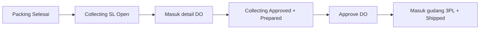
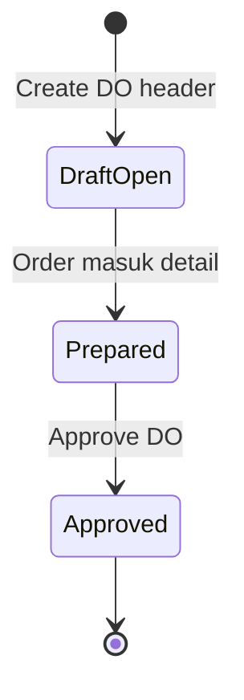
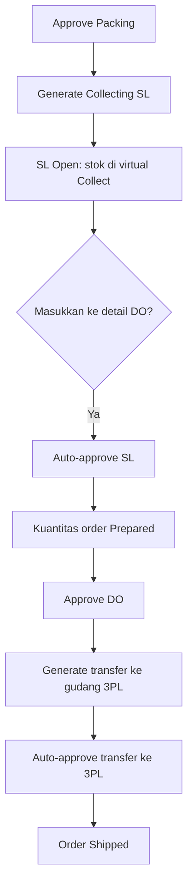
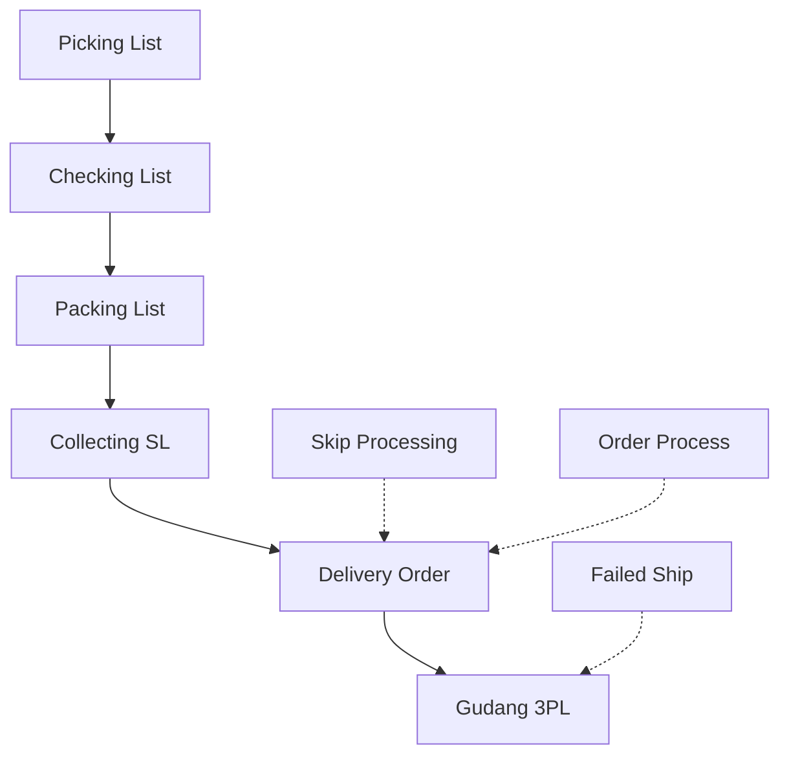

### 🚀 Delivery Order

**Delivery Order (DO)** adalah dokumen *handover* pengiriman yang diterbitkan setelah proses *Collecting* selesai. Dokumen ini menutup rantai *fulfillment* dengan menyerahkan sekumpulan order kepada *Shipper* atau gudang kurir pihak ketiga (3PL).

Menu ini melayani dua alur pesanan sekaligus: pesanan **internal** (pengiriman dan pelacakan dikelola sendiri) dan pesanan **platform** (menggunakan kurir dari *marketplace*). Seluruh pesanan dapat dicampur ke dalam satu dokumen Delivery Order selama menggunakan *Shipper* yang sama.

> **Hal terpenting:** stok barang baru resmi berpindah ke gudang 3PL saat dokumen DO di-**approve**, bukan pada saat order dimasukkan ke dalam daftar.

---

### 🔑 Istilah Kunci

| Istilah | Definisi |
| :---- | :---- |
| **Delivery Order (DO)** | Daftar order yang diserahkan ke *shipper* atau gudang 3PL; berfungsi sebagai dokumen *handover* pengiriman. |
| **Collecting (SL-...)** | Dokumen pengumpulan setelah tahap *packing*; diterbitkan saat *packing* di-*approve* (berstatus *Open*), dan berubah menjadi *Approved* saat order masuk ke detail DO. |
| **Shipper** | Kurir atau pihak pengirim yang dipilih pada *header* DO, yang akan menentukan gudang 3PL tujuan. |
| **Gudang 3PL** | Gudang milik kurir atau *shipper*, yang menjadi tujuan akhir perpindahan stok saat DO di-*approve*. |
| **Lokasi virtual collect/ship** | Lokasi internal di dalam gudang proses tempat barang ditampung sementara setelah *packing*, **bukan** gudang kurir. |
| **Prepared** | Status order yang sudah terdaftar di dalam DO tetapi belum dikirim secara resmi ke gudang kurir. |
| **Processed** | Status kuantitas yang sudah resmi diproses di DO, terjadi tepat saat DO di-*approve*. |
| **Shipped** | Status pesanan yang sudah resmi keluar ke gudang kurir setelah DO di-*approve*. |
| **Available to Delivery Order** | Jendela modal berisi daftar pilihan order atau dokumen *Collecting* yang tersedia untuk dimasukkan ke dalam DO. |
| **Transfer Internal (Mode)** | Mode memasukkan data pengiriman berdasarkan dokumen *Collecting* (SL-...), bukan berdasarkan per order. |
| **Instant Settlement** | Pencairan dana *marketplace* yang mensyaratkan order sudah harus berstatus *Shipped*. |

---

### 🎯 Kapan & Kenapa Dipakai

| ✅ Pakai kalau | ❌ Jangan berharap kalau |
| :---- | :---- |
| Order sudah selesai melalui tahapan *Pick* → *Check* → *Pack* dan sudah memiliki dokumen **Collecting**. | Order belum masuk tahap *Collecting* (proses *packing* belum selesai) — order tidak akan muncul di *Available to Delivery Order*. |
| Ingin menyerahkan banyak order sekaligus kepada satu *shipper* atau gudang 3PL. | *Shipper* pada *header* DO belum terikat dengan gudang 3PL — proses *approve* pasti akan gagal. |
| Ingin agar order berubah status menjadi *Shipped* dan stok secara resmi berada di gudang kurir. | Mengira stok sudah berada di gudang kurir begitu order dimasukkan ke detail DO — **belum**, stok baru pindah saat *approve* DO. |

---

### 📋 Prasyarat

| Prasyarat | Sumber | Catatan |
| :---- | :---- | :---- |
| Rantai *pick* → *check* → *pack* telah selesai dikerjakan. | Proses Gudang | *Approve* pada *packing* menghasilkan dokumen *Collecting*. |
| Dokumen **Collecting** (SL-\*) sudah tersedia. | Dokumen transfer internal tipe *shipping* | Memindahkan dari gudang *pack* ke lokasi *virtual collect/ship*; awalnya berstatus **Open**. |
| **Shipper** pada *header* DO terikat dengan gudang 3PL. | Binding Shipper ↔ 3PL | Tanpa *binding*, pembuatan dokumen transfer ke 3PL akan gagal saat *approve*. |
| Order tidak dalam status *void*. | Sales Order | Order yang di-*void* akan ditolak saat dicoba dimasukkan. |
| Tanggal transaksi order tidak boleh lebih baru dari tanggal DO. | Header DO vs Sales Order | Apabila lebih baru, order tidak bisa ditambahkan. |
| Tanggal dokumen *Collecting* tidak boleh lebih baru dari tanggal DO. | Collecting vs DO | Apabila lebih baru, order tidak bisa dipakai pada DO terkait. |
| Sisa kuantitas order belum seluruhnya *Prepared*. | Sales Order | Order dengan kuantitas yang sudah penuh *Prepared* tidak akan muncul lagi. |

---

### 🔄 Posisi dalam Alur Bisnis

**Keterangan langkah:** Setelah *Packing* selesai, sistem menghasilkan dokumen *Collecting* (SL) berstatus *Open*. Saat order dimasukkan ke detail DO, *Collecting* otomatis menjadi *Approved* dan order berstatus *Prepared*. Saat operator *Approve DO*, barang resmi masuk gudang 3PL dan status pesanan menjadi *Shipped*.

**Fallback teks:** Packing Selesai → Collecting (SL) Open → Masuk detail DO → Collecting Approved + Prepared → Approve DO → Gudang 3PL + Shipped.

---

### 📍 Lokasi Menu & Tampilan Halaman

* **Navigasi:** Supply Chain → OmniChannel → **Delivery Order**
* **Route daftar:** `/supplychain/delivery-order`
* **Route edit:** `/supplychain/delivery-order/edit/:id`

> 🖼️ **[PLACEHOLDER GAMBAR]** — Halaman daftar Delivery Order dengan toolbar (Global Search, Advanced Filter, Show Deleted, Column show/hide, Export) dan kolom-kolom daftar.

Rutinitas *fulfillment* yang *live* wajib dikerjakan dari **Supply Chain → Delivery Order** (bukan menu salinan lawas Omni → Delivery Order).

---

### 📊 Siklus Status

| Dokumen / Objek | Status | Kapan Berubah |
| :---- | :---- | :---- |
| **DO Header** | *Draft* / *Open* | Saat *header* dibuat; *shipper* dan *customer* diisi. |
| **DO Header** | *Approved* | Setelah tombol *Approve* DO diklik. |
| **Sales Order (di dalam DO)** | *Prepared* (termasuk kuantitas *prepared*) | Saat order dimasukkan ke dalam detail DO. |
| **Collecting (SL-...)** | *Open* → *Approved* | *Open* saat *packing* di-*approve*; otomatis **Approved** saat dimasukkan ke DO jika sebelumnya belum *Approved*. |
| **Transfer ke gudang 3PL** | *Open* lalu *Approved* | **Dibuat dan di-approve secara otomatis saat Approve DO**. |
| **Sales Order (Status Proses)** | *Shipping* → *Shipped* | Menjadi *Shipping* saat masuk detail DO; menjadi *Shipped* saat *Approve* DO. |
| **Kuantitas Order** | *Prepared* → *Processed* | Menjadi *Prepared* saat masuk detail; menjadi *Processed* saat *approve* DO. |

---

### 📝 Langkah-Langkah Penggunaan

#### A. Membuat Header DO

1. Buka menu Delivery Order, lalu buat DO baru.
2. Isi field **tanggal transaksi**, **customer/store**, dan **shipper** (pastikan *shipper* **harus sudah terikat dengan gudang 3PL**). Pengisian *Tracking* atau AWB mengikuti alur internal maupun platform.
3. **Simpan** *header* dokumen.

> 🖼️ **[PLACEHOLDER GAMBAR]** — Form header Delivery Order: tanggal transaksi, customer/store, dan field Shipper terisi.

#### B. Memasukkan Order

4. Buka modal **Available to Delivery Order**, lalu pilih opsi **By Sales Order** (cara *live* yang dipakai sehari-hari).
5. Daftar yang muncul adalah order yang sudah berstatus *Collecting* setelah *packing* selesai. Pilih order yang diinginkan — sistem akan otomatis memasukkan **seluruh sisa kuantitas** dari order tersebut.

> 🖼️ **[PLACEHOLDER GAMBAR]** — Modal Available to Delivery Order (mode By Sales Order) menampilkan order yang sudah Collecting.

**Reaksi sistem saat order dimasukkan:**

* Dokumen *Collecting* (SL-...) yang tadinya *Open* menjadi **Approved**.
* Status pengiriman pada order berubah menjadi **Prepared**.
* Barang fisik **belum** pindah ke gudang kurir.

#### C. Approve DO

1. Klik tombol **Approve** pada dokumen DO.
2. Sistem akan memindahkan stok ke **gudang 3PL** milik *shipper* dan order akan menjadi **Shipped**.
3. Apabila muncul pesan *error* bahwa *shipper* tidak memiliki gudang 3PL, perbaiki *binding shipper* ↔ gudang 3PL terlebih dahulu, kemudian lakukan *approve* ulang.

> 🖼️ **[PLACEHOLDER GAMBAR]** — Tombol Approve pada Delivery Order dan status dokumen setelah approve.

#### Alur end-to-end stok

**Keterangan langkah:** Setelah *packing* di-*approve*, dokumen *Collecting* (SL) terbentuk berstatus *Open* (stok dari gudang *pack* ke *virtual collect*). Saat order masuk detail DO, SL otomatis di-*approve* dan kuantitas menjadi *Prepared*. Ketika DO di-*approve*, sistem membuat transfer internal ke gudang 3PL milik *shipper*, lalu otomatis meng-*approve*-nya sehingga order berstatus *Shipped*.

#### Contoh kasus lapangan

*Packing* PK-1 di-*approve* → *Collecting* **SL-100** berstatus **Open** (asal gudang *pack* → tujuan *virtual collect*). Operator membuat DO dengan *shipper* **JNE**, lalu memasukkan order. **SL-100** menjadi **Approved**, order **Prepared**. Operator **Approve DO** → transfer internal ke **gudang 3PL JNE** ter-*approve* otomatis → order **Shipped**.

---

### 📑 Referensi Field & Elemen Lengkap (Field Reference)

#### Header Delivery Order

| Field | Wajib? | Catatan |
| :---- | :---- | :---- |
| **Tanggal transaksi** | Ya | Tidak boleh lebih lama dari tanggal order atau *Collecting* yang dimasukkan. |
| **Customer / Store** | Ya | Mengidentifikasi entitas pelanggan atau toko. |
| **Shipper** | **Wajib** | Harus terikat dengan gudang 3PL; menentukan ke mana stok dikirim saat *approve*; **satu DO = satu shipper**. |
| **Tracking / AWB** | Opsional | Internal memakai *tracking* mandiri; platform mengikuti sistem *shipper* terkait. |
| **Deadline** | Tidak tampil di form | Kolom *Deadline Time* masih bisa dimunculkan di tabel daftar, tetapi sudah dihilangkan dari form *header*. |

#### Kolom daftar (List Columns)

| Kolom | Tampil Default? | Catatan |
| :---- | :---- | :---- |
| **Trx Code \| Trx Date** | Ya | Nomor kode DO dan tanggal transaksi. |
| **Sales Order** | Ya | Nomor referensi *Sales Order*. |
| **Platform Order \| Platform Status** | Ya | Melacak alur *marketplace*/platform. |
| **Shipper \| Tracking Number** | Ya | *Tracking Number* bisa tersembunyi tergantung resolusi/tampilan. |
| **Customer \| Buyer Name** | Ya | Informasi nama pembeli. |
| **Warehouse** | Ya | Gudang yang memproses pengiriman. |
| **Trx Date \| Deadline Time** | Ya (di daftar) | Bisa disembunyikan lewat *Column show/hide*; sering disembunyikan karena duplikasi tanggal. |
| **Trx Status** | Ya | Status terkini dokumen DO. |
| **Trx Ref** | Ya | Di tingkat *header*, menampilkan kode transfer ke gudang 3PL bila DO sudah di-*approve*. |
| **Created By \| Created At** | Ya | *Created At* terkadang tersembunyi. |
| **Action** | Ya | Akses edit atau *approve* dokumen. |

#### Detail — Available to Delivery Order

| Mode | Isi Daftar | Tindakan Saat Dipilih |
| :---- | :---- | :---- |
| **By Sales Order** | Order yang sudah punya dokumen *Collecting* (SL-...) dan masih punya sisa kuantitas. | Sistem memasukkan **seluruh sisa kuantitas** order tersebut. |
| **By Transfer Internal** | Dokumen *Collecting* (SL-...) berstatus **Open maupun Approved**. | Bergantung pada status SL. |
| *By SKU / Inventory Out* | *Tersedia teknis* | **Tidak dipakai** oleh pengguna akhir secara *live*. |

#### Kolom pada baris/modal Collecting

| Label | Isi |
| :---- | :---- |
| **Trx Code** | Nomor dokumen *Collecting* (awalan SL-...). |
| **Trx Ref** | Nomor *Sales Order*. |
| **Status** | Status dokumen *Collecting* (SL-...). |

---

### ✅ Aturan Bisnis & Validasi

* **Kalau kamu** melakukan *approve* DO namun *shipper* di *header* tidak memiliki gudang 3PL, **maka sistem** menolak dengan pesan: `Approval failed because the shipper doesn’t have a 3PL warehouse.`
* **Kalau kamu** memasukkan order di mana tanggal dokumen *Collecting* lebih baru dari tanggal DO, **maka sistem** menolak dengan pesan: `{SO code} This SO can’t be used in this DO. Please check the transaction date in the Transfer Collected document.`
* **Kalau kamu** memasukkan order di mana tanggal transaksi order lebih baru dari tanggal DO, **maka sistem** menolak dengan pesan: `Cannot add an SO with a later transaction date than {DO code}. Please check the DO date.`
* **Kalau kamu** mencoba memasukkan order yang sudah di-*void*, **maka sistem** menolak dengan pesan: `Sales order has been voided.`
* **Kalau kamu** mencoba memasukkan order platform yang telah dibatalkan dan belum melalui proses *outbound approved*, **maka sistem** menolak dengan pesan: `Sales order has been cancelled.`
* **Kalau kamu** mencoba mengubah atau menambahkan data pada DO yang sudah *Approved*, **maka sistem** memblokir dengan pesan: `This delivery order and it's properties already approved, you can't modify this data anymore.`
* **Satu DO HANYA MENGIZINKAN satu shipper**. Pesanan internal dan platform boleh dicampur, asalkan *shipper* sama.
* Order dengan kuantitas yang sudah sepenuhnya *Prepared* tidak ditampilkan lagi di *Available to Delivery Order*.
* Order yang proses *packing*-nya belum *complete* (belum punya *Collecting*) tidak pernah muncul.

---

### ⚠️ Stok Baru Resmi Pindah ke Gudang 3PL Saat DO Di-approve — Bukan Saat Order Dimasukkan

Ada dua momen krusial yang sering salah dipahami:

**Momen 1 — Saat order dimasukkan ke detail DO**

* Dokumen *Collecting* (SL-...) menjadi **Approved** (jika sebelumnya *Open*).
* Kuantitas pesanan menjadi **Prepared**, status order *Shipping*.
* **Belum ada** dokumen transfer ke gudang 3PL.
* **Stok masih di lokasi virtual collect/ship di dalam gudang proses** — **belum** ke gudang kurir.

**Momen 2 — Saat DO di-approve**

* Kuantitas pesanan menjadi **Processed**.
* Status proses order resmi **Shipped**.
* Sistem otomatis membuat sekaligus meng-*approve* dokumen transfer ke gudang 3PL.
* **Stok resmi berpindah ke gudang 3PL milik shipper**.

Lokasi *virtual collect/ship* adalah area di dalam gudang internal perusahaan, bukan fasilitas milik kurir. Saat *Approve DO*, sistem **tidak** membuat dokumen *Collecting* baru — dokumen itu sudah terbit saat *packing*.

---

### 🔀 Memasukkan Order: Per Order vs Per Transfer Internal (Collecting)

| Aspek | By Sales Order (Live Harian) | By Transfer Internal (Dokumen Collecting SL-...) |
| :---- | :---- | :---- |
| **Isi daftar** | Order yang sudah punya *Collecting* dan masih punya sisa kuantitas. | Dokumen *Collecting* SL-... berstatus **Open dan Approved**. |
| **Perilaku saat dipilih** | Sistem memasukkan **seluruh** sisa kuantitas order sekaligus. | Bergantung pada status SL. |

**Aturan status SL pada mode Transfer Internal:**

* **SL Open:** Sistem otomatis menjadikannya **Approved** lalu memasukkannya ke detail DO.
* **SL Approved:** Status tidak diubah lagi. Order tetap bisa dimasukkan (*re-insert*) lewat *Available to Delivery Order* selama sisa kuantitas masih ada.

> 🖼️ **[PLACEHOLDER GAMBAR]** — Modal Available to Delivery Order mode By Transfer Internal dengan daftar dokumen Collecting SL (status Open dan Approved).

---

### 🔀 Dua Alur Order dan Mencampurnya dalam Satu DO

* **Internal:** Pengiriman dan pelacakan standar dikelola mandiri oleh perusahaan.
* **Platform:** Menggunakan *shipper* dari ekosistem *marketplace*, diikatkan ke gudang 3PL yang sama dengan *shipper* DO.

Sistem mengizinkan **mencampur** pesanan internal dan platform dalam satu DO, dengan syarat wajib **shipper di header DO harus sama**.

---

### ⚠️ Kalau Shipper Berubah Setelah Order Masuk Detail DO

Jika kurir (*shipper*) berubah dari pihak platform *marketplace*:

* **Sebelum order masuk detail DO:** Sistem memfilter *Available to DO* dengan kurir terbaru — order aman masuk ke DO dengan *shipper* baru.
* **Sesudah order masuk detail DO (AS-IS):** Sistem **TIDAK** memindahkan baris detail ke DO lain, **TIDAK** memblokir *approve*, dan **TIDAK** memperbarui kurir otomatis. *Approve* DO tetap mengeksekusi transfer ke **gudang 3PL milik shipper di header DO**.

Akibatnya, barang fisik bisa dikirim ke gudang 3PL kurir yang lama (salah kurir). Laporkan ke tim QA atau pihak terkait jika kurir platform berubah saat order sudah di dalam DO — sistem saat ini tidak meluruskan pemindahan tersebut otomatis.

---

### 📌 Dua Istilah "Trx" yang Bisa Membingungkan

* **Di tingkat baris detail DO:** Trx Code = nomor dokumen **Collecting (SL-...)**, Trx Ref = nomor order, Status = status dokumen *Collecting*.
* **Di tingkat header DO:** Trx Ref = **kode transfer internal ke gudang 3PL** (terisi setelah DO di-*approve*).

> 🖼️ **[PLACEHOLDER GAMBAR]** — Baris detail DO dengan kolom Trx Code (nomor SL), Trx Ref (nomor order), dan Status.

---

### 📎 Dampak ke Proses Lain

* **Instant Settlement:** Pencairan dana *marketplace* dapat gagal apabila DO belum di-*approve* (order belum *Shipped*).
* **Skip Processing:** Mengotomatiskan memasukkan order ke DO sekaligus *approve*, sehingga aliran stok ke 3PL terjadi dengan urutan logika yang sama seperti pengerjaan manual.
* **Failed Ship:** Penanganan kendala setelah DO dan stok berstatus dikirim ke 3PL.

---

### 📌 Yang Perlu Diperhatikan / Keterbatasan yang Diketahui

Kondisi sistem apa adanya (AS-IS):

* Sistem tidak mengurus atau memindahkan pesanan yang *shipper*-nya berubah secara eksternal setelah order masuk detail DO.
* Kolom Trx Date \| Deadline Time masih muncul *default* di daftar meskipun form *header* tidak lagi menampilkan *Deadline* — bisa disembunyikan lewat *Column show/hide*.
* Jalur **By SKU / Inventory Out** hanya ada secara teknis dan **bukan** alur *live* end user.
* Mode **By Transfer Internal** menampilkan dokumen *Collecting* yang **Open** maupun **Approved**.
* DO **Approved** dikunci permanen — tidak bisa dimodifikasi atau ditambah lagi.
* Menu salinan lawas "Omni → Delivery Order" tidak dipakai lagi; *live* wajib dari **Supply Chain → Delivery Order**.
* `[NEEDS SOURCE]` Hak akses (*role*), cara hapus/batalkan DO, detail *Show Deleted*, dan elemen hasil *Export* tidak dijelaskan di sumber ini.

---

### 🔗 Hubungan dengan Menu Lain

| Menu | Perannya |
| :---- | :---- |
| **Packing List** | Menerbitkan dokumen *Collecting* (SL-...) berstatus *Open* setelah *packing* di-*approve*. |
| **Collecting / Shipping List** | Dokumen SL-...; sering disebut operator sebagai "Collecting". |
| **Skip Processing** | Otomatisasi: masukkan order ke DO lalu *approve* hingga *Shipped*. |
| **Order Process** | Pantauan tahapan logistik dan penarikan Resi / AWB. |
| **Failed Ship** | Penanganan retur/kendala jika stok/DO menuju 3PL gagal terkirim. |
| **Instant Settlement** | Fitur keuangan yang bergantung pada status order *Shipped*. |
| **Sales Platform** | Sumber *void*, penentuan *shipper*, dan aturan logistik platform. |

---

### 🛠️ Troubleshooting

| Gejala | Penyebab Umum | Solusi |
| :---- | :---- | :---- |
| Order tidak muncul di *Available to Delivery Order*. | *Packing* belum selesai / belum ada *Collecting* (SL-...); atau kuantitas sudah *Prepared* penuh. | Pastikan *packing* complete, *Collecting* tersedia, dan sisa kuantitas belum habis. |
| Gagal *approve*: "Approval failed because the shipper doesn’t have a 3PL warehouse." | *Shipper* di *header* belum terikat ke gudang 3PL. | Perbaiki *binding shipper* ↔ gudang 3PL, lalu *approve* ulang. |
| Tidak bisa menambah order / cek *Transfer Collected*. | Tanggal DO lebih lama daripada tanggal order atau *Collecting*. | Samakan penanggalan DO / *Collecting*. |
| Order *void* atau *cancelled* ditolak masuk. | Order sudah dibatalkan atau di-*void*. | Order batal memang tidak bisa diproses ke DO. |
| Form DO terkunci. | DO sudah di-*approve*. | Dokumen *approved* tidak bisa dimodifikasi lagi. |
| Kolom *Deadline* masih muncul di daftar. | Preferensi kolom daftar masih *default*. | Sembunyikan lewat *Column show/hide*. |
| Barang belum ke gudang kurir padahal order sudah masuk DO. | Masuk detail hanya *Prepared*; stok bergerak saat *approve*. | Lakukan **Approve DO**. |
| Kurir platform berubah di sistem luar setelah order masuk DO. | Sistem tidak memindahkan otomatis. | Jangan asumsikan gudang 3PL ikut pindah — laporkan ke QA/tim terkait. |
| *Settlement marketplace* gagal (tertahan). | DO belum di-*approve* / belum *Shipped*. | *Approve DO* hingga order *Shipped*. |

> 🖼️ **[PLACEHOLDER GAMBAR]** — Pesan error "Approval failed because the shipper doesn't have a 3PL warehouse.".

---

### ❓ FAQ

**Kapan barang "benar-benar" diserahkan dan pindah ke gudang kurir?**  
Saat dokumen DO di-**approve**, bukan saat order dimasukkan ke detail DO.

**Kenapa sebuah order tidak bisa masuk ke form DO?**  
Umumnya: belum *Collecting* (*packing* belum selesai), *shipper* DO belum terikat ke 3PL, tanggal tidak cocok, atau kuantitas sudah *Prepared* penuh.

**Apakah bisa mencampur order internal dan platform?**  
Ya, asalkan **satu shipper yang sama** di *header* DO.

**Mode Available to DO by Transfer Internal menampilkan apa?**  
Kode **SL** (dokumen *Collecting*) berstatus **Open** maupun **Approved**.

**Bagaimana jika pelanggan mengganti kurir di platform setelah order masuk DO?**  
Saat ini **berisiko**. Sistem tidak otomatis memindahkan order — *approve* bisa mengirim stok ke gudang 3PL kurir lama. Laporkan ke QA/tim terkait.

**Apa bedanya memilih Collecting Open vs Approved?**  
SL *Open* otomatis jadi *Approved* lalu masuk detail. SL *Approved* tidak diubah lagi; boleh dimasukkan ulang jika masih ada sisa kuantitas.

---

### 📚 Lihat Juga / Referensi

* **Packing List** — menerbitkan Collecting (SL)
* **Skip Processing** — otomatisasi masuk DO + approve hingga Shipped
* **Order Process** — pantauan dan Resi / AWB
* **Failed Ship** — kendala setelah kirim ke 3PL
* **Collecting / Shipping List** — dokumen SL-...
