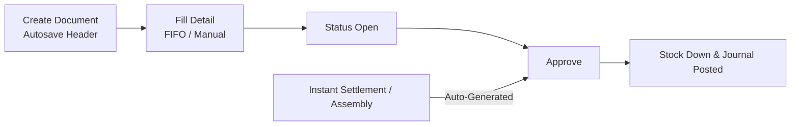
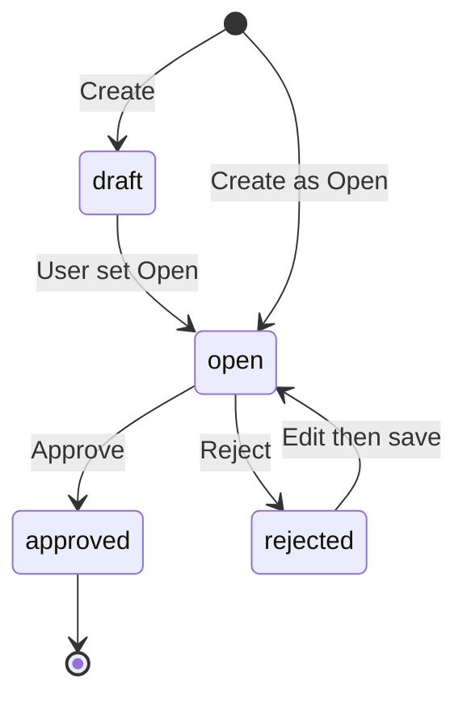
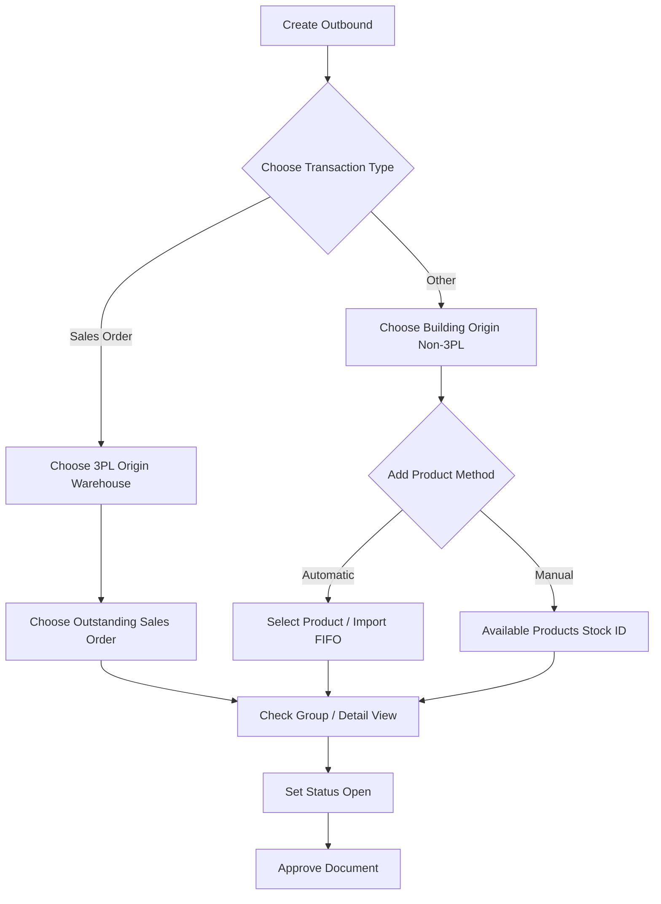
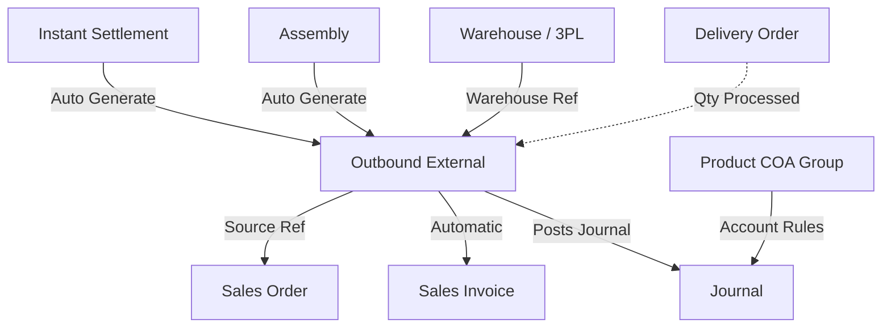

### 🚀 Outbound External

**Outbound External** records goods leaving the warehouse so stock availability decreases and inventory journal entries are posted automatically when the document is *approved*. There are two issue types: **Sales Order** for orders leaving a 3PL warehouse, and **Other** for internal operational use without an order number.

> **Note:** *Approve* is final — it immediately cuts stock and posts the related journal.

**Target Audience:**

| Persona | Typical Use | Where to Begin |
| :---- | :---- | :---- |
| **Warehouse & Ops** | Record physical goods issues and internal consumption | `/supplychain/mutation-outbound` |
| **Finance Support** | Confirm inventory journal and COGS/OpEx posting | `/supplychain/mutation-outbound` |

---

### 🔑 Key Terms

| Term | Operational definition |
| :---- | :---- |
| **Outbound External (OT)** | Warehouse goods-issue document with OT code prefix. |
| **Type: Sales Order** | Order-specific issue; only 3PL warehouses. |
| **Type: Other** | Operational use without an order; origin warehouse must not be 3PL. |
| **3PL Origin** | Courier/shipping warehouse (Sales Order type only). |
| **Building Origin** | Source warehouse (Other type). |
| **FIFO (Is FIFO)** | System auto-picks stock *batches* by receipt time, versus manual *stock id* selection. |
| **Stock ID** | Identity of one stock receipt; stock received at different times has different *stock ids*. |
| **Group View** | One row per SKU with qty aggregated across *stock ids*. |
| **Detail View** | Qty broken down per *stock id*, including the Is FIFO column. |
| **Auto-generated** | Outbound created automatically by Instant Settlement or Assembly (must not be edited). |
| **DO Status** | Shows *Prepared* or *Processed* from DO qty — not a specific DO number. |

---

### 🎯 When & Why to Use

| ✅ Create Outbound when | ❌ Do not when |
| :---- | :---- |
| You need to reduce stock manually for internal use (Other). | Editing an *auto-generated* Outbound from Settlement / Assembly (*read-only*). |
| You need to issue order stock from a 3PL warehouse (Sales Order). | *Approving* a document with no product detail rows. |
| You need stock reduction posted to accounting. | *Approving* when stock is insufficient. |
| Running bulk marketplace order *generate* (via Instant Settlement). | Accounting period (fiscal) or product COA is not ready. |

**Note:** This menu is **not** for moving stock between warehouses — there is no destination warehouse field.

---

### 📋 Prerequisites

* **Access rights:** User must have the relevant *Role* / *Privilege* to view, create, edit, delete, or approve.
* **Accounting period:** Fiscal period must be Open for *create* and *approve*.
* **Warehouse match:** Sales Order must use a 3PL warehouse; Other must use a non-3PL warehouse.
* **Stock availability:** Qty must be available in the origin warehouse structure for *Select Product*, *Available Products*, or *Import*.
* **Product COA Group:** COA mapping (Inventory + COGS, Operational Expense, or WIP) **must be filled before approve** or the journal fails.
* **Order eligibility:** For Sales Order type, the order must be *Approved/Processed* with a 3PL shipping route.

---

### 🔄 Position in the Business Flow

**Step notes:**

1. User creates a new document (Create), saves detail, then proceeds to Approve.
2. Approve automatically reduces physical stock availability and posts the related accounting journal.
3. Instant Settlement or Assembly can create an Outbound External that is immediately *Approved* (skipping *draft*).

---

### 📍 Menu Location & Page Layout

* **Navigation:** Supply Chain → **Outbound External**
* **UI route:** `/supplychain/mutation-outbound`

> 🖼️ **[IMAGE PLACEHOLDER]** — Outbound External list page: toolbar (Create, Show deleted, Column show/hide, Export, Global Search, Advanced Filter) and list columns including DO Status and Trx Status.

**Advanced Filter (fields & operators):** Trx Date, Trx Code, Product, Building Origin, Description, Qty, Trx Ref, DO Status, Trx Status, Created By/At, Updated By/At.

* **Text:** *equals, not equals, contains, starts with, ends with, empty, not empty*
* **Date / Number:** *equals, not equals, \<, ≤, \>, ≥, between, not between, empty, not empty*

---

### 📊 Status Cycle

> **Hard rule:** There is no Void feature, and Unapprove is not available in *staging/production*.

| Status | Editable? | Deletable? | Approvable? | Print / Show |
| :---- | :---- | :---- | :---- | :---- |
| **Draft** | Yes | Yes | No | Yes |
| **Open** | Yes | Yes | Yes | Yes |
| **Rejected** | Yes (returns to Open) | Yes\* | No (until back to Open) | Yes |
| **Approved** | No | No | — | Yes |

\* Deletion depends on access rights; Sales Order–related documents may be blocked from delete. Auto documents from Instant Settlement/Assembly start as Approved.

---

### 📝 How to Use

**Step notes:**

1. Open **Supply Chain → Outbound External**.
2. Click **Create**. The system loads the last-used warehouse and transaction type defaults. On first use, fill the form manually.
3. Enter **Transaction Date**, choose **Sales Order** or **Other**, and set the origin warehouse.

> 🖼️ **[IMAGE PLACEHOLDER]** — Basic Information form: Transaction Date, Type (Sales Order / Other), Building Origin or 3PL Origin, and Description.

4. Add products to document detail:
   * **Other:** Use **Select Product** (FIFO), **Available Products → Use / Bulk Use** (manual per stock id), or **Import** Excel.

> 🖼️ **[IMAGE PLACEHOLDER]** — Other-type detail: Select Product dropdown with SKUs available at origin.

> 🖼️ **[IMAGE PLACEHOLDER]** — Available Products modal with per stock id list, Use button and Bulk Use (checkbox).

   * **Sales Order:** Choose *outstanding Sales Orders* whose stock is in the 3PL warehouse.

> 🖼️ **[IMAGE PLACEHOLDER]** — Sales Order–type detail: outstanding Sales Order selection at 3PL.

5. Use **Group View** or **Detail View** to review aggregated qty.
6. Set status to **Open**, then click **Approve**.

> 🖼️ **[IMAGE PLACEHOLDER]** — Approve button on an Open document, and Approved status afterward.

7. Use **Print** or **Export** (*with details / without details*) if needed.

---

### 📑 Complete Field Reference

#### Basic Information

| Field | Required? | Rules |
| :---- | :---- | :---- |
| **Transaction Code** | Automatic | Prefix **OT**. |
| **Transaction Date** | Yes | Future dates not allowed; period must be open. |
| **Type** | Yes | Radio **Sales Order** or **Other**. Locked once detail rows exist. |
| **Building Origin / 3PL Origin** | Yes | Other = non-3PL; Sales Order = 3PL. FIFO reminder tooltip available. |
| **Description** | No | Free-text notes. |

#### Other-type detail controls

| Control | Behavior |
| :---- | :---- |
| **Select Product** | Shows SKU availability. Qty uses FIFO (Is FIFO = Yes). |
| **Available Products modal** | Pick by specific *stock id*. **Use** for one id, **Bulk Use** for many. FIFO fulfill option available. |
| **Import** | Template: Product ID, System Product SKU, Qty/Outbound Qty, Unit (FIFO path). |
| **Export detail** | Follows the visible detail table layout. |
| **Group View** | Aggregates qty from multiple *stock ids* into one SKU row. |
| **Detail View** | Rows split per *stock id* with Is FIFO column. |

**Sales Order detail controls:** Select one or many orders (bulk) as long as they share the same origin warehouse reference. Qty follows 3PL *outstanding*.

#### Toolbar & datalist columns

* **Main list columns:** Trx Code \| Trx Date, Building Origin, Description, Qty, Trx Ref, DO Status, Trx Status, Audit (Created/Updated By & At).
* **Action toolbar:** Global Search, Advanced Filter, Create, Show deleted, Column show/hide, Export.
* **Row actions:** Show/Edit/Delete/Print/Approve. Approve/Delete/Print are hidden for auto documents from *platform* and POS.

---

### ✅ Business Rules & Validation

* **If** you enter a future date, **then** the system rejects with `Transaction date cannot be greater than today.`
* **If** you try Approve with no product detail rows, **then** the system rejects with `…doesn't have any detail data.`
* **If** you try to change or Approve while *import* is still loading in the background, **then** the system shows `Updating process is in progress…`
* **If** you Approve with normal rights on a document related to a Sales Order header reference, **then** the system may block with `Can't approve… related with Sales Order.`
* **If** you try to delete a document tied to a Sales Order reference, **then** the system rejects with `Can't delete… related with Sales Order.`
* **If** you try Unapprove in production/staging, **then** the system fails with `Cannot do such action, please contact administrator.`
* **If** you *import* with a mismatched column format, **then** the system logs `The file format doesn't match the system template.`
* **If** you *import* an empty file (no SKU rows), **then** the system shows `The imported file is empty…`
* **If** an *import* row fails, **then** the system shows a per-row message (starting with `Row N:`): SKU required, SKU not found, SKU inactive, SKU is a *parent*, product is *Fixed Asset/Service*, invalid/negative/non-integer Qty, detail limit exceeded, or insufficient stock.

---

### 🔀 Sales Order vs Other — When to Use Which

| Aspect | Sales Order | Other |
| :---- | :---- | :---- |
| **Origin warehouse** | **3PL only** | Any, **not 3PL** |
| **Header reference** | Based on Sales Order (can be multiple) | Optional (Assembly code if from internal manufacturing) |
| **Journal debit** | COGS / HPP | Operational Expense / WIP |
| **Business example** | External courier ships an order from a 3PL warehouse | HR takes stationery from a regular warehouse |

---

### 🔀 FIFO vs Manual, Group View vs Detail View

| Input method | Stock pull method | Is FIFO |
| :---- | :---- | :---- |
| **Select Product** | Automatic (FIFO) | **Yes** |
| **Import** | Automatic (FIFO) | **Yes** |
| **Modal Use / Bulk Use** | Manual specific *stock id* | **No** |
| **Sales Order + FIFO helper** | Automatic (FIFO) | **Yes** |
| **Sales Order + pick stock id** | Manual specific *stock id* | **No** |

**Allocation example (pencil case study):** SKU-PENSIL received twice: 1,500 pcs at 08:00 and 500 pcs at 10:00. Outbound at 10:30 requests **1,700** pcs.

* **Group View:** one combined row of **1,700** pcs.
* **Detail View:** two receipt rows: **1,500** pcs and **200** pcs.

> 🖼️ **[IMAGE PLACEHOLDER]** — Group View (one SKU row 1,700) beside Detail View (1,500 + 200 with Is FIFO column).

---

### ⚠️ Approve Is Final — No Unapprove, and Auto Documents Cannot Be Edited

> **Warning:** Goods-issue rules are strict:

* **Unapprove is disabled** in *staging* and production.
* Document cancel (**Void**) is not available yet.
* Documents generated by *Instant Settlement* and *Assembly* are created as **Approved** and *read-only* — they cannot be changed from this menu.
* To correct a *Settlement*-sourced transaction, **delete the related Instant Settlement** (the system auto-*reverts* Outbound, stock, and journal). Do not manipulate from the Outbound menu.

---

### ⚠️ What Happens on Approve: Stock & Journal

> **Warning:** After Approve succeeds:

1. **Physical stock availability:** Decreases immediately for the related *stock id* rows.
2. **Journal creation:** Always credits **Inventory**. Debit maps to **Operational Expense** (Other), **COGS/HPP** (Sales Order), or **WIP** (from Assembly). Product COA validation must be complete; the process fails hard if the product has no financial accounts.
3. **Automatic invoice:** If related to a Sales Order that has no invoice yet, approve here may conditionally trigger an automatic *Sales Invoice*.

---

### 📥 Import Detail

Users can bulk-upload stock lines via Excel with 4 columns: Product ID | System Product SKU | Qty or Outbound Qty | Unit. Import uses automatic (FIFO) allocation.

> 🖼️ **[IMAGE PLACEHOLDER]** — Import detail modal with 4-column template and sample "Row N:" error.

**Important rule:** Do not change approve status while import is still *loading* in the *background*. Failure messages point to the row number (example: `Row 2: SKU not found`).

---

### ⚠️ Approve/Delete Rejected: "Related with Sales Order"

> **Warning:** AS-IS: Outbound Sales Order documents worked normally in the app can usually be approved. However, if the transaction has a special *platform/general* order reference and a user with ordinary rights tries to execute, the system may reject with **"Can't approve this data because it's related with Sales Order."** This rejection is under business-rule alignment discussion. If a *platform* document loses action buttons, escalate to QA.

---

### 📌 DO Status Column

This column identifies logistics readiness from *Delivery Order* detail quantities. Text output is only three kinds: **Prepared**, **Processed**, or a dash `-` (for Other type). It does **not** show a physical DO number.

> 🖼️ **[IMAGE PLACEHOLDER]** — DO Status column on the list showing Prepared / Processed / dash.

---

### 💾 Autosave on Create and Edit

The system *autosaves* the last-used warehouse and *Outbound* transaction type for the company. On a company’s first use of this menu, *autosave* does not run — enter date and type manually. Changes to Type, Date, or Warehouse in edit mode are saved automatically.

---

### 📌 Things to Note / Known Limitations

* No *Void* or *Unapprove* in production.
* The *Type* radio is permanently locked once product detail rows exist.
* The 3PL warehouse UI locks Sales Order ↔ 3PL, but there is currently no absolute server-side control.
* *DO Status* only shows volume-based status, not the DO number string.
* Sorting regression note: *Print* output and the last row position on the table may be asynchronously sorted.
* Some Reject detail behaviors are not fully defined. `[NEEDS SOURCE]`

---

### 🔗 Related Menus

| Menu | Role |
| :---- | :---- |
| **Instant Settlement** | Auto-generates and approves transactions from 3PL orders. Deleting it cancels the Outbound status. |
| **Assembly** | Auto source for manufacturing stock issues (*WIP*). |
| **Sales Order** | Source reference for order details and reserved product qty. |
| **Delivery Order** | Supplies DO Status data (*prepared/processed*). |
| **Sales Invoice** | May be created automatically as a downstream of Outbound Sales Order. |
| **Product COA Group** | Required accounts (Inventory, OpEx, COGS, WIP) for the journal. |
| **Journal** | Financial posting destination after successful *Approve*. |
| **Real Time Stock** | Monitors availability qty mutations after *Approve*. |

---

### 🛠️ Troubleshooting

| Symptom | Cause | Solution |
| :---- | :---- | :---- |
| **3PL warehouse not visible** | Wrong type radio. | Sales Order = 3PL only; Other = Non-3PL only. |
| **SKU missing in Select Product** | Insufficient stock / wrong warehouse. | Audit Availability at origin. |
| **Approve fails (COA / Account)** | Product accounts incomplete. | Complete product COA (Inventory + COGS/OpEx/WIP). |
| **Approve rejected "Related with..."** | Related to *platform* order. | Report and confirm approval status with QA. |
| **Cannot unapprove** | Feature disabled. | If from *Instant Settlement*, delete in that Settlement menu. |
| **Import error "Row N:"** | Bad Excel row data. | Check per-row log, fix, re-upload. |
| **Form does not autosave header** | First-time use. | Enter values manually on the company’s first document. |

---

### ❓ FAQ

**What is the main difference between Other and Sales Order?**  
Other records internal operational consumption. Sales Order issues physical order stock from a 3PL warehouse.

**Can one document hold multiple orders?**  
Yes (Sales Order type only) as long as the origin warehouse reference is the same.

**Why does Create go straight to the Edit form?**  
The system *autosaves* by duplicating the previous transaction-type settings.

**How do I read Group View vs Detail View?**  
*Group View* combines total qty for one product. *Detail View* splits by *stock id* and shows whether the pull used *FIFO*.

**Can I edit an Outbound auto-created from Instant Settlement?**  
No. Automation creates a final (*read-only*) document. Fixes must start from the *Settlement* source.

---

### 📚 See Also / References

* **Instant Settlement** — auto generate/revert OT
* **Assembly** — OT from WIP
* **Delivery Order** — DO Status source
* **Sales Order (General)** — Sales Order type reference
* **Sales Invoice** — automatic downstream
* **Product COA Group** — required journal accounts
* **Real Time Stock / Stock History** — stock monitoring after approve
