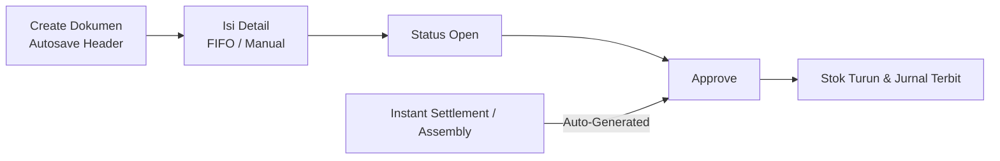
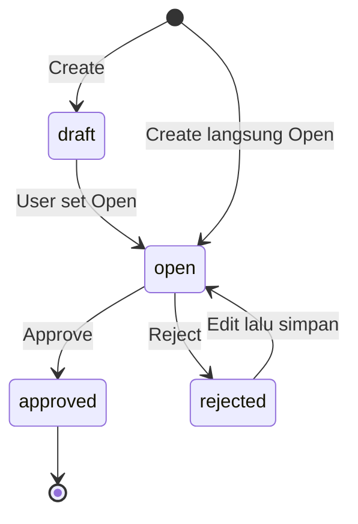
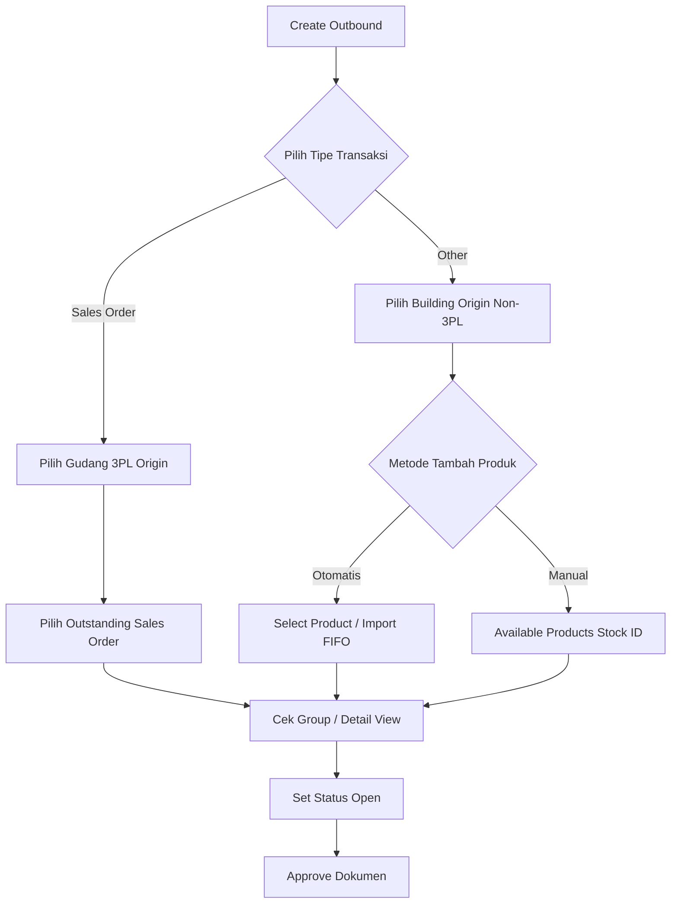
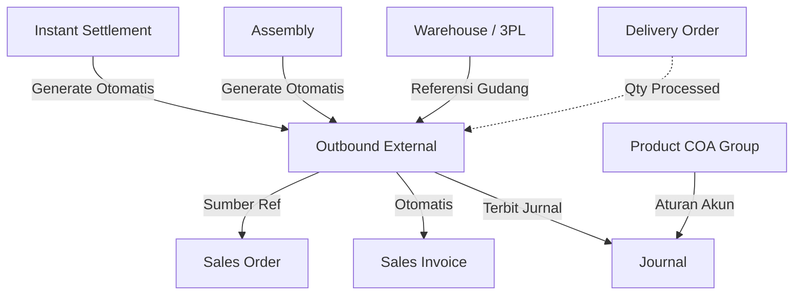

### 🚀 Outbound External

**Outbound External** adalah modul yang mencatat pengeluaran barang dari gudang sehingga ketersediaan stok berkurang dan pembukuan jurnal persediaan otomatis tercatat pada saat dokumen disetujui (*approve*). Terdapat dua tipe pengeluaran: **Sales Order** untuk order yang keluar dari gudang 3PL, dan **Other** untuk pemakaian operasional internal tanpa nomor pesanan.

> **Perhatian:** proses *approve* bersifat final karena langsung memotong stok dan menerbitkan jurnal terkait.

**Target Audience:**

| Persona | Typical Use | Where to Begin |
| :---- | :---- | :---- |
| **Warehouse & Ops** | Mencatat pengeluaran fisik barang dan pemakaian internal | `/supplychain/mutation-outbound` |
| **Finance Support** | Memastikan jurnal persediaan dan COGS/OpEx tercatat | `/supplychain/mutation-outbound` |

---

### 🔑 Istilah Kunci

| Istilah | Definisi Operasional |
| :---- | :---- |
| **Outbound External (OT)** | Dokumen pengeluaran barang dari gudang dengan awalan kode OT. |
| **Type: Sales Order** | Pengeluaran khusus pesanan, hanya menggunakan gudang tipe 3PL. |
| **Type: Other** | Pemakaian operasional tanpa pesanan, menggunakan gudang asal yang bukan tipe 3PL. |
| **3PL Origin** | Gudang layanan kurir/shipping (hanya berlaku untuk tipe Sales Order). |
| **Building Origin** | Gudang asal barang (berlaku untuk tipe Other). |
| **FIFO (Is FIFO)** | Metode sistem memilih *batch* stok secara otomatis berdasarkan waktu masuk, berlawanan dengan pemilihan *stock id* manual. |
| **Stock ID** | Identitas dari satu kedatangan stok; stok yang masuk pada waktu berbeda memiliki *stock id* yang berbeda pula. |
| **Group View** | Tampilan satu baris per SKU dengan kuantitas yang teragregasi dari berbagai *stock id*. |
| **Detail View** | Tampilan pecahan kuantitas per *stock id* yang menampilkan kolom Is FIFO. |
| **Auto-generated** | Dokumen Outbound yang terbuat otomatis dari Instant Settlement atau Assembly (tidak boleh diedit). |
| **DO Status** | Kolom yang menampilkan status *Prepared* atau *Processed* berbasis kuantitas DO, bukan nomor spesifik DO. |

---

### 🎯 Kapan & Kenapa Dipakai

| ✅ Buat Outbound kalau | ❌ Jangan lakukan kalau |
| :---- | :---- |
| Ingin mengurangi stok secara manual untuk pemakaian internal (tipe Other). | Mencoba mengedit Outbound hasil *auto-generate* dari Settlement / Assembly (statusnya *read-only*). |
| Ingin mengeluarkan stok pesanan langsung dari gudang 3PL (tipe Sales Order). | Melakukan *approve* namun dokumen belum memiliki baris detail barang. |
| Ingin agar pembukuan penyusutan stok tercatat. | Melakukan *approve* saat persediaan stok tidak mencukupi. |
| Menjalankan *generate* massal pesanan dari *marketplace* (melalui Instant Settlement). | Periode akuntansi (fiscal period) atau COA produk belum dipersiapkan. |

**Catatan:** Menu ini **bukan** untuk memindahkan stok antar gudang — tidak ada opsi pengisian gudang tujuan.

---

### 📋 Prasyarat

* **Hak Akses:** Pengguna wajib memiliki *Role* / *Privilege* yang relevan untuk mengakses, membuat, mengubah, menghapus, atau menyetujui dokumen.
* **Periode Akuntansi:** Periode fiskal wajib dalam keadaan terbuka (Open) untuk proses *create* dan *approve*.
* **Kesesuaian Gudang:** Tipe Sales Order wajib menggunakan gudang 3PL; tipe Other wajib menggunakan gudang selain 3PL.
* **Ketersediaan Stok:** Kuantitas stok wajib tersedia di struktur gudang asal saat *Select Product*, *Available Products*, atau *Import*.
* **Product COA Group:** Pemetaan akun COA (Inventory + COGS, Operational Expense, atau WIP) **wajib terisi sebelum approve** agar jurnal tidak gagal.
* **Kelayakan Order:** Untuk tipe Sales Order, pesanan harus berstatus *Approved/Processed* dengan rute pengiriman 3PL.

---

### 🔄 Posisi dalam Alur Bisnis

**Keterangan langkah:**

1. Pengguna membuat dokumen baru (Create), menyimpan detail, lalu melanjutkan ke tahap persetujuan (Approve).
2. Proses Approve secara otomatis mengurangi ketersediaan stok fisik dan menerbitkan jurnal akuntansi terkait.
3. Instant Settlement atau Assembly dapat menghasilkan dokumen Outbound External yang langsung *Approved* (melewati tahap *draft*).

---

### 📍 Lokasi Menu & Tampilan Halaman

* **Path navigasi:** Supply Chain → **Outbound External**
* **Route UI:** `/supplychain/mutation-outbound`

> 🖼️ **[PLACEHOLDER GAMBAR]** — Halaman daftar Outbound External: toolbar (Create, Show deleted, Column show/hide, Export, Global Search, Advanced Filter) dan kolom daftar termasuk DO Status dan Trx Status.

**Advanced Filter (Field & Operator):** Trx Date, Trx Code, Product, Building Origin, Description, Qty, Trx Ref, DO Status, Trx Status, Created By/At, Updated By/At.

* **Teks:** *equals, not equals, contains, starts with, ends with, empty, not empty*
* **Date / Number:** *equals, not equals, \<, ≤, \>, ≥, between, not between, empty, not empty*

---

### 📊 Siklus Status

> **Hard Rule:** Tidak ada fitur Void, dan Unapprove tidak tersedia di lingkungan *staging/produksi*.

| Status | Bisa diedit? | Bisa dihapus? | Bisa di-approve? | Print / Show |
| :---- | :---- | :---- | :---- | :---- |
| **Draft** | Ya | Ya | Tidak | Ya |
| **Open** | Ya | Ya | Ya | Ya |
| **Rejected** | Ya (kembali Open) | Ya\* | Tidak (sampai kembali Open) | Ya |
| **Approved** | Tidak | Tidak | — | Ya |

\* Penghapusan bergantung pada hak akses; dokumen terkait Sales Order dapat terblokir dari penghapusan. Dokumen otomatis dari Instant Settlement/Assembly langsung berstatus Approved.

---

### 📝 Langkah-Langkah Penggunaan

**Keterangan langkah:**

1. Buka **Supply Chain → Outbound External**.
2. Klik **Create**. Sistem mengambil default gudang dan tipe transaksi dari pembuatan terakhir. Jika kali pertama, isi form secara manual.
3. Masukkan **Transaction Date**, pilih tipe **Sales Order** atau **Other**, dan tentukan gudang asal.

> 🖼️ **[PLACEHOLDER GAMBAR]** — Form Basic Information: Transaction Date, pilihan Type (Sales Order / Other), Building Origin atau 3PL Origin, dan Description.

4. Tambahkan produk ke detail dokumen:
   * **Tipe Other:** Gunakan **Select Product** (FIFO), **Available Products → Use / Bulk Use** (manual per stock id), atau **Import** file Excel.

> 🖼️ **[PLACEHOLDER GAMBAR]** — Detail tipe Other: dropdown Select Product dengan SKU yang tersedia di gudang asal.

> 🖼️ **[PLACEHOLDER GAMBAR]** — Modal Available Products dengan daftar per stock id, tombol Use dan opsi Bulk Use (centang).

   * **Tipe Sales Order:** Pilih *Sales Order outstanding* yang stoknya ada di gudang 3PL.

> 🖼️ **[PLACEHOLDER GAMBAR]** — Detail tipe Sales Order: pilihan Sales Order outstanding di gudang 3PL.

5. Gunakan tombol **Group View** atau **Detail View** untuk meninjau agregat kuantitas.
6. Ubah status menjadi **Open**, lalu klik **Approve**.

> 🖼️ **[PLACEHOLDER GAMBAR]** — Tombol Approve pada dokumen berstatus Open, dan status Approved setelahnya.

7. Gunakan **Print** atau **Export** (*with details / without details*) bila diperlukan.

---

### 📑 Referensi Field Lengkap (Field Reference)

#### Basic Information

| Field | Wajib? | Keterangan Aturan |
| :---- | :---- | :---- |
| **Transaction Code** | Otomatis | Menggunakan awalan **OT**. |
| **Transaction Date** | Ya | Tidak diizinkan masa depan; periode wajib terbuka. |
| **Type** | Ya | Radio **Sales Order** atau **Other**. Terkunci mati bila detail sudah dimasukkan. |
| **Building Origin / 3PL Origin** | Ya | Other = gudang non-3PL; Sales Order = 3PL. Ada tooltip pengingat FIFO. |
| **Description** | Tidak | Deskripsi tambahan atau teks bebas. |

#### Kontrol detail tipe Other

| Kontrol | Perilaku Operasional |
| :---- | :---- |
| **Select Product** | Menampilkan ketersediaan SKU. Kuantitas basis FIFO (Is FIFO = Ya). |
| **Modal Available Products** | Memilih produk berdasarkan *stock id* spesifik. **Use** untuk satu id, **Bulk Use** untuk banyak. Opsi FIFO fulfill tersedia. |
| **Import** | Template: Product ID, System Product SKU, Qty/Outbound Qty, Unit (alur FIFO). |
| **Export detail** | Mengikuti tata letak tabel detail yang terlihat. |
| **Group View** | Menjumlahkan total kuantitas dari berbagai *stock id* ke satu SKU. |
| **Detail View** | Baris dipecah per *stock id* beserta kolom Is FIFO. |

**Kontrol detail tipe Sales Order:** Memungkinkan pemilihan satu atau banyak pesanan (bulk) selama dari referensi gudang asal yang sama. Kuantitas mengikuti *outstanding* di 3PL.

#### Toolbar & kolom datalist

* **Kolom daftar utama:** Trx Code \| Trx Date, Building Origin, Description, Qty, Trx Ref, DO Status, Trx Status, Audit (Created/Updated By & At).
* **Toolbar aksi:** Global Search, Advanced Filter, Create, Show deleted, Column show/hide, Export.
* **Action baris:** Show/Edit/Delete/Print/Approve. Tombol Approve/Delete/Print disembunyikan untuk dokumen otomatis dari *platform* dan POS.

---

### ✅ Aturan Bisnis & Validasi

* **Kalau kamu** memasukkan tanggal di masa depan, **maka sistem** menolak dengan pesan `Transaction date cannot be greater than today.`
* **Kalau kamu** mencoba Approve tanpa baris detail barang, **maka sistem** menolak dengan pesan `…doesn't have any detail data.`
* **Kalau kamu** mencoba mengubah atau Approve saat proses *import* masih memuat data di belakang layar, **maka sistem** menampilkan `Updating process is in progress…`
* **Kalau kamu** melakukan Approve dengan hak akses normal pada dokumen terkait referensi Sales Order di header, **maka sistem** dapat memblokir dengan `Can't approve… related with Sales Order.`
* **Kalau kamu** mencoba men-delete dokumen terikat referensi Sales Order, **maka sistem** menolak dengan `Can't delete… related with Sales Order.`
* **Kalau kamu** mencoba Unapprove di produksi/staging, **maka sistem** menggagalkannya dengan `Cannot do such action, please contact administrator.`
* **Kalau kamu** *import* dengan format kolom tidak sesuai, **maka sistem** memberi log `The file format doesn't match the system template.`
* **Kalau kamu** meng-*import* berkas kosong (tidak ada baris SKU), **maka sistem** menampilkan `The imported file is empty…`
* **Kalau kamu** mengalami kesalahan baris *import*, **maka sistem** memberi pesan per baris (berawalan `Row N:`): SKU wajib diisi, SKU tidak ditemukan, SKU tidak aktif, SKU merupakan *parent*, produk *Fixed Asset/Service*, Qty tidak valid/kurang dari nol/bukan bulat, batas detail terlampaui, atau stok tidak cukup.

---

### 🔀 Sales Order vs Other — Kapan Pakai yang Mana

| Aspek | Tipe Sales Order | Tipe Other |
| :---- | :---- | :---- |
| **Gudang Asal** | **Hanya 3PL** | Bebas, **tidak boleh 3PL** |
| **Referensi Header** | Berdasarkan Sales Order (bisa multipel order) | Opsional (kode Assembly jika dari manufaktur internal) |
| **Sisi Debit Jurnal** | HPP / COGS | Operational Expense / WIP |
| **Contoh Bisnis** | Kurir eksternal mengirim pesanan dari gudang 3PL | Staf HRD mengambil ATK dari stok gudang reguler |

---

### 🔀 FIFO vs Manual, Group View vs Detail View

| Cara Input | Metode Penarikan Stok | Indikator Is FIFO |
| :---- | :---- | :---- |
| **Select Product** | Otomatis (FIFO) | **Ya** |
| **Import** | Otomatis (FIFO) | **Ya** |
| **Modal Use / Bulk Use** | Manual *stock id* tertentu | **Tidak** |
| **Sales Order + FIFO helper** | Otomatis (FIFO) | **Ya** |
| **Sales Order + pilih stock id** | Manual *stock id* tertentu | **Tidak** |

**Contoh alokasi (studi kasus pensil):** SKU-PENSIL masuk 2 kali: 1.500 pcs pukul 08:00 dan 500 pcs pukul 10:00. Outbound pukul 10:30 meminta **1.700** pcs.

* **Group View:** satu baris gabungan **1.700** pcs.
* **Detail View:** dua baris per kedatangan: **1.500** pcs dan **200** pcs.

> 🖼️ **[PLACEHOLDER GAMBAR]** — Group View (satu baris SKU 1.700) berdampingan dengan Detail View (1.500 + 200 dengan kolom Is FIFO).

---

### ⚠️ Approve Itu Final — Tidak Ada Unapprove, dan Dokumen Otomatis Tidak Bisa Diedit

> **Warning:** Proses pengeluaran dokumen ini diatur ketat:

* **Fitur Unapprove dinonaktifkan** di *staging* maupun produksi.
* Fitur membatalkan dokumen (**Void**) belum tersedia.
* Dokumen hasil generate *Instant Settlement* dan *Assembly* tercipta langsung **Approved** serta *read-only* — tidak bisa diubah dari menu ini.
* Untuk koreksi transaksi dari *Settlement*, **hapus Instant Settlement terkait** (sistem otomatis me-*revert* Outbound, stok, dan jurnal). Jangan manipulasi dari menu Outbound.

---

### ⚠️ Apa yang Terjadi Saat Approve: Stok & Jurnal

> **Warning:** Setelah Approve berhasil dieksekusi:

1. **Ketersediaan fisik stok (Availability):** Berkurang seketika sesuai baris *stock id* terkait.
2. **Pembuatan jurnal:** Selalu mengkredit **Inventory (Persediaan)**. Debit dipetakan ke **Operational Expense** (tipe Other), **COGS/HPP** (tipe Sales Order), atau **WIP** (jika dari Assembly). Validasi COA produk wajib lengkap; proses gagal mutlak bila produk tidak punya akun keuangan.
3. **Faktur otomatis:** Apabila terkait Sales Order yang belum dibuat tagihannya, *approve* di sini secara kondisional memicu penerbitan *Sales Invoice* otomatis.

---

### 📥 Import Detail

Pengguna dapat mengunggah massal daftar stok melalui file Excel dengan 4 kolom: Product ID | System Product SKU | Qty atau Outbound Qty | Unit. Import memakai alokasi otomatis (FIFO).

> 🖼️ **[PLACEHOLDER GAMBAR]** — Modal import detail dengan template 4 kolom dan contoh pesan error "Row N:".

**Aturan penting:** Dilarang mengubah status *approve* dokumen ketika proses impor masih *loading* di *background*. Pesan kegagalan menunjuk ke nomor baris (contoh: `Row 2: SKU tidak ditemukan`).

---

### ⚠️ Approve/Hapus Ditolak: "Related with Sales Order"

> **Warning:** Kondisi AS-IS: Dokumen Outbound tipe Sales Order yang dikerjakan secara normal di aplikasi umumnya dapat di-approve. Namun, bila transaksi memiliki referensi terkait pesanan *platform/general* khusus dan *user* mencoba mengeksekusi dengan hak akses biasa, sistem dapat menolak dengan pesan **"Can't approve this data because it's related with Sales Order."** Penolakan ini sedang dalam diskusi penyelarasan aturan bisnis. Jika dokumen *platform* kehilangan tombol aksi, teruskan ke tim QA.

---

### 📌 Kolom DO Status

Kolom ini mengidentifikasi status kesiapan logistik berdasarkan jumlah nilai *Delivery Order* detail. Output teks hanya tiga jenis: **Prepared**, **Processed**, atau tanda strip `-` (untuk tipe Other). Kolom ini **tidak menampilkan nomor DO** resi fisik.

> 🖼️ **[PLACEHOLDER GAMBAR]** — Kolom DO Status di daftar menampilkan Prepared / Processed / tanda strip.

---

### 💾 Autosave pada Create dan Edit

Sistem meniru *autosave* preferensi gudang dan tipe transaksi *Outbound* yang terakhir dipakai perusahaan. Jika pertama kali perusahaan memakai menu ini, *autosave* tidak berjalan — isi tanggal dan tipe secara manual. Perubahan Tipe, Tanggal, atau Gudang pada mode edit otomatis tersimpan oleh sistem.

---

### 📌 Yang Perlu Diperhatikan / Keterbatasan yang Diketahui

* Tidak tersedia *Void* maupun *Unapprove* di area produksi.
* Radio pemilih *Type* dikunci permanen bila form detail produk sudah terisi data.
* Struktur layar gudang 3PL mengunci di antarmuka (Sales Order ↔ 3PL), namun saat ini tidak punya kontrol mutlak di server belakang layar.
* *DO Status* hanya menampilkan status berbasis volume, belum menampilkan nomor DO.
* Catatan regresi pengurutan: cetakan *Print* dan letak baris terakhir di layar tabel mungkin *sorting*-nya asinkron.
* Beberapa fungsionalitas detail penolakan (Reject) belum sepenuhnya didefinisikan. `[NEEDS SOURCE]`

---

### 🔗 Hubungan dengan Menu Lain

| Menu | Perannya |
| :---- | :---- |
| **Instant Settlement** | Generate dan approve transaksi dari pesanan 3PL secara otomatis. Menghapusnya membatalkan status Outbound. |
| **Assembly** | Sumber otomatis pencatatan manufaktur pengeluaran stok (*WIP*). |
| **Sales Order** | Rujukan detail sumber referensi pesanan dan jumlah reservasi produk. |
| **Delivery Order** | Menyediakan sumber data DO Status (*prepared/processed*). |
| **Sales Invoice** | Dapat tercipta otomatis sebagai hilir Outbound Sales Order. |
| **Product COA Group** | Menyediakan akun wajib (Inventory, OpEx, COGS, WIP) pembentuk jurnal. |
| **Journal** | Tujuan mutasi finansial saat *Approve* berhasil. |
| **Real Time Stock** | Papan pemantau mutasi kuantitas ketersediaan setelah *Approve*. |

---

### 🛠️ Troubleshooting

| Gejala | Penyebab | Solusi |
| :---- | :---- | :---- |
| **Gudang 3PL tidak terlihat** | Tipe radio menu salah. | Sales Order = hanya gudang 3PL; Other = hanya Non-3PL. |
| **SKU tidak ada di Select Product** | Stok kurang / gudang salah. | Audit kelengkapan Availability gudang asal. |
| **Gagal Approve (COA / Akun)** | Akun produk belum lengkap. | Lengkapi COA produk (Inventory + COGS/OpEx/WIP). |
| **Approve ditolak "Related with..."** | Terkait *order platform*. | Laporkan dan pastikan status persetujuan dengan tim QA. |
| **Gagal unapprove dokumen** | Fungsi dimatikan. | Bila dari *Instant Settlement*, hapus di menu Settlement tersebut. |
| **Import Error "Row N:"** | Data baris Excel bermasalah. | Periksa log per baris, perbaiki, unggah ulang. |
| **Form tidak autosave header** | Pertama kali pakai. | Isi manual di dokumen pertama perusahaan. |

---

### ❓ FAQ

**Apa perbedaan utama tipe Other dan Sales Order?**  
Other mencatat pemakaian barang internal untuk operasional. Sales Order mengeluarkan fisik pesanan dari gudang 3PL.

**Bolehkah satu dokumen menampung multipel pesanan?**  
Diizinkan (khusus tipe Sales Order) selama referensi asal memakai gudang yang sama.

**Kenapa saat menekan Create langsung diarahkan ke form Edit?**  
Sistem melakukan simpan otomatis (*autosave*) dengan menduplikasi pengaturan tipe transaksi sebelumnya.

**Bagaimana cara membaca bedanya Group View vs Detail View?**  
*Group View* menyatukan total kuantitas satu produk. *Detail View* mengurai per *stock id* dan menampilkan apakah penarikan lewat *FIFO*.

**Bolehkah Outbound otomatis dari Instant Settlement diubah isinya?**  
Tidak. Fitur otomatisasi menciptakan dokumen final (*read-only*). Perbaikan wajib dari akar sumber *Settlement*.

---

### 📚 Lihat Juga / Referensi

* **Instant Settlement** — generate/revert OT otomatis
* **Assembly** — OT dari WIP
* **Delivery Order** — sumber DO Status
* **Sales Order (General)** — referensi tipe Sales Order
* **Sales Invoice** — hilir otomatis
* **Product COA Group** — akun jurnal wajib
* **Real Time Stock / Stock History** — pantauan stok setelah approve
