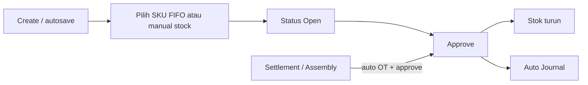
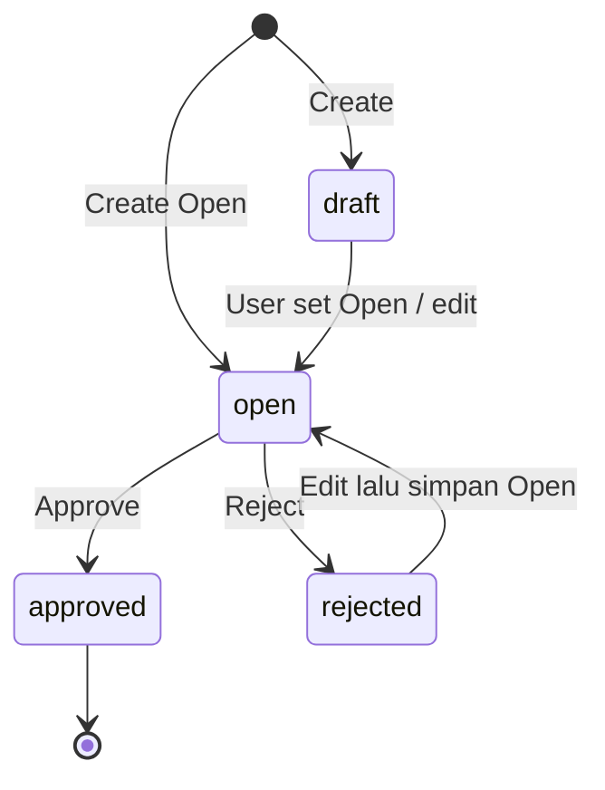
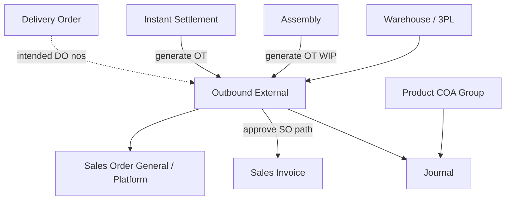

# Outbound External — Source of Truth

**Route UI:** `/supplychain/mutation-outbound` ([staging](https://staging.olshoperp.com/supplychain/mutation-outbound))  
**Kode transaksi:** prefix `OT`  
**Modul:** Supply Chain — pengeluaran stok dari gudang + jurnal persediaan

---

## 1. Ringkasan Eksekutif

**Outbound External** mencatat **pengeluaran barang dari gudang** dan menggerakkan stok serta jurnal saat approve. Ada dua tipe UI: **Sales Order** (order general/internal dari WH **3PL** saja) dan **Other** (pemakaian operasional tanpa referensi order; origin **bukan** 3PL).

Dokumen juga bisa **auto-generate + auto-approve** dari Instant Settlement atau Assembly — hasilnya **read-only** di menu ini. Approve mengurangi availability, menerbitkan jurnal (Cr Inventory; Dr COGS / Operational Expense / WIP sesuai tipe/ref).



---

## 2. Prasyarat

| Prasyarat | Sumber | Catatan |
|-----------|--------|---------|
| Privilege viewAny / create / update / delete / approval | Gate | |
| Fiscal period terbuka | Fiscal Period | Create / approve |
| Warehouse origin sesuai tipe | Master Warehouse | SO → 3PL; Other → non-3PL (filter UI) |
| Stok available di struktur origin | Item Stock | Select Product / modal / import |
| Product COA Group (Inventory + COGS atau OpEx atau WIP) | Product COA | Wajib sebelum approve (jurnal) |
| Type Sales Order: SO eligible | Sales Order | Approved/processed; jalur shipping 3PL |

---

## 3. Siklus Status

Void **belum** ada. Unapprove **bukan** fitur produksi end-user (lihat §6.7).



| Status | Editable? | Delete? | Approve? | Print / Show |
|--------|-----------|---------|----------|--------------|
| Draft | Ya | Ya | Tidak | Ya |
| Open | Ya | Ya | Ya | Ya |
| Rejected | Ya (lalu bisa Open) | Ya* | Tidak sampai Open | Ya |
| Approved | Tidak | Tidak | — | Ya |

\*Sesuai `can_update` / policy; dokumen terkait Sales Order header bisa diblok delete.

**Generate Settlement / Assembly:** langsung **Approved** → tidak masuk halaman edit.

---

## 4. Datalist

| Kontrol | Perilaku |
|---------|----------|
| Global Search | Cari lintas kolom standar |
| Advanced Filter | SearchBuilder — field & operator §4.2 |
| Create | Ke `/create`; jika ada last trx → autosave header + redirect **edit** |
| Show deleted | Soft-deleted rows |
| Column show/hide | Standar DataTables |
| Export | **With details** dan **without details** |

### 4.1 Kolom

| Kolom | Isi |
|-------|-----|
| Trx Code \| Trx Date | Kode `OT…` + tanggal |
| Building Origin | Source WH (Other: Building Origin; SO: 3PL Warehouse) |
| Description | Free text; generate: teks AS-IS §6.5 |
| Qty | Akumulasi qty detail |
| Trx Ref | SO (bisa **multi** satu OT, same origin) **atau** Assembly code (`type` Other) |
| DO Status | **AS-IS:** teks Prepared / Processed (atau `-`) dari qty DO di detail — **bukan** nomor DO. **Intended (Yemima):** nomor DO multi di header (agregat dari detail) + track per SKU di detail — GAP-OB-01 |
| Trx Status | draft / open / rejected / approved |
| Created / Updated By \| At | Audit |
| Action | Show/Edit selalu; Print selalu; Approve jika Open; Delete jika Draft/Open. Platform (`from_platform`) & POS: approve/delete/print disembunyikan di action |

### 4.2 Advanced Filter — field & operator

**Field (key UI / filter):** Trx Date, Trx Code, Product, Building Origin, Description, Qty, Trx Ref, DO Status, Trx Status, Created By/At, Updated By/At.

**Operator (shared SearchBuilder):**

| Tipe field | Operator |
|------------|----------|
| Text | equals, not equals, contains, starts with, ends with, empty, not empty |
| Date / Number | equals, not equals, &lt;, ≤, &gt;, ≥, between, not between, empty, not empty |

DO Status filter AS-IS: keyword `prepared` / `processed` (qty-based), plus empty/not empty.

---

## 5. Form & Field

### 5.1 Basic Information

| Field | Wajib | Aturan |
|-------|-------|--------|
| Transaction Code | Auto | Prefix OT |
| Transaction Date | Ya | Tidak di masa depan; fiscal period |
| Type | Ya | Radio **Sales Order** (`sales order general`) \| **Other** (`other`). Disabled setelah ada detail |
| Building Origin / 3PL Origin | Ya | Other: `is_3pl=false`, non-virtual. SO: `is_3pl=true`. Tippy: FIFO tidak ke Outrack/WIP |
| Description | Opsional | Max panjang validasi BE |

Autosave edit: perubahan type / date / warehouse origin auto-PUT. Type ganti → load default warehouse terakhir untuk tipe itu.

### 5.2 Detail — Other (Group View & Detail View)

| Kontrol | Perilaku |
|---------|----------|
| Select Product | SKU available di struktur WH origin; default qty 1; ubah qty → **single-rack fulfill / FIFO** (`is_fifo` = ya) |
| Modal Available Products | List per stock id; **Use** = manual stock id; **Bulk Use** (centang) = manual multi stock id; juga opsi FIFO fulfill |
| Import | Template Product ID, System Product SKU, Qty/Outbound Qty, Unit — jalur fulfill/FIFO; validasi §7 |
| Export detail | Sesuai datatable (bukan with/without details) |
| Group View | SKU + qty teragregasi multi stock id |
| Detail View | Per stock id + kolom **Is FIFO** |

**Contoh kasus (Yemima — wajib ke KB/UG saat split):**

SKU-PENSIL inbound 2×: 08:00 → 1.500 pcs; 10:00 → 500 pcs (= 2 stock id).  
Outbound 10:30 sebanyak **1.700**:

- Group View: SKU-PENSIL **1.700**  
- Detail View: SKU-PENSIL **1.500** + SKU-PENSIL **200**

### 5.3 Detail — Sales Order

Section detail by Sales Order: pilih SO outstanding (stok di 3PL origin), single/bulk/FIFO by SO. Multi SO dalam satu OT selama store/origin selaras (outstanding filter).

---

## 6. How It Works

### 6.1 Create & autosave

1. Create → `default-values` (warehouse_origin + type_so last OT).  
2. Ada nilai → POST header → redirect edit.  
3. Belum pernah ada OT → tidak autosave; user isi field required.

### 6.2 Tipe Sales Order vs Other

| | Sales Order | Other |
|--|-------------|-------|
| Nilai `type_so` UI | `sales order general` | `other` |
| Origin | 3PL saja | Bebas non-3PL (tidak ada opsi 3PL di dropdown) |
| Referensi | Sales Order (multi) | Opsional Assembly (generate); manual tanpa ref |
| Contoh bisnis Other | ATK masuk stok → HRD minta buku → OT Other kurangi stok | |

Filter 3PL **AS-IS** di UI select warehouse; BE store **tidak** enforce pasangan type↔3PL (GAP-OB-02).

### 6.3 FIFO vs manual (Is FIFO)

| Cara input | Metode | Is FIFO |
|------------|--------|---------|
| Select Product (+ ubah qty / fulfill) | Auto fulfill / FIFO | Ya |
| Import | Fulfill | Ya |
| Modal Use / Bulk Use (pilih stock id) | Manual stock id; edit qty terbatas stock id terpilih | Tidak |
| SO + FIFO helper | FIFO | Ya |
| SO + pilih stock id | Manual | Tidak |

### 6.4 Approve — stok & jurnal

Approve (status Open, ada detail, import tidak jalan, struktur WH valid):

1. Kurangi item stock (FIFO/manual sesuai baris).  
2. Auto journal: **Credit** Inventory (Product COA Group).  
3. **Debit:**
   - Other (bukan Assembly) → **Operational Expense**
   - Sales Order (`type_so` sales order… atau ref SO) → **COGS**
   - Ref **Assembly / WorkOrder** → **Work In Progress**
4. Conditional auto Customer Invoice jika detail ref SO Detail dan belum ada prepared/processed invoice qty.

### 6.5 Generate dari transaksi lain (read-only)

| Sumber | Description header (AS-IS) | Status |
|--------|---------------------------|--------|
| Assembly | `Auto generated from Assembly {code}` | Auto-approved |
| Instant Settlement (dari transfer) | `Auto Generated From Transfer {code}` | Auto-approved via job |

User **tidak** edit di form — langsung approved.

### 6.6 Approve manual vs block (pending discussion)

| Kasus | AS-IS |
|-------|-------|
| OT Other manual Open | Bisa Approve dari UI |
| OT Sales Order **general/internal** tanpa header ref yang memblok | Bisa Approve (sesuai pengalaman end-user) |
| Header `transaction_reference` = Sales Order / Sales Order General **dan** approve dengan authorized normal | Error: `Can't approve this data because it's related with Sales Order.` |
| `from_platform` / POS di datalist | Tombol Approve/Delete/Print disembunyikan |
| Settlement / job | Approve dengan bypass authorized |

**Pending discussion (GAP-OB-03):** kapan tepatnya block vs boleh untuk platform vs general — dokumentasikan AS-IS; keputusan bisnis belakangan.

### 6.7 Unapprove & hapus

| Jalur | Perilaku |
|-------|----------|
| End-user staging/production | **Tidak boleh unapprove.** Endpoint `un-approve` ada tapi **ditolak** kecuali env `local`/`development` (`Cannot do such action…`). Siklus berhenti di Approved karena jurnal sudah terbit |
| Instant Settlement delete/revert | **Ya** — delete settlement menghapus/revert OT generate + journal + stok (rantai DeleteSettlement) |
| Soft delete OT | Hanya sebelum approved / sesuai policy; terkait SO bisa diblok |

### 6.8 DO Status — AS-IS vs intended

**AS-IS header:** status Prepared/Processed (atau `-`) dari `prepared_to_do_quantity` / `processed_to_do_quantity` di detail — Other selalu `-`.

**Intended (Yemima):**

- Detail: track referensi DO **per SKU** (boleh multi DO per baris/agregat).  
- Header: tampilkan **semua nomor DO** yang muncul di detail (multi).  

→ GAP-OB-01.

---

## 7. Validasi

| ID | Kondisi | Pesan / behavior (AS-IS) |
|----|---------|--------------------------|
| V-OB-01 | Tanggal masa depan | Transaction date cannot be greater than today |
| V-OB-02 | Approve tanpa detail | doesn't have any detail data |
| V-OB-03 | Import sedang jalan | Updating process is in progress… |
| V-OB-04 | Approve related SO (authorized) | Can't approve… related with Sales Order |
| V-OB-05 | Delete related SO | Can't delete… related with Sales Order |
| V-OB-06 | Unapprove non-local | Cannot do such action, please contact administrator |
| V-OB-07 | Import format salah | The file format doesn't match the system template. |
| V-OB-08 | Import kosong | The imported file is empty… |
| V-OB-09 | Row import | `Row N:` Product SKU required / not found / inactive / parent / Fixed Asset / Service / Qty required / numeric / &gt; 0 / Unit required / inactive / max details / not available / whole numbers / stock |

**Template import kolom:** Product ID \| System Product SKU \| Qty atau Outbound Qty \| Unit.

---

## 8. Relasi Menu Lain



| Menu | Relasi |
|------|--------|
| Instant Settlement | Generate + approve OT 3PL; delete settlement revert OT |
| Assembly | Generate OT Other dari WIP + jurnal WIP |
| Sales Order | Referensi type SO; qty used/reserved |
| Delivery Order | Qty prepared/processed di detail OT; intended nomor DO |
| Sales Invoice | Auto generate conditional saat approve OT SO |
| Product COA Group | COA Inventory / COGS / OpEx / WIP |
| Journal | Auto journal saat approve |
| Real Time Stock / Stock History | Dampak stok |

---

## 9. Gap Registry

| ID | Deskripsi | Type | Dampak | Status |
|----|-----------|------|--------|--------|
| GAP-OB-01 | Intended: header + detail tampil **nomor DO multi**. AS-IS: status Prepared/Processed saja | Missing Behavior / Contradiction | Operator tidak lihat nomor DO di OT | Pending Decision — Yemima / improvement |
| GAP-OB-02 | Filter 3PL hanya UI; BE store tidak enforce type↔warehouse | Unverified | Bypass API bisa salah WH | Open |
| GAP-OB-03 | Block approve “related with Sales Order” vs platform vs general — AS-IS campur; perlu diskusi kapan boleh approve manual | Contradiction / Need Discussion | QA/ops bingung platform vs general | **Pending Discussion** |
| GAP-OB-04 | `un-approve` route + UI hook ada; non-local ditolak. Bisnis: tidak ada unapprove kecuali settlement delete | Resolved (dokumen AS-IS) | — | Resolved |
| GAP-OB-05 | UI radio hanya `sales order general`; platform form di-force Other | Unverified | Platform OT lewat generate, bukan radio | Open — dokumentasikan AS-IS |

---

## 10. FAQ

**Q: Kapan pakai Other vs Sales Order?**  
A: Other = pemakaian internal tanpa order (contoh ATK). Sales Order = keluarkan stok order dari gudang 3PL saja.

**Q: Kenapa Create langsung ke edit?**  
A: Autosave meniru warehouse + type transaksi terakhir. Belum pernah ada OT → isi form dulu.

**Q: Beda Group vs Detail View?**  
A: Group = total per SKU; Detail = pecahan per stock id + Is FIFO. Contoh pensil 1.700 → group satu baris, detail 1.500+200.

**Q: OT dari Settlement bisa diedit?**  
A: Tidak — sudah auto-approved.

**Q: Bisa unapprove OT approved?**  
A: Tidak di staging/production. Hapus lewat delete Instant Settlement jika OT dari settlement.

**Q: DO Status kosong / hanya Prepared?**  
A: AS-IS memang status qty, bukan nomor DO. Improvement nomor DO = GAP-OB-01.

---

## 11. Changelog

| Date | Version | Changes |
|------|---------|---------|
| 2026-10-11 | 1.0 | SOT dari penjelasan Yemima + verifikasi FE InventoryOut / BE StockMutationOutbound; contoh pensil; gap DO & approve platform |

---

## 12. Knowledge Base Hints

| Istilah | Awam |
|---------|------|
| 3PL Origin | Gudang kurir / shipping — hanya untuk type Sales Order |
| Building Origin | Gudang asal untuk type Other |
| Is FIFO | Sistem pilih batch otomatis vs user pilih stock id |
| Group View | Satu baris per SKU |
| Detail View | Pecahan per kedatangan / stock id |
| Auto generate | OT dari Settlement/Assembly — jangan diedit |

Troubleshooting: stok tidak muncul → cek WH origin & available; approve gagal related SO → GAP-OB-03; jurnal gagal → cek Product COA.

---

## 13. Technical Hints

| Area | Lokasi |
|------|--------|
| FE list/form | `olshoperp-frontend/src/pages/SCM/StockMutation/InventoryOut/` — DataList, Form, AvailableWarehouse, DatalistDetail, DatalistDetailGroup, DatalistDetailBySO |
| BE | `StockMutationOutboundController`, `StockMutationOutboundDetailController`, entity `StockMutationOutbound` |
| Import | `StockMutationOutboundImport` — 4 kolom template |
| Approve stok + SI | `ItemStockMutation::approveOutbound` |
| Jurnal | `JournalProcess::stockOutboundAutoJournal` |
| Assembly | `WorkOrderApprovalJob` |
| Settlement | `Settlement::generate` / approve jobs; `DeleteSettlementJob::deleteOutbound` |
| Unapprove | `unApprove` — hanya `local`/`development` |
| default-values | `getLatestData` warehouse_origin + type_so |
| DO status column | `delivery_order_status_formatted` → Prepared/Processed |

**Invariants:** OT = destination null, non-adjustment, non-return; Other origin non-3PL di UI; SO origin 3PL di UI; approved + journal → no production unapprove; settlement delete boleh revert OT generate.

**Failure modes:** import lock; related SO approve/delete; COA missing; stock insufficient; unapprove blocked outside local.

---

## 14. Referensi Struktur untuk Proses Split

```
Section 1-11 → material utama untuk requirement.md
Section 5, 6, 7, 10 → adaptasi ke knowledge-base.md dengan tone awam (lihat Section 12)
Section 13 Technical Hints → seed untuk technical.md, sudah pakai path/nama real
Frontmatter YAML di atas → copy ke 3 file utama (+ user-guide.md kalau gate review/final), sinkronkan version + last_updated
Golden reference tone & struktur: docs/qa-docs/accounting-supplier-invoice/
```
