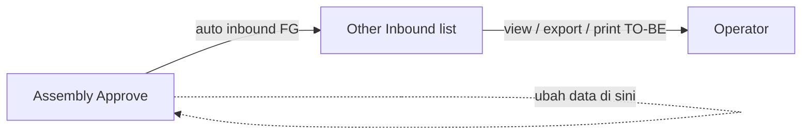
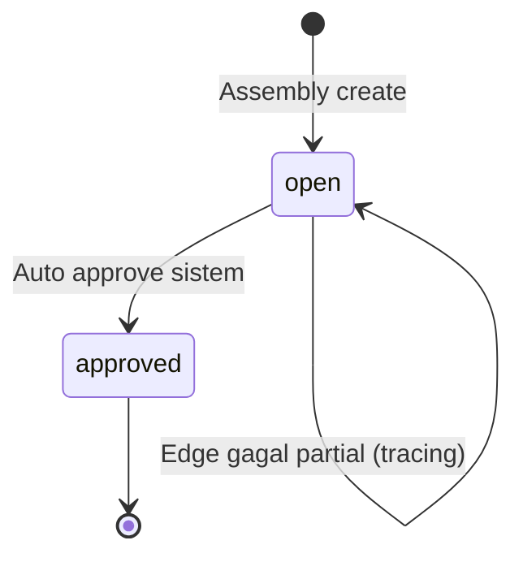
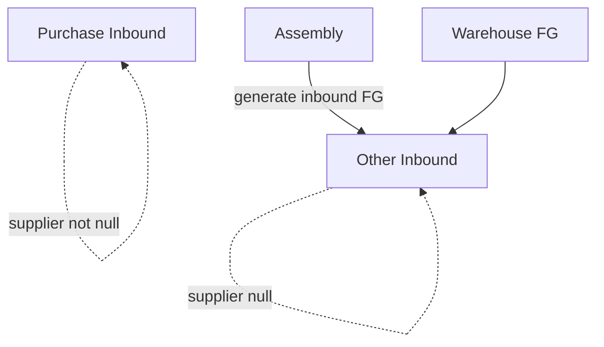

# Other Inbound — Source of Truth

**Route UI:** `/supplychain/other-inbound` ([staging](https://staging.olshoperp.com/supplychain/other-inbound))  
**Modul:** Supply Chain — daftar inbound **non-PO** (auto-generate)  
**Pasangan:** Purchase Inbound (inbound ber-supplier / dari PO)

---

## 1. Ringkasan Eksekutif

**Other Inbound** menampilkan dokumen inbound yang **bukan** dari Purchase Order — filter AS-IS: inbound dengan **supplier kosong**, destination terisi, non-adjustment, non-return. Saat ini generator yang ada hanya **Assembly** (auto-create + auto-approve finish goods). Transaksi ini **tidak muncul** di menu Purchase Inbound.

Menu ini **view / monitoring only** untuk end user: perubahan hanya di transaksi origin (Assembly). Tidak boleh create/edit/approve/delete dari sini (intended).



---

## 2. Prasyarat

| Prasyarat | Sumber | Catatan |
|-----------|--------|---------|
| Privilege view Other Inbound | Gate | |
| Assembly approved (happy path) | Assembly | Menghasilkan baris di sini |
| Finish good warehouse | Warehouse Setting | Destination inbound |

---

## 3. Siklus Status

Dokumen memakai status inbound bersama (draft / open / approved / rejected / …). Happy path Assembly: dibuat **Open** lalu langsung **Approved** oleh sistem.

Edge case: generate Assembly gagal sebagian → inbound bisa tertinggal **Open** di list (untuk tracing). **Intended:** baris Open tetap **tidak bisa** diedit / di-approve / dihapus dari menu ini — perbaikan di Assembly.



Void belum menjadi alur operasional menu ini.

---

## 4. Datalist

Mirip Purchase Inbound, tanpa kolom Supplier & Item Stock Status.

| Kontrol | Perilaku AS-IS / intended |
|---------|---------------------------|
| Global Search | Ya |
| Advanced Filter | Ya (pola SearchBuilder seperti inbound) |
| Create | **Tidak boleh** (intended). Route create masih ada di FE — leftover |
| Show deleted | Standar |
| Column show/hide | Standar |
| Export | With / without details — **hanya** baris Other Inbound (`supplier_id` null). MATCH kode |
| Bulk Delete / Bulk Approve | **Tidak boleh** (intended). AS-IS FE masih `bulk_delete` / `bulk_approve` true → **GAP-OI-01** / Jira Error |
| Row Action | Show/Edit navigasi; **tidak** delete/approve/print row (BE `render_*` false untuk print/delete/approve). Print header TO-BE → **GAP-OI-02** |

### 4.1 Kolom (AS-IS FE)

| Kolom | Catatan |
|-------|---------|
| Trx Code \| Trx Date | Kode inbound |
| Location Destination | WH finish good |
| Description | Contoh: `Auto generated from Assembly {code}` |
| Qty | Akumulasi detail |
| Trx Ref | Link **Assembly** (bukan PO) |
| Trx Status | Termasuk Open edge case |
| Created / Updated | Audit (export Created By sering "System") |

---

## 5. Form / Show (view)

Halaman show/edit: Basic Information (code, date, destination, description) — field **disabled**. Detail: Assembly Reference, SKU, Stock WH, Inbound Qty, COLLI (bila ada). Group/Detail view pola inbound.

**Intended:** tidak ada Save, tidak ada ubah detail, tidak ada Approve/Delete/Void operasional dari menu ini. Ubah hanya di **Assembly**.

**AS-IS gap:** detail masih bisa hit API `mutation-inbound-detail` jika `can_update` true (Open); `disable_inbound` FE tidak efektif — **GAP-OI-03**.

---

## 6. How It Works

### 6.1 Generator saat ini: Assembly

Saat Assembly detail approve sukses:

1. Create / reuse inbound `supplier_id` null, ref WorkOrder, description `Auto generated from Assembly {code}`.
2. Detail = finish goods (+ colli bila ada), harga dari konsumsi komponen.
3. Auto-approve sistem.

### 6.2 Isolasi vs Purchase Inbound

| Menu | Filter utama |
|------|----------------|
| Other Inbound | `supplier_id` **null** (+ flag inbound) |
| Purchase Inbound | `supplier_id` **not null** |

Satu dokumen tidak muncul di kedua menu.

### 6.3 Export

Export Other Inbound memanggil index dengan flag other → hanya ID Other Inbound. Data PI **tidak** ikut.

### 6.4 Print (TO-BE)

Wajib ada print standar setara Purchase Inbound (header document). AS-IS: row print off; endpoint `other-inbound/{id}/print` belum ada; icon print di form bisa 404 — **GAP-OI-02**.

---

## 7. Validasi / larangan (intended)

| ID | Kondisi | Behavior |
|----|---------|----------|
| V-OI-01 | User coba bulk approve/delete di Other Inbound | Tidak tersedia / ditolak |
| V-OI-02 | User coba edit/approve/delete Open atau Approved dari menu ini | Ditolak; arahkan ke Assembly |
| V-OI-03 | Export | Hanya Other Inbound |

---

## 8. Relasi Menu Lain



| Menu | Relasi |
|------|--------|
| Assembly | Origin generate + satu-satunya generator AS-IS |
| Purchase Inbound | Sibling list; data tidak overlap |
| Warehouse / Product | Destination & FG SKU |

---

## 9. Gap Registry

| ID | Deskripsi | Type | Dampak | Status |
|----|-----------|------|--------|--------|
| GAP-OI-01 | FE masih bulk delete & bulk approve; API lewat mutation-inbound tanpa guard other | Contradiction | Operator bisa hapus/approve Open OT inbound dari list | Open — [ETM-16440](https://erpintegration.atlassian.net/browse/ETM-16440) (Faisal, Highest, 2 SP) |
| GAP-OI-02 | Print standar PI belum ada di Other Inbound | Missing Behavior | Tidak bisa print dokumen | Open — [ETM-16441](https://erpintegration.atlassian.net/browse/ETM-16441) (Qudum, High, 3 SP) |
| GAP-OI-03 | Open inbound: detail masih writable via shared API; header disabled saja | Contradiction | Melanggar view-only | Open — ikut scope [ETM-16440](https://erpintegration.atlassian.net/browse/ETM-16440) |
| GAP-OI-04 | Route create/edit + breadcrumb Create masih ada | Unverified leftover | Bingungkan user | Open |

---

## 10. FAQ

**Q: Kenapa tidak ada Create?**  
A: Semua baris auto dari Assembly (atau generator non-PO nanti). Buat/ubah di origin.

**Q: Bedanya dengan Purchase Inbound?**  
A: PI dari PO + ada supplier. Other Inbound tanpa supplier; ref Assembly.

**Q: Ada status Open di list?**  
A: Boleh untuk tracing gagal generate; tetap tidak boleh diedit/approve/delete di sini.

**Q: Export ikut PI?**  
A: Tidak — hanya Other Inbound.

---

## 11. Changelog

| Date | Version | Changes |
|------|---------|---------|
| 2026-10-11 | 1.0 | SOT dari Yemima + verifikasi; view-only intended; gaps bulk/print |

---

## 12. Knowledge Base Hints

| Istilah | Awam |
|---------|------|
| Other Inbound | Daftar barang masuk **bukan** dari beli PO |
| Auto generated from Assembly | Dibuat sistem saat Assembly selesai |
| View only | Lihat & export/print saja; ubah di Assembly |

Troubleshooting: data tidak muncul → cek Assembly approve & WH FG; mau ubah qty → buka Assembly bukan menu ini.

---

## 13. Technical Hints

| Area | Lokasi |
|------|--------|
| FE | `olshoperp-frontend/src/pages/SCM/StockMutation/InventoryOther/` — DataList, Form, DatalistDetail |
| BE | `OtherInboundController` — index/show/export only (`other: true`) |
| Shared | `StockMutationInboundController::index(..., other: true)` → `whereNull(supplier_id)` |
| Generator | `WorkOrderApprovalJob` store+approve inbound other |
| Export | `OtherInboundExportJob` ← index ExportData other |
| Print PI ref | `mutation-inbound/{id}/print` — Other belum punya mirror |

**Invariants:** PI ∩ Other Inbound = ∅ pada `supplier_id`; export Other ⊆ supplier null; intended no mutate from this menu.

**Failure modes:** bulk/detail mutate via shared inbound APIs; missing print route.

---

## 14. Referensi Struktur untuk Proses Split

```
Section 1-11 → material utama untuk requirement.md
Section 5, 6, 7, 10 → adaptasi ke knowledge-base.md dengan tone awam (lihat Section 12)
Section 13 Technical Hints → seed untuk technical.md, sudah pakai path/nama real
Frontmatter YAML di atas → copy ke 3 file utama (+ user-guide.md kalau gate review/final), sinkronkan version + last_updated
Golden reference tone & struktur: docs/qa-docs/accounting-supplier-invoice/
```
