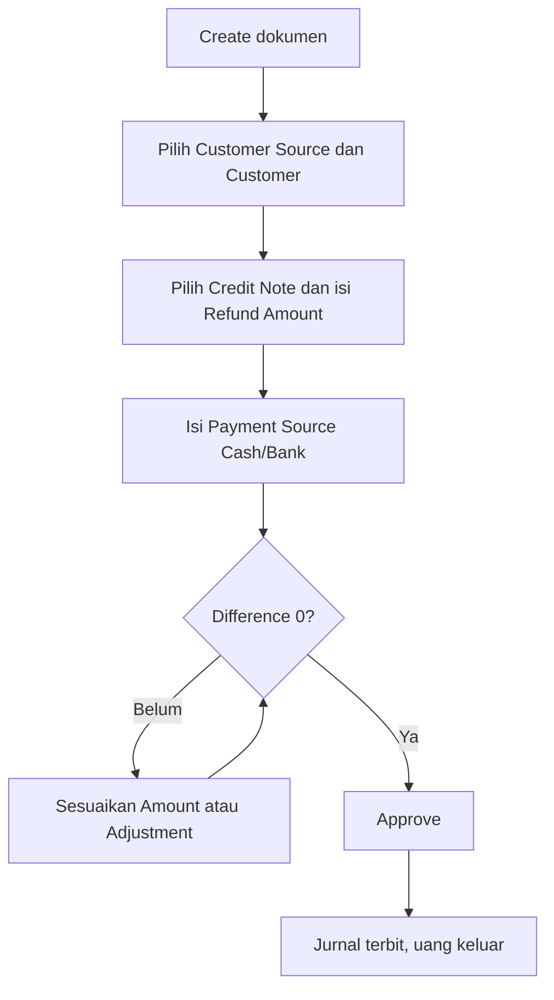

# Credit Note Refund — Knowledge Base (Operator)

**Audience:** Finance, AR clerk, Operations support  
**Route:** `/accounting/credit-note-refund`

---

## 1. Apa itu Credit Note Refund?

Credit Note Refund dipakai saat customer meminta **uang sisa Credit Note dikembalikan** ke rekeningnya. Uang keluar dari Cash/Bank perusahaan, dan sisa Credit Note berkurang sebesar uang yang dikembalikan.

**Kode transaksi:** diawali `CNR`.

Sisa Credit Note bisa diselesaikan dengan dua cara:

| Cara | Menu |
|------|------|
| Dipotongkan ke tagihan customer | Account Receive |
| Dikembalikan dalam bentuk uang | Credit Note Refund |

Keduanya memakai **sisa yang sama**. Kalau sebagian sudah dipakai di Account Receive, yang bisa di-refund otomatis tinggal sisanya, dan sebaliknya.

---

## 2. Kapan dipakai?

| ✅ Pakai jika | ❌ Jangan pakai jika |
|---------------|----------------------|
| Customer minta uang sisa Credit Note ditransfer balik | Sisa Credit Note mau dipotongkan ke tagihan → pakai Account Receive |
| Customer marketplace (store platform) punya Credit Note yang harus dikembalikan | Credit Note belum di-approve |

---

## 3. Alur kerja standar

**Keterangan langkah:**
- **Create:** dokumen baru langsung berstatus Open. Currency otomatis IDR dan rate 1; ubah bila refund dalam mata uang lain.
- **Customer Source:** pilih **General** untuk customer biasa, **Platform** untuk store marketplace. Setelah ada Credit Note di detail, customer, currency, rate, dan tanggal tidak bisa diganti. Hapus dulu semua baris Credit Note kalau perlu mengganti.
- **Pilih Credit Note:** lewat **Select Credit Note** atau **Available Credit Note** (bisa pilih banyak lalu **Use**). Yang muncul hanya Credit Note customer itu yang sudah Approved, mata uangnya sama, tanggalnya tidak lebih dari tanggal refund, dan masih ada sisanya. Refund Amount otomatis terisi sisa penuh; ubah bila hanya sebagian.
- **Begitu Credit Note masuk detail, sisanya langsung terpakai (dipesan)**, walau dokumen belum di-approve. Orang lain di Account Receive tidak bisa memakai bagian itu.
- **Payment Source:** pilih Cash/Bank asal uang. Sistem menolak kalau saldo rekening tidak cukup.
- **Adjustment (opsional):** untuk biaya transfer atau potongan.
- **Approve:** sistem mengecek ulang sisa Credit Note dan saldo Cash/Bank, lalu jurnal terbit.

---

## 4. Membaca angka

| Tempat | Arti |
|--------|------|
| Remaining Balance (di detail dan datalist Credit Note) | Sisa Credit Note yang masih bisa dipakai |
| Used Status → Prepared | Sedang dipesan dokumen yang belum di-approve (Account Receive atau Refund) |
| Used Status → Processed | Sudah terpakai final (dokumen Approved) |
| Summary → Difference | Harus 0 sebelum Approve |
| Total Amount (datalist refund) | Uang yang keluar dari Cash/Bank |

**Uang keluar = total Refund Amount + Adjustment Debit − Adjustment Credit.**

Contoh: refund 900.000, biaya transfer ditanggung perusahaan 6.500 (Debit), biaya admin dipotong dari customer 5.000 (Credit). Cash/Bank yang diisi = 901.500.

---

## 5. Status yang perlu kamu kenali

| Status | Arti | Sisa Credit Note |
|--------|------|------------------|
| Open | Siap di-approve | Dipesan |
| Draft | Masih disiapkan | Dipesan |
| Rejected | Ditolak approver; bisa diperbaiki | Tetap dipesan |
| Approved | Selesai, jurnal terbit | Terpakai final |

Tombol Void belum ada. Dokumen Approved tidak bisa diubah atau dihapus.

---

## 6. Troubleshooting

| Gejala | Penyebab | Solusi |
|--------|----------|--------|
| "Entered amount exceeds the remaining Credit Note balance." | Refund Amount lebih besar dari sisa | Kecilkan nilainya. Cek di Credit Note siapa yang memesan sisa (Detail Related Transaction) |
| Credit Note tidak muncul di daftar | Belum Approved, beda customer, beda mata uang, tanggal Credit Note setelah tanggal refund, atau sisa sudah 0 | Cek kelima hal itu |
| "… is still being used in other transaction, please try again later" | User lain sedang memakai Credit Note yang sama | Tunggu sebentar lalu ulangi |
| "There is no available balance or insufficient funds …" | Saldo Cash/Bank tidak cukup (atau sudah dipesan transaksi lain) | Pilih rekening lain atau tunggu dana masuk |
| Approve ditolak soal saldo padahal tadi lolos | Ada transaksi lain yang mengeluarkan uang dari rekening sama | Cek saldo lalu sesuaikan |
| "Approval Failed. Total Payment Source must be equal to Total Payment Detail." | Difference belum 0 | Samakan Cash/Bank dengan Refund + Adj Debit − Adj Credit |
| "Cannot edit Header when detail data exists…" | Mengganti customer/currency/tanggal saat sudah ada Credit Note | Hapus semua baris Credit Note dulu |
| Sisa Credit Note tidak kembali setelah Reject | Rejected tetap memesan sisa | Hapus baris/dokumen, atau perbaiki lalu Approve |
| Tombol Print memunculkan "still under development" | Cetakan belum tersedia | Belum ada solusi; perbaikan sudah terdaftar |

---

## 7. FAQ

**Kenapa Credit Note tanggal hari ini bisa di-refund tapi tidak muncul di Account Receive?**  
Refund boleh memakai Credit Note bertanggal sama dengan tanggal refund. Account Receive hanya menampilkan Credit Note bertanggal sebelum tanggal penerimaan.

**Bisa refund ke customer marketplace?**  
Bisa. Pilih Customer Source **Platform**, lalu pilih store-nya. Yang muncul hanya Credit Note milik store itu.

**Bisa refund sebagian lalu sisanya dipakai di Account Receive?**  
Bisa. Contoh: Credit Note 1.000.000, refund 300.000 → sisa 700.000 masih bisa dipakai Account Receive atau refund lain.

**Satu dokumen boleh berisi banyak Credit Note?**  
Boleh, asal customer dan mata uangnya sama.

**Kalau refund dalam USD?**  
Pilih currency USD dan isi kurs. Hanya Credit Note dan Cash/Bank USD yang muncul. Selisih kurs antara Credit Note dan refund dicatat otomatis.

---

## Related Documents

- [requirement.md](./requirement.md) — aturan lengkap
- [technical.md](./technical.md) — developer
- [user-guide.md](./user-guide.md) — panduan pengguna
- [Credit Note KB](../accounting-credit-note/knowledge-base.md)
