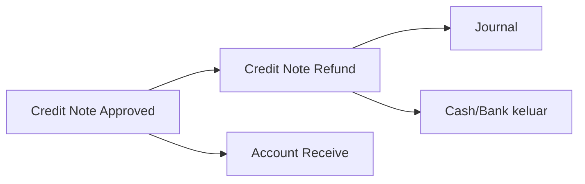
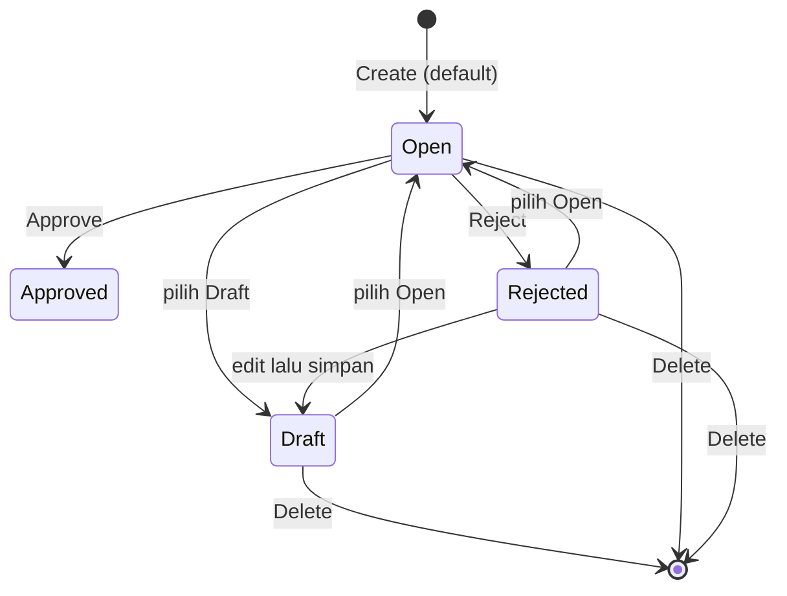
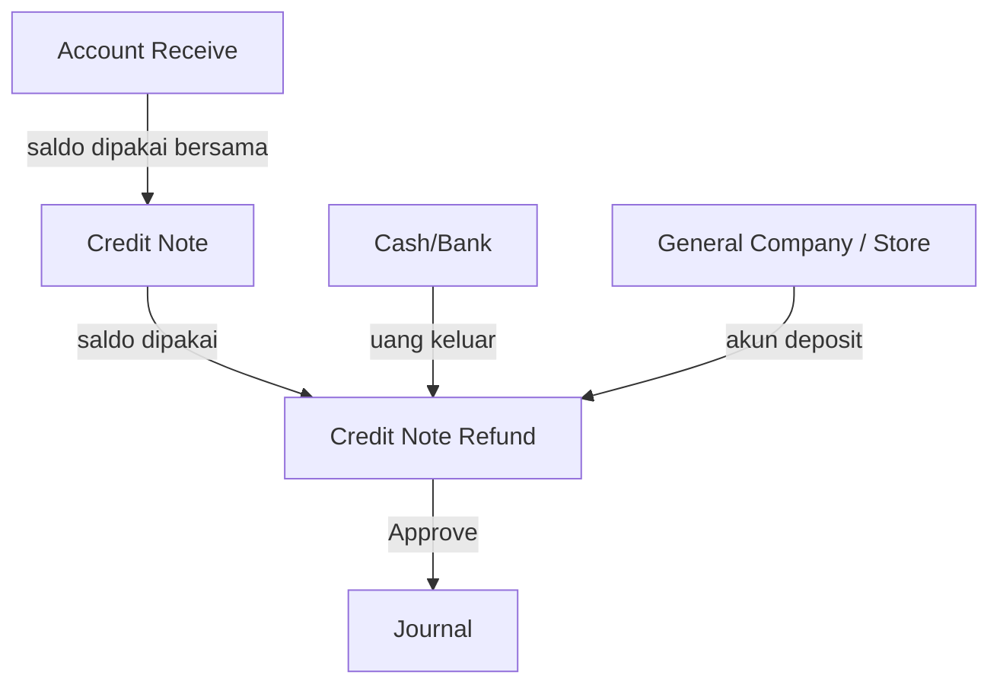

# Credit Note Refund — Requirement Documentation

**Modul:** Finance & Accounting / Account Receivable  
**Prefix:** `CNR`  
**Audience:** PM, Finance, QA  
**UI route:** `/accounting/credit-note-refund`  
**Origin:** [ETM-17655](https://erpintegration.atlassian.net/browse/ETM-17655) (keputusan G1–G17, 23–24 Nov 2026) · **[ETM-17829](https://erpintegration.atlassian.net/browse/ETM-17829)** (Exchange Gain UI + konsistensi jurnal AP)

Upstream: [Credit Note](../accounting-credit-note/requirement.md) · Saldo dipakai bersama: [Account Receive](../accounting-customer-payment/requirement.md) · Kembaran sisi supplier: [Debit Note Refund](../accounting-debit-note-refund/requirement.md)

---

## 0. Metadata & Changelog

| Version | Date | Author | Changes |
|---------|------|--------|---------|
| 1.1 | 2026-11-27 | QA - Yemima | **TO-BE** [ETM-17829](https://erpintegration.atlassian.net/browse/ETM-17829): kolom/summary **Exchange Gain**; rumus & sisi jurnal selisih kurs konsisten konsep Account Payment |
| 1.0 | 2026-11-26 | QA - Yemima | Dokumen awal dari keputusan ETM-17655 + kode dev (PR refund, 26 Nov 2026) |

---

## 1. Ringkasan Eksekutif

Credit Note Refund (CNR) mengembalikan **uang** sisa saldo Credit Note (CN) ke customer lewat Cash/Bank. Sebelum menu ini ada, saldo CN hanya bisa dihabiskan sebagai deposit di Account Receive (AR). Sekarang satu CN bisa diselesaikan lewat AR, lewat Refund, atau sebagian di masing-masing.

Saldo CN **satu dan dipakai bersama**: begitu CN masuk detail AR atau detail Refund, saldo yang bisa dipakai pihak lain langsung berkurang. Uang **keluar** dari Cash/Bank, jadi saldo Cash/Bank dicek seperti Account Payment.

| Aspek | Aturan singkat |
|-------|----------------|
| Pihak | Customer **General** (General Company customer) atau **Platform** (store bertipe platform) |
| Isi dokumen | Banyak CN milik satu customer, satu currency, boleh sebagian |
| Uang | Keluar dari Cash/Bank (section **Payment Source**) |
| Jurnal Approve | Debit deposit sesuai asal CN, Kredit Cash/Bank (+ Adjustment, + selisih kurs) |
| Void | Belum tersedia (pending diskusi end user) |

### 1.1 Rantai proses



---

## 2. Prasyarat

| Prasyarat | Sumber | Catatan |
|-----------|--------|---------|
| CN berstatus Approved dengan Remaining Balance lebih dari 0 | Credit Note | Milik customer yang sama, currency sama |
| Customer aktif dan COA lengkap | General Company / Store | Platform: store bertipe platform |
| Akun deposit terisi | Setting company/customer/store | Customer's Deposit, Deposit of Sales Return, deposit store |
| Cash/Bank aktif untuk currency dokumen | Master Cash Bank | Tanpa Cash/Bank currency itu, header tidak bisa disimpan |
| Saldo Cash/Bank cukup | General Ledger | Dicek saat isi Payment Source dan saat Approve |
| Fiscal period terbuka; Cash/Bank belum terkunci rekonsiliasi | Fiscal Period, Cash/Bank Reconcile | Dicek saat Approve |
| Exchange Diff. COA terisi (bila valas) | Setting company | Untuk selisih kurs |

---

## 3. Siklus Status



| Status | Saldo CN | Jurnal | Bisa diedit | Tombol |
|--------|----------|--------|-------------|--------|
| **Open** (default saat create) | Prepared | Tidak | Ya | Save All, Approve, Delete |
| **Draft** | Prepared | Tidak | Ya | Save All, Delete |
| **Rejected** | Prepared (setara Draft/Open) | Tidak | Ya | Save All, Delete |
| **Approved** | Processed | Ya | Tidak (Show) | — |

- Approve/Reject hanya dari Open. Approval satu level.
- **Reject** hanya mengubah status + log; tidak menerbitkan jurnal dan tidak memindah saldo (selaras perbaikan ETM-17620).
- **Void** belum ada (G5/G8/G14 pending).
- Rejected yang diedit kembali ke Draft (atau Open bila user memilih Open). [VERIFY: CODEBASE] — status mengikuti pilihan radio di sidebar saat Save All.

---

## 4. Datalist

| Kolom | Keterangan |
|-------|------------|
| Trx. Code / Trx. Date | Prefix `CNR`, link edit |
| Customer | Nama customer atau store |
| Credit Note | Kode CN di detail, bisa diklik ke CN |
| Curr. / Rate | Header |
| Total Amount | Total Refund + Adj Debit − Adj Credit (= uang keluar seharusnya); diperbarui setiap detail/Adjustment berubah |
| Trx. Status | Draft / Open / Rejected / Approved |
| Journal | Kode jurnal setelah Approve |
| Created By / Created At | Audit |
| Action | Edit + Delete (Draft/Open/Rejected); Show (Approved) |

Fitur datalist: find something, Advanced Filter, Show deleted data, Columns Show/Hide, Export, tombol **Create** kanan atas.

---

## 5. Form & Field

Halaman penuh (bukan modal). Section: Basic Information → Detail Credit Note Refund → Payment Source → Adjustment → Summary → Approval → Audit Log.

### 5.1 Basic Information

| Field | Wajib? | Default | Validasi / catatan |
|-------|--------|---------|--------------------|
| Transaction Code | Tidak | Otomatis `CNR…` | Max 50 |
| Transaction Date | Ya | Hari ini | Fiscal period terbuka |
| Customer Source | Ya | General | Radio **General** / **Platform** |
| Customer / Store | Ya | — | General: General Company customer. Platform: store bertipe platform. Pesan kosong: "The customer field is required." |
| Reference Doc | Tidak | — | Max 150 |
| Transaction Currency | Ya | Primary (IDR) | Harus ada Cash/Bank aktif untuk currency itu |
| Exchange Rate | Ya | 1 | Angka, min 0 |
| Description | Tidak | — | Max 150 |
| Attachment | Tidak | — | Ekstensi standar upload |

**Field terkunci** setelah ada CN di detail: Customer Source, Customer/Store, Currency, Exchange Rate, Transaction Date. Pesan: "Cannot edit Header when detail data exists. Please clear all details first."

### 5.2 Detail Credit Note Refund

Tambah lewat dropdown **Select Credit Note** atau tombol **Available Credit Note** (Use per baris / pilih banyak lalu Use).

| Kolom | Keterangan |
|-------|------------|
| Credit Note Code / Date | Link ke CN |
| Trx. Ref | Asal CN (SR-…, AR-…, atau kosong) |
| Total Amount | Total CN |
| Used Status | Prepared / Processed CN saat ini |
| Remaining Balance | Sisa CN yang masih bisa dipakai (tooltip di judul) |
| Refund Amount | Bisa diedit; default = Remaining Balance saat Use |
| **Exchange Gain** (IDR) | **TO-BE** [ETM-17829](https://erpintegration.atlassian.net/browse/ETM-17829): setelah Refund Amount; pola kolom **EXCHANGE GAIN** Account Payment (`exchange_gain_formatted`). Lihat §6.8 |
| GL Account | Akun deposit yang akan didebit (sesuai asal CN, §6.5) |

### 5.3 Payment Source

Cash/Bank tujuan uang keluar. Pilih lewat **Select Cash/Bank** (hanya Cash/Bank dengan currency dokumen). Kolom: Bank Account / Bank Name, GL Account, Currency, Amount.

### 5.4 Adjustment

Sama dengan Adjustment Account Receive: Select Account, Debit, Credit, Description. Posisi uang mengikuti Account Payment (§6.4).

### 5.5 Summary

| Baris | Isi |
|-------|-----|
| Credit Note | Total Refund Amount |
| Adj Debit | Total Adjustment Debit |
| Adj Credit | Total Adjustment Credit |
| Payment Source | Total Cash/Bank |
| **Exchange Gain** (IDR) | **TO-BE** ETM-17829: total selisih kurs IDR bila currency **bukan** primary; **informasi saja** — **tidak** masuk hitungan Difference. Currency primary → baris disembunyikan |
| Difference | (Credit Note + Adj Debit − Adj Credit) − Payment Source; harus 0 untuk Approve (tetap dalam currency dokumen) |

---

## 6. How It Works

### 6.1 CN yang bisa dipilih

CN muncul di daftar dan diterima saat Use bila **semua** terpenuhi:
- Status CN Approved.
- Currency CN = currency dokumen refund.
- Tanggal CN **kurang dari atau sama dengan** tanggal refund.
- Customer CN = customer/store dokumen (Customer Source Platform: CN yang customer-nya store tersebut).
- Remaining Balance lebih dari 0.

Contoh tanggal: refund tanggal 22 Nov tidak menampilkan CN tanggal 23 Nov; refund tanggal 23 Nov menampilkan CN tanggal 23 Nov.

Beda dengan AR: daftar CN di AR memakai tanggal CN **sebelum** tanggal AR (tanggal sama tidak muncul).

### 6.2 Saldo CN dipakai bersama AR dan Refund

```
Remaining Balance = Total CN − Prepared − Processed
Prepared  = CN yang ada di detail AR / Refund belum Approved (Draft, Open, Rejected)
Processed = CN yang dipakai AR / Refund Approved
```

- CN masuk detail Refund (status apa pun) → Prepared naik sebesar Refund Amount.
- Ubah Refund Amount → Prepared ikut selisihnya.
- Hapus baris / hapus dokumen → Prepared dilepas.
- Approve → Prepared pindah ke Processed.
- Aturan sama dengan AR, dan sama dengan saldo piutang SI yang langsung berkurang saat masuk detail AR.

**Contoh (ETM-17655):** CN-A total 1.000.000; AR Approved 400.000; AR Open 250.000 → Remaining Balance 350.000. Refund menyimpan 300.000 → Remaining Balance 50.000. AR baru yang mencoba memakai 100.000 dari CN-A ditolak.

### 6.3 Dua user bersamaan

Saat CN dipakai (AR atau Refund), sistem mengunci CN itu ±30 detik dan mengecek sisa saldo. Permintaan kedua di saat yang sama ditolak ("… is still being used in other transaction, please try again later") atau ditolak karena saldo tidak cukup. Saat Approve, baris CN dikunci lagi dan dicek ulang (CN masih memenuhi §6.1, Prepared cukup, Remaining Balance tidak minus). Rujukan: [ETM-17657](https://erpintegration.atlassian.net/browse/ETM-17657).

### 6.4 Uang keluar dan Adjustment

```
Payment Source wajib = Total Refund + Adj Debit − Adj Credit
```

Rumus mengikuti Account Payment karena uang keluar.

**Contoh:** refund 900.000; Debit biaya transfer ditanggung perusahaan 6.500; Credit biaya admin dipotong dari customer 5.000 → Payment Source 901.500.

### 6.5 Akun deposit per baris CN

| Asal CN | Customer General | Customer Platform (store) |
|---------|------------------|---------------------------|
| Dari Sales Return Billed | Deposit of Sales Return (customer, fallback company) | Deposit of Sales Return COA store |
| Lainnya (manual, kelebihan bayar AR) | Customer's Deposit COA customer | Customer's Deposit COA store |

Setting kosong → baris ditolak dengan pesan "Please configure …".

### 6.6 Cek saldo Cash/Bank

Saat Payment Source diisi dan saat Approve: ditolak bila saldo tersedia lebih kecil sama dengan 0, atau saldo tersedia dikurangi saldo yang dipesan transaksi lain lebih kecil dari Amount. Saat Approve, nilai dokumen ini sendiri tidak dihitung sebagai pesanan lain.

Pesan: "There is no available balance or insufficient funds in the selected bank/cash account. Available fund in this account: … Reserved/booked fund in this account: …"

### 6.7 Jurnal saat Approve

| Sisi | Akun | Nilai |
|------|------|-------|
| Debit | Akun deposit tiap baris CN (§6.5) | Refund Amount (kurs CN) |
| Debit / Kredit | Akun Adjustment | Sesuai isian |
| Kredit | Akun Cash/Bank Payment Source | Amount (kurs dokumen) |
| Debit / Kredit | Exchange Diff. COA | Selisih kurs CN vs dokumen (valas) — §6.8 |

Jurnal langsung Approved, tanggal = tanggal refund, deskripsi header jurnal `"Auto-Journal from Credit Note Refund: {kode}"`. Store (Platform) ikut ditandai di jurnal. Debit harus sama dengan Kredit; jika tidak, Approve gagal ("Credit Note Refund journal is not balanced.").

**Contoh jurnal (IDR / tanpa selisih kurs):**

| Akun | Debit | Kredit |
|------|------:|-------:|
| Customer's Deposit (CN manual) | 300.000 | |
| Deposit of Sales Return (CN dari SR) | 600.000 | |
| Bank Charges (Adj Debit) | 6.500 | |
| Pendapatan Lain-lain (Adj Credit) | | 5.000 |
| Bank BCA (Payment Source) | | 901.500 |
| **Total** | **906.500** | **906.500** |

### 6.8 Selisih kurs / Exchange Gain (TO-BE · ETM-17829)

CNR = uang **keluar**, konsep sama **Account Payment**.

| Item | Aturan |
|------|--------|
| Rumus per baris CN | `exchange_gain_local_currency = (Exchange Rate refund − Exchange Rate CN) × Refund Amount valas` (hasil IDR) |
| Minus | Laba kurs → **Kredit** Exchange Diff. COA |
| Plus | Rugi kurs → **Debit** Exchange Diff. COA |
| Akun | Satu sumber: setting company **"Exchange Diff. COA"** (sama AP/AR). Tidak dipisah Laba/Rugi Kurs |
| Currency primary (IDR) | Selisih selalu 0; kolom detail tampil 0; baris Summary Exchange Gain disembunyikan; tidak ada baris selisih di jurnal |
| Rate sama dengan CN | Selisih 0; tidak ada baris selisih di jurnal |
| Setting kosong (valas) | Approve ditolak: `Please Configure Company "Exchange Diff. COA"` |
| Keterangan baris jurnal selisih | `"Auto-Journal from Differential Rate Credit Note Refund: {kode CNR}. Customer Name: {nama customer/store}"` |
| UI | Kolom **Exchange Gain** setelah Refund Amount; footer/total detail = Summary; tidak mengubah Difference |

**Contoh valas:** CN USD 100 kurs 15.500 (Rp 1.550.000) di-refund kurs 16.000 (Rp 1.600.000). Selisih = (16.000 − 15.500) × 100 = **+50.000** → rugi kurs.

| Akun | Debit | Credit |
|------|------:|-------:|
| Akun deposit asal CN | 1.550.000 | 0 |
| Exchange Diff. COA (rugi kurs) | 50.000 | 0 |
| Cash/Bank (USD) | 0 | 1.600.000 |

---

## 7. Validasi

### 7.1 Header

| # | Kondisi | Pesan |
|---|---------|-------|
| 1 | Customer kosong | The customer field is required. |
| 2 | Tidak ada Cash/Bank aktif untuk currency | Cannot update transaction. Please set up a cash/bank account for this currency first. |
| 3 | Di luar fiscal period | Pesan fiscal period |
| 4 | Ubah field kritikal saat ada detail | Cannot edit Header when detail data exists. Please clear all details first. |
| 5 | Edit dokumen Approved | This payment and it's properties already approved, you can't modify this data anymore. |

### 7.2 Detail Credit Note

| # | Kondisi | Pesan |
|---|---------|-------|
| 1 | CN tidak memenuhi §6.1 | The selected Credit Note is not available for this refund. |
| 2 | Refund Amount melebihi Remaining Balance | Entered amount exceeds the remaining Credit Note balance. |
| 3 | CN sama dua kali | Credit Note already added. Please select a different Credit Note. |
| 4 | CN sedang dipakai transaksi lain | {kode} is still being used in other transaction, please try again later |
| 5 | Akun deposit belum diset | Please configure … (nama akun) |

### 7.3 Payment Source

| # | Kondisi | Pesan |
|---|---------|-------|
| 1 | Saldo Cash/Bank tidak cukup | There is no available balance or insufficient funds … |
| 2 | Cash/Bank terkunci rekonsiliasi | Pesan rekonsiliasi Cash/Bank |

### 7.4 Approve

| # | Kondisi | Pesan |
|---|---------|-------|
| 1 | Tidak ada detail CN | This payment doesn't have any credit note detail data. |
| 2 | Payment Source kosong | Complete the payment source section to approve this transaction. |
| 3 | Difference ≠ 0 (toleransi 0,01) | Approval Failed. Total Payment Source must be equal to Total Payment Detail. |
| 4 | Saldo Cash/Bank tidak cukup | There is no available balance or insufficient funds … |
| 5 | CN tidak lagi memenuhi §6.1 | Credit Note {kode} is no longer available for this refund. |
| 6 | Prepared CN kurang dari Refund Amount | Prepared amount for {kode} is insufficient. |
| 7 | Sisa CN jadi minus | Used credit note amount exceed remaining {kode} amount |
| 8 | Fiscal period / rekonsiliasi | Pesan fiscal / rekonsiliasi |
| 9 | Approve bersamaan | Approval process in progress |
| 10 | Exchange Diff. COA kosong (valas) | Please Configure Company "Exchange Diff. COA" |

### 7.5 Delete

Draft / Open / Rejected boleh; Approved tidak. Delete melepas semua Prepared CN.

---

## 8. Relasi Menu Lain



| Menu | Peran |
|------|-------|
| Credit Note | Sumber saldo; datalist menampilkan Paid, Used Status, Remaining Balance yang ikut menghitung Refund; Related Transaction menampilkan baris Refund |
| Account Receive | Pemakai saldo CN yang sama (Prepared/Processed bersama) |
| Journal / General Ledger / Trial Balance | Jurnal Approve |
| Cash/Bank Reconcile | Refund = uang keluar; Approve ditolak di periode terkunci |
| General Company / Store | Akun deposit |
| Debit Note Refund | Kembaran sisi supplier |

---

## 9. Gap Registry

| ID | Deskripsi | Dampak | Status |
|----|-----------|--------|--------|
| GAP-CNR-01 | Void Credit Note Refund belum ada | Kesalahan refund Approved belum bisa dibatalkan dari layar | Pending — belum dibahas end user |
| GAP-CNR-02 | Tombol Print ada, tapi menampilkan "This feature is still under development…" | Belum ada cetakan bukti refund | Open |
| GAP-CNR-03 | Import refund belum ada | Input satu per satu | Di luar lingkup ETM-17655 |
| GAP-CNR-04 | Aturan tanggal Refund (≤) berbeda dengan AR (<) | CN tanggal sama bisa di-refund tapi tidak bisa dipakai AR | Open — keputusan apakah AR disamakan |
| GAP-CNR-05 | Kolom/Summary Exchange Gain + keterangan jurnal Differential Rate | Layar belum menampilkan selisih kurs (hitung/jurnal BE sudah ada) | **Open (TO-BE)** [ETM-17829](https://erpintegration.atlassian.net/browse/ETM-17829) |

---

## 10. FAQ

**Q: Kenapa Remaining Balance CN langsung berkurang padahal refund belum di-Approve?**  
A: Begitu CN masuk detail (AR atau Refund), saldonya dipesan supaya tidak dipakai dua kali. Hapus baris atau dokumen untuk melepas.

**Q: Refund di-Reject, apakah saldo CN kembali?**  
A: Tidak otomatis. Rejected setara Draft/Open: saldo tetap dipesan, tanpa jurnal. Edit lalu Approve lagi, atau hapus dokumen untuk melepas saldo.

**Q: CN tanggal hari ini tidak muncul di Account Receive tapi muncul di Refund?**  
A: Benar. AR memakai tanggal CN sebelum tanggal AR; Refund memakai kurang dari atau sama dengan.

**Q: Approve ditolak karena saldo bank, padahal saat isi Payment Source lolos?**  
A: Saldo dicek ulang saat Approve. Ada transaksi lain yang mengeluarkan uang dari rekening yang sama di antaranya.

**Q: Bisa refund untuk customer marketplace?**  
A: Bisa. Pilih Customer Source **Platform**, lalu store bertipe platform. Yang muncul hanya CN yang customer-nya store tersebut.

**Q: Bisa refund sebagian?**  
A: Bisa. Sisa CN tetap bisa dipakai AR atau refund lain.

**Q: Kenapa tidak ada tombol Void?**  
A: Void belum tersedia (GAP-CNR-01).

**Q: Apa arti kolom Exchange Gain di refund valas?**  
A: Selisih kurs dokumen refund vs kurs CN, dalam IDR: `(rate refund − rate CN) × amount`. Plus = rugi kurs; minus = laba kurs. Tidak mengubah Difference Summary (§6.8 / ETM-17829).
