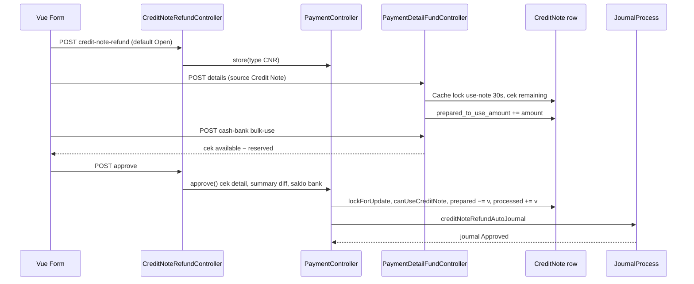

# Credit Note Refund — Technical Documentation

**API prefix:** `accounting/credit-note-refund`  
**Module:** `Modules/Accounting`  
**Behavior SoT:** [requirement.md](./requirement.md) v1.1  
**Origin:** [ETM-17655](https://erpintegration.atlassian.net/browse/ETM-17655) · kode: PR `refund` (BE #6846, FE #4580) + fix `2d9c01733` (match by customer source) · **TO-BE UI Exchange Gain:** [ETM-17829](https://erpintegration.atlassian.net/browse/ETM-17829)

---

## 1. File Map

### Backend

| Layer | Path |
|-------|------|
| Routes | `Modules/Accounting/Routes/api.php` (group `credit-note-refund`) |
| Controller header | `Modules/Accounting/Http/Controllers/CreditNoteRefundController.php` (delegasi ke `PaymentController`) |
| Controller detail CN + Cash/Bank | `Modules/Accounting/Http/Controllers/CreditNoteRefundDetailController.php` (delegasi ke `PaymentDetailFundController`) |
| Controller adjustment | `Modules/Accounting/Http/Controllers/CreditNoteRefundAdjustmentController.php` (delegasi ke `PaymentDetailAdjustmentController`) |
| Entity | `Modules/Accounting/Entities/CreditNoteRefund.php` (extends `Payment`, `code_identifier = CNR`, `canUseCreditNote()`) |
| Scope | `Modules/Accounting/Entities/Scopes/CreditNoteRefundScope.php` (`type = Credit Note Refund`) |
| Policy | `Modules/Accounting/Policies/CreditNoteRefundPolicy.php` |
| Summary helper | `app/Helpers/Accounting/NoteRefundAmount.php` (`creditNote()`) |
| Total | `app/Helpers/Accounting/PaymentPrice.php` (`totalDetailAfterVat`, `grandTotalPriceAfterVat` cabang refund) |
| Journal | `app/Helpers/Accounting/JournalProcess.php` → `creditNoteRefundAutoJournal()` → `noteRefundAutoJournal()` |
| Menu seeder | `Modules/Gate/Database/Seeders/ModuleMenu/AccountingMenuSeeder.php` (menu `Credit Note Refund`, approval 1 level) |

### Frontend (`olshoperp-frontend`)

| Layer | Path |
|-------|------|
| List | `src/pages/Accounting/CreditNoteRefund/DataList.vue` |
| Form (dipakai juga DN Refund via `refundType`) | `src/pages/Accounting/CreditNoteRefund/Form.vue` |
| Detail CN | `RefundDetails.vue` |
| Cash/Bank | `PaymentSource.vue` |
| Adjustment | `Adjustment.vue` |
| Summary | `Summary.vue` |
| Approval log | `ApprovalHistory.vue` |

---

## 2. API Routes

| Method | Path | Action |
|--------|------|--------|
| GET/POST | `accounting/credit-note-refund` | Index / Store |
| GET/PUT/DELETE | `…/{id}` | Show / Update / Destroy |
| POST | `…/{id}/approve` | Approve / Reject |
| PATCH | `…/{id}/transaction-status` | Ganti Draft/Open |
| GET | `…/{id}/summary` | Summary (`NoteRefundAmount::creditNote`) |
| GET | `…/{id}/details` · `…/available-credit-notes` · `…/select2-available-credit-notes` | Detail CN / daftar CN tersedia |
| POST | `…/{id}/details` · `…/details/bulk` | Use satu CN / Use banyak (clearing sisa penuh) |
| PUT/DELETE | `…/{id}/details/{detail}` | Ubah / hapus baris CN |
| GET/POST | `…/{id}/cash-bank-account` · `…/cash-bank-account/bulk-use` | Daftar / Use Cash/Bank |
| CRUD | `…/{id}/adjustments` | Adjustment |
| GET | `select2-customer`, `select2-currency`, `select2-cash-bank`, `select2-adjustment-account`, `default-values`, `approval-eligibility/{id}`, `{id}/audit`, `{id}/log/approve` | Lookup & audit |

---

## 3. Database — Key Tables

| Table | Role |
|-------|------|
| `accounting_payments` | Header (`type = Credit Note Refund`), `grand_total` = uang keluar |
| `accounting_payment_detail_deposits` | Baris CN (`deposit_id` = CN, `coa_id` = akun deposit, `exchange_gain_local_currency`) |
| `accounting_payment_detail_funds` | Payment Source (`type = Cash/Bank`) |
| `accounting_payment_detail_adjustments` | Adjustment debit/credit |
| `accounting_payments` (baris CN) | `prepared_to_use_amount`, `processed_to_use_amount` di CN |
| `accounting_journals` + details | Jurnal Approve (`transaction_reference_class` = CreditNoteRefund) |
| `accounting_payments_approvals` | Log approve/reject |

---

## 4. Services / Pricing / Journal

| Concern | Implementation |
|---------|----------------|
| Eligibility CN | `CreditNoteRefund::canUseCreditNote()`: CN Approved, currency sama, `transaction_date` CN ≤ refund, `actor_reference_id/class` sama (Platform = Store) |
| Summary | `NoteRefundAmount::creditNote`: `difference = note + adj_debit − adj_credit − cash_bank` |
| Grand total | `grandTotalPriceAfterVat` cabang CNR: `Σ deposit − (credit − debit)`; di-update setiap detail/adjustment berubah |
| Akun deposit baris | `PaymentDetailFundController::store`: CN asal `CustomerInvoice` → Deposit of Sales Return (actor company / owner company; store `sales_return_deposit_coa_id`); lainnya → Customer's Deposit COA (company) / `deposit_coa_id` (store) |
| Cek saldo bank | Fund store/update: `available <= 0 || available − reserved < amount` → tolak (CNR + source Cash/Bank). Approve: sama, `reserved` dikurangi amount dokumen sendiri |
| Journal | `noteRefundAutoJournal(deposit_side=debit, cash_bank_side=credit, positive_exchange_side=debit)`; adjustment debit/credit; selisih kurs ke `Exchange Diff. COA`; tag store; auto Approved; `updateCurrentProfitLoss` |
| Exchange Gain (ETM-17829) | Field `exchange_gain_local_currency` / `exchange_gain_formatted` sudah dihitung BE (`(rate_refund − rate_note) × amount`). **TO-BE FE:** kolom detail setelah Refund Amount + baris Summary (non-primary only); mirror pola AP. Keterangan baris jurnal Differential Rate: `Auto-Journal from Differential Rate Credit Note Refund: {code}. Customer Name: {name}` |

---

## 5. Flow utama

### 5.1 Create → detail → Approve

### 5.2 Reject

`approve()` dengan status Rejected → `approvePayment()` mengubah status lalu **return** sebelum memindah saldo / membuat jurnal (selaras ETM-17620). Prepared CN tetap.

---

## 6. Invariants

| ID | Assertion |
|----|-----------|
| INV-CNR-01 | Untuk tiap CN: `prepared_to_use_amount + processed_to_use_amount <= grand_total CN` (remaining ≥ 0) |
| INV-CNR-02 | Prepared CN = Σ baris deposit dari AR/Refund belum Approved (termasuk Rejected) |
| INV-CNR-03 | Approve: `|note + adj_debit − adj_credit − cash_bank| <= 0.01` |
| INV-CNR-04 | Jurnal Approve: Σ Dr = Σ Cr (round 2) |
| INV-CNR-05 | Satu `deposit_id` maksimal satu baris per dokumen |
| INV-CNR-06 | Semua baris CN: currency = header, tanggal CN ≤ header, actor sama |
| INV-CNR-07 | Rejected/Draft/Open tidak punya jurnal |
| INV-CNR-08 | `grand_total` header = note + adj_debit − adj_credit |

---

## 7. Validation Highlights

| Area | Key checks |
|------|------------|
| Store/update header | actor required; Cash/Bank aktif untuk currency; fiscal; critical lock bila `hasDetails()` (actor, class, currency, rate, date) |
| Detail CN | `canUseCreditNote`; cache lock; `remaining_funds >= amount`; tidak duplikat; amount ≤ grand_total CN; akun deposit terisi |
| Cash/Bank | saldo tersedia; reconcile lock; currency sama |
| Approve | `can_approve` (Open); detail ada; Cash/Bank ada; diff ≤ 0.01; saldo bank; lock CN + recheck; prepared cukup; remaining ≥ 0; jurnal seimbang; Exchange Diff. COA |
| Destroy | Draft/Open/Rejected; deposit dihapus + `prepared_to_use_amount` CN dikurangi |

Pesan lengkap: [requirement §7](./requirement.md).

---

## 8. Frontend Behaviors

| Behavior | Where |
|----------|-------|
| Satu form untuk CN Refund & DN Refund (`refundConfig`) | `Form.vue` |
| Default currency IDR + rate 1 saat create | `Form.vue onMounted` |
| Ganti Customer Source mengosongkan Customer bila belum ada CN | `Form.vue watch customer_source` |
| Use dari Available = `fund_amount` sisa penuh; Use banyak = `details/bulk` (clearing) | `RefundDetails.vue` |
| Section saling refresh setelah perubahan (detail ↔ Payment Source ↔ Summary) | `Form.vue sectionUpdated` |
| Difference ≠ 0 diberi warna warning | `Summary.vue` |
| Print → toast "still under development" | `Form.vue printPage` (GAP-CNR-02) |

---

## 9. Failure Modes & Transaction Boundary

| Failure | Boundary |
|---------|----------|
| Dua request Use CN yang sama | Cache lock `usePaymentNote` 30 dtk; request kedua ditolak |
| Approve bersamaan | Cache key `approval_payment:{id}` |
| Approve gagal di tengah (CN tidak eligible, prepared kurang, jurnal tidak seimbang, Exchange Diff kosong) | `DB::rollBack` → status, saldo CN, jurnal tidak berubah |
| CN di-update antara Use dan Approve | `lockForUpdate` + `canUseCreditNote` + cek prepared/remaining saat Approve |
| Saldo bank turun setelah Payment Source diisi | Dicek ulang saat Approve |

---

## 10. Data Lifecycle (cross-document)

| Document | Field | When it moves |
|----------|-------|---------------|
| Credit Note | `prepared_to_use_amount` | + saat baris CN ditambah/naik; − saat turun/hapus baris/hapus dokumen; − saat Approve |
| Credit Note | `processed_to_use_amount` | + saat Approve |
| Credit Note datalist | `total_paid_amount` | Σ deposit dari payment Approved (AR + Refund) |
| Cash/Bank (GL) | Kredit | Saat Approve |
| Journal | `transaction_reference` → CNR | Saat Approve |

---

## 11. Tests & QA Notes

- TC Jira: ETM-17757 … ETM-17790 (34 TC: happy, negative, edge, cross-menu, regression, permission).
- Fokus regresi: saldo CN bersama AR, concurrency Use/Approve, Reject tanpa jurnal, cek saldo bank saat Approve, rumus Adjustment, valas.
- Fixture Staging (company 13): customer NJA, Bank 1-10002, Kas 1-10001 (saldo minus), 1-10011, 1-10009 USD, store Garment Marts - Seruni.

---

## 12. Known Issues

| GAP | Tech note |
|-----|-----------|
| GAP-CNR-01 | Tidak ada cabang Void untuk CNR |
| GAP-CNR-02 | `printPage()` hanya toast |
| GAP-CNR-03 | Tidak ada import |
| GAP-CNR-04 | `canUseCreditNote` pakai `<=` tanggal; AR `queryAvailableCreditNote` pakai `<` |
