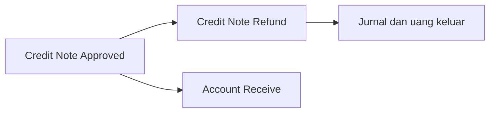
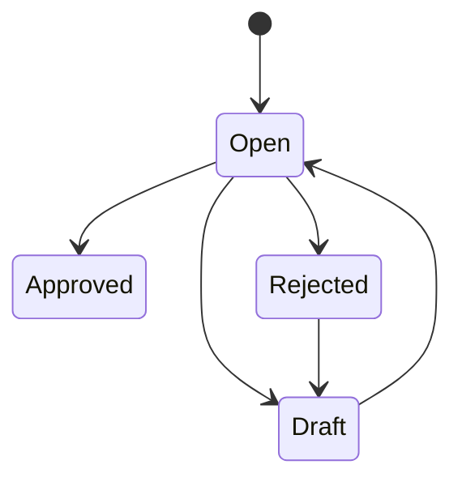

# Credit Note Refund — Panduan Pengguna

**Siapa yang baca panduan ini:** finance, AR clerk, operations support  
**Menu di sistem:** Finance and Accounting → Credit Note Refund  
**Kode transaksi:** dimulai dengan `CNR`

---

## 1. Apa Itu & Kenapa Penting

Credit Note Refund dipakai untuk mengembalikan uang sisa Credit Note ke customer. Uang keluar dari Cash/Bank perusahaan dan sisa Credit Note berkurang. Menu ini penting supaya sisa Credit Note tidak dipakai dua kali: sekali di Account Receive dan sekali lagi sebagai refund.

---

## 2. Overview Flow & Proses Bisnis

### Rantai proses

Versi teks:
1. Credit Note di-approve dan punya sisa.
2. Sisa itu bisa dipotongkan ke tagihan lewat Account Receive, atau dikembalikan sebagai uang lewat Credit Note Refund.
3. Setelah refund di-approve, jurnal terbit dan uang tercatat keluar dari Cash/Bank.

### Siklus status

Versi teks:
1. Dokumen baru langsung **Open**. Kamu bisa ganti ke **Draft** kalau masih menyiapkan.
2. Dari **Open**, approver bisa **Approve** (selesai, jurnal terbit) atau **Reject**.
3. Dokumen **Rejected** bisa diperbaiki. Setelah disimpan statusnya kembali Draft, lalu pilih Open untuk diajukan lagi.

---

## 3. Sebelum Mulai (Flow Sebelum)

- Credit Note customer sudah **Approved** dan masih punya sisa.
- Mata uang Credit Note sama dengan mata uang refund.
- Tanggal Credit Note tidak lebih dari tanggal refund.
- Ada rekening Cash/Bank aktif untuk mata uang itu, dan saldonya cukup.
- Untuk customer marketplace: store-nya bertipe platform.

---

## 4. Setelah Selesai (Flow Sesudah)

- Sisa Credit Note berkurang sebesar uang yang dikembalikan. Cek di datalist Credit Note: **Used Status** dan **Remaining Balance**.
- Kolom **Paid** di Credit Note ikut menghitung refund yang sudah Approved.
- Di halaman Credit Note, **Detail Related Transaction** menampilkan baris refund beserta statusnya.
- Jurnal muncul di Journal dan General Ledger: akun deposit customer berkurang, Cash/Bank berkurang.

🎬 [Interactive demo akan ditambahkan di sini]

---

## 5. Yang Perlu Diperhatikan

- **Sisa Credit Note langsung terpakai begitu masuk detail**, walau dokumen belum di-approve. Contoh: Credit Note 1.000.000, sudah dipakai Account Receive 400.000 dan sedang dipesan Account Receive lain 250.000. Yang bisa di-refund tinggal 350.000.
- Kalau kamu isi Refund Amount melebihi sisa, sistem menolak.
- Kalau saldo Cash/Bank tidak cukup, sistem menolak saat kamu memilih rekening dan saat Approve.
- Kalau dokumen di-Reject, sisa Credit Note **tetap dipesan**. Hapus baris atau dokumennya kalau refund batal.
- Setelah ada Credit Note di detail, customer, mata uang, kurs, dan tanggal tidak bisa diganti.
- Tombol Void dan cetak belum tersedia.

---

## 6. Langkah-Langkah (Step by Step)

1. Buka **Finance and Accounting → Credit Note Refund**, klik **Create**.
2. Pilih **Customer Source**: **General** (customer biasa) atau **Platform** (store marketplace).
3. Pilih **Customer** atau **Store**, cek tanggal, mata uang, dan kurs, lalu **Save All**.
4. Di **Detail Credit Note Refund**, klik **Select Credit Note** atau **Available Credit Note**, lalu pilih Credit Note-nya. Refund Amount otomatis terisi sisa penuh; ubah bila hanya sebagian.
5. Di **Payment Source**, klik **Select Cash/Bank** dan isi Amount.
6. (Opsional) Di **Adjustment**, isi biaya transfer (Debit) atau potongan (Credit).
7. Cek **Summary**: Difference harus 0. Rumusnya: Cash/Bank = total Refund + Debit − Credit.
8. Pilih **Open**, **Save All**, lalu klik tombol **Approve**.

Contoh: refund 900.000, biaya transfer 6.500 ditanggung perusahaan, potongan admin 5.000 dari customer → isi Cash/Bank 901.500.

---

## 7. Tips & Hal yang Sering Bikin Bingung

- **Credit Note tidak muncul?** Cek status Approved, customer, mata uang, tanggal, dan sisanya.
- **Muncul pesan "still being used in other transaction"?** Ada user lain yang sedang memakai Credit Note yang sama. Tunggu sebentar lalu ulangi.
- **Credit Note tanggal hari ini muncul di Refund tapi tidak di Account Receive?** Memang begitu. Refund boleh tanggal yang sama, Account Receive hanya tanggal sebelumnya.
- **Refund dalam USD?** Pilih USD dan isi kurs. Selisih kurs dengan Credit Note dicatat otomatis.
- **Approve ditolak soal saldo padahal tadi bisa?** Saldo dicek ulang saat Approve. Mungkin ada uang keluar lain dari rekening yang sama.

---

## 8. Referensi

- [Knowledge Base](./knowledge-base.md)
- [Requirement](./requirement.md)
- [Credit Note](../accounting-credit-note/user-guide.md)
- [Account Receive](../accounting-customer-payment/user-guide.md)
