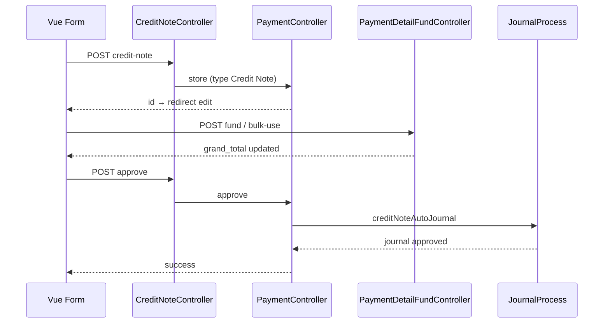

# Credit Note — Technical Documentation

**API prefix:** `accounting/credit-note`  
**Module:** `Modules/Accounting`  
**Behavior SoT:** [requirement.md](./requirement.md) v1.6  
**TO-BE deposit COA:** [ETM-16764](https://erpintegration.atlassian.net/browse/ETM-16764)

---

## 1. File Map

### Backend

| Layer | Path |
|-------|------|
| Routes | `Modules/Accounting/Routes/api.php` (group `credit-note`) |
| Controller | `Modules/Accounting/Http/Controllers/CreditNoteController.php` |
| Detail fund | `Modules/Accounting/Http/Controllers/CreditNoteDetailFundController.php` |
| Shared payment | `Modules/Accounting/Http/Controllers/PaymentController.php` (store/update/approve/show/destroy) |
| Shared fund | `Modules/Accounting/Http/Controllers/PaymentDetailFundController.php` |
| Entity | `Modules/Accounting/Entities/CreditNote.php` (extends `Payment`) |
| Scope | `Modules/Accounting/Entities/Scopes/CreditNoteScope.php` (`type = Credit Note`) |
| Detail fund entity | `Modules/Accounting/Entities/CreditNoteDetailFund.php` |
| Policy | `Modules/Accounting/Policies/CreditNotePolicy.php` |
| Import | `Modules/Accounting/Import/CreditNoteImport.php` |
| Import job | `Modules/Accounting/Jobs/CreditNoteImportJob.php` |
| Export jobs | `CreditNoteExportJob`, `CreditNoteDetailExportJob`, `CreditNoteDetailFundExportJob` |
| Template | `Modules/Accounting/Exports/CreditNoteTemplateExport.php` |
| Journal | `app/Helpers/Accounting/JournalProcess.php` → `creditNoteAutoJournal()` |
| Auto from return | `app/Helpers/SupplyChain/ItemStockMutation.php` → `generateCreditNoteFromReturn()` dan `generateCreditNoteAutoApprove()` — lihat §5.2 (text/url Sales Return; class tetap Customer Invoice) |
| AR import → CN | `Modules/Accounting/Jobs/ReceiveImportPerMutationJob.php` → `createCreditNote()` |
| Pricing helper | `app/Helpers/Accounting/PaymentPrice.php` (CN `grand_total` primarily from fund sum) |

### Frontend (`olshoperp-frontend`)

| Layer | Path |
|-------|------|
| Router | `src/router/index.ts` → `/accounting/credit-note*` |
| Store | `src/stores/project/CreditNote/index.ts` |
| List | `src/pages/Accounting/CreditNote/DataList.vue` |
| Form | `Form.vue`, `Header.vue`, `Destination.vue`, `RelatedTransaction.vue` |
| Approval | `ApprovalDialog.vue`, `ApprovalEligibility.vue`, `DatalistLogApproval.vue` |

---

## 2. API Routes (utama)

| Method | Path | Action |
|--------|------|--------|
| GET/POST | `accounting/credit-note` | Index / Store |
| GET/PUT/DELETE | `accounting/credit-note/{id}` | Show / Update / Destroy |
| POST | `…/{id}/approve` | Approve / Reject / Void / Closed (`approval_status`) |
| GET | `…/{id}/log/approve`, `…/approval-eligibility/{id}` | Logs / eligibility |
| GET | `…/{id}/audit` | Audit |
| CRUD | `…/{id}/credit-note-detail-fund` | Fund lines |
| POST | `…/{id}/cash-bank-account/bulk-use` | Bulk Cash/Bank |
| GET | `…/{id}/related-transactions/primevue` | Related deposits |
| GET/POST | `download-template`, `upload`, `progress`, import-log/history, export-* | Import/export |
| GET | `select2-customer`, `select2-currency`, `select2-cash-bank`, `default-values` | Lookups |

**Print:** FE memanggil `GET accounting/credit-note/{id}/print` — **route/controller CN print tidak ada** (lihat GAP-CN-01). Debit Note punya print route; CN belum.

---

## 3. Database — Key Tables

| Table / model | Role |
|---------------|------|
| `accounting_payments` | Header CN (`type = Credit Note`) |
| `accounting_payment_detail_funds` | Receiving Destination |
| `accounting_payment_detail_deposits` | Usage as deposit (`deposit_id` = CN id) + Related Transaction |
| Payment store pivots | Multi-store on CN |
| `accounting_journals` (+ details) | Auto journal on approve |
| `accounting_credit_note_export_files` | Export files |
| `accounting_credit_note_import_histories` / `accounting_import_credit_note_logs` | Import history / errors |

Key amount fields on payment: `grand_total`, `prepared_to_use_amount`, `processed_to_use_amount`.  
Invoice tracking (return path): `prepared_to_amount_credit_note`, `processed_to_amount_credit_note`, `processed_to_payment_amount`.

---

## 4. Services / Pricing / Journal

| Concern | Implementation |
|---------|----------------|
| List totals | `withSum` funds as `total_amount`; deposit_details as `total_paid_amount` (AR Approved only) |
| `remaining_funds` | Attribute on `Payment`: basis `grand_total` or `total_funds` minus prepared/processed use |
| Fund create on CN | Updates `grand_total = SUM(payment_detail_funds.amount)` |
| Approve journal | `JournalProcess::creditNoteAutoJournal($cn, $with_auth, $invert_journal)` |
| Invert | Sales Return billed platform → `invert_journal: true` |
| Deposit COA (**AS-IS**) | Company: `company_coa_name("Customer's Deposit COA")`; Store: `deposit_coa_id` — semua asal CN |
| Deposit COA (**TO-BE** ETM-16764) | Manual/overpay: Customer's Deposit / store `deposit_coa_id`; **Sales Return billed:** `company_coa_name("Deposit of Sales Return")`. Consume AR stamp COA yang sama (bukan re-resolve generic) |

Default journal (non-invert): **Dr** fund COAs / **Cr** Deposit COA (balanced).

### 4.1 Fund type & free COA **(TO-BE)**

| Rule | Detail |
|------|--------|
| Classify | Active `CompanyDetailBank` on `coa_id` → fund `type=Cash/Bank`; else `type=COA` |
| Store free COA | `source_type=COA` + `coa_id`; exclude bank-bound + Deposit COA actor; leaf aktif semua class |
| Select2 | Endpoint baru (bukan `select2Child_bank` Assets-only) |
| Update/inline | Null-safe: jangan resolve via `company_detail_bank` jika type `COA` |
| Sales Return | `generateCreditNoteFromReturn` → `source_type`/`type` by classify helper (Sales COA → `COA`) |
| Reconcile | Store Cash/Bank: lock AS-IS; free COA skip; Approve lock hanya COA baris `Cash/Bank` |
| Import | Tetap Cash/Bank COA only |

Brief: `~/Downloads/Brief-Dev-Credit-Note-Free-COA-Receiving.md` (locked D1–D14).

---

## 5. Flow utama

### 5.1 Manual create → approve



### 5.2 Sales Return billed → auto CN

```mermaid
sequenceDiagram
    participant SR as Sales Return Complete
    participant ISM as ItemStockMutation
    participant PC as PaymentController
    participant Fund as PaymentDetailFundController

    SR->>ISM: approve path
    ISM->>ISM: group amounts by invoice + Sales COA
    ISM->>PC: store CN (class CustomerInvoice; text/url Sales Return)
    ISM->>Fund: store funds (from_sales_return)
    ISM->>PC: approve (invert_journal if billed platform)
```

**Trx Ref override (ETM-17070):** `generateCreditNoteFromReturn` dan `generateCreditNoteAutoApprove` tetap mengisi `transaction_reference_id` serta `transaction_reference_class` = `CustomerInvoice` (settlement dan COA). Keduanya meng-override tampilan: `transaction_reference_text` = kode Sales Return, `transaction_reference_url` = `{fe_url}/accounting/sales-return/edit/{return_id}`.

`CreditNoteController` kolom `transaction_reference_formatted` memakai `transaction_reference_text` / `transaction_reference_url` bila terisi; kode dan URL morph hanya fallback saat text/url kosong. Filter kolom itu mencari `transaction_reference_text` dulu, lalu kode invoice/AR hanya jika text null. SearchBuilder kolom yang sama mencocokkan `transaction_reference_text`. Tidak ada perubahan frontend. Baris CN yang sudah menyimpan teks SI tidak di-backfill.

---

## 6. Invariants

| ID | Assertion |
|----|-----------|
| INV-CN-01 | `type` always `Credit Note` (scope) |
| INV-CN-02 | `grand_total` equals sum of fund amounts (primary column) after fund mutations |
| INV-CN-03 | List `outstanding = total_amount - total_paid` (foreign variants when currency ≠ primary) |
| INV-CN-04 | `remaining_funds = basis - prepared_to_use_amount - processed_to_use_amount` ≥ 0 after valid AR allocate |
| INV-CN-05 | Approve requires ≥1 fund and all fund amounts (primary or foreign column) > 0 |
| INV-CN-06 | Deposit COA must resolve before journal insert |
| INV-CN-07 | Critical header fields immutable while any fund/detail/deposit/adjustment exists |
| INV-CN-08 | Journal lines balance: fund side total equals deposit COA counter-side (respecting invert) |

---

## 7. Validation Highlights

| Area | Key checks |
|------|------------|
| Store header | Fiscal; cash/bank for currency; unique code; rate > 0; actor required |
| Update header | Draft/Open only; critical lock if `hasDetails()`; cash/bank for currency |
| Fund store | Editable header; amount > 0 unless CN create seed 0; Cash/Bank currency match; no duplicate COA; **TO-BE** free COA branch + classify type |
| Approve | Cache lock 30s; fiscal; funds exist; amounts > 0; Deposit COA; **TO-BE** reconcile lock hanya jika ada fund `Cash/Bank` |
| Import | Template headers exact; all-or-nothing parse; General customer by **code**; Cash/Bank COA only (no free COA); max 100 details/header; consistent grouped Trx Code |

Detail messages: [requirement §7](./requirement.md).

---

## 8. Frontend Behaviors

| Behavior | Where |
|----------|-------|
| Auto header save on watch (customer, date, currency) | `Header.vue` |
| Default values auto-create | `fetchDefaultValues` → `submit` |
| Bulk Cash/Bank modal | `Destination.vue` → bulk-use |
| Free COA picker **(TO-BE)** | `Destination.vue` + select2 receiving COA |
| Print tippy calls `print()` | `Form.vue` — API likely missing (GAP-CN-01) |
| Void / Closed dialogs | Privilege `can_void` / `can_closed` |
| Sidenav checks | Basic / Destination count / Related exists |

---

## 9. Failure Modes & Transaction Boundary

| Failure | Boundary |
|---------|----------|
| Approve + journal error (e.g. missing Deposit COA) | DB transaction rollback — no partial journal |
| Concurrent approve | Cache key `approval_payment:{id}` ~30s |
| Approve during receive import cache | Rejected until import finishes |
| Import parse errors | No jobs dispatched; history failed; logs written |
| Import job create exception | Per-header log; other headers may still succeed after parse passed |
| Critical header change with funds | Rejected before update |

---

## 10. Data Lifecycle (cross-document)

| Document | Flag / link | When it moves |
|----------|-------------|----------------|
| Customer Invoice | existence of SI / invoice detail | Determines billed return → CN (required); code bug still uses `processed_to_payment_amount` — ETM-17064 |
| Customer Invoice | `prepared/processed_to_amount_credit_note` | On return complete generating CN |
| Credit Note | `prepared_to_use_amount` | AR allocates CN as deposit (draft/open) |
| Credit Note | `processed_to_use_amount` | AR approved |
| Journal | `transaction_reference` → Payment | On CN approve |
| PaymentDetailDeposit | `deposit_id` → CN | Related Transaction rows |

---

## 11. Tests & QA Notes

- Prefer feature tests around `PaymentController::approve` with `CreditNote` + fund fixtures.
- Import: assert all-or-nothing and template header mismatch.
- Return path: billed vs unbilled (CN vs no CN). CN baru dari return: `transaction_reference_text` = kode SR, URL = edit Sales Return, class tetap `CustomerInvoice`.
- No dedicated CN print test expected until GAP-CN-01 resolved.

---

## 12. Known Issues

| GAP | Tech note |
|-----|-----------|
| GAP-CN-01 | FE `print()` → no `credit-note/{id}/print` route |
| GAP-CN-02 | `bulkCashBank` forces `balance = 0` seed for CN |
| GAP-CN-03 | Void/Closed via same approve endpoint Rule::in |
| GAP-CN-04 | Destroy path shared with Payment — document deposit-in-use guards if/when hardened |
| GAP-CN-05 | Free COA Receiving Destination + type `COA` + Sales Return classify + reconcile D11 — see requirement §5.2 / technical §4.1 |
| GAP-CN-07 | **A:** `ItemStockMutation` (CN dari SR, SI tanpa customer + `store_id`) menyimpan aktor `Company` dengan id Store pada 3 CN lama (id 30); `PaymentController::show` memuat `actor` (morphTo, kena company scope) → `actor: null` bila company aktif tak melihatnya, sedangkan datalist memakai `Payment::company()` `withoutCompanyScope` (menampilkan nama lain). FE `stores/project/CreditNote/index.ts` `fetchHeader` membaca `data.data.actor.name` tanpa null-guard → TypeError tertelan `catch` → isian sesudahnya batal. **B:** `CreditNoteController::select2Customer` hanya `is_customer` + ≥3 COA tag `company-as-customer` (ETM-11634); fallback nilai terpilih memakai syarat sama. Mirror: DN GAP-DN-07 |
| GAP-CN-08 | `app/Helpers/SupplyChain/ItemStockMutation.php`: kunci `'descripton'` (typo) di `generateCreditNoteAutoApprove` (±835) dan `generateCreditNoteFromReturn` (±1581) → `PaymentController::store` membaca `description`, jadi tidak tersimpan; `document_reference` tidak dikirim; `CreditNote/Header.vue` hanya punya Reference Doc (tanpa Transaction Reference seperti DN) |
