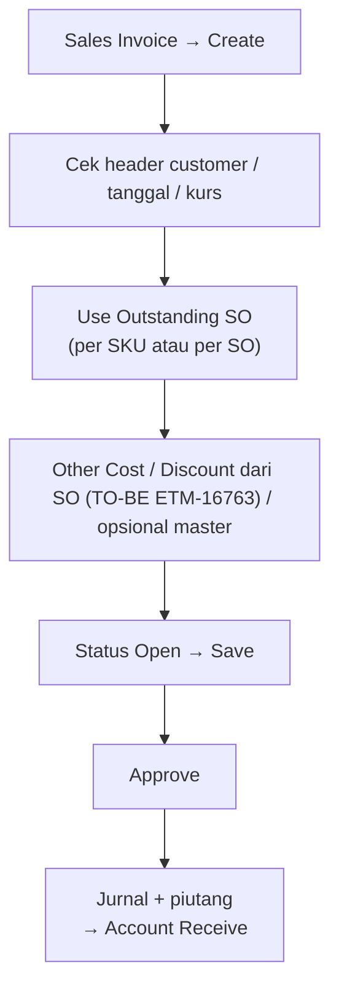

# Sales Invoice — Knowledge Base (Operator)

**Audience:** Finance AR, sales admin, support  
**Route:** Accounting → Sales Invoice (`/accounting/customer-invoice`)  
**Kode dokumen:** diawali **SI**

---

## 1. Apa itu Sales Invoice?

Sales Invoice (SI) adalah dokumen **tagihan ke pelanggan**. Dari sini sistem mencatat **piutang** dan **penjualan** (plus PPN / biaya / diskon lain jika ada).

- **Customer General:** buat SI dari Sales Order General yang sudah approved, lalu Approve.
- **Customer platform:** SI biasanya muncul otomatis dari **Instant Settlement** — biasanya hanya bisa dilihat (tidak reject/hapus seperti SI biasa).

Setelah SI **Approved**, lanjut pelunasan di **Account Receive**.

---

## 2. Kapan dipakai?

| ✅ Buat / proses SI jika | ❌ Jangan jika |
|--------------------------|----------------|
| Ada SO General approved dengan sisa belum ditagih | Mau tagih order marketplace lewat Create manual |
| AR COA customer/store & Sales COA produk sudah siap | COA belum lengkap — Approve akan gagal |
| Periode fiskal tanggal SI masih terbuka | Periode tutup |
| Import saldo awal SO General | Import order platform / SO sudah full di-invoice |

---

## 3. Alur kerja standar (General)

**Langkah teks:**

1. **Create** — sistem sering mengisi customer/kurs dari SI terakhir; tanggal = hari ini.
2. **Tambah barang** dari Outstanding SO (satu SKU penuh sisa, atau semua sisa satu SO).
3. Status **Open** + Save (jika masih Draft).
4. **Approve** — stok qty “sudah di-invoice” di SO naik; jurnal piutang + penjualan terbit.
5. Tagih bayar di **Account Receive**.

> AS-IS: Create baru biasanya masuk **Draft** dulu — pilih **Open** sebelum Approve. (Target nanti: Create langsung Open.)

---

## 4. Partial invoice — yang perlu dipahami

- Satu SO boleh punya **beberapa SI**.
- Dari tombol Use: sistem mengambil **seluruh sisa** baris SKU itu — **tidak** bisa isi “5 dari 10” di UI.
- Boleh tagih SKU-A dulu (penuh 10), SKU-B di SI berikutnya.

**Contoh:** SO-001: SKU-A 10 pcs, SKU-B 10 pcs → SI-1 Use SKU-A saja → qty 10. SKU-B tetap outstanding.

---

## 5. Status singkat

| Status | Arti | Bisa edit? |
|--------|------|------------|
| Draft | Belum siap approve | Ya |
| Open | Siap Approve / Reject | Ya |
| Approved | Terkunci; sudah ada jurnal & piutang | Tidak (lihat saja) |
| Rejected | Ditolak — setelah Save edit biasanya jadi **Draft** lagi | Ya |

**Platform:** tidak bisa Reject / Delete dari UI normal.

---

## 6. Import Excel (saldo awal)

Template **3 kolom:** Transaction Date · Order Number · Platform Order ID.

- Isi **salah satu** Order Number **atau** Platform Order ID (jangan keduanya kosong / keduanya terisi).
- Hanya **SO General/internal**. Platform ditolak.
- Hasil import: SI status **Open** — **belum** Approve, jurnal belum dari proses import.
- Satu baris rusak → **seluruh** import gagal.

---

## 7. Tombol & aksi

| Tombol | Fungsi |
|--------|--------|
| Create | SI baru (auto-save dari last saved) |
| Approve | Post jurnal + kunci dokumen (hanya Open) |
| Reject | Tolak Open (bukan platform) |
| Delete | Hapus draft/open/rejected non-platform |
| Import | Excel saldo awal + log |
| Export | **Without Details** / **With Details**: isi judul file dulu (§7b). **Export Active Page Only**: langsung, tanpa dialog |
| Print | Semua status |

---

## 7b. Export — judul file

**Export Without Details** dan **Export With Details** meminta judul file dulu, supaya unduhan dan riwayat export mudah dikenali.

1. Di daftar Sales Invoice, klik **Export** → **Export Without Details** atau **Export With Details**.
2. Dialog **Export File Name** terbuka. Field **File name** sudah terisi saran (boleh diganti, paling banyak 150 karakter). Contoh: `Sales Invoice - With Details Export 09-11-2026_10.51.00`.
3. Klik **Export**. Kalau field kosong, muncul **File name is required.** dan file tidak dibuat.
4. Nama itu yang terunduh (file Excel, atau zip bila hasilnya dipecah) dan yang tampil di riwayat export. Bagian di dalam zip memakai judul itu plus rentang baris.
5. Dua export dengan judul sama tetap jadi dua file terpisah di riwayat export; masing-masing mengunduh datanya sendiri.
6. **Export Active Page Only** tidak membuka dialog — file langsung diproses.

Karakter yang tidak boleh di nama file diganti tanda minus. Spasi berlebih dirapikan. Contoh: `Laporan SI 09/11` tersimpan `Laporan SI 09-11`.

---

## 8. Troubleshooting

| Gejala | Cek / tindakan |
|--------|----------------|
| Tidak bisa Approve dari Draft | Ubah status ke **Open** dulu |
| Outstanding kosong | SO belum approved, atau sisa sudah full prepared/processed |
| SO tidak muncul lagi setelah baris/SI dihapus | TO-BE ETM-17019: seharusnya SO kembali Approved & bisa dipakai lagi (manual/import). Data yang terlanjur rusak sebelum fix tidak otomatis pulih — laporkan ke QA |
| Approve gagal COA | AR Company/Store + Sales COA produk + Tax sales |
| SI platform tidak bisa hapus/reject | Normal — dari platform |
| Import gagal semua | Satu baris invalid menggagalkan batch; cek log |
| Rejected jadi Draft setelah Save | Normal — set Open lagi lalu Approve |
| **Export** tidak jalan / pesan **File name is required.** | Field **File name** di dialog **Export File Name** masih kosong. Isi nama, lalu klik **Export** lagi |

---

## 9. FAQ

**Q: Beda SI manual vs Instant Settlement?**  
A: Manual = SO General. Platform = dari settlement; sering auto-approved & terbatas edit.

**Q: Other Cost/Discount dari SO ikut ke SI? (TO-BE ETM-16763)**  
A: Ya — default penuh ke **SI pertama**; SI berikutnya (termasuk Instant Settlement) tidak bawa lagi. Create manual: editable seperti PO→PI (amount terkunci, COA boleh ubah, baris boleh dihapus). Settlement: fee file tidak menumpuk baris order; OC/OD dari order tidak diedit di jalur settlement.

**Q: SO masih ada SKU random — bisa di-invoice? (TO-BE ETM-16807)**  
A: **Tidak.** Kalau SO (single atau komponen bundle) masih random, tidak bisa Use / create SI. Di modal outstanding ada ikon warning + tooltip (bahasa Inggris). Proses **Outbound** dulu sampai random jadi SKU tetap, baru invoice. Ini mencegah SI pecah (sebagian komponen dulu, sisanya SI kedua setelah Outbound).

**Q: Wajib Other Cost?**  
A: Tidak.

**Q: Kapan jurnal muncul?**  
A: Saat SI **Approve** (bukan saat import berhenti di Open).

**Q: Customer Create dari mana?**  
A: Company General as customer + AR COA + SO outstanding — bukan store platform.

**Q: Export minta nama file?**  
A: Ya, untuk **Export Without Details** dan **Export With Details**. Kosongkan **File name** → **File name is required.** Saran awal boleh dipakai atau diganti (paling banyak 150 karakter). Contoh `Laporan SI 09/11` tersimpan `Laporan SI 09-11`. Dua export berjudul sama tetap dua file. **Export Active Page Only** tidak menanyakan nama.

---

## Kamus singkat

| Istilah | Awam |
|---------|------|
| Prepared to invoice | Qty sudah masuk SI belum approved |
| Processed to invoice | Qty sudah di SI approved |
| Net Sales | Total tagihan (setelah VAT & other cost/disc) |
| Instant Settlement | Upload settle marketplace yang otomatis bikin SI |

---

## Related Documents

| Doc | Path |
|-----|------|
| Requirement | [requirement.md](./requirement.md) |
| Technical | [technical.md](./technical.md) |
| User Guide | [user-guide.md](./user-guide.md) |
| Account Receive | [../accounting-customer-payment/knowledge-base.md](../accounting-customer-payment/knowledge-base.md) |
| Credit Note | [../accounting-credit-note/knowledge-base.md](../accounting-credit-note/knowledge-base.md) |

