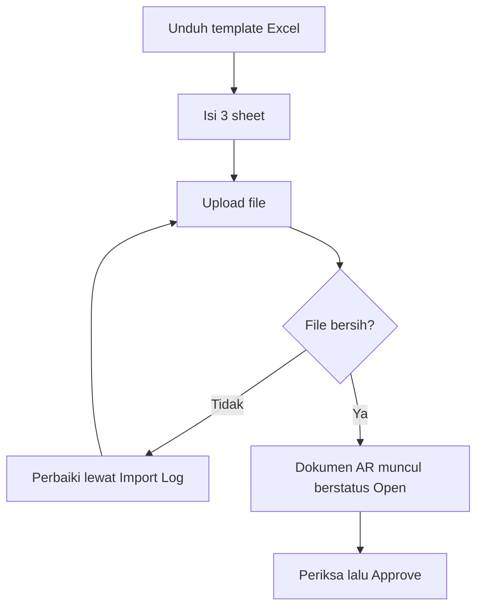

# Account Receive — Knowledge Base

## Apa itu menu ini

Menu **Account Receive** mencatat uang yang masuk dari customer dan mencocokkannya dengan tagihan (Sales Invoice) yang belum lunas. Satu dokumen bisa melunasi beberapa tagihan sekaligus.

Di daftar, kolom **Description** menampilkan deskripsi header tiap dokumen. Kolom itu bisa dicari dan diurutkan, dan ikut tertulis di file ekspor daftar, termasuk **Receive per tanggal** ([ETM-16991](https://erpintegration.atlassian.net/browse/ETM-16991)).

Di daftar, pilihan jumlah baris per halaman: **10 / 20 / 50** (tidak ada 100) — supaya halaman tidak error memori saat banyak dokumen settlement ber-detail besar ([ETM-17198](https://erpintegration.atlassian.net/browse/ETM-17198)).

| Item | Nilai |
|------|-------|
| Menu | Accounting → **Account Receive** |
| Route UI | `/accounting/customer-payment` |

## Kapan dipakai

- Ada transfer masuk di rekening dan Anda perlu mencatat tagihan mana yang terlunasi.
- Ada banyak pelunasan sekaligus dalam satu hari — pakai **Import** supaya tidak perlu input satu per satu.
- Customer membayar memakai deposit (Credit Note) yang sudah disetujui sebelumnya.

## Alur kerja standar

**Keterangan langkah:**

- **Unduh template** — selalu pakai template dari sistem. File buatan sendiri akan ditolak karena nama sheet dan judul kolomnya tidak dikenali.
- **Isi 3 sheet** — sheet pertama berisi uang masuk (satu baris satu transaksi bank), sheet kedua berisi tagihan yang dilunasi, sheet ketiga hanya diisi kalau ada selisih. Sheet ketiga boleh dibiarkan kosong; dua sheet pertama wajib terisi.
- **Angka pengikat** — di sheet kedua dan ketiga ada kolom yang meminta **nomor baris Excel** dari sheet pertama. Isi dengan nomor baris yang terlihat di kiri layar Excel, bukan nomor urut data. Salah isi di sini membuat tagihan menempel ke transaksi bank yang keliru.
- **Upload** — proses berjalan di belakang layar. Tunggu sampai selesai, jangan upload ulang berkali-kali.
- **Periksa lalu Approve** — hasil import selalu masuk berstatus **Open**, belum masuk jurnal. Ini memang disengaja supaya Finance sempat memeriksa dulu.

## Mengisi sheet pertama (uang masuk)

Satu baris berarti satu dokumen pelunasan. Kalau di rekening ada 3 transfer masuk, tulis 3 baris — walaupun banknya sama dan tanggalnya sama. Sistem tetap membuat 3 dokumen terpisah.

Kolom sumber dana bisa diisi dua macam: **kode akun bank** yang aktif, atau **nomor Credit Note** kalau customer membayar dengan deposit. Sistem mengenali sendiri mana yang Anda maksud, jadi tidak ada pilihan tipe yang perlu diisi.

Kolom deskripsi boleh dikosongkan. Kalau kosong, sistem menuliskan sendiri "Payment for" diikuti nomor-nomor tagihan yang dilunasi.

## Mengisi sheet ketiga (selisih)

Sheet ini dipakai kalau uang yang masuk tidak persis sama dengan nilai tagihan.

| Situasi | Yang diisi | Hasilnya |
|---|---|---|
| Uang masuk **lebih besar**, kelebihan mau disimpan sebagai deposit customer | Ketik `CREDIT NOTE` di kolom kode akun, isi kelebihannya di kolom **Credit** | Sistem membuat Credit Note baru atas nama customer |
| Uang masuk **lebih besar**, kelebihan mau langsung diakui sebagai pendapatan | Isi kode akun pendapatan, nilainya di kolom **Credit** | Kelebihan masuk ke akun itu, tanpa Credit Note |
| Uang masuk **lebih kecil** dari tagihan | Isi kode akun biaya, selisihnya di kolom **Debit** | Tagihan tetap tercatat lunas penuh, selisihnya masuk akun biaya |

Dalam satu baris, isi **salah satu** saja — Debit atau Credit, tidak boleh dua-duanya.

**Contoh kelebihan bayar:** tagihan 500.000, uang masuk 550.000. Ketik `CREDIT NOTE` dengan Credit 50.000. Hasilnya tagihan lunas 500.000 dan customer punya deposit 50.000 untuk dipakai lain kali. Credit Note deposit itu langsung muncul setelah import (status Open) — tidak menunggu Approve Account Receive.

**Jangan hapus Credit Note hasil kelebihan bayar** selama Account Receive terkait masih Open dan belum di-Approve. Kalau dihapus di menu Credit Note, dokumen deposit itu benar-benar hilang dari daftar transaksi Credit Note (bukan cuma lepas dari layar edit AR), dan Approve Account Receive akan ditolak. Membuat ulang deposit itu dari form edit Account Receive **tidak bisa** — section Adjustment hanya untuk akun biaya/pendapatan, bukan untuk membuat Credit Note baru. Yang bisa: kembalikan (restore) Credit Note yang terhapus, atau batalkan dan ulang import.

**Contoh kekurangan bayar:** tagihan 500.000, uang masuk 493.500. Isi kode akun biaya dengan Debit 6.500. Tagihan tetap dianggap lunas penuh 500.000, selisih 6.500 tercatat sebagai biaya.

## Adjustment di form Create/Edit (bukan import)

Pakai section **Adjustment** di halaman edit dokumen kalau uang di bank tidak sama dengan nilai tagihan yang Anda lunaskan, tapi customer tetap dianggap bayar penuh (atau sebaliknya ada kelebihan yang diakui pendapatan).

- Pilih **akun** (hanya akun paling bawah / tidak punya anak; semua jenis akun boleh, asal aktif).
- Isi **Debit atau Credit** saja — jangan keduanya. Satuan mata uang mengikuti header dokumen.
- **Deskripsi** menjelaskan kenapa ada selisih (ikut ke jurnal). Saat ini sistem masih mewajibkan diisi.
- **Tidak** bisa membuat Credit Note deposit dari sini — itu hanya lewat import dengan teks `CREDIT NOTE`.

**Contoh Debit — potongan admin bank.** Tagihan 1.000.000; uang masuk rekening 990.000. Di Detail isi bayar tagihan 1.000.000. Di Receiving Destination isi bank 990.000. Di Adjustment isi Debit 10.000 ke akun biaya admin bank. Tagihan customer lunas; 10.000 jadi biaya perusahaan.

**Contoh Credit — transfer lebih, diakui pendapatan.** Tagihan 1.000.000; uang masuk 1.010.000 dan kelebihan 10.000 tidak mau jadi deposit. Detail 1.000.000; Receiving Destination 1.010.000; Adjustment Credit 10.000 ke akun pendapatan. Angka balance: 1.000.000 + 10.000 = 1.010.000.

## Approve dokumen (manual)

1. Status harus **Open** (hasil create/autosave saat ini masih **Draft** — ubah dulu ke Open; nanti TO-BE autosave langsung Open).
2. Ada tagihan di Detail **dan** sumber dana di Receiving Destination.
3. Angka Receiving Destination harus balance dengan Detail + Adjustment (lihat Summary di bawah form).
4. Periode pembukuan tanggal AR harus terbuka; akun bank tidak sedang terkunci rekonsiliasi.
5. Jangan hapus Credit Note hasil overpayment import sebelum Approve.

Kalau lolos: status **Approved**, muncul di **Approval Log**, dan sistem membuat **Journal** yang tertaut ke nomor AR ini (bisa dibuka dari kolom Journal di daftar).

## Troubleshooting

| Gejala | Penyebab | Solusi |
|---|---|---|
| Seluruh file ditolak padahal cuma satu baris salah | Sistem memang membatalkan semuanya kalau ada satu kesalahan, supaya tidak ada pelunasan yang masuk separuh | Buka panel **Import Log**, perbaiki semua baris yang dilaporkan sekaligus, lalu upload ulang |
| Muncul keluhan angka tidak cocok | Per nomor baris pengikat: uang masuk (sheet 1) harus = total bayar tagihan (sheet 2) **ditambah** selisih di sheet 3. Di sheet 3, angka Credit menambah, angka Debit mengurangi | Jumlahkan ulang per nomor pengikat. Contoh: uang 550.000, tagihan 500.000, Credit Note 50.000 → cocok. Lupa isi sheet 3 → sistem bilang timpang |
| Tagihan ditolak karena melebihi sisa, padahal terlihat belum dibayar | Ada dokumen pelunasan lain yang masih Open dan sudah memesan sebagian nilainya | Cek dokumen AR lain untuk tagihan itu; pesan errornya menyebutkan nilai yang tertahan |
| Kode bank ditolak walau ada di master | Akun atau data banknya sedang nonaktif | Aktifkan kembali akun bank tersebut lalu ulangi |
| Muncul keluhan input dikenali sebagai dua hal sekaligus | Ada kode akun bank dan nomor Credit Note yang kebetulan persis sama | Ubah salah satu penamaannya |
| Upload ditolak karena ada proses lain | Hanya boleh ada satu proses import berjalan | Tunggu sampai import sebelumnya selesai |
| Pembayaran pakai deposit ditolak | Credit Note belum disetujui, saldonya kurang, atau pemiliknya beda dengan customer di tagihan | Pastikan CN sudah Approved, saldo mencukupi, dan customernya sama |
| Approve AR gagal karena Credit Note kelebihan bayar sudah dihapus | Deposit yang terbentuk dari import kelebihan bayar dihapus di menu Credit Note sebelum AR di-Approve | Kembalikan Credit Note itu (restore), atau batalkan AR dan ulang import. Jangan coba buat Credit Note baru dari form edit AR — tidak tersedia |
| Muncul permintaan mengatur akun deposit customer | Akun deposit customer belum diisi di data perusahaan atau data store | Lengkapi dulu pengaturan akun deposit customer tersebut |
| Tagihan masuk ke detail, Receiving Destination tetap kosong | Section tujuan penerimaan belum selesai dimuat ulang, atau tagihan tidak punya kas/bank tertaut | Tunggu sebentar lalu cek lagi. Kalau tetap kosong, catat kode dokumen dan tagihannya |

## Memilih tagihan di dokumen yang sudah ada

Pada dokumen Account Receive yang masih **Draft** atau **Open**, field **Select Invoice** (pilih tagihan di bagian detail) memasukkan tagihan ke tabel detail. Bagian **Receiving Destination** ikut terisi baris penerimaan dengan jumlah yang sama, lalu tampilannya disegarkan. Anda tidak perlu memuat ulang halaman.

**Misalnya** tagihan 105.000. Setelah tagihan itu dipilih, cek Receiving Destination: ada baris dengan jumlah 105.000.

Akun pada baris itu mengikuti kas/bank yang tertaut di tagihan.

## Relasi Instant Settlement

| Yang perlu Anda tahu | Penjelasan singkat |
|----------------------|-------------------|
| Kapan AR otomatis muncul | Setelah upload settlement selesai dan Anda klik **Approve** di Instant Settlement |
| Berapa dokumen AR | Biasanya satu dokumen per batch upload (per store), berisi banyak referensi tagihan |
| Tanggal & jam AR dari settlement | Tanggal = tanggal SI (semua SI batch harus hari yang sama); jam = jam SI paling akhir di batch |
| AR manual sebelumnya | Tagihan yang sudah punya AR manual tidak dibuatkan lagi |
| Reject settlement | Tidak membuat AR — tagihan dan dokumen lain tetap ada |
| Delete settlement | Diblokir kalau ada tagihan dengan AR manual |

**Prasyarat:** Cash/Bank Receiving di pengaturan store harus terisi sebelum Approve settlement. Approve Instant Settlement juga ditolak jika tanggal SI di batch campur beda hari.

## FAQ

**Kenapa transfer di bank dan tanggal yang sama jadi dua dokumen?** Karena pemisahan mengikuti baris transaksi bank, bukan gabungan bank dan tanggal.

**Hasil import langsung masuk pembukuan?** Belum. Semuanya masuk berstatus Open dan baru masuk jurnal setelah di-Approve.

**Boleh mencampur tagihan dari beberapa customer dalam satu transaksi bank?** Tidak boleh. Satu transaksi bank hanya untuk satu customer.

**Sheet ketiga wajib diisi?** Tidak. Isi hanya kalau ada selisih antara uang masuk dan nilai tagihan.

**Apa section Summary? (TO-BE ETM-16644)** Setelah Adjustment — ringkasan Piutang, Cash/Bank, Credit Note (sumber + yang terbentuk), Adj Debit/Credit, Total dalam currency header. Total sebaiknya 0; kalau tidak, angka Total berwarna orange (peringatan visual saja).

**Setelah pilih invoice di dokumen yang sudah ada, apa yang harus dicek?** Receiving Destination. Jumlahnya harus sama dengan tagihan yang baru masuk, misalnya 105.000.

**Detail lengkap ada di mana?** Lihat [requirement.md](./requirement.md) untuk aturan rinci dan [user-guide.md](./user-guide.md) untuk panduan langkah.
