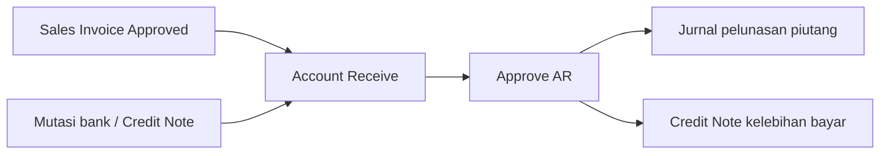
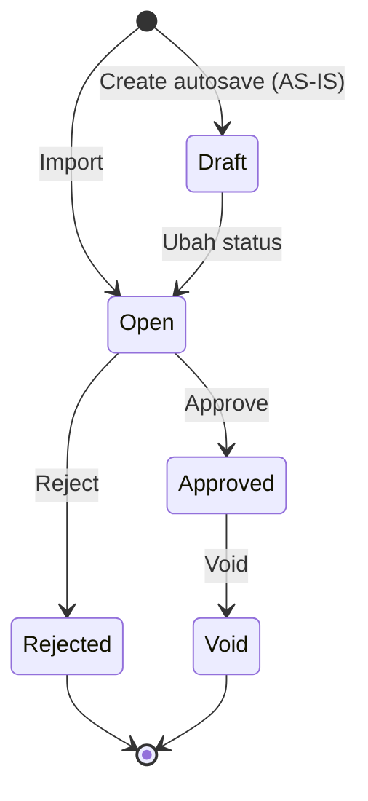
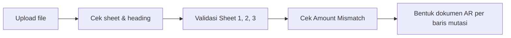
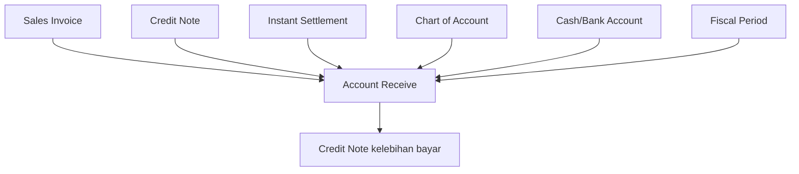

# Account Receive — Requirement Documentation

**Modul:** Accounting
**UI route:** `/accounting/customer-payment`
**Audience:** PM, Operations, QA, Support, Developer

**Related Improvement:** [ETM-16764](https://erpintegration.atlassian.net/browse/ETM-16764) (Done) · [ETM-17198](https://erpintegration.atlassian.net/browse/ETM-17198) (Done) · [ETM-16644](https://erpintegration.atlassian.net/browse/ETM-16644) (Done — Summary) · **[ETM-17298](https://erpintegration.atlassian.net/browse/ETM-17298)** (jam import 23:59:00) · **[ETM-17325](https://erpintegration.atlassian.net/browse/ETM-17325)** (autosave default Open) · **[ETM-17326](https://erpintegration.atlassian.net/browse/ETM-17326)** (audit log readable)

## 0. Metadata & Changelog

| Version | Date | Author | Changes |
|---------|------|--------|---------|
| 2.13 | 2026-11-11 | QA - Yemima | **AS-IS** validasi Approve AR lengkap (§6.4.1); jurnal Approve (§5.11); audit log gap + TO-BE readable (§5.12 / [ETM-17326](https://erpintegration.atlassian.net/browse/ETM-17326)); TO-BE autosave Open [ETM-17325](https://erpintegration.atlassian.net/browse/ETM-17325); Description Adjustment locked wajib ikut kode |
| 2.12 | 2026-11-11 | QA - Yemima | **AS-IS** §5.10 Adjustment form manual (COA child semua class; Debit/Credit contoh admin bank & pendapatan lebih bayar); copy Single Use modal → Receive wording (FE) |
| 2.11 | 2026-11-11 | QA - Yemima | **AS-IS sync:** GAP-AR-SUMMARY-01 / GAP-AR-CN-COA / GAP-AR-MEM-01 closed (ETM-16644, 16764, 17198 Done + kode selaras); klarifikasi GAP-AR-09 tetap Open (docs alur manual) |
| 2.10 | 2026-11-11 | QA - Yemima | **TO-BE** [ETM-17298](https://erpintegration.atlassian.net/browse/ETM-17298): jam import AR **23:59:00** (bukan 23:59:59) agar CN overpayment +10s = 23:59:10 hari yang sama; GAP-AR-03 dibuka kembali sebagai TO-BE; GAP-AR-08 closed — bukan gap, relates Instant Settlement saja |
| 2.9 | 2026-11-11 | QA - Yemima | **AS-IS locked:** GAP-AR-03 (jam 23:59:59) · GAP-AR-04 (matching Sheet 1 = Sheet 2 + Sheet 3) · GAP-AR-05 (class COA Adjustment) · GAP-AR-06 (katalog pesan §6) · GAP-AR-07 closed (copy/lock AR sudah benar di kode) |
| 2.8 | 2026-11-11 | QA - Yemima | **AS-IS locked:** GAP-AR-01 (heading template = file unduhan live) · GAP-AR-02 (CN overpayment terbentuk saat import, status Open) + aturan hapus CN vs Approve AR |
| 2.7 | 2026-11-09 | QA - Yemima | **TO-BE** [ETM-17198](https://erpintegration.atlassian.net/browse/ETM-17198): datalist AR — hilangkan opsi 100 entries (maks 50), optimasi query/eager load, tooltip TRX. REF tidak boros memori |
| 2.6 | 2026-11-09 | QA - Yemima | **AS-IS** [ETM-17102](https://erpintegration.atlassian.net/browse/ETM-17102): Select Invoice pada AR Draft/Open menambah baris Receiving Destination sebesar nilai invoice, dan section itu langsung menampilkan barisnya |
| 2.5 | 2026-11-04 | QA - Yemima | Daftar Account Receive menampilkan kolom Description per dokumen; bisa dicari dan diurut, dan ikut di file ekspor termasuk Receive per tanggal ([ETM-16991](https://erpintegration.atlassian.net/browse/ETM-16991)) |
| 2.4 | 2026-10-26 | QA - Yemima | Klarifikasi final ETM-16764: stamp COA = setting by asal CN (bukan historis jurnal CN) |
| 2.3 | 2026-10-22 | QA - Yemima | **TO-BE** [ETM-16764](https://erpintegration.atlassian.net/browse/ETM-16764): Payment Source CN stamp COA dari asal CN; GAP-AR-CN-COA |
| 2.2 | 2026-10-19 | QA - Yemima | **TO-BE** [ETM-16644](https://erpintegration.atlassian.net/browse/ETM-16644): Section Summary read-only setelah Adjustment (header currency; Credit=+/Debit=−; CN terpisah; Total orange jika ≠ 0) |
| 2.1 | 2026-09-01 | QA - Yemima | Relasi Instant Settlement: AR date/time dari SI + guard same calendar date (ETM-15701) |
| 2.0 | 2026-08-31 | QA - Yemima | Split dari SoT v1.0 — Import AR multi-sheet, validasi terverifikasi codebase, Gap Registry |
| 1.1 | 2026-06-26 | QA - Yemima | Test cases AR detail insert (single/bulk use, bulk select) — lihat test-cases/ |
| 1.0 | 2026-06-23 | QA - Yemima | Cross-reference Relasi Instant Settlement (Fase 1) |

## 1. Ringkasan Eksekutif

**Account Receive** (AR receipt) mencatat penerimaan pembayaran dari customer dan mengalokasikannya ke Sales Invoice yang masih outstanding. Satu dokumen AR bisa melunasi banyak invoice.

Dokumen AR lahir dari tiga jalur: input manual, **Import multi-sheet** (satu file Excel menghasilkan banyak dokumen sekaligus), dan generate otomatis saat Approve Instant Settlement. Jalur mana pun menghasilkan dokumen berstatus Open yang tetap perlu Approve manual sebelum jurnal terbentuk.



## 2. Prasyarat

| Prasyarat | Sumber | Catatan |
|---|---|---|
| Sales Invoice sudah Approved / Processed | Sales Invoice | Invoice Draft, Open, Rejected, atau Void ditolak saat import |
| Invoice masih punya outstanding | Sales Invoice | Outstanding nol berarti tidak bisa dibayar lagi |
| COA Cash/Bank aktif & terhubung ke Cash/Bank Account | Chart of Account + Cash/Bank Account | COA tanpa data bank dianggap tidak valid |
| Credit Note Approved (jika bayar pakai CN) | Credit Note | Perlu saldo outstanding yang cukup |
| Fiscal period terbuka pada tanggal transaksi | Fiscal Period | Divalidasi per baris mutasi saat import |
| Customer's Deposit COA terkonfigurasi | General Company / Store Binding | Wajib untuk pembayaran via CN dan auto-generate CN |
| Currency transaksi sama dengan primary currency | General Setting | Selain itu import ditolak |

## 3. Siklus Status



| Status | Arti | Dampak ke outstanding invoice |
|---|---|---|
| Draft | Create/autosave manual (AS-IS) — belum siap approve | Belum mengunci alokasi seperti Open bila belum ada detail |
| Open | Siap review / Approve | Detail SI menambah prepared — outstanding ikut berkurang |
| Approved | Sudah disetujui, jurnal terbentuk + Approval Log | Pindah dari prepared ke processed |
| Rejected | Ditolak approver | Alokasi dilepas |
| Void | Dibatalkan setelah Approved | Alokasi dilepas |

**Tombol Approve/Reject** hanya muncul saat status **Open** (plus privilege).  
Hasil **import** selalu **Open**.  
**TO-BE [ETM-17325](https://erpintegration.atlassian.net/browse/ETM-17325):** create/autosave manual juga default **Open** (bukan Draft).

## 4. Form & Field — Template Import

Template diunduh dari menu dan berisi **3 sheet**. Sheet Bank Mutation dan Detail Account Receive wajib ada dan tidak boleh kosong; sheet Adjustment opsional.

### 4.1 Sheet "Bank Mutation"

Satu baris = satu dokumen AR yang akan dibentuk.

| Kolom | Wajib | Sumber | Validasi |
|---|---|---|---|
| Date | Ya | Input user | Divalidasi terhadap fiscal period; jam disimpan **23:59:59** (AS-IS). **TO-BE [ETM-17298](https://erpintegration.atlassian.net/browse/ETM-17298):** jam **23:59:00** supaya CN overpayment (+10 detik → 23:59:10) tetap di tanggal kalender yang sama |
| COA Bank Account | Ya | Chart of Account / Credit Note | Kode COA Cash/Bank aktif atau nomor Credit Note; tipe dideteksi otomatis |
| Amount | Ya | Input user | Angka positif; wajib sama dengan akumulasi Sheet 2 + Sheet 3 untuk baris yang sama |
| Description | Tidak | Input user | Kosong berarti deskripsi dibuat otomatis |

### 4.2 Sheet "Detail Account Receive"

Satu baris = satu Sales Invoice yang dilunasi.

| Kolom | Wajib | Sumber | Validasi |
|---|---|---|---|
| Sales Invoice No | Ya | Sales Invoice | Terdaftar, status Approved/Processed, currency primary |
| Invoice Paid Amount | Ya | Input user | Angka; tidak boleh melebihi outstanding invoice |
| Cash Bank Identification Row | Ya | Input user | Nomor baris Excel fisik di sheet Bank Mutation |

### 4.3 Sheet "Adjustment"

Satu baris = satu selisih antara dana masuk dan nilai invoice.

| Kolom | Wajib | Sumber | Validasi |
|---|---|---|---|
| Account Code | Ya | Chart of Account | Class Expense, Revenue, atau Other Revenue & Expenses — atau teks `CREDIT NOTE` |
| Debit | Salah satu | Input user | Tidak boleh diisi bersamaan dengan Credit |
| Credit | Salah satu | Input user | Tidak boleh diisi bersamaan dengan Debit |
| Description | Tidak | Input user | Kosong berarti deskripsi baris jurnal dibuat otomatis |
| Cash Bank Identification Row | Ya | Input user | Sama seperti Sheet 2 |

**Identification Row** adalah nomor baris Excel fisik di sheet Bank Mutation — bukan nomor urut data. Inilah pengikat yang menentukan invoice dan adjustment mana milik mutasi bank mana.

### 4.4 Datalist & Export

Daftar Account Receive menampilkan kolom **Description**: teks deskripsi di header dokumen (bukan deskripsi baris jurnal atau baris invoice). Kolom ini bisa dicari dan diurutkan.

Ekspor daftar memuat kolom Description yang sama, termasuk berkas berjudul **Receive per tanggal** (heading `OlshopERP | Receive per {tanggal}`).

[ETM-16991](https://erpintegration.atlassian.net/browse/ETM-16991)

#### Pagination & performa (AS-IS · ETM-17198 Done)

| Aturan | Detail |
|--------|--------|
| Opsi panjang halaman | **10 / 20 / 50** — opsi **100** tidak tersedia |
| Load datalist | Eager load detail dibatasi; tidak boleh *Allowed memory size exhausted* pada volume settlement besar |
| Tooltip **TRX. REF** | Tidak me-load seluruh invoice detail berlebihan per baris |

Jika LocalStorage browser masih menyimpan length=100 dari versi lama, UI memaksa ke opsi yang valid (maks 50).

## 5. How It Works

### 5.1 Alur import

Import berjalan asynchronous lewat antrian, bertahap per sheet, dan baru menulis dokumen setelah seluruh file bersih.



Prinsip yang berlaku: **All-or-Nothing** (satu baris bermasalah membatalkan seluruh file), screening dulu baru proses, dan seluruh error dikumpulkan sekaligus supaya user tidak perlu upload berulang untuk menemukan error berikutnya.

### 5.2 Satu baris mutasi = satu dokumen AR

Pemisahan dokumen mengikuti baris mutasi, bukan kombinasi bank dan tanggal. Dua baris dengan bank dan tanggal yang sama tetap menghasilkan dua dokumen AR terpisah.

**Contoh.** Sheet 1 berisi baris 5 (BCA-001, 500.000, "Pelunasan Toko A"), baris 6 (BCA-001, 400.000, deskripsi kosong), baris 7 (Mandiri-002, 1.000.000, "Transfer Bulk"). Sheet 2 mengaitkan SI-001 ke baris 5; SI-002 (150.000) dan SI-003 (250.000) ke baris 6; SI-004 (600.000) dan SI-005 (400.000) ke baris 7. Hasilnya 3 dokumen AR berstatus Open — AR pertama melunasi SI-001 dengan deskripsi dari user, AR kedua melunasi SI-002 dan SI-003 dengan deskripsi otomatis, AR ketiga melunasi SI-004 dan SI-005.

Deskripsi otomatis berbentuk "Payment for {daftar nomor invoice}". Jika daftar nomor melebihi 120 karakter, deskripsi diringkas menjadi "Payment for {jumlah} invoices".

### 5.3 Dua sumber dana: Cash/Bank atau Credit Note

Kolom COA Bank Account menerima dua jenis input dan sistem mendeteksi sendiri tipenya: cocok dengan COA Cash/Bank aktif berarti pembayaran tunai atau transfer, cocok dengan nomor Credit Note berarti pembayaran memakai deposit customer. Jika satu input cocok dengan keduanya, file ditolak karena ambigu.

Pembayaran via Credit Note menuntut CN sudah Approved, saldo outstanding CN mencukupi, tanggal pembayaran tidak lebih awal dari tanggal CN, currency CN primary, dan customer invoice sama dengan pemilik CN.

**COA deposit CN (AS-IS · [ETM-16764](https://erpintegration.atlassian.net/browse/ETM-16764) Done):**

Saat Payment Source = Credit Note (UI / clearing / import), sistem **identifikasi asal CN** lalu baca COA dari **setting** (bukan menyalin COA dokumen/jurnal CN):

| Asal CN | Field setting |
|---------|---------------|
| Sales Return (billed) | **Deposit of Sales Return** |
| Regular (manual / overpay AR) | **Customer's Deposit** / store deposit |

Satu Account Receive boleh campur beberapa CN beda asal → baris GL boleh beda akun. Setting diganti setelah CN Approve → ikut setting saat consume. Detail: [Credit Note §6.7–6.8.1](../accounting-credit-note/requirement.md).

### 5.4 Adjustment — kelebihan dan kekurangan bayar

**Overpayment jadi Credit Note.** Dana masuk 550.000 untuk SI-001 senilai 500.000. Sheet 3 diisi Account Code `CREDIT NOTE`, kolom Credit 50.000. Sistem membentuk AR pelunasan SI-001 plus Credit Note baru senilai 50.000 atas nama customer invoice tersebut. CN itu terbentuk **saat import selesai** (bukan menunggu Approve AR), berstatus **Open**, dan tertaut ke dokumen AR sebagai referensi transaksi. Nilai CN dipotong dari grand total dan amount Cash/Bank dokumen AR.

**Overpayment ke akun pendapatan.** Sama seperti di atas, tapi Account Code diisi kode COA pendapatan — kelebihan langsung diakui ke akun itu tanpa membentuk CN.

**Underpayment.** Dana masuk 493.500 sedangkan SI-001 senilai 500.000. Sheet 3 diisi kode COA Expense dengan Debit 6.500. Jurnal mencatat Debit bank 493.500, Debit akun expense 6.500, Credit piutang 500.000 — pelunasan piutang tetap dicatat penuh sesuai nilai invoice.

Nilai grand total dokumen AR dihitung dari amount mutasi dikurangi nilai adjustment bertipe Credit Note.

**Hapus Credit Note hasil overpayment (AR masih Open).**

| Aturan | Perilaku |
|---|---|
| Hapus CN di menu Credit Note | Dokumen CN dihapus di level transaksi Credit Note (soft delete) — bukan sekadar lepas dari layar edit AR |
| Approve AR setelah CN itu dihapus | Ditolak. Pesan: `Approval Failed. Total receive is not balanced because the generated Credit Note has been deleted` |
| Buat ulang CN dari form edit AR | **Tidak bisa.** Section Adjustment hanya menerima COA Expense / Revenue / Other Revenue & Expenses. Teks `CREDIT NOTE` dan pembentukan dokumen CN hanya lewat **import** Sheet 3 |
| CN baru manual di menu Credit Note | Tidak menggantikan CN overpayment yang sudah dihapus untuk keperluan Approve AR ini — blokir tetap berlaku selama CN hasil generate yang soft-deleted masih tertaut ke AR tersebut |

Jalan keluar operasional: **restore** CN yang dihapus, atau batalkan/ulang alur AR + import (bukan regenerate dari Adjustment).

### 5.5 Matching amount

Per nomor baris pengikat (Identification Row): **Amount Sheet 1 = Σ Invoice Paid Amount (Sheet 2) + nilai Sheet 3**. Di Sheet 3, **Debit dihitung negatif**, **Credit dihitung positif** (termasuk baris `CREDIT NOTE`).

**Contoh.** Sheet 1 baris 5 Amount 550.000. Sheet 2: SI-001 bayar 500.000 (pengikat 5). Sheet 3: `CREDIT NOTE` Credit 50.000 (pengikat 5). Rumus: 500.000 + 50.000 = 550.000 → cocok. Tanpa Sheet 3, 500.000 ≠ 550.000 → Amount Mismatch.

Ketimpangan dilaporkan lengkap dengan nomor sheet dan baris yang timpang (pesan §6.4).

### 5.6 Outstanding check dengan akumulasi

Outstanding invoice sama dengan nilai grand total setelah VAT dikurangi jumlah prepared dan processed. Jika satu invoice muncul di beberapa baris dalam satu file, seluruh nilai bayarnya diakumulasikan lebih dulu sebelum dibandingkan ke outstanding — mencegah kelebihan bayar lolos karena dicek baris per baris. Pesan error menyebut adanya dokumen AR Draft atau Open yang masih menggantung bila memang ada.

### 5.7 Satu proses import per waktu

Hanya boleh ada satu proses import AR berjalan. Upload kedua ditolak dengan pemberitahuan bahwa import sedang diproses sesi lain.

### 5.8 Relasi Instant Settlement

Saat user Approve batch Instant Settlement, sistem membentuk satu dokumen AR per settlement upload yang mengalokasikan pembayaran ke invoice hasil generate. Invoice yang sudah punya AR manual dilewati supaya tidak dobel (Smart AR). Store wajib punya Cash/Bank Receiving sebelum Approve settlement, dan fiscal period harus terbuka pada tanggal settlement.

**Tanggal & jam AR (ETM-15701):** semua Sales Invoice dalam batch wajib **same calendar date** (jam boleh beda). Jika campur tanggal → Approve Instant Settlement ditolak (tidak generate AR). Jika lolos: **tanggal AR** = tanggal SI; **jam AR** = waktu SI paling akhir di batch. Detail: [Instant Settlement §6.3 / V-23](../accounting-settlement-upload/requirement.md).

AR manual tidak ikut terhapus saat settlement di-Reject, dan justru memblokir Delete settlement bila terhubung ke invoice hasil upload. Detail alur bulk ada di [Instant Settlement](../accounting-settlement-upload/requirement.md).

### 5.9 Select Invoice pada dokumen Draft atau Open (ETM-17102)

Pada Account Receive yang masih bisa diubah (Draft atau Open), field **Select Invoice** di Detail Account Receive memasukkan Sales Invoice ke tabel detail. Sistem ikut menambah baris di **Receiving Destination** dengan Amount sama dengan nilai invoice yang masuk. Select Invoice memakai sisa tagihan penuh. Section Receiving Destination disegarkan setelah pilihan berhasil, sehingga baris itu terlihat tanpa memuat ulang halaman.

Akun pada baris itu adalah kas/bank yang tertaut di Sales Invoice.

**Contoh.** Sales Invoice senilai Rp105.000 ditambahkan lewat Select Invoice pada dokumen Account Receive yang masih Draft. Detail Account Receive memuat invoice itu, dan Receiving Destination memuat baris dengan Amount Rp105.000.

| ID | Kriteria |
|----|----------|
| AR-SEL-01 | Select Invoice pada AR Draft/Open memasukkan Sales Invoice ke Detail Account Receive |
| AR-SEL-02 | Receiving Destination mendapat baris dengan Amount sama dengan nilai invoice yang masuk |
| AR-SEL-03 | Baris itu tampil di Receiving Destination tanpa memuat ulang halaman |

### 5.10 Adjustment pada form Create/Edit (manual)

Section **Adjustment** menyeimbangkan dokumen AR bila uang masuk (Receiving Destination) tidak sama dengan nilai piutang yang dilunasi (Detail), tanpa mengubah niat pelunasan penuh ke customer.

| Field | Wajib | Aturan |
|---|---|---|
| Account (COA) | Ya | Opsi select2: COA **aktif**, **bukan parent** (child/leaf saja), **semua class** (tidak dibatasi Expense/Revenue seperti Sheet import). COA yang sedang terkunci Cash Bank Reconcile Approved pada tanggal AR dikeluarkan dari daftar. Satu COA hanya boleh sekali per dokumen AR |
| Debit | Salah satu | Mata uang = currency header AR. Tidak boleh terisi bersamaan dengan Credit; nilai harus > 0 |
| Credit | Salah satu | Sama seperti Debit |
| Description | Ya | Freetext max 150 (wajib). Ikut ke deskripsi baris jurnal / GL |
| Save | — | Menambah baris ke tabel Adjustment |
| Delete baris | — | Menghapus baris Adjustment; grand total / Summary ikut berubah |

**Bukan** jalur pembentukan Credit Note overpayment — teks `CREDIT NOTE` hanya di **import** Sheet 3 (§5.4).

**Contoh Debit — biaya admin bank dipotong di transfer.** SI 1.000.000; uang masuk rekening 990.000 (10.000 admin bank). Detail Paid Amount = 1.000.000; Receiving Destination Cash/Bank = 990.000; Adjustment Debit 10.000 ke akun biaya admin bank. Piutang customer lunas penuh; 10.000 menjadi beban internal. Balance: 990.000 + 10.000 = 1.000.000.

**Contoh Credit — uang masuk lebih, diakui pendapatan (bukan deposit CN).** SI 1.000.000; transfer masuk 1.010.000 (kelebihan 10.000 mau diakui pendapatan, bukan Credit Note). Detail Paid Amount = 1.000.000; Receiving Destination = 1.010.000; Adjustment Credit 10.000 ke akun pendapatan / other income. Balance: 1.000.000 + 10.000 = 1.010.000.

Kolom tabel Adjustment: Account Code \| Account Name · Debit · Credit · Amount in {header currency} · Description · Action Delete.

### 5.11 Jurnal saat Approve Account Receive (AS-IS)

Setelah Approve lolos validasi (§6.4.1), sistem membentuk **satu Journal** lewat `customerPaymentAutoJournal`, lalu **auto-approve** journal tersebut.

| Aspek header Journal | Nilai |
|---|---|
| Tanggal | = tanggal transaksi AR |
| Description (header) | Jika ≤5 SI: `Payment for invoice(s) number: {kode SI, …}`. Jika >5 SI: `Payment for {N} invoices`. Tanpa detail: `Auto-Journal from {kode AR}` |
| Transaction reference | `transaction_reference_id` = id AR; class Payment; text **Payment from Customer**; URL edit AR (`/accounting/customer-payment/edit/{id}`) — **ya, journal mereferensikan dokumen AR** |
| Status akhir | **Approved** (auto) + baris Approval Log journal: Auto Approve by System |

| Sisi jurnal | COA yang dipakai |
|---|---|
| **Credit — Piutang** | Customer **General Company** → setting company **Account Receivable COA**. Customer **Store/platform** → COA AR di Store Binding, fallback Account Receivable COA company owner |
| **Debit — Cash/Bank** | `coa_id` baris Receiving Destination tipe Cash/Bank (dari master Cash/Bank yang dipilih) |
| **Debit — Credit Note (deposit)** | `coa_id` yang sudah di-stamp di baris deposit saat pakai CN (§5.3 / ETM-16764): CN dari Sales Return → **Deposit of Sales Return**; CN regular → **Customer's Deposit** / store deposit |
| **Debit/Credit — Adjustment** | COA yang diisi user di section Adjustment (+ deskripsi baris adjustment digabung ke desc detail) |
| Exchange Diff / Cash Diff | Setting company **Exchange Diff. COA** / **Cash Diff. COA** bila ada selisih kurs/kas pada detail |

Deskripsi baris detail default: `Auto-Journal from Payment from Customer: {kode AR}. Customer Name: {nama}`.

### 5.12 Audit Log transaksi AR

**AS-IS:** Audit memakai jejak create/update/delete pada header Payment + relasi detail (detail SI, funds/deposits, adjustments, attachment). Identifier teknis sering menampilkan `coa_id` / `transaction_reference_id` (sebagian sudah di-transform ke teks COA).

**Gap (dari review UX):** banyak peristiwa kurang / terlalu teknis / terlalu lengkap saat edit satu section — user bingung.

**TO-BE [ETM-17326](https://erpintegration.atlassian.net/browse/ETM-17326)** (Qudum, High):

| Aturan | Ideal |
|---|---|
| Scope per peristiwa | Hanya field yang berubah di **section** yang diedit (Basic / Detail / Receiving Destination / Adjustment), bukan dump seluruh dokumen |
| Label | Nama UI (Customer, Paid Amount, Cash/Bank Label), bukan nama kolom DB / class PHP |
| Identifier baris | Kode SI / kode CN / Label Cash Bank / Account Code+Name — bukan hanya id numerik |
| Sembunyikan | `owned_by`, `is_all_company`, `status` flag internal, foreign amount mentah bila user input di header CCY, UUID/class morph |
| Wajib tercatat | Create header; ubah status Draft↔Open; tambah/ubah/hapus Detail, Receiving Destination, Adjustment; Approve / Reject / Void; Soft-delete dokumen |

Setelah Approve, **Approval Log** terpisah di halaman AR menampilkan riwayat Approve/Reject/Void (bukan menggantikan Audit Log).

## 6. Validasi

Format pesan: `Row {baris} at Sheet {nomor sheet}: {Kolom} {pesan}`. Nomor sheet mengikuti urutan sheet fisik di file.

### 6.1 Sheet Bank Mutation

| Kondisi | Pesan |
|---|---|
| Kolom wajib kosong | `Row X at Sheet 1: Date cannot be empty` (idem Amount, COA Bank Account) |
| Amount bukan angka | `Row X at Sheet 1: Amount must be a numeric value` |
| Amount nol atau negatif | `Row X at Sheet 1: Amount must be a positive numeric value` |
| Kode tidak cocok COA maupun CN | `Row X at Sheet 1: COA Bank Account {kode} is invalid` |
| Kode mengandung karakter tersembunyi | `Row X at Sheet 1: COA Bank Account {kode} contains invalid character` |
| Cocok COA sekaligus CN | `Row X at Sheet 1: COA Bank Account ambiguity detected: Input matches both a Bank COA and a Credit Note` |
| COA atau bank-nya nonaktif | `Row X at Sheet 1: COA Bank Account {kode} is inactive, Please reactivate it first` |
| Currency bukan primary | `Row X at Sheet 1: Multi-currency import not supported. Please use manual settlement.` |
| CN belum Approved | `Row X at Sheet 1: Credit Note {kode} is not approved` |
| Saldo CN kurang | `Row X at Sheet 1: Insufficient balance for Credit Note {kode}. Current Outstanding: {nilai}` |
| Tanggal bayar lebih awal dari tanggal CN | `Row X at Sheet 1: Payment date (…) cannot be earlier than Credit Note date (…) for {kode}` |
| Fiscal period tertutup | Pesan diteruskan apa adanya dari validasi fiscal period |
| Deposit COA customer belum diatur | `Row X at Sheet 1: Please configure company "Customer's Deposit COA" in {nama}` (varian store: `Please configure store …`) |

### 6.2 Sheet Detail Account Receive

| Kondisi | Pesan |
|---|---|
| Sheet kosong | `Sheet 2 (Detail) is empty. Each bank mutation must have at least one invoice detail.` |
| Kolom wajib kosong | `Row X at Sheet 2: Sales Invoice No cannot be empty` (idem Invoice Paid Amount, Cash Bank Identification Row) |
| Invoice tidak ditemukan | `Row X at Sheet 2: Sales Invoice No {kode} not found. Please use System Invoice Number.` |
| Invoice belum Approved | `Row X at Sheet 2: Sales Invoice {kode} is not approved` |
| Invoice sudah Void | `Row X at Sheet 2: Sales Invoice {kode} has already been voided` |
| Invoice currency bukan primary | `Row X at Sheet 2: Multi-currency import not supported. Please use manual settlement.` |
| Nilai bayar melebihi outstanding | `Row X at Sheet 2: Paid amount exceeds the current outstanding for {kode}` — ditambah `(Reason: There is pending DRAFT/OPEN AR documents for {nilai})` bila ada |
| Nilai bayar melebihi outstanding CN | `Row X at Sheet 2: Paid Amount is greater than Credit Note Outstanding.` |
| Identification Row tidak ada di Sheet 1 | `Row X at Sheet 2: Identification Row {N} does not exist or refers to an empty row in Sheet 1` |
| Invoice beda customer dalam satu mutasi | `Row X at Sheet 2: unable to use invoices from different customers in a single bank mutation.` |
| Campur invoice sales platform dan sales order | `Row X at Sheet 2: unable to use invoices from sales platform and sales order in a single bank mutation.` |
| Customer invoice bukan pemilik CN | `Row X at Sheet 2: Invoice {kode} belongs to a different customer than Credit Note {kode CN}.` |
| Tanggal bayar lebih awal dari tanggal invoice | `Row X at Sheet 1: Payment date (…) cannot be earlier than Sales Invoice date (…) for {kode}` — dilaporkan pada baris mutasi |

### 6.3 Sheet Adjustment

| Kondisi | Pesan |
|---|---|
| Debit dan Credit terisi bersamaan | `Row X at Sheet 3: Cannot have both Debit and Credit values. Please fill only one.` |
| Debit dan Credit dua-duanya kosong | `Row X at Sheet 3: Credit or Debit cannot be empty` |
| Account Code kosong | `Row X at Sheet 3: Account Code cannot be empty` |
| COA tidak ditemukan | `Row X at Sheet 3: Account Code {kode} is invalid` |
| Class COA tidak diizinkan | `Row X at Sheet 3: Account Code {kode} is not allowed. Only Expense, Revenue or Other Revenue & Expenses COAs are permitted.` — varian pesan menambahkan `or "CREDIT NOTE"` saat nilai berada di posisi credit |
| COA nonaktif | `Row X at Sheet 3: Account Code {kode} is inactive.` |
| COA punya anak | `Row X at Sheet 3: Account Code {kode} is not allowed because it is a parent COA.` |
| `CREDIT NOTE` diisi di kolom Debit | `Row X at Sheet 3: Credit Note amount must be on Credit column.` |
| `CREDIT NOTE` tanpa detail invoice | `Row X at Sheet 3: Unable to generate Credit Note without any Receive detail.` |
| Identification Row tidak ada | `Row X at Sheet 3: Identification Row {N} does not exist or refers to an empty row in Sheet 1` |

### 6.4 Validasi tingkat file

| Kondisi | Pesan |
|---|---|
| Bukan file XLSX | `Uploaded file must be using XLSX format` |
| Struktur bukan template resmi | `Invalid file structure. Please use the official Excel template provided by the system.` |
| Sheet wajib hilang | `Template Error: Required sheet {nama} is not found. Please use the original template.` |
| Sheet wajib kosong | `Template Error: Required sheet {nama} is empty.` |
| Amount tidak cocok | `Amount Mismatch: Total at Sheet 1 Row X ({nilai}) does not match total in Sheet 2 and Sheet 3 ({nilai}).` |
| Import lain sedang berjalan | `Import Transaction for Account Receive is currently being processed by another session.` |

### 6.4.1 Approve dokumen AR

Prasyarat UI: status **Open** + privilege Approve. Urutan cek di backend (AS-IS):

| # | Kondisi | Pesan / efek |
|---|---|---|
| 1 | Approval detail import sedang berjalan untuk dokumen ini | `Updating process is in progress. Please wait a moment.` |
| 2 | Fiscal period tertutup / tidak valid untuk tanggal AR | Pesan dari `validate_fiscal_period` |
| 3 | COA Cash/Bank di Receiving Destination terkunci Cash Bank Reconcile Approved pada tanggal AR | Pesan dari `validate_cash_bank_reconcile_lock` |
| 4 | Status bukan Open / tidak `can_approve` | `This payment doesn't have any detail data.` *(copy generik — status/privilege)* |
| 5 | Ada CN overpayment soft-deleted yang masih tertaut ke AR ini | `Approval Failed. Total receive is not balanced because the generated Credit Note has been deleted` |
| 6 | Belum ada baris Detail **atau** belum ada Receiving Destination (Cash/Bank maupun Credit Note) | `Complete the receiving destination section to approve this transaction.` |
| 7 | Total Receiving Destination ≠ total Detail + Adjustment (rumus balance) | `Approval Failed. Total Payment Source must be equal to Total Payment Detail.` |
| 8 | Gagal membentuk / menyimpan jurnal (setting COA hilang, dll.) | Pesan dari JournalProcess (mis. `Please Configure Company/Store "Account Receivable COA" in: …`, Exchange Diff / Cash Diff belum dikonfigurasi) |

Lolos → status **Approved**, Approval Log terisi, outstanding SI: prepared ↓ processed ↑, jurnal Approved terbentuk (§5.11).

## 6.5 Section Summary (AS-IS · ETM-16644 Done)

Section **Summary** read-only di form **Show** dan **Edit**, posisi **setelah** accordion **Adjustment** (sebelum Approval Log / Audit).

**Card:** [ETM-16644](https://erpintegration.atlassian.net/browse/ETM-16644) Done · sibling AP [ETM-16643](https://erpintegration.atlassian.net/browse/ETM-16643) · TC terkait (ETM-16685–16689, 16715–16719) Done

### Aturan konversi & tampilan

| Rule | Nilai |
|------|-------|
| Currency & kurs | **Currency header** transaksi AR; rate = **header exchange rate** (bukan rate SI / CN sumber) |
| CN ikut kurs | CN as source maupun CN yang terbentuk dari AR ini → nilai Summary memakai rate header |
| Desimal | **2** digit |
| Editability | Read-only |
| Validasi baru | **Tidak** — balancing tetap di Approve |

### Baris & tanda (AR)

**Aturan tanda AR** (kebalikan AP untuk sisi jurnal): posisi jurnal **Credit** = penambah (**+**); posisi jurnal **Debit** = pengurang (**−**).

| Label | Sumber agregat | Tanda |
|-------|----------------|-------|
| **Piutang** | Σ alokasi Detail (SI) dikonversi ke currency header | **+** |
| **Cash / Bank** | Σ Payment Source / Receive tipe Cash/Bank | Biasanya Debit → **−** |
| **Credit Note** | Σ CN sebagai Payment Source **+** CN yang terbentuk dari dokumen AR ini (pisah dari Cash/Bank) | Sesuai jurnal: CN as source biasanya Debit → **−**; CN issued (Credit) → **+** |
| **Adj Debit** | Σ Adjustment Debit | **−** |
| **Adj Credit** | Σ Adjustment Credit | **+** |
| **Total** | Jumlah baris di atas | Ideal **0.00**; jika ≠ 0 → Total warna **warning orange** (tanpa block) |

### UI reference

```
[ Adjustment ]

┌─ Summary ──────────────────────────────┐
│  Piutang         {CCY}   xx,xxx.xx     │
│  Cash / Bank     {CCY}   -x,xxx.xx     │
│  Credit Note     {CCY}   ±x,xxx.xx     │
│  Adj Debit       {CCY}   -x,xxx.xx     │
│  Adj Credit      {CCY}   +x,xxx.xx     │
│  Total (bold)    {CCY}        0.00     │  ← orange if ≠ 0
└────────────────────────────────────────┘

[ Approval Log / Audit ]
```

---

## 7. Relasi Menu Lain



| Menu | Relasi |
|---|---|
| [Sales Invoice](../accounting-customer-invoice/requirement.md) | Sumber piutang yang dilunasi; outstanding-nya jadi batas nilai bayar |
| [Credit Note](../accounting-credit-note/requirement.md) | Bisa jadi sumber dana pembayaran, sekaligus bisa terbentuk dari kelebihan bayar |
| [Instant Settlement](../accounting-settlement-upload/requirement.md) | Approve settlement membentuk dokumen AR otomatis |
| [Chart of Account](../accounting-chart-of-account/requirement.md) | Sumber COA bank dan COA adjustment beserta aturan class-nya |
| [Cash/Bank Account](../accounting-company-detail-bank/requirement.md) | COA bank wajib terhubung ke data bank yang aktif |
| [Fiscal Period](../accounting-fiscal-period/requirement.md) | Menentukan tanggal transaksi boleh dipakai atau tidak |

## 8. Gap Registry

| ID | Deskripsi | Type | Dampak | Status |
|---|---|---|---|---|
| GAP-AR-01 | Nama kolom template Excel import. Raw memakai "Payment Source" / "Identification Row" / kolom Currency; template live memakai "COA Bank Account" / "Cash Bank Identification Row" tanpa Currency (§4). | Contradiction | TC/panduan pakai nama raw gagal di file unduhan | **Closed — Locked AS-IS** (Yemima 2026-11-11): ikut heading file template existing |
| GAP-AR-02 | Waktu pembentukan CN overpayment. Raw: setelah Approve AR. Live: saat import selesai, status Open, tertaut AR. Hapus CN → Approve AR ditolak; tidak bisa regenerate dari edit AR (§5.4, §6.4.1). | Contradiction | Expected TC overpayment + skenario hapus CN | **Closed — Locked AS-IS** (Yemima 2026-11-11): ikut codebase + aturan hapus CN didokumentasikan |
| GAP-AR-03 | Jam tanggal transaksi import. Live AS-IS: **23:59:59**; CN overpayment = AR + 10 detik → bisa loncat ke hari berikutnya. **TO-BE:** AR **23:59:00** → CN **23:59:10** hari yang sama. | Contradiction → Change | Fiscal period / tanggal CN vs AR | **Open — TO-BE** [ETM-17298](https://erpintegration.atlassian.net/browse/ETM-17298) (Yemima 2026-11-11; assignee Ahmad Dlomiri) |
| GAP-AR-04 | Matching amount. Raw: Sheet 1 vs Sheet 2 saja. Live: Sheet 1 = Sheet 2 + Sheet 3 (Debit −, Credit +) — §5.5. | Contradiction | File bertadjustment salah dinilai timpang jika ikut raw | **Closed — Locked AS-IS** (Yemima 2026-11-11) |
| GAP-AR-05 | Class COA Adjustment. Raw: Expense & Pendapatan saja. Live: Expense, Revenue, Other Revenue & Expenses; tolak parent & nonaktif; plus teks `CREDIT NOTE` — §4.3 / §6.3. | Contradiction | Batas uji negatif berbeda | **Closed — Locked AS-IS** (Yemima 2026-11-11) |
| GAP-AR-06 | Teks pesan error. Raw ≠ string kode. Katalog resmi = §6 (kode). | Contradiction | TC assert string raw fail | **Closed — Locked AS-IS** (Yemima 2026-11-11): TC/UG ikut §6 |
| GAP-AR-07 | Dulu: cache lock AR memakai penanda AP + pesan "Account Payment". **AS-IS sekarang:** cache `import/ar/{company}`; pesan & notifikasi menyebut Account Receive / Receive. | Missing Behavior | — | **Closed — Fixed** (sudah benar di kode; tidak perlu ubah copy lagi) |
| GAP-AR-08 | Raw §7 (Smart Settlement / Failed Ship / Hard Delete) milik Instant Settlement — bukan gap perilaku AR. Cukup **relates** lewat §5.8; detail di docs Instant Settlement. | N/A (salah klasifikasi) | — | **Closed — Bukan gap** (Yemima 2026-11-11): relates Instant Settlement saja |
| GAP-AR-09 | SoT awal fokusat **Import** multi-sheet. Alur **manual** (create AR dari form, modal Available Sales Invoice / Select Invoice, bulk approve) sudah ada di app + TC arsip, tapi requirement tertulis belum lengkap sebagai satu paket (sebagian sudah: §5.9 Select Invoice / ETM-17102). | Missing Behavior (docs) | TC/manual tanpa acuan lengkap di requirement | **Open** — backlog tulis requirement alur manual (bukan bug produk) |
| GAP-AR-SUMMARY-01 | Section Summary setelah Adjustment | Ada di UI (Show/Edit); aturan §6.5 | — | **Closed — AS-IS** [ETM-16644](https://erpintegration.atlassian.net/browse/ETM-16644) Done |
| GAP-AR-CN-COA | CN Payment Source COA = setting by asal CN | SR → Deposit of Sales Return; regular → Customer's Deposit / store | — | **Closed — AS-IS** [ETM-16764](https://erpintegration.atlassian.net/browse/ETM-16764) Done |
| GAP-AR-MEM-01 | Datalist pagination & memori | Maks 50; load/tooltip hemat | — | **Closed — AS-IS** [ETM-17198](https://erpintegration.atlassian.net/browse/ETM-17198) Done |

## 9. FAQ

**Kenapa dua baris dengan bank dan tanggal sama jadi dua dokumen AR?** Karena pemisahan dokumen mengikuti baris mutasi bank, bukan kombinasi bank dan tanggal.

**Kenapa satu error kecil membatalkan seluruh file?** Prinsip All-or-Nothing dipakai supaya tidak ada file yang masuk separuh dan menyisakan pelunasan menggantung.

**Kolom deskripsi boleh dikosongkan?** Boleh. Sistem mengisi "Payment for" diikuti daftar nomor invoice, atau jumlah invoice bila daftarnya terlalu panjang.

**Kenapa invoice yang kelihatan belum dibayar ditolak karena melebihi outstanding?** Kemungkinan ada dokumen AR lain berstatus Draft atau Open yang sudah memesan sebagian nilainya. Pesan error menyebut nilai yang tertahan itu.

**Bisa bayar pakai deposit customer?** Bisa. Isi nomor Credit Note di kolom COA Bank Account, dengan syarat CN sudah Approved dan saldonya cukup.

**CN overpayment dari import sudah dihapus — kenapa Approve AR gagal?** Sistem mendeteksi CN generate yang soft-deleted masih tertaut ke AR itu dan menolak Approve. Restore CN tersebut, atau ulang alur AR; jangan harap bisa buat CN overpayment ulang dari section Adjustment di edit AR.

**Apa section Summary?** Ringkasan read-only setelah Adjustment: Piutang, Cash/Bank, Credit Note, Adj Debit/Credit, Total — semua dalam currency header. Total ideal 0; jika ≠ 0 teks Total berwarna orange (info saja). Lihat §6.5.

**Setelah Select Invoice, apa yang harus muncul di Receiving Destination?** Baris penerimaan dengan jumlah yang sama dengan tagihan yang baru masuk. Misalnya tagihan Rp105.000, Amount di Receiving Destination juga Rp105.000, tanpa memuat ulang halaman.

## Related Documents

| Doc | Path |
|-----|------|
| Knowledge Base | [knowledge-base.md](./knowledge-base.md) |
| Technical | [technical.md](./technical.md) |
| User Guide | [user-guide.md](./user-guide.md) |
| Source of Truth | [_meta/sot/accounting-customer-payment-source-of-truth.md](../_meta/sot/accounting-customer-payment-source-of-truth.md) |
