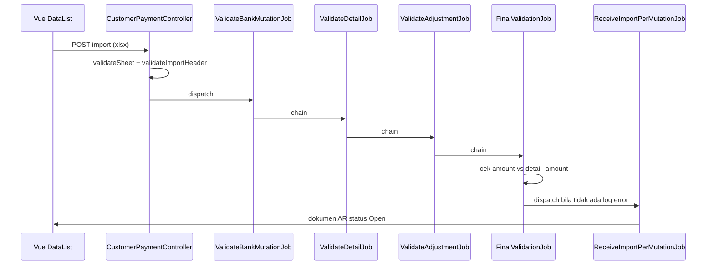

# Account Receive — Technical

**Behavior SoT:** [requirement.md](./requirement.md) v2.13  
**Summary UI (AS-IS Done):** [ETM-16644](https://erpintegration.atlassian.net/browse/ETM-16644) — `summary` endpoint + FE `Summary.vue`  
**CN deposit COA (AS-IS Done):** [ETM-16764](https://erpintegration.atlassian.net/browse/ETM-16764) — resolve setting by asal CN (`PaymentDetailFundController`, import `createFund`)  
**Datalist memory / pagination (AS-IS Done):** [ETM-17198](https://erpintegration.atlassian.net/browse/ETM-17198) — FE `pageLengths=[10,20,50]`; trim eager load + TRX. REF tooltip  
**Autosave default Open (TO-BE):** [ETM-17325](https://erpintegration.atlassian.net/browse/ETM-17325) — AS-IS `PaymentController::store` masih `TS_DRAFT`

## 1. File Map

### Backend

| Berkas | Peran |
|---|---|
| `Modules/Accounting/Http/Controllers/CustomerPaymentController.php` | Endpoint import, download template, progress, log, history; validasi sheet dan heading |
| `Modules/Accounting/Http/Controllers/PaymentController.php` | Store/update/approve AR; datalist Description (ETM-16991); default create `TS_DRAFT` (TO-BE Open ETM-17325) |
| `app/Helpers/Accounting/JournalProcess.php` | `customerPaymentAutoJournal` — jurnal Approve AR |
| `Modules/Accounting/Entities/PaymentDetail*.php` | `auditIdentifier` + `transformAudit` (COA → code\|name) |
| `Modules/Accounting/Exports/CustomerPaymentExport.php` | Heading ekspor "Receive per {tanggal}" termasuk kolom Description |
| `Modules/Accounting/Jobs/CustomerPaymentExportChunkJob.php` | Mengisi kolom Description dari deskripsi header dokumen |
| `Modules/Accounting/Http/Controllers/CustomerPaymentDetailController.php` | Detail dokumen AR + jalur import detail lama |
| `Modules/Accounting/Http/Controllers/CustomerPaymentDetailAdjustmentController.php` | Baris adjustment pada dokumen AR |
| `Modules/Accounting/Exports/AccountReceiveTemplateExport.php` | Definisi tiga sheet + konstanta nama sheet |
| `Modules/Accounting/Exports/AccountReceiveBankMutationTemplateSheet.php` | `REQUIRED_HEADINGS` Sheet 1 |
| `Modules/Accounting/Exports/AccountReceiveDetailTemplateSheet.php` | `REQUIRED_HEADINGS` Sheet 2 |
| `Modules/Accounting/Exports/AccountReceiveAdjustmentTemplateSheet.php` | `REQUIRED_HEADINGS` Sheet 3 |
| `Modules/Accounting/Import/ReceiveValidateBankMutationImport.php` | Sheet mapper Sheet 1 |
| `Modules/Accounting/Import/ReceiveValidateBankMutationSheet.php` | Validasi Sheet 1 |
| `Modules/Accounting/Import/ReceiveValidateDetailImport.php` | Sheet mapper Sheet 2 |
| `Modules/Accounting/Import/ReceiveValidateDetailSheet.php` | Validasi Sheet 2 |
| `Modules/Accounting/Import/ReceiveValidateAdjustmentImport.php` | Sheet mapper Sheet 3 |
| `Modules/Accounting/Import/ReceiveValidateAdjustmentSheet.php` | Validasi Sheet 3 |
| `Modules/Accounting/Jobs/ImportReceiveValidateBankMutationJob.php` | Rantai validasi tahap 1 |
| `Modules/Accounting/Jobs/ImportReceiveValidateDetailJob.php` | Rantai validasi tahap 2 |
| `Modules/Accounting/Jobs/ImportReceiveValidateAdjustmentJob.php` | Rantai validasi tahap 3 |
| `Modules/Accounting/Jobs/ImportReceiveFinalValidationJob.php` | Amount Mismatch check + penentuan sukses/gagal |
| `Modules/Accounting/Jobs/ReceiveImportPerMutationJob.php` | Pembentukan dokumen AR, detail, adjustment, dan Credit Note |
| `Modules/Accounting/Entities/CustomerPayment.php` | Model dokumen AR |
| `Modules/Accounting/Entities/CustomerPaymentDetail.php` | Model alokasi ke invoice |
| `Modules/Accounting/Entities/CustomerInvoice.php` | Sumber outstanding lewat `invoice_remaining_after_vat` |
| `Modules/Accounting/Import/CustomerPaymentImport.php` | Jalur import lama satu sheet — menambah detail ke dokumen AR yang sudah ada |
| `Modules/Accounting/Policies/CustomerPaymentPolicy.php` | Otorisasi |

### Frontend

| Berkas | Peran |
|---|---|
| `olshoperp-frontend/src/pages/Accounting/AccountReceivable/Receive/DataList.vue` | Datalist, export, riwayat import; kolom Description (ETM-16991) |
| `olshoperp-frontend/src/pages/Accounting/AccountReceivable/Receive/ImportLog.vue` | Panel error hasil screening |
| `olshoperp-frontend/src/pages/Accounting/AccountReceivable/Receive/Form.vue` | Form dokumen AR |
| `olshoperp-frontend/src/pages/Accounting/AccountReceivable/Receive/DatalistDetail.vue` | Datalist detail invoice terlunasi |
| `olshoperp-frontend/src/pages/Accounting/AccountReceivable/Receive/AvailableData.vue` | Modal Available Sales Invoice |
| `olshoperp-frontend/src/pages/Accounting/AccountReceivable/Receive/Adjustment.vue` | Baris adjustment |
| `olshoperp-frontend/src/pages/Accounting/AccountReceivable/Receive/ApprovalDialog.vue` | Dialog approve |

## 2. API Routes

| Method | Path | Handler |
|---|---|---|
| POST | `accounting/customer-payment/import` | `CustomerPaymentController@import` |
| GET | `accounting/customer-payment/import/template` | `CustomerPaymentController@importTemplate` |
| GET | `accounting/customer-payment/import/progress` | `CustomerPaymentController@importProgress` |
| GET | `accounting/customer-payment/import-log` | `CustomerPaymentController@importLog` |
| GET | `accounting/customer-payment/import-history` | `CustomerPaymentController@importHistory` |
| GET | `accounting/customer-payment/import-history-detail/{historyId}` | `CustomerPaymentController@importHistoryDetail` |
| GET | `accounting/customer-payment/{payment}/outstanding-customer-invoice` | `CustomerPaymentController@outstanding_customer_invoice` |
| GET | `accounting/customer-payment/{payment}/select2-outstanding-invoice` | `CustomerPaymentController@select2OutstandingCustomerInvoice` |
| POST | `accounting/customer-payment/{payment}/bulk-select` | `CustomerPaymentDetailController@bulkSelectStore` |

## 3. Database Key Tables

| Tabel | Peran |
|---|---|
| `accounting_customer_payments` | Header dokumen AR — `transaction_status`, `grand_total`, `actor_reference_id`, `actor_reference_class` |
| `accounting_customer_payment_details` | Alokasi per invoice |
| `import_receive_temps` | Staging antar sheet; kolom kunci `type_id`, `row`, `identifier`, `identifier_class`, `amount`, `detail_amount`, `bank_mutation_id` |
| `import_receive_logs` | Kumpulan pesan error satu sesi import |
| `payment_import_histories` | Riwayat import beserta hitungan baris sukses/gagal |
| `accounting_customer_invoices` | `prepared_to_payment_amount`, `processed_to_payment_amount`, `grand_total_after_vat` |

`identifier_class` bersifat polymorphic: `ChartOfAccount::class` untuk pembayaran bank, `Payment::class` untuk Credit Note.

## 4. Flow utama

## 5. Invariants

- Per baris mutasi sebelum dokumen dibentuk: `amount == detail_amount`, di mana `detail_amount` adalah akumulasi Sheet 2 ditambah adjustment Sheet 3 (Debit disimpan negatif, Credit positif).
- Per invoice: `prepared_to_payment_amount + processed_to_payment_amount <= grand_total_after_vat`.
- `invoice_remaining_after_vat = grand_total_after_vat - (prepared_to_payment_amount + processed_to_payment_amount)`.
- Dokumen AR hasil import selalu lahir dengan `transaction_status = open`.
- `grand_total` dokumen AR = amount mutasi dikurangi total adjustment bertipe Credit Note.
- Satu baris adjustment hanya boleh mengisi Debit atau Credit, tidak keduanya.

## 6. Validation Highlights

- Validasi berlapis: ekstensi dan mime XLSX di controller, keberadaan sheet wajib di `validateSheet`, judul kolom di `validateImportHeader`, lalu validasi isi per sheet di kelas `ReceiveValidate*Sheet`.
- Seluruh pesan error ditulis ke `ImportReceiveLog` dengan format `Row {row} at Sheet {index}: {Column} {message}`; nomor sheet berasal dari posisi fisik sheet di file.
- Tanggal menerima serial number Excel maupun string tanggal kalender, lalu disimpan dengan jam 23:59:59 — lihat GAP-AR-03 di requirement.
- COA adjustment dibatasi ke class `Expense`, `Revenue`, `Other Revenue & Expenses`, harus aktif, dan bukan COA induk.
- Daftar pesan lengkap ada di [requirement §6](./requirement.md).

## 7. Frontend Behaviors

- Datalist memuat panel riwayat import (`has_import_history`) dan komponen `ImportLog.vue` untuk menampilkan hasil screening.
- Kolom **Description** di `DataList.vue` (deskripsi header) bisa dicari dan diurutkan lewat `PaymentController`. Ekspor daftar "Receive per {tanggal}" menulis kolom yang sama di `CustomerPaymentExport` dan `CustomerPaymentExportChunkJob` (ETM-16991).
- Progress import di-poll lewat endpoint `import/progress`.
- Modal Available Sales Invoice mengambil data dari endpoint outstanding invoice pada dokumen AR terkait.
- **Select Invoice (ETM-17102):** `DatalistDetail.vue` memanggil `POST .../bulk-select`. `PaymentDetailController::bulkSelectStore` membuat detail dengan `is_full_amount = 1` dan amount = `invoice_remaining_after_vat`, lewat `store()`. Di `store()`, bila Sales Invoice punya `cash_bank`, transaksi yang sama membuat baris fund Cash/Bank (`PaymentDetailFundController::store`) dengan `fund_amount` = amount detail. `Form.vue` harus memuat ulang section Receiving Destination setelah response sukses supaya baris baru tidak tertinggal di tampilan lama. Nama key komponen Vue tidak dicek ulang pada pembaruan ini.

## 8. Failure Modes & Transaction Boundary

- Import bersifat all-or-nothing: bila `ImportReceiveLog` berisi entri apa pun saat `ImportReceiveFinalValidationJob` berjalan, riwayat ditandai gagal dan `ReceiveImportJob` tidak pernah di-dispatch — tidak ada dokumen tertulis sebagian.
- Exception di validasi akhir dicatat sebagai `Something went wrong: {pesan}`, riwayat ditandai gagal, lalu exception dilempar ulang supaya job masuk failed queue.
- Berkas upload dihapus pada tahap validasi akhir.
- Penguncian sesi: cache `import/ar/{company}` + cek `ImportReceive` yang belum `ended_at`. Pesan penolakan & notifikasi memakai nama Account Receive / Receive (GAP-AR-07 closed). AP terpisah: `import/ap/{company}`.
- Pembentukan dokumen berjalan per baris mutasi di job terpisah; kegagalan satu job tidak otomatis merollback dokumen dari baris mutasi lain yang sudah selesai.

## 9. Data Lifecycle

| Tahap | Flag / kolom | Efek |
|---|---|---|
| Import lolos validasi | Baris di `import_receive_temps` | Data staging siap dibentuk |
| Dokumen AR dibentuk | `transaction_status = open` | `prepared_to_payment_amount` invoice bertambah |
| AR di-Approve | `transaction_status = approved` | Nilai pindah dari prepared ke `processed_to_payment_amount`, jurnal terbentuk |
| AR di-Reject atau Void | status berubah | Alokasi dilepas dari invoice |
| Adjustment `CREDIT NOTE` (import) | Credit Note baru status open | Tertaut ke dokumen AR lewat `transaction_reference_id` + `transaction_reference_class = CustomerPayment`; nilai CN dipotong dari `grand_total` + fund AR saat create |
| Hapus CN hasil generate (AR masih Open) | CN soft-deleted (`SemiHardDeletes`) | Approve AR ditolak: cek `CreditNote::onlyTrashed()` by `transaction_reference_id` AR — pesan di requirement §6.4.1. `PaymentDetailAdjustmentController::store` **tidak** membuat CN (hanya COA) |

## 10. Summary panel (AS-IS · ETM-16644 Done)

FE read-only block after Adjustment accordion (Show + Edit). Mirror AP ETM-16643 with **inverted** journal sign rule. Total orange memakai nilai yang sudah dibulatkan 2 desimal.

| Aggregate | Formula note |
|-----------|--------------|
| Piutang | Σ detail SI amounts → header CCY via **header** rate (**+**) |
| Cash/Bank | Σ cash/bank receive (**−** if journal Dr) |
| Credit Note | Σ CN used as source + CN spawned from this AR — **separate** from Cash/Bank; sign by journal side |
| Adj Debit / Adj Credit | Σ adjustment (**−** / **+**) |
| Total | Sum; **2** decimals; orange if ≠ 0 — **no** new save validation |

Sign rule AR: journal **Cr → +**, **Dr → −**. See [requirement §6.5](./requirement.md).

## 11. Approve + Journal (AS-IS)

**Approve gate:** `PaymentController::approve` → `approvePayment` → `JournalProcess::customerPaymentAutoJournal`. Urutan validasi & pesan: [requirement §6.4.1](./requirement.md).

**Journal header**

| Field | Value |
|---|---|
| `description` | ≤5 SI unik: `Payment for invoice(s) number: {codes}`; >5: `Payment for {N} invoices`; tanpa detail: `Auto-Journal from {AR code}` |
| `transaction_reference_*` | id = Payment AR; class `Payment`; text `Payment from Customer`; url FE edit AR |
| Status akhir | `TS_APPROVED` + Approval: `Auto Approve Journal Generated by System from Payment from Customer {code}.` |

**COA mapping (detail)**

| Sisi | Sumber COA |
|---|---|
| Cr AR | Company customer → `company_coa_name('Account Receivable COA')`; Store → `store.account_receivable_coa` fallback company owner |
| Dr Cash/Bank | `payment_detail_funds.coa_id` (dari Cash/Bank dipilih) |
| Dr Deposit/CN | `payment_detail_deposits.coa_id` (stamp saat pakai CN — SR → Deposit of Sales Return; regular → Customer Deposit) |
| Dr/Cr Adjustment | `payment_detail_adjustments.coa_id` + deskripsi baris digabung ke desc detail |
| Exchange / Cash Diff | Company `Exchange Diff. COA` / `Cash Diff. COA` (wajib terkonfigurasi atau throw) |

Detail line default desc: `Auto-Journal from Payment from Customer: {AR code}. Customer Name: {name}`.

**Audit (AS-IS):** Auditable pada detail entities; identifier sering `coa_id` (sudah di-transform ke teks COA). Gap UX readable → requirement §5.12 TO-BE [ETM-17326](https://erpintegration.atlassian.net/browse/ETM-17326).

## 12. Tests & QA Notes

- Test case aktif menu ini ada di `test-cases/` — mencakup bulk approve dan insert Sales Invoice, belum mencakup alur import multi-sheet (lihat GAP-AR-09).
- Assertion pesan error wajib mengikuti string di §6 requirement, bukan string di raw requirement lama.
- Fixture import sebaiknya memakai template hasil endpoint `import/template` supaya nama sheet dan heading selalu sinkron.
- Summary (ETM-16644 Done): after Adjustment; header CCY; CN split; Total orange when ≠ 0 (rounded 2dp); signs opposite of AP.
- Adjustment form select2: `customer-payment-adjustment/select2-coa` → `ChartOfAccountController::select2Child` (leaf/active, all classes; exclude CBR-locked COA by payment date). Store: debit XOR credit; `description` **required** max 150; unique `coa_id` per payment. Import Sheet 3 tetap filter class Expense/Revenue/Other Revenue & Expenses (+ `CREDIT NOTE`).
- Single Use modal FE labels (Receive wording): `SingleUseModal.vue` + `OutstandingCustomerInvoice.vue`.

## 13. Known Issues

| GAP | Ringkas |
|---|---|
| GAP-AR-01 | **Closed — Locked AS-IS:** heading template = file unduhan live (§4 requirement) |
| GAP-AR-02 | **Closed — Locked AS-IS:** CN overpayment saat import (Open); hapus CN blokir Approve; no regenerate dari edit AR |
| GAP-AR-03 | **TO-BE ETM-17298:** jam import AR 23:59:00 (AS-IS masih 23:59:59); CN = AR + 10s → 23:59:10 same day |
| GAP-AR-04 | **Closed — Locked AS-IS:** match Sheet 1 = Sheet 2 + Sheet 3 (Dr−/Cr+) |
| GAP-AR-05 | **Closed — Locked AS-IS:** Expense / Revenue / Other Revenue & Expenses (+ CREDIT NOTE) |
| GAP-AR-06 | **Closed — Locked AS-IS:** assert string ikut requirement §6 |
| GAP-AR-07 | **Closed — Fixed:** cache `ar` + copy Account Receive (bukan AP) |
| GAP-AR-08 | **Closed — Bukan gap:** raw §7 = Instant Settlement; AR hanya relates §5.8 |
| GAP-AR-09 | **Open (docs):** alur manual / bulk approve belum satu paket requirement |
| GAP-AR-SUMMARY-01 | **Closed — AS-IS:** ETM-16644 Done |
| GAP-AR-CN-COA | **Closed — AS-IS:** ETM-16764 Done (`PaymentDetailFundController` + import `createFund`) |
| GAP-AR-MEM-01 | **Closed — AS-IS:** ETM-17198 Done (max 50) |

Detail lengkap: [requirement §8](./requirement.md).
