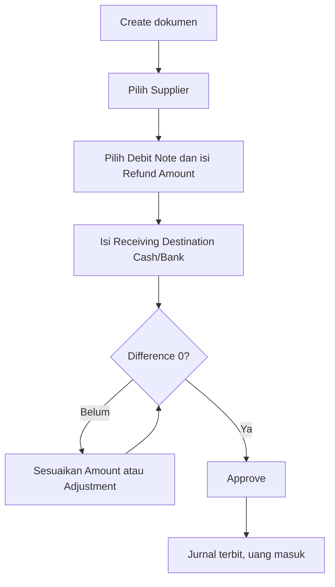

# Debit Note Refund — Knowledge Base (Operator)

**Audience:** Finance, AP clerk, Operations support  
**Route:** `/accounting/debit-note-refund`

---

## 1. Apa itu Debit Note Refund?

Debit Note Refund dipakai saat **supplier mengembalikan uang** sisa Debit Note ke rekening perusahaan. Uang masuk ke Cash/Bank, dan sisa Debit Note berkurang sebesar uang yang diterima.

**Kode transaksi:** diawali `DNR`.

Sisa Debit Note bisa diselesaikan lewat:

| Cara | Menu |
|------|------|
| Dipotongkan ke tagihan supplier | Account Payment |
| Supplier mengembalikan uangnya | Debit Note Refund |

Keduanya memakai **sisa yang sama**. Kalau sebagian sudah dipakai di Account Payment, yang bisa di-refund tinggal sisanya, dan sebaliknya.

---

## 2. Kapan dipakai?

| ✅ Pakai jika | ❌ Jangan pakai jika |
|---------------|----------------------|
| Supplier mentransfer balik sisa uang muka / nilai retur | Sisa Debit Note mau dipotongkan ke tagihan → pakai Account Payment |
| | Debit Note belum di-approve |

---

## 3. Alur kerja standar

**Keterangan langkah:**
- **Create:** langsung Open; currency IDR dan rate 1 otomatis.
- **Supplier:** hanya supplier perusahaan (bukan store), tampil kodenya saja. Setelah ada Debit Note di detail, supplier, mata uang, kurs, dan tanggal terkunci.
- **Pilih Debit Note:** lewat **Select Debit Note** atau **Available Debit Note**. Yang muncul hanya Debit Note supplier itu yang Approved, mata uangnya sama, tanggalnya tidak lebih dari tanggal refund, dan masih ada sisa. Refund Amount otomatis sisa penuh; ubah bila sebagian.
- **Begitu Debit Note masuk detail, sisanya langsung terpakai (dipesan)** walau belum di-approve.
- **Receiving Destination:** rekening penerima uang. Tidak ada cek saldo karena uangnya masuk.
- **Approve:** sistem cek ulang sisa Debit Note, lalu jurnal terbit.

---

## 4. Membaca angka

**Uang masuk = total Refund Amount + Adjustment Credit − Adjustment Debit.**

Contoh: supplier mengembalikan 900.000; bank memotong biaya transfer 6.500 (Debit); supplier ternyata transfer lebih 2.000 (Credit). Isi Receiving Destination = 895.500.

| Tempat | Arti |
|--------|------|
| Remaining Balance | Sisa Debit Note yang masih bisa dipakai |
| Used Status → Prepared | Dipesan dokumen yang belum di-approve |
| Used Status → Processed | Sudah terpakai final |
| Summary → Difference | Harus 0 sebelum Approve |
| Detail / Summary → **Exchange Gain** | Selisih kurs IDR (TO-BE ETM-17830). Info saja — tidak mengubah Difference. Plus = laba kurs; minus = rugi kurs |

---

## 5. Status

| Status | Sisa Debit Note |
|--------|-----------------|
| Open / Draft | Dipesan |
| Rejected | Tetap dipesan; bisa diperbaiki. Setelah disimpan jadi Draft, atau Open kalau kamu pilih Open |
| Approved | Terpakai final; jurnal terbit |

Void belum ada.

---

## 6. Troubleshooting

| Gejala | Penyebab | Solusi |
|--------|----------|--------|
| "Entered amount exceeds the remaining Debit Note balance." | Melebihi sisa | Kecilkan nilai; cek siapa yang memesan di Detail Related Transaction Debit Note |
| Debit Note tidak muncul | Belum Approved, beda supplier/mata uang, tanggal setelah refund, sisa 0 | Cek kelima hal itu |
| "… is still being used in other transaction…" | User lain sedang memakai Debit Note yang sama | Tunggu lalu ulangi |
| "Approval Failed. Total Receiving Destination must be equal to Total Payment Detail." | Difference belum 0 | Samakan uang masuk dengan Refund + Credit − Debit |
| "Complete the receiving destination section…" | Rekening penerima belum diisi | Isi Receiving Destination |
| Sisa Debit Note tidak kembali setelah Reject | Rejected tetap memesan | Hapus baris/dokumen atau perbaiki lalu Approve |

---

## 7. FAQ

**Kenapa tidak ada cek saldo rekening?** Karena uangnya masuk, bukan keluar.

**Rekening Kas yang saldonya minus boleh dipakai?** Boleh, karena transaksi ini menambah saldonya.

**Bisa sebagian?** Bisa. Contoh Debit Note 1.000.000, refund 300.000, sisa 700.000 masih bisa dipakai Account Payment.

**Debit Note tanggal hari ini tidak muncul di Account Payment?** Account Payment hanya menampilkan Debit Note bertanggal sebelum tanggal pembayaran; refund boleh tanggal yang sama.

**Kalau refund dalam USD?** Pilih USD dan isi kurs. Selisih kurs dicatat otomatis. TO-BE ETM-17830: kolom **Exchange Gain** (IDR) setelah Refund Amount; di Summary juga, tanpa mengubah Difference. Plus = laba kurs; minus = rugi kurs.

---

## Related Documents

- [requirement.md](./requirement.md) · [technical.md](./technical.md) · [user-guide.md](./user-guide.md)
- [Debit Note KB](../accounting-debit-note/knowledge-base.md) · [Credit Note Refund KB](../accounting-credit-note-refund/knowledge-base.md)
