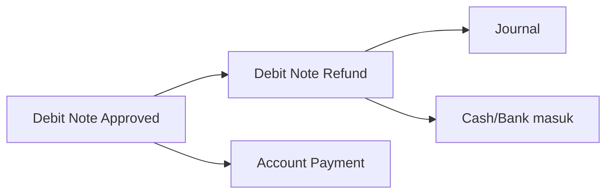
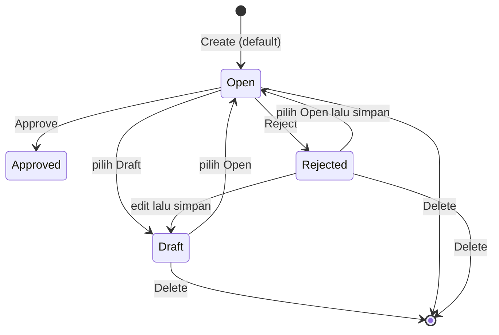
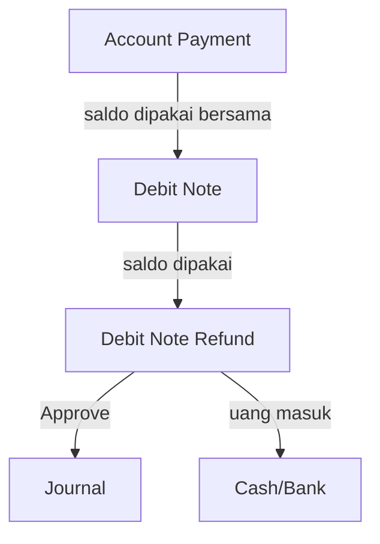

# Debit Note Refund — Requirement Documentation

**Modul:** Finance & Accounting / Account Payable  
**Prefix:** `DNR`  
**Audience:** PM, Finance, QA  
**UI route:** `/accounting/debit-note-refund`  
**Origin:** [ETM-17686](https://erpintegration.atlassian.net/browse/ETM-17686) (kembaran ETM-17655 + 3 perbedaan disetujui 24 Nov 2026)

Upstream: [Debit Note](../accounting-debit-note/requirement.md) · Saldo dipakai bersama: [Account Payment](../accounting-supplier-payment/requirement.md) · Kembaran sisi customer: [Credit Note Refund](../accounting-credit-note-refund/requirement.md)

---

## 0. Metadata & Changelog

| Version | Date | Author | Changes |
|---------|------|--------|---------|
| 1.0 | 2026-11-26 | QA - Yemima | Dokumen awal dari keputusan ETM-17686 + kode dev (PR refund, 26 Nov 2026) |

---

## 1. Ringkasan Eksekutif

Debit Note Refund (DNR) mencatat **uang** sisa saldo Debit Note (DN) yang dikembalikan supplier ke perusahaan lewat Cash/Bank. Sebelumnya saldo DN hanya bisa dihabiskan lewat Account Payment (AP). Sekarang satu DN bisa diselesaikan lewat AP, lewat Refund, atau sebagian di masing-masing. Saldo DN **satu dan dipakai bersama**.

Semua aturan sama dengan Credit Note Refund, kecuali tiga perbedaan karena arah uang terbalik dan supplier hanya General Company:

| Bagian | Credit Note Refund | Debit Note Refund |
|--------|--------------------|-------------------|
| Pihak | Customer, radio General / Platform | Supplier General Company saja (tampil kode), tanpa radio |
| Arah uang | Keluar (section Payment Source) | **Masuk** (section **Receiving Destination**) |
| Rumus Adjustment | Total + Adj Debit − Adj Credit | **Total + Adj Credit − Adj Debit** (ikut Account Receive) |
| Cek saldo Cash/Bank | Ada | **Tidak ada** |
| Jurnal | Dr deposit customer / Cr Cash/Bank | **Dr Cash/Bank / Cr deposit supplier** |

### 1.1 Rantai proses



---

## 2. Prasyarat

| Prasyarat | Sumber | Catatan |
|-----------|--------|---------|
| DN Approved dengan Remaining Balance lebih dari 0 | Debit Note | Supplier sama, currency sama |
| Supplier aktif, COA lengkap | General Company | Hanya General Company supplier |
| Akun deposit terisi | Setting supplier / company | Deposit to Supplier COA, Deposit of Purchase Return |
| Cash/Bank aktif untuk currency dokumen | Master Cash Bank | Tanpa itu header tidak bisa disimpan |
| Fiscal period terbuka; Cash/Bank belum terkunci rekonsiliasi | Fiscal Period, Cash/Bank Reconcile | Dicek saat Approve |
| Exchange Diff. COA terisi (bila valas) | Setting company | Selisih kurs |

---

## 3. Siklus Status



| Status | Saldo DN | Jurnal | Bisa diedit |
|--------|----------|--------|-------------|
| Open (default) | Prepared | Tidak | Ya |
| Draft | Prepared | Tidak | Ya |
| Rejected | Prepared (setara Draft/Open) | Tidak | Ya |
| Approved | Processed | Ya | Tidak |

- Approve/Reject hanya dari Open, approval satu level.
- Reject: status + log saja, tanpa jurnal dan tanpa memindah saldo.
- Rejected diedit lalu disimpan: Draft, atau Open bila radio Open dipilih (aturan Debit Note, GAP-DN-01). [VERIFY: CODEBASE] status mengikuti pilihan radio saat Save All.
- Void belum ada (pending, sama dengan Debit Note GAP-DN-05).

---

## 4. Datalist

| Kolom | Keterangan |
|-------|------------|
| Trx. Code / Trx. Date | Prefix `DNR` |
| Supplier | Kode supplier |
| Debit Note | Kode DN di detail |
| Curr. / Rate | Header |
| Total Amount | Total Refund + Adj Credit − Adj Debit (= uang masuk seharusnya) |
| Trx. Status | Draft / Open / Rejected / Approved |
| Journal | Kode jurnal setelah Approve |
| Created By / Created At | Audit |
| Action | Edit + Delete (Draft/Open/Rejected); Show (Approved) |

Fitur: find something, Advanced Filter, Show deleted data, Columns Show/Hide, Export, **Create**.

---

## 5. Form & Field

Halaman penuh. Section: Basic Information → Detail Debit Note Refund → Receiving Destination → Adjustment → Summary → Approval → Audit Log.

### 5.1 Basic Information

| Field | Wajib? | Default | Validasi / catatan |
|-------|--------|---------|--------------------|
| Transaction Code | Tidak | Otomatis `DNR…` | Max 50 |
| Transaction Date | Ya | Hari ini | Fiscal period terbuka |
| Supplier | Ya | — | General Company supplier, tampil kode. Kosong: "The supplier field is required." |
| Reference Doc | Tidak | — | Max 150 |
| Transaction Currency | Ya | Primary (IDR) | Harus ada Cash/Bank aktif |
| Exchange Rate | Ya | 1 | Angka, min 0 |
| Description | Tidak | — | Max 150 |
| Attachment | Tidak | — | — |

Terkunci setelah ada DN di detail: Supplier, Currency, Exchange Rate, Transaction Date ("Cannot edit Header when detail data exists. Please clear all details first.").

### 5.2 Detail Debit Note Refund

Lewat **Select Debit Note** atau **Available Debit Note** (Use / pilih banyak). Kolom: Debit Note Code / Date, Trx. Ref, Total Amount, Used Status, Remaining Balance, Refund Amount (default sisa penuh, bisa diedit), GL Account (akun deposit yang dikredit).

### 5.3 Receiving Destination

Cash/Bank penerima uang (currency sama). Kolom: Bank Account / Bank Name, GL Account, Currency, Amount. **Tanpa** cek saldo.

### 5.4 Adjustment

Select Account, Debit, Credit, Description. Rumus ikut Account Receive (§6.4).

### 5.5 Summary

Debit Note · Adj Debit · Adj Credit · Receiving Destination · **Difference** = (Debit Note − Adj Debit + Adj Credit) − Receiving Destination; harus 0.

---

## 6. How It Works

### 6.1 DN yang bisa dipilih

- Status DN Approved.
- Currency DN = currency dokumen.
- Tanggal DN **kurang dari atau sama dengan** tanggal refund (AP memakai "sebelum").
- Supplier DN = supplier dokumen (General Company).
- Remaining Balance lebih dari 0.

### 6.2 Saldo DN dipakai bersama AP dan Refund

```
Remaining Balance = Total DN − Prepared − Processed
```

DN masuk detail Refund (status apa pun) → Prepared naik; ubah nilai → ikut selisih; hapus baris/dokumen → dilepas; Approve → pindah ke Processed. Sama dengan AP dan saldo Purchase Invoice di AP.

**Contoh:** DN-A total 1.000.000; AP Approved 400.000; AP Open 250.000 → Remaining Balance 350.000. Refund menyimpan 300.000 → sisa 50.000. AP baru yang memakai 100.000 ditolak.

### 6.3 Dua user bersamaan

Sama dengan Credit Note Refund §6.3: kunci DN ±30 detik saat Use, kunci baris + cek ulang saat Approve ([ETM-17657](https://erpintegration.atlassian.net/browse/ETM-17657)).

### 6.4 Uang masuk dan Adjustment

```
Receiving Destination wajib = Total Refund + Adj Credit − Adj Debit
```

**Contoh:** refund 900.000; Debit biaya transfer dipotong bank 6.500; Credit supplier transfer lebih 2.000 → Receiving Destination 895.500.

### 6.5 Akun deposit per baris DN

| Asal DN | Akun (dikredit) |
|---------|------------------|
| Dari Purchase Return | Deposit of Purchase Return (supplier, fallback company) |
| Lainnya (manual, import AP) | Deposit to Supplier COA (supplier, fallback company) |

### 6.6 Cash/Bank

Tidak ada cek saldo karena uang masuk. Rekonsiliasi Cash/Bank tetap dicek saat Approve.

### 6.7 Jurnal saat Approve

| Sisi | Akun | Nilai |
|------|------|-------|
| Debit | Cash/Bank Receiving Destination | Amount (kurs dokumen) |
| Debit / Kredit | Akun Adjustment | Sesuai isian |
| Kredit | Akun deposit tiap baris DN (§6.5) | Refund Amount (kurs DN) |
| Debit / Kredit | Exchange Diff. COA | Selisih kurs |

Jurnal langsung Approved, tanggal = tanggal refund, deskripsi "Auto-Journal from Debit Note Refund: {kode}".

**Contoh jurnal:**

| Akun | Debit | Kredit |
|------|------:|-------:|
| Bank BCA (Receiving Destination) | 895.500 | |
| Bank Charges (Adj Debit) | 6.500 | |
| Pendapatan Lain-lain (Adj Credit) | | 2.000 |
| Deposit to Supplier (DN manual) | | 300.000 |
| Deposit of Purchase Return (DN dari retur) | | 600.000 |
| **Total** | **902.000** | **902.000** |

**Contoh valas:** DN USD 100 kurs 15.500 (Rp 1.550.000) di-refund kurs 16.000 (Rp 1.600.000) → laba selisih kurs Rp 50.000.

---

## 7. Validasi

### 7.1 Header

| # | Kondisi | Pesan |
|---|---------|-------|
| 1 | Supplier kosong | The supplier field is required. |
| 2 | Tidak ada Cash/Bank untuk currency | Cannot update transaction. Please set up a cash/bank account for this currency first. |
| 3 | Fiscal period tertutup | Pesan fiscal |
| 4 | Ubah field kritikal saat ada detail | Cannot edit Header when detail data exists. Please clear all details first. |
| 5 | Edit dokumen Approved | This payment and it's properties already approved, you can't modify this data anymore. |

### 7.2 Detail Debit Note

| # | Kondisi | Pesan |
|---|---------|-------|
| 1 | DN tidak memenuhi §6.1 | The selected Debit Note is not available for this refund. |
| 2 | Melebihi Remaining Balance | Entered amount exceeds the remaining Debit Note balance. |
| 3 | DN sama dua kali | Debit Note already added. Please select a different Debit Note. |
| 4 | DN sedang dipakai | {kode} is still being used in other transaction, please try again later |

### 7.3 Approve

| # | Kondisi | Pesan |
|---|---------|-------|
| 1 | Tidak ada detail DN | This payment doesn't have any debit note detail data. |
| 2 | Receiving Destination kosong | Complete the receiving destination section to approve this transaction. |
| 3 | Difference ≠ 0 (toleransi 0,01) | Approval Failed. Total Receiving Destination must be equal to Total Payment Detail. |
| 4 | DN tidak lagi memenuhi §6.1 | Debit Note {kode} is no longer available for this refund. |
| 5 | Prepared DN kurang | Prepared amount for {kode} is insufficient. |
| 6 | Sisa DN minus | Used debit note amount exceed remaining {kode} amount |
| 7 | Fiscal / rekonsiliasi / Exchange Diff. COA / approve bersamaan | Pesan masing-masing |

### 7.4 Delete

Draft / Open / Rejected boleh; melepas semua Prepared DN. Approved tidak boleh.

---

## 8. Relasi Menu Lain



| Menu | Peran |
|------|-------|
| Debit Note | Sumber saldo; datalist Paid / Used Status / Remaining Balance ikut menghitung Refund; Detail Related Transaction menampilkan baris Refund |
| Account Payment | Pemakai saldo DN yang sama |
| Purchase Return | Sumber DN dari retur billed |
| Journal / General Ledger / Trial Balance | Jurnal Approve |
| Cash/Bank Reconcile | Refund = uang masuk |
| Credit Note Refund | Kembaran sisi customer |

---

## 9. Gap Registry

| ID | Deskripsi | Dampak | Status |
|----|-----------|--------|--------|
| GAP-DNR-01 | Void belum ada | Refund Approved belum bisa dibatalkan dari layar | Pending — belum dibahas end user |
| GAP-DNR-02 | Tombol Print menampilkan "still under development" | Belum ada cetakan | Open |
| GAP-DNR-03 | Import belum ada | Input satu per satu | Di luar lingkup ETM-17686 |
| GAP-DNR-04 | Aturan tanggal Refund (≤) beda dengan AP (<) | DN tanggal sama bisa di-refund tapi tidak muncul di AP | Open |

---

## 10. FAQ

**Q: Kenapa tidak ada cek saldo Cash/Bank?**  
A: Uang masuk dari supplier, jadi saldo rekening tidak bisa kurang karena transaksi ini.

**Q: Kenapa rumus Adjustment beda dengan Credit Note Refund?**  
A: Arah uangnya terbalik. Biaya yang dipotong bank (Debit) mengurangi uang yang diterima; kelebihan transfer supplier (Credit) menambahnya.

**Q: Refund di-Reject, saldo DN kembali?**  
A: Tidak. Rejected tetap memesan saldo. Hapus baris/dokumen untuk melepas.

**Q: Bisa refund sebagian?**  
A: Bisa. Sisa DN tetap bisa dipakai AP atau refund lain.
