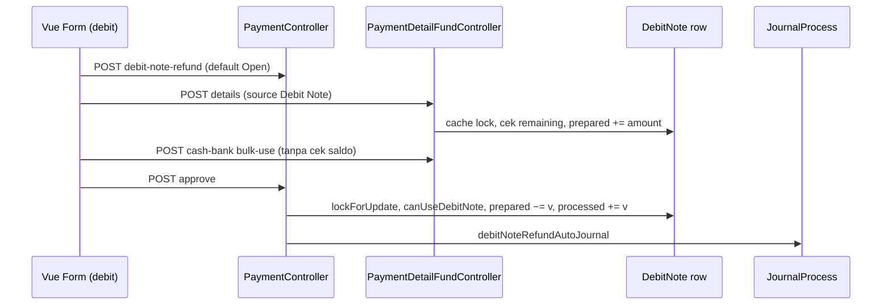

# Debit Note Refund — Technical Documentation

**API prefix:** `accounting/debit-note-refund`  
**Module:** `Modules/Accounting`  
**Behavior SoT:** [requirement.md](./requirement.md) v1.0  
**Origin:** [ETM-17686](https://erpintegration.atlassian.net/browse/ETM-17686) · kode: PR `refund` (BE #6846, FE #4580)  
**Kembaran:** [Credit Note Refund technical](../accounting-credit-note-refund/technical.md) — kode dipakai bersama; dokumen ini mencatat bedanya.

---

## 1. File Map

### Backend

| Layer | Path |
|-------|------|
| Routes | `Modules/Accounting/Routes/api.php` (group `debit-note-refund`) |
| Controller header | `Modules/Accounting/Http/Controllers/DebitNoteRefundController.php` |
| Controller detail DN + Cash/Bank | `Modules/Accounting/Http/Controllers/DebitNoteRefundDetailController.php` |
| Controller adjustment | `Modules/Accounting/Http/Controllers/DebitNoteRefundAdjustmentController.php` |
| Entity | `Modules/Accounting/Entities/DebitNoteRefund.php` (`code_identifier = DNR`, `canUseDebitNote()`) |
| Scope / Policy | `Entities/Scopes/DebitNoteRefundScope.php` · `Policies/DebitNoteRefundPolicy.php` |
| Shared | `PaymentController`, `PaymentDetailFundController`, `PaymentDetailAdjustmentController`, `NoteRefundAmount::debitNote`, `PaymentPrice` (cabang DNR), `JournalProcess::debitNoteRefundAutoJournal` |
| Menu seeder | `Modules/Gate/Database/Seeders/ModuleMenu/AccountingMenuSeeder.php` (`Debit Note Refund`, approval 1) |

### Frontend

| Layer | Path |
|-------|------|
| List | `src/pages/Accounting/DebitNoteRefund/DataList.vue` (bungkus `CreditNoteRefund/DataList.vue` `refund-type="debit"`) |
| Form | `src/pages/Accounting/DebitNoteRefund/Form.vue` (bungkus `CreditNoteRefund/Form.vue` `refund-type="debit"`) |

---

## 2. API Routes

Sama pola dengan Credit Note Refund: `accounting/debit-note-refund` index/store/show/update/destroy, `{id}/approve`, `{id}/transaction-status`, `{id}/summary`, `{id}/details` (+ `bulk`, `available-debit-notes`, `select2-available-debit-notes`), `{id}/cash-bank-account` (+ `bulk-use`), `{id}/adjustments`, lookup `select2-supplier`, `select2-currency`, `select2-cash-bank`, `select2-adjustment-account`, `default-values`, `approval-eligibility/{id}`, `{id}/audit`, `{id}/log/approve`.

---

## 3. Database — Key Tables

| Table | Role |
|-------|------|
| `accounting_payments` | Header `type = Debit Note Refund`; `grand_total` = uang masuk |
| `accounting_payment_detail_deposits` | Baris DN (`deposit_id` = DN) |
| `accounting_payment_detail_funds` | Receiving Destination (`type = Cash/Bank`) |
| `accounting_payment_detail_adjustments` | Adjustment |
| DN (`accounting_payments`) | `prepared_to_use_amount`, `processed_to_use_amount` |
| `accounting_journals` + details | Jurnal Approve |

---

## 4. Beda dengan Credit Note Refund

| Concern | DNR |
|---------|-----|
| Eligibility | `canUseDebitNote`: Approved, currency sama, tanggal DN ≤ refund, `actor_reference_id` sama, `actor_reference_class = Company` |
| Summary | `NoteRefundAmount::debitNote`: `difference = note − adj_debit + adj_credit − cash_bank` |
| Grand total | `grandTotalPriceAfterVat` cabang DNR: `Σ deposit + (credit − debit)` |
| Akun deposit baris | Asal `PurchaseReturn` → supplier `Deposit of Purchase Return`; lainnya → `Deposit to Supplier COA`; fallback company |
| Cek saldo bank | **Tidak ada** (fund store hanya cek untuk Payment to Supplier / CNR) |
| Approve | Detail ada; Cash/Bank ada; diff ≤ 0.01; lock DN + `canUseDebitNote`; prepared cukup; remaining ≥ 0 |
| Journal | `noteRefundAutoJournal(deposit_side=credit, cash_bank_side=debit, positive_exchange_side=credit)` |
| Pesan | "The supplier field is required.", "… debit note detail data.", "Complete the receiving destination section…", "Approval Failed. Total Receiving Destination must be equal to Total Payment Detail." |

---

## 5. Flow utama

Reject: status + log, return sebelum saldo/jurnal.

---

## 6. Invariants

| ID | Assertion |
|----|-----------|
| INV-DNR-01 | Tiap DN: `prepared + processed <= grand_total DN` |
| INV-DNR-02 | Approve: `|note − adj_debit + adj_credit − cash_bank| <= 0.01` |
| INV-DNR-03 | Jurnal: Σ Dr = Σ Cr |
| INV-DNR-04 | Satu DN maksimal satu baris per dokumen |
| INV-DNR-05 | Draft/Open/Rejected tanpa jurnal |
| INV-DNR-06 | `grand_total` header = note + adj_credit − adj_debit |

---

## 7. Validation Highlights

| Area | Key checks |
|------|------------|
| Header | supplier required; Cash/Bank untuk currency; fiscal; critical lock |
| Detail DN | `canUseDebitNote`; cache lock; remaining; tidak duplikat; akun deposit |
| Receiving Destination | currency sama; reconcile lock; **tanpa** saldo |
| Approve | lihat §4 |
| Destroy | Draft/Open/Rejected; prepared DN dilepas |

---

## 8. Frontend Behaviors

Sama dengan CNR (`refundConfig` debit): label Supplier, section **Detail Debit Note Refund** dan **Receiving Destination**, tanpa radio Customer Source, Summary baris terakhir "Receiving Destination", Print → toast.

---

## 9. Failure Modes & Transaction Boundary

| Failure | Boundary |
|---------|----------|
| Use DN bersamaan | Cache lock 30 dtk |
| Approve bersamaan | Cache `approval_payment:{id}` |
| Approve gagal di tengah | Rollback: status, saldo DN, jurnal tidak berubah |

---

## 10. Data Lifecycle

| Document | Field | When |
|----------|-------|------|
| Debit Note | `prepared_to_use_amount` | + tambah/naik; − turun/hapus/Approve |
| Debit Note | `processed_to_use_amount` | + Approve |
| Debit Note datalist | Paid | Σ deposit dari payment Approved (AP + Refund) |
| Cash/Bank (GL) | Debit | Approve |

---

## 11. Tests & QA Notes

- TC Jira: ETM-17791 … ETM-17821 (31 TC).
- Fixture Staging company 13: supplier NJA (15 DN Approved, 3 dari Purchase Return, ada USD), MSP, Bank 1-10002, Kas 1-10001 (saldo minus, uji tanpa cek saldo), 1-10009 USD.

---

## 12. Known Issues

| GAP | Tech note |
|-----|-----------|
| GAP-DNR-01 | Tidak ada Void |
| GAP-DNR-02 | Print toast |
| GAP-DNR-03 | Tidak ada import |
| GAP-DNR-04 | `<=` vs AP `<` |
