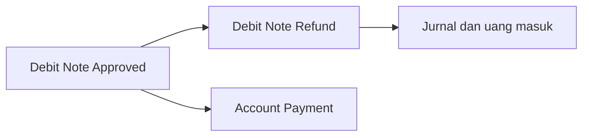

# Debit Note Refund — Panduan Pengguna

**Siapa yang baca panduan ini:** finance, AP clerk, operations support  
**Menu di sistem:** Finance and Accounting → Debit Note Refund  
**Kode transaksi:** dimulai dengan `DNR`

---

## 1. Apa Itu & Kenapa Penting

Debit Note Refund mencatat uang sisa Debit Note yang dikembalikan supplier ke rekening perusahaan. Sisa Debit Note berkurang dan uang tercatat masuk ke Cash/Bank. Menu ini memastikan sisa Debit Note tidak dipakai dua kali: sekali di Account Payment dan sekali lagi sebagai refund.

---

## 2. Overview Flow & Proses Bisnis

Versi teks:
1. Debit Note di-approve dan punya sisa.
2. Sisa itu bisa dipotongkan ke tagihan supplier lewat Account Payment, atau dicatat sebagai uang kembali lewat Debit Note Refund.
3. Setelah refund di-approve, jurnal terbit dan uang tercatat masuk.

Status: dokumen baru **Open** → **Approve** (selesai) atau **Reject**. Rejected bisa diperbaiki; setelah disimpan menjadi Draft (atau Open kalau kamu pilih Open).

---

## 3. Sebelum Mulai (Flow Sebelum)

- Debit Note supplier sudah **Approved** dan masih ada sisa.
- Mata uang sama, tanggal Debit Note tidak lebih dari tanggal refund.
- Ada rekening Cash/Bank aktif untuk mata uang itu.

---

## 4. Setelah Selesai (Flow Sesudah)

- Sisa Debit Note berkurang (cek **Used Status** dan **Remaining Balance** di datalist Debit Note). Kolom **Paid** ikut menghitung refund.
- **Detail Related Transaction** di Debit Note menampilkan baris refund.
- Jurnal: Cash/Bank bertambah, akun deposit supplier berkurang.

🎬 [Interactive demo akan ditambahkan di sini]

---

## 5. Yang Perlu Diperhatikan

- Sisa Debit Note langsung terpakai begitu masuk detail, walau belum di-approve. Contoh: Debit Note 1.000.000, sudah dipakai Account Payment 400.000 dan dipesan Account Payment lain 250.000 → yang bisa di-refund 350.000.
- Kalau Refund Amount melebihi sisa, sistem menolak.
- Saldo rekening tidak dicek karena uangnya masuk.
- Dokumen Rejected tetap memesan sisa. Hapus kalau refund batal.
- Supplier, mata uang, kurs, dan tanggal terkunci setelah ada Debit Note di detail.
- Void dan cetak belum tersedia.

---

## 6. Langkah-Langkah (Step by Step)

1. Buka **Finance and Accounting → Debit Note Refund**, klik **Create**.
2. Pilih **Supplier**, cek tanggal, mata uang, kurs, lalu **Save All**.
3. Di **Detail Debit Note Refund**, klik **Select Debit Note** atau **Available Debit Note**, pilih Debit Note. Ubah Refund Amount bila hanya sebagian.
4. Di **Receiving Destination**, klik **Select Cash/Bank** dan isi Amount uang yang diterima.
5. (Opsional) **Adjustment**: biaya yang dipotong bank (Debit) atau kelebihan transfer supplier (Credit).
6. Cek **Summary**: Difference harus 0. Rumusnya: uang masuk = total Refund + Credit − Debit.
7. (Valas) Cek kolom **Exchange Gain** — selisih kurs Rupiah; tidak mengubah Difference.
8. Pilih **Open**, **Save All**, lalu **Approve**.

Contoh: refund 900.000, bank memotong 6.500, supplier transfer lebih 2.000 → isi Receiving Destination 895.500.

Contoh valas: DN USD 100 kurs 15.500 di-refund kurs 16.000 → Exchange Gain **+50.000** (laba kurs).

---

## 7. Tips & Hal yang Sering Bikin Bingung

- **Debit Note tidak muncul?** Cek status, supplier, mata uang, tanggal, dan sisanya.
- **Pesan "still being used in other transaction"?** Ada user lain memakai Debit Note yang sama; ulangi sebentar lagi.
- **Rumus Adjustment kok beda dengan Credit Note Refund?** Karena di sini uangnya masuk, bukan keluar.
- **Refund dalam USD?** Pilih USD dan isi kurs; selisih kurs dicatat otomatis. TO-BE: kolom **Exchange Gain** (IDR) setelah Refund Amount (ETM-17830).

---

## 8. Referensi

- [Knowledge Base](./knowledge-base.md)
- [Requirement](./requirement.md)
- [Debit Note](../accounting-debit-note/user-guide.md)
- [Account Payment](../accounting-supplier-payment/user-guide.md)
