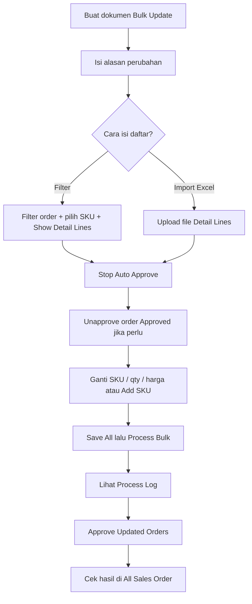

# Bulk Update Sales Order — Knowledge Base

Menu untuk **mengubah banyak Sales Order sekaligus**: ganti System SKU, ubah qty/harga, atau tambah SKU baru — tanpa buka order satu per satu. Hasil akhirnya dicek di **All Sales Order**.

> **TO-BE** — belum live. Ikuti alur di bawah saat fitur sudah di-deploy.

---

## 1. Apa itu & kapan dipakai

Pakai menu ini kalau stok warna/SKU habis, promo follow-up, atau perlu tambah hadiah ke banyak order yang masih bisa diubah.

**Jangan** pakai untuk membuat order baru dari Excel (itu **Import Processed / Non-Processed** di Sales Order / All Sales Order).

---

## 2. Alur kerja standar

**Keterangan langkah:**

- **Stop Auto Approve** wajib sebelum edit. Sekali di-stop, sistem tidak approve otomatis lagi — kamu yang approve manual.
- Order **Approved** yang belum ke wave & belum invoice: Unapprove dulu (langsung jalan, tidak bisa dibatalkan).
- **Process Bulk** baru benar-benar menulis perubahan ke order. Yang gagal ada alasannya di Process Log; yang sukses tidak otomatis “undo”.
- Maksimal sekitar **500 baris** per dokumen; approve massal maksimal **100 order** per klik.

---

## 3. Yang boleh & tidak boleh diubah

| Boleh | Tidak boleh |
|-------|-------------|
| Ganti System SKU (baris tetap sama; SKU marketplace tetap terlihat) | Hapus baris order lewat menu ini |
| Ubah qty & unit price (termasuk order marketplace) | Mengubah order yang sudah ke Default Waves / sudah invoice |
| Tambah SKU baru ke order | Menyalakan lagi auto-approve dari menu ini |

**Ganti SKU:** harga mengikuti harga lama kecuali kamu ubah. Pajak mengikuti pengaturan produk baru + aturan toko/perusahaan.

**Tambah SKU di order marketplace:** baris baru tidak terikat produk marketplace (aman dari sync menimpa).

---

## 4. Filter vs Import

Dua cara mengisi daftar baris:

1. **Filter** (status, toko, tanggal, nomor order, pilih SKU) lalu **Show Detail Lines**.
2. **Import** file Excel (Download Template / Upload / riwayat import).

Keduanya **mengganti seluruh** daftar. Kalau daftar sudah terisi, sistem minta konfirmasi dulu.

Order yang auto-approve-nya sudah di-stop tetap berhenti. Order baru yang masuk dari import/filter ulang harus di-stop lagi sebelum diedit.

---

## 5. Troubleshooting

| Gejala | Kemungkinan | Solusi |
|--------|-------------|--------|
| Tombol Process Bulk tidak aktif | Masih ada order diubah tapi belum Stop Auto Approve | Stop Auto Approve dulu |
| Order Approved tidak bisa diedit | Belum Unapprove | Centang → Unapprove (cek dulu belum wave/invoice) |
| Process Log Failed | Order sudah diubah orang lain / sudah approve / stok aturan / produk nonaktif | Baca pesan di log; perbaiki order atau proses ulang setelah kondisi aman |
| SKU tidak muncul di Select SKU | SKU tidak ada di order hasil filter | Perlonggar filter atau pastikan SKU memang ada di order itu |
| Import banyak baris gagal | Detail ID kosong padahal SKU sama di 2 baris; tanggal order setelah dokumen; qty 0 | Export Detail Lines dulu (Detail ID terisi), atau perbaiki Excel sesuai pesan Import Log |
| Setelah sukses, order belum Approved | Process Bulk hanya mengubah isi; approve order terpisah | Pakai **Approve Updated Orders** atau approve dari All Sales Order |

---

## 6. FAQ

**Apakah bisa batalkan Unapprove?**  
Tidak. Unapprove langsung mengubah status order.

**Di mana lihat jejak perubahan?**  
Audit Log di dokumen Bulk Update dan di halaman Sales Order (ada nomor dokumen BS- sebagai referensi).

**Kenapa cek hasil di All Sales Order?**  
Karena tujuan akhir operasional: order di daftar gabungan sudah menampilkan SKU/qty/harga baru setelah job selesai.

---

## Related

- [requirement.md](./requirement.md) — aturan lengkap & kartu Jira  
- [All Sales Order](../all-sales-order/knowledge-base.md) — pantau hasil
