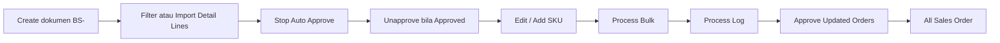
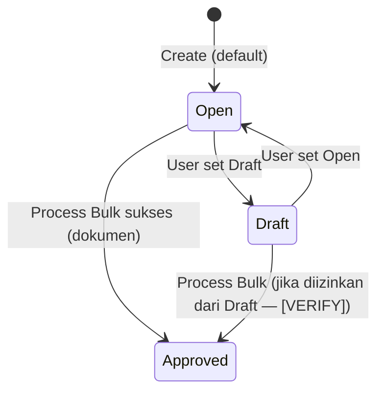
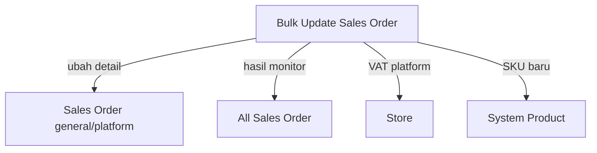

# Bulk Update Sales Order — Requirement Documentation

**Modul:** BusinessDevelopment  
**UI route (TO-BE):** `/businessdevelopment/bulk-update-sales-order`  
**Audience:** PM, Ops, QA  

> **TO-BE** — menu baru (belum AS-IS di production). Sumber keputusan: end user 27 Nov 2026 (**Opsi 1**), card [ETM-17847](https://erpintegration.atlassian.net/browse/ETM-17847), [ETM-17854](https://erpintegration.atlassian.net/browse/ETM-17854), [ETM-17855](https://erpintegration.atlassian.net/browse/ETM-17855). Prototype hanya referensi informasi (data / posisi / fungsi); implementasi UI wajib komponen standar OlshopERP.

**Request ID:** `reczz28dQtfaO6jG` · **Notion Page:** Bulk Update Sales Order

---

## 0. Metadata & Changelog

| Version | Date | Author | Changes |
|---------|------|--------|---------|
| 1.0 | 2026-11-27 | QA - Yemima | Initial TO-BE dari ETM-17847/17854/17855 + keputusan Opsi 1; Import Detail Lines ditulis lengkap di menu yang sama; Warehouse Process Import SO General **tidak** masuk scope |

---

## 1. Ringkasan Eksekutif

Operator butuh mengubah System SKU / qty / unit price / menambah SKU di banyak Sales Order sekaligus, dengan aman (stop auto-approve, unapprove bila perlu, jejak audit), tanpa menghapus baris detail lewat bulk.

| Kebutuhan | Jawaban BUSO |
|-----------|--------------|
| Mass update detail order | Menu dokumen terpisah + permission sendiri |
| Order platform tetap linked | Replace di **baris yang sama** (Detail ID / Platform SKU / ikatan marketplace terbawa) |
| Tidak create SO baru | Bukan Import Processed / Non-Processed |
| Hasil terlihat di ASO | Setelah Process Bulk, order di [All Sales Order](../all-sales-order/requirement.md) sudah berubah |

**Non-goals:** hapus baris detail lewat BUSO; ubah Platform SKU display; Warehouse Process di Import SO General; Reject dokumen BUSO.

---

## 2. Prasyarat

| Prasyarat | Keterangan |
|-----------|------------|
| Permission menu BUSO | Diberikan hanya ke user yang diizinkan |
| Company / store aktif | Filter Store & order mengikuti company login |
| System Product valid | SKU baru aktif, bukan PARENT, unit aktif |
| Order eligible | Lihat §4 — status & batas Trx. Date |

---

## 3. Siklus status dokumen BUSO

| Status | Arti |
|--------|------|
| **Open** | Default saat Create. Trx. Date = waktu create (tanggal + jam). Bisa diedit jadi Draft |
| **Draft** | Boleh disimpan / dikerjakan bertahap; contoh status di datalist — ikut SoT form field |
| **Approved** | Setelah **Process Bulk** (ini = approve dokumen). Perubahan order sudah dijalankan (per order success). **Tidak ada Reject** |

Prefix kode: **BS-** (contoh `BS-6A3302F7`). Semua label layar **Bahasa Inggris**.

---

## 4. Order yang boleh masuk Detail Lines

| Boleh | Syarat |
|-------|--------|
| Draft / Open | Ya |
| Rejected | Hanya **Sales Order General** |
| Approved | Belum dikirim ke Default Waves **dan** belum punya Sales Invoice — harus **Unapprove** dulu sebelum edit |

| Tidak ditampilkan / ditolak | Contoh alasan |
|-----------------------------|---------------|
| Trx. Date order setelah Trx. Date dokumen | Date order > date dokumen BS |
| Approved sudah ke Default Waves | Tidak bisa unapprove |
| Approved sudah ber-invoice | Tidak bisa unapprove |
| Void / deleted / batal platform | Tidak eligible |

Jumlah order yang terfilter-out dan alasannya ditulis di atas tabel Detail Lines.

---

## 5. Form & field (ringkas)

### 5.1 Basic Information

| Field | Wajib? | Default / validasi |
|-------|--------|-------------------|
| Trx. Code | Auto | Prefix BS- |
| Trx. Date | Auto create | Tanggal + jam create; acuan batas Trx. Date order |
| Description | Ya | Alasan perubahan |
| Trx. Status | Ya | Default Open; boleh diubah ke Draft |

### 5.2 Filter Order & SKU

Urutan: **Trx. Status → Store → Trx. Date (sampai jam) → Trx. Code / Platform Order → Select SKU (modal)** → **Show Detail Lines**.

**Select SKU (modal):** hanya SKU yang ada di detail order hasil filter (tampil total order, baris, qty). Cari, centang massal, Import SKU (template System Product SKU). SKU di luar hasil filter ditolak pesan jelas.

### 5.3 Detail Lines (kolom)

Visible: Trx. Code / Platform Order, Trx. Date, Trx. Status / Auto Approve (Active / Stopped), Store / Customer, Current System SKU, Platform SKU, New System SKU, Qty, Unit Price, DPP, VAT, Total Price, Note, Action.

Hidden default (`visible = false`, bisa Columns Show/Hide): Row, Detail ID, Line (Existing / Added SKU).

| Aturan tampilan | Detail |
|-----------------|--------|
| Added SKU | Satu tabel yang sama; Current System SKU kosong + Note `"Added SKU"`; urut per order |
| DPP / VAT / Total | Pola detail Sales Order; nilai lama dicoret, nilai baru saat berubah |
| Note contoh | `"Ready to edit"` (teks biasa) |
| Apply & Add SKU | Warna primer keduanya |

### 5.4 Datalist dokumen

Kolom: Trx. Code / Trx. Date, Description, Order Type (General / Platform / All + tooltip), Total Order, Replace SKU / Edit Qty/Price / Add SKU (+ tooltip), Process Result (Success/Failed klikable), Trx. Status (teks biasa), Created By / Created At, Action (ikon primer).

---

## 6. How It Works

### 6.1 Alur end-to-end (TO-BE · ETM-17847)

1. Create dokumen → isi Description (status default Open).
2. Isi Detail Lines lewat **Filter → Show Detail Lines** **atau** **Import Detail Lines** (§6.8). Keduanya **mengganti seluruh** isi Detail Lines; jika sudah ada data → konfirmasi (sebut jumlah baris / perubahan / Added SKU yang diganti).
3. **Stop Auto Approve** untuk semua order di daftar yang masih Active (wajib sebelum edit). Satu arah — **tidak ada Release**. Tombol: `Stop Auto Approve for {n} Order` + konfirmasi. Order yang di-stop wajib approve manual nanti.
4. Order Approved eligible: centang → **Unapprove** (konfirmasi, tidak bisa di-undo meski dokumen tidak jadi Process Bulk). Platform → Open; SO General → Draft; auto approve ikut stop.
5. Ubah: centang baris → Change Selected SKU to / Qty (`Input new qty`) / Unit Price (`Input new price`) → **Apply**; atau edit per baris. **Add SKU to Selected Orders** untuk baris baru. Batal Added SKU lewat ikon Action (bukan hapus baris order).
6. Cek **Summary** → **Save All**.
7. **Process Bulk** (= approve dokumen). Terkunci jika masih ada order yang diubah tapi belum Stop Auto Approve. Per order: semua baris sukses **atau** order itu tidak berubah sama sekali. Lihat Process Log (Success / Failed + alasan). Proses ulang yang gagal bila perlu.
8. **Approve Updated Orders** dari Process Log: hanya order sukses update, maks. **100** per klik, fungsi approval sama Sales Order.

### 6.2 Replace System SKU

- Tetap **baris yang sama**: Detail ID, Platform SKU, ikatan product marketplace, qty platform terbawa (termasuk ganti biasa ↔ random).
- Harga default = harga SKU **lama**, kecuali user ubah.
- VAT dihitung ulang dari Sales VAT System Product baru. Dipakai/tidak: platform → Store › Auto Add VAT (Platform Orders); general → General Company › Auto Add Transaction (Yes / No / Default by Product).
- Bundle: ganti di **header** bundle; komponen rebuild otomatis. Baris komponen bundle tidak bisa dipilih.

### 6.3 Add SKU

- Baris baru di Detail Lines. Order platform: **tidak** terikat produk marketplace; sync tidak menimpa baris itu.
- Maks. **100** detail per order tetap berlaku.
- Tidak boleh hapus baris order lewat BUSO (hapus tetap edit order satu-satu).

### 6.4 Stop Auto Approve & Unapprove

| Aksi | Efek | Undo? |
|------|------|-------|
| Stop Auto Approve | Auto Approve Active → Stopped; prevent auto-approve | Tidak |
| Unapprove | Approved → Open (platform) / Draft (general); AA stop | Tidak (langsung jalan) |

Process Bulk terkunci selama ada perubahan pada order yang belum di-stop.

### 6.5 Process Bulk & batas

| Batas | Nilai |
|-------|-------|
| Baris per dokumen | Maks. 500 |
| Detail per order (Add SKU) | Maks. 100 |
| Approve Updated Orders | Maks. 100 order / klik |

ATS: setelah Process Bulk, hitung ulang ATS SKU lama & baru di belakang (terkait ETM-17692). **Tidak** ada section ATS impact di layar.

### 6.6 Kasus gagal Process Bulk (per order)

| Kode | Kasus | Pesan user |
|------|-------|------------|
| F01 | Sudah di-approve user lain | This sales order and it's properties already approved, you can't modify this data anymore. |
| F02 | Sedang di-approve bersamaan | Approval process is in progress. Please wait a moment. |
| F03 | Sudah ke Default Waves | Unable to unapprove this sales order, it has been processed to wave. |
| F04 | Sudah punya Sales Invoice | Unable to unapprove this sales order, it already has invoice |
| F05 | Void / deleted / batal platform | Sales order is void or deleted. |
| F06 | Detail berubah sejak save dokumen | Row {n} of {SO} was changed after this document was saved. |
| F07 | Lebih dari 100 detail | This transaction has more than 100 details. |
| F08 | Produk baru invalid | The selected product is inactive. |
| F09 | Qty/harga invalid | SKU {X} must be entered with a quantity in whole numbers not decimals. |
| F10 | VAT produk belum lengkap | Configure 'Purchase COA' in master tax form. |
| F11 | Import detail order sedang jalan | Import is currently in progress. |
| F12 | Error teknis | Something went wrong. Please try again. |

### 6.7 Audit log (TO-BE · ETM-17854)

Kolom sama Audit Log Sales Order: Date, Source, Old Value, New Value, Action, User. Old/New = `Label: nilai` per baris. Di Audit Log **Sales Order**, setiap jejak dari BS wajib `Reference: BS-…`.

| Kejadian | Audit Log dokumen BS | Audit Log Sales Order |
|----------|----------------------|------------------------|
| Create / ubah dokumen | created / updated (Trx Code, Date, Description, Status) | — |
| Stop Auto Approve | stop auto approve (daftar Trx Code, Active → Stopped) | updated: Prevent Auto Approve No → Yes + Reference BS-… (Stop Auto Approve) |
| Unapprove | unapprove (+ Description) | Approval log unapprove + Reference BS-… |
| Ubah baris / Add / batal Add (sebelum Process) | updated / created / deleted di dokumen BS saja | — (order belum berubah) |
| Ganti isi Detail Lines (filter ↔ import) | replaced (sumber + jumlah baris) | — |
| Process Bulk sukses | approved + Process Result | Replace/edit: **satu** baris `updated` (bukan deleted+created); Add SKU: `created`; + Reference BS-… |
| Process Bulk gagal (order) | Process Log dokumen | Tidak ada perubahan di SO |
| Approve Updated Orders | approve orders (daftar + hasil) | Approval log + Reference BS-… |

**AC audit:** pemetaan 1-1; Reference BS-… di SO; ganti SKU dari BS = satu `updated`; order gagal Process Bulk tanpa jejak perubahan di SO.

### 6.8 Import Detail Lines (TO-BE · ETM-17855 — tahap 2, dicatat lengkap di docs ini)

Tombol standar: **Upload File**, **Download Template**, **Import History** (+ Import Log baris gagal). **Export Detail Lines** mengunduh isi saat ini dengan Detail ID terisi.

Template: [Template Bulk Update Sales Order.xlsx](https://drive.google.com/file/d/1v_3v_T1DF-o_aDHdWo4JqLN23bK712hu/view?usp=drivesdk)

| Kolom | Wajib | Keterangan |
|-------|-------|------------|
| Detail ID | Tidak | Dari export; kosong = cocokkan Trx. Code + Current System SKU |
| Trx. Code | Ya | SO-… |
| Platform Order ID | Tidak | Jika diisi harus cocok Trx. Code |
| Row | Tidak | Bantuan baca |
| Current System SKU | Tidak | Terisi = ubah baris; kosong = Add SKU |
| New System SKU | Ya untuk Add | Replace: kosong = SKU tetap |
| Qty | Ya untuk Add | Kosong = tetap; harus > 0 |
| Unit Price | Ya untuk Add | Kosong = tetap; 0 boleh; maks. 4 desimal |

**Aturan import:** mengganti seluruh Detail Lines (saling konfirmasi dengan filter). Stop AA yang sudah stop **tetap** stop; yang belum stop **tidak** tersentuh. Order baru dari import wajib Stop AA sebelum edit / Process Bulk. Tidak bisa hapus baris lewat import. Batas 500 / 100 sama §6.5. Eligibility order sama §4.

Contoh reject Import Log: SKU duplikat tanpa Detail ID; Trx. Date order setelah dokumen; sudah Waves / invoice; SKU not found / inactive; qty 0; harga negatif / >4 desimal; >100 detail.

**Import SKU di modal Select SKU** (tahap 1 / ETM-17847): template [System Product SKU](https://drive.google.com/file/d/1WdBnTM5xBfVjG4QwB_ERfTR3Kmi3Ai0B/view?usp=drivesdk); SKU di luar filter ditolak.

---

## 7. Validasi (ringkas)

| ID | Rule | Trigger |
|----|------|---------|
| V-01 | Description wajib | Save / Process Bulk |
| V-02 | Stop AA sebelum edit & sebelum Process Bulk pada order yang disentuh | Apply / Process Bulk |
| V-03 | Trx. Date order ≤ Trx. Date dokumen | Show Detail Lines / Import |
| V-04 | Maks. 500 baris dokumen | Show / Import / Save |
| V-05 | Maks. 100 detail per order saat Add | Add SKU / Import |
| V-06 | Tidak hapus baris order | UI & Import |
| V-07 | Komponen bundle tidak selectable | Select / Apply |
| V-08 | Konfirmasi ganti Detail Lines jika sudah berisi | Filter ↔ Import |

---

## 8. Relasi menu lain

| Menu | Relasi |
|------|--------|
| [All Sales Order](../all-sales-order/requirement.md) | Goals ending: order ter-update terlihat & diuji di ASO |
| [Dev - Sales Order](../sales-order-general/requirement.md) | Unapprove → Draft; aturan general |
| [Dev - Sales Platform](../omni-sales-platform/requirement.md) | Replace tetap linked; beda dengan inline edit AS-IS (deleted+created / harga PO) |
| Store / System Product | VAT & validitas SKU |

**Catatan Dev (beda AS-IS form edit):** ganti biasa↔random di form edit sering hapus+buat baris baru; BUSO wajib baris sama. Inline ganti produk di detail order mengisi harga PO + qty 1; BUSO ikut aturan harga lama. Auto approve cache ~3 menit harus hormati stop AA; kunci per order sama untuk Process Bulk & approve.

---

## 9. Gap Registry

| ID | Deskripsi | Dampak | Status |
|----|-----------|--------|--------|
| GAP-BUSO-01 | Implementasi menu + alur ETM-17847 | Fitur belum ada di app | Open (TO-BE) |
| GAP-BUSO-02 | Audit log dual BS + SO ETM-17854 | Jejak lintas menu | Open (TO-BE) |
| GAP-BUSO-03 | Import Detail Lines ETM-17855 | Jalur Excel massal | Open (TO-BE) |
| GAP-BUSO-04 | Draft → Process Bulk langsung tanpa Open? | Edge status | Open — ikuti perilaku approval dokumen sejenis saat implementasi |

---

## 10. FAQ

**Q: Apa bedanya dengan Import Processed?**  
A: Import Processed/Non-Processed **membuat** SO baru. BUSO **mengubah** SO yang sudah ada.

**Q: Boleh hapus baris lewat bulk?**  
A: Tidak. Hapus tetap di form edit order satu per satu.

**Q: Setelah Stop Auto Approve, bisa dinyalakan lagi dari BUSO?**  
A: Tidak. Approve manual (Approve Updated Orders atau menu Sales Order / ASO).

**Q: Di mana cek hasil akhir untuk testing?**  
A: [All Sales Order](../all-sales-order/requirement.md) (dan form order terkait) setelah Process Bulk sukses.

---

## Related Documents

| Doc | Path |
|-----|------|
| Knowledge Base | [knowledge-base.md](./knowledge-base.md) |
| Technical | [technical.md](./technical.md) |
| User Guide | [user-guide.md](./user-guide.md) |
