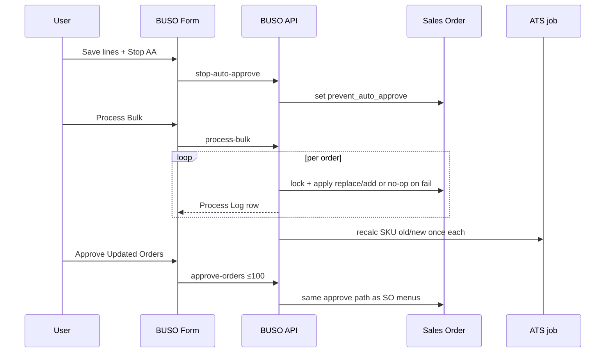

# Bulk Update Sales Order — Technical Documentation

> **TO-BE** — path/class di bawah bertanda `[VERIFY: CODEBASE]` sampai modul diimplementasi. Perilaku kanonik: [requirement.md](./requirement.md) + ETM-17847 / 17854 / 17855.

---

## 0. Changelog

| Version | Date | Author | Changes |
|---------|------|--------|---------|
| 1.0 | 2026-11-27 | QA - Yemima | Skeleton teknis TO-BE; globs usulan; invariants & failure modes dari card |

---

## 1. File Map (usulan)

| Area | Path usulan | Catatan |
|------|-------------|---------|
| BE controller | `Modules/BusinessDevelopment/Http/Controllers/*BulkUpdateSalesOrder*` | `[VERIFY: CODEBASE]` |
| BE jobs | Job Process Bulk per order + ATS recalc (ETM-17692) | Kunci per sales order id |
| FE pages | `olshoperp-frontend/src/pages/BusinessDevelopment/BulkUpdateSalesOrder/**` | DataList + Form penuh (bukan modal) |
| FE components | Pola `DataTablesV3`, Disclosure, Import toolbar standar, AuditLog slideover | Tanpa komponen UI baru |
| Shared SO | Service approve / unapprove / prevent auto-approve existing Sales Order | Paritas pesan F01–F12 |

Route FE (TO-BE): `/businessdevelopment/bulk-update-sales-order` (+ `/create`, `/edit/:id`).

---

## 2. API Routes (usulan)

| Method | Path (usulan) | Fungsi |
|--------|---------------|--------|
| GET | `…/bulk-update-sales-order` | Datalist |
| POST | `…/bulk-update-sales-order` | Create (status default Open) |
| GET/PUT | `…/bulk-update-sales-order/{id}` | Show / update dokumen + lines |
| POST | `…/bulk-update-sales-order/{id}/stop-auto-approve` | Stop AA daftar order |
| POST | `…/bulk-update-sales-order/{id}/unapprove-orders` | Unapprove langsung |
| POST | `…/bulk-update-sales-order/{id}/process-bulk` | Approve dokumen + apply per order |
| POST | `…/bulk-update-sales-order/{id}/approve-orders` | Approve Updated Orders (≤100) |
| POST | `…/import` (SKU modal / Detail Lines) | Import + history/log standar |

Semua `[VERIFY: CODEBASE]` saat wiring.

---

## 3. Database (usulan)

| Entitas | Isi inti |
|---------|----------|
| Header dokumen BS | code (`BS-…`), trx_date, description, status (draft/open/approved), company, created_by |
| Lines | sales_order_id, detail_id (nullable for add), old/new sku, qty, price, flags added/replaced, snapshots |
| Process log | per order: success/fail, reason code F01–F12, message |
| Pivot / flags on SO | prevent_auto_approve; audit entries dengan reference BS code |

---

## 4. Flow utama

---

## 5. Invariants

1. Replace SKU **tidak** menghapus detail row: `detail_id` (dan platform product link / platform qty) tetap.
2. Process Bulk **atomik per order**: semua line order itu commit, atau order tidak berubah.
3. Order dengan `prevent_auto_approve` (Stopped) **tidak** masuk kandidat auto-approve (baca status terkini, bukan cache stale).
4. Unapprove dari BUSO memakai gate yang sama: belum wave, belum invoice.
5. Import / Show Detail Lines: mengganti set lines dokumen; tidak mengubah SO sampai Process Bulk.
6. Stop AA yang sudah Stopped **tidak** di-reset oleh import/filter replace.
7. Audit SO untuk replace dari BS = **satu** event `updated` (bukan deleted+created), berisi `Reference: BS-…`.
8. ATS recalc: **sekali per SKU** (old & new), bukan per line.
9. Max 500 lines / dokumen; max 100 details / SO pada Add; max 100 SO per Approve Updated Orders batch.
10. Tidak ada hard-delete detail SO lewat BUSO API.

---

## 6. Validation highlights

- Trx. Date SO ≤ Trx. Date dokumen.
- SKU modal import: hanya SKU ∈ filtered order set.
- Detail Lines import: match Detail ID atau (Trx. Code + Current System SKU); ambigu tanpa Detail ID → reject.
- Qty > 0; unit price ≥ 0; max 4 decimal price; whole-number qty rules per product (F09).
- Bundle: hanya header selectable; rebuild components on replace.

---

## 7. Frontend behaviors

- Datalist + full-page Create/Edit; English copy; status text without colored badge box (per card).
- Process Result Success/Failed clickable → order list (+ fail reason).
- Detail Lines: strikethrough old DPP/VAT/Total when changed; Added rows recognizable without relying on hidden Line column.
- Import toolbar pola standar (Upload / Template / History) di modal SKU dan di Detail Lines (ETM-17855).
- Konfirmasi modal saat replace seluruh Detail Lines.
- Prototype visual **bukan** acuan styling.

---

## 8. Failure modes & transaction boundary

| Titik gagal | Boundary | Efek |
|-------------|----------|------|
| Stop AA sebagian | Per request batch | Yang sukses tetap Stopped; audit per kejadian |
| Unapprove gagal (wave/invoice) | Per order | Order lain di batch bisa lanjut; pesan F03/F04 |
| Process Bulk mid-batch | Per order transaction | Order gagal tidak half-updated; sukses sebelumnya tetap |
| Concurrent approve SO | Lock per SO | F01/F02 |
| Import file partial | Row-level Import Log | Valid rows masuk dokumen; invalid di log; SO belum berubah |

Idempotency: Process Bulk ulang untuk order yang sudah sukses di dokumen Approved → tidak double-apply (definisikan di implementasi: skip atau fail jelas) `[VERIFY]`.

---

## 9. Data lifecycle (lintas menu)

| Event BUSO | SO / ASO | Audit |
|------------|----------|-------|
| Stop AA | Flag prevent auto-approve | BS + SO Reference |
| Unapprove | Status Open/Draft | Approval log + BS ref |
| Process Bulk success | Detail sku/qty/price/VAT updated | SO updated/created + BS approved |
| Process Bulk fail | No SO change | Process Log only |
| Approve Updated Orders | SO Approved | Approval log + BS |

Testing lintas menu: setelah Process Bulk, assert di **All Sales Order** (dan form SO) — lihat [all-sales-order](../all-sales-order/technical.md).

---

## 10. Tests & QA notes

- Happy: filter → stop → replace + add → process → approve → visible di ASO.
- Platform replace: platform SKU & link preserved (contrast AS-IS inline delete+create).
- Negative: F01–F12 messages; import reject samples ETM-17855.
- Permission: user tanpa menu BUSO tidak akses.
- Race: auto-approve job vs Stopped flag.

Known issues: GAP-BUSO-01…04 di requirement.
