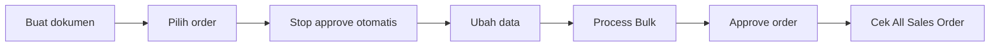

# Bulk Update Sales Order — User Guide

> Status **pending** — sumber layer masih `draft` (TO-BE). Jangan publish eksternal sampai layer naik `review`/`final` dan guide di-generate ulang.

## 1. Apa Itu & Kenapa Penting

**Bulk Update Sales Order** membantu kamu mengubah banyak pesanan sekaligus: ganti produk sistem, ubah jumlah/harga, atau menambah produk — tanpa membuka satu per satu. Berguna saat stok warna habis atau ada koreksi massal setelah promo.

## 2. Overview Flow & Proses Bisnis

Fallback: buat dokumen → isi daftar order (filter atau Excel) → hentikan approve otomatis → unapprove jika perlu → ubah/tambah SKU → Process Bulk → approve order yang sukses → cek di All Sales Order.

## 3. Sebelum Mulai (Flow Sebelum)

- Pastikan akun punya akses menu ini.
- Siapkan alasan perubahan (wajib diisi).
- Pastikan order belum dikirim ke wave / belum punya invoice jika masih Approved.
- Kalau pakai Excel, unduh template resmi dulu.

## 4. Setelah Selesai (Flow Sesudah)

- Order yang sukses sudah berubah isinya.
- Approve order (tombol di Process Log atau dari All Sales Order).
- Cek daftar di **All Sales Order** apakah SKU/qty/harga sudah benar.
- Simpan nomor dokumen BS- jika perlu dilacak di Audit Log.

## 5. Yang Perlu Diperhatikan

- Stop auto-approve **tidak bisa dibatalkan** dari menu ini.
- Unapprove langsung mengubah status order — tidak bisa undo.
- Tidak bisa menghapus baris order lewat menu ini.
- Process Bulk yang sukses tidak otomatis “kembalikan” perubahan.
- Maksimal sekitar 500 baris per dokumen; approve massal maksimal 100 order per klik.

## 6. Langkah-Langkah (Step by Step)

1. Buka **Business Development → Bulk Update Sales Order** (di bawah All Sales Order).
2. Create → isi alasan → simpan (status default Open; boleh Draft).
3. Filter order & pilih SKU lalu **Show Detail Lines**, **atau** Import file Detail Lines.
4. **Stop Auto Approve** untuk semua order di daftar.
5. Unapprove order Approved yang masih boleh diubah.
6. Ganti SKU / qty / harga (Apply) atau **Add SKU**; Save All.
7. **Process Bulk** → baca Process Log.
8. **Approve Updated Orders** untuk yang sukses.
9. Verifikasi di All Sales Order.

## 7. Tips & Hal yang Sering Bikin Bingung

- **Import vs filter:** keduanya mengganti seluruh daftar — konfirmasi dulu jika daftar sudah terisi.
- **Order marketplace:** ganti System SKU tidak menghilangkan tampilan SKU toko; tambah SKU baru tidak terikat produk marketplace.
- **Gagal di Process Log:** baca pesan; sering karena order sudah diubah/approve orang lain atau produk tidak aktif.
- Contoh: ganti Grey → Black di banyak order Bekasi karena stok Grey habis — isi alasan itu di Description, stop auto-approve, Process Bulk, lalu cek All Sales Order.

## 8. Referensi

- [requirement.md](./requirement.md) · [knowledge-base.md](./knowledge-base.md)
- Jira: ETM-17847 · ETM-17854 · ETM-17855
- All Sales Order — tempat cek hasil akhir
