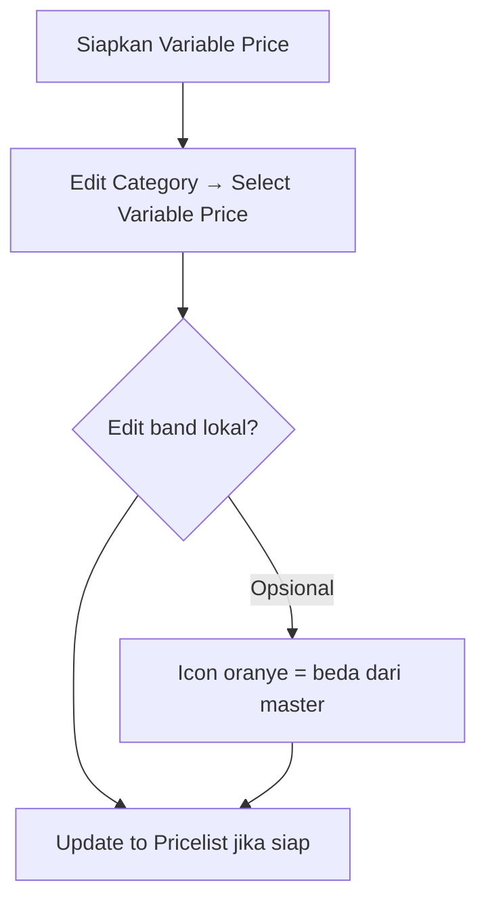

# Category Price — Knowledge Base

## Apa itu

Kategori harga untuk channel/store. **TO-BE:** aturan margin diambil dari satu atau lebih **Variable Price** (tier). Hasil semua tier dijumlahkan saat Update ke Pricelist.

## Applied Store (TO-BE ETM-16882)

Bisa pilih store **platform** dan store **Others** yang **Active**. Boleh kosong. Boleh campur platform + Others. Store Others inactive tidak muncul. (Sebelumnya ETM-16666 hanya platform — diganti sebagian.)

## Alur standar

## Tombol penting

| Aksi | Efek |
|------|------|
| **Select Variable Price** | Pasang tier (snapshot). Hanya Active yang belum dipasang. |
| **Update from Master** | Timpa semua tier dari master terkini (edit lokal hilang). |
| **Update to Pricelist** (merah) | Hitung ulang Final di Pricelist. Margin yang diedit manual di Pricelist **tidak dihapus**; Final = default + margin user + tier category (ETM-16884). Wajib centang persetujuan. |

## Weight berubah di System Product (TO-BE ETM-16668)

Ubah weight DnW **default** di System Product → nilai Category/Pricelist yang **dihitung dari weight** ikut terhitung ulang (tier Category saat itu). Input **manual** di Category **tidak** tertimpa. Perubahan Pricelist masuk Log Pricelist.

## Tips

- Edit band di Category **tidak** mengubah Variable Price master.
- Ubah master → Update to Category dari Variable Price, atau Update from Master di sini.
- Edit Value Type **Percentage** di tier lokal: batas **-9.999 … 9.999** (sama Variable Price); desimal dipotong 4 digit; **Max Value** ikut (plafon hasil %) — kosong = tidak ada batas ([ETM-16835](https://erpintegration.atlassian.net/browse/ETM-16835)).
- Harga jual baru berubah setelah **Update to Pricelist** — kecuali path auto weight (ETM-16668) untuk nilai calculated by Weight.
- Category hanya Others / tanpa store: Final di Pricelist tetap terhitung; Sync ke platform tidak muncul (ETM-16884).
- Contoh: harga 16.000 + berat 1.500 g + 3 tier → Final 24.500 (User Set Margin di Pricelist = `-` jika belum edit manual).

## Troubleshooting

| Gejala | Solusi |
|--------|--------|
| Select kosong | Semua Active sudah dipasang, atau belum ada Variable Price Active |
| Icon oranye di tier | Band sudah diedit lokal — Update from Master untuk samakan master |
| Pricelist belum berubah | Belum Update to Pricelist / belum centang konfirmasi (kecuali auto weight default DnW — ETM-16668) |

Detail: [requirement.md](./requirement.md) · Wireframe: https://claude.ai/artifact/CSgXVMhzsztTJqwpeD7f89
