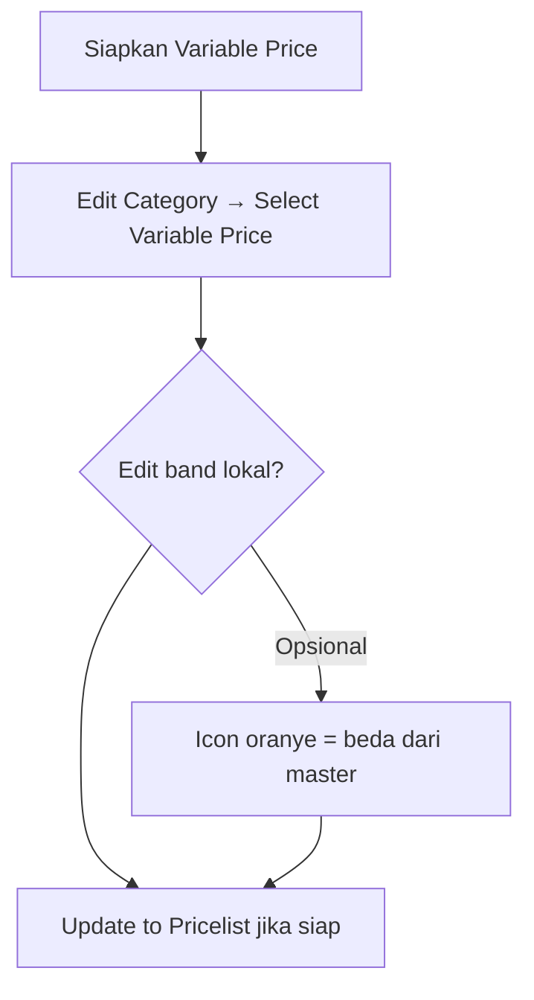

# Category Price — Knowledge Base

## Apa itu

Kategori harga untuk channel/store. **TO-BE:** aturan margin diambil dari satu atau lebih **Variable Price** (tier). Hasil semua tier dijumlahkan saat Update ke Pricelist.

## Applied Store (TO-BE ETM-16882)

Bisa pilih store **platform** dan store **Others** yang **Active**. Boleh kosong. Boleh campur platform + Others. Store Others inactive tidak muncul. (Sebelumnya ETM-16666 hanya platform — diganti sebagian.)

Tooltip Applied Store menyebut store platform dan store Others Active (bukan lagi "Only platform stores can be selected"). Satu store hanya boleh dipasang di satu Category Price. Category yang masih terikat store tidak bisa dihapus — termasuk jika store itu kemudian dinonaktifkan; saat ini hapus masih lolos kalau store-nya sudah Inactive.

## Alur standar

## Tombol penting

| Aksi | Efek |
|------|------|
| **Select Variable Price** | Pasang tier (snapshot). Hanya Active yang belum dipasang. |
| **Update from Master** | Timpa semua tier dari master terkini (edit lokal hilang). |
| **Update to Pricelist** (merah) | Hitung ulang Final di Pricelist. Margin yang diedit manual **tidak dihapus**; Final = harga dasar + margin kamu + tier category (ETM-16884). Wajib centang persetujuan. Detail optimasi: bagian di bawah. |

## Update to Pricelist (TO-BE ETM-17002)

Angka di popup adalah jumlah produk yang benar-benar akan dihitung (produk aktif yang tidak punya produk anak), bukan jumlah baris yang sudah tersimpan. Kalimat bahwa margin manual tetap dipertahankan, dan centang persetujuan, tidak hilang.

Selama proses jalan, halaman category menampilkan progres (berapa dari berapa, atau persen). Muat ulang halaman, angkanya tetap. Kalau Update category ini masih berjalan, klik Update lagi ditolak dengan pesan bahwa proses masih berjalan. Category lain tidak ketuker.

Harga yang tidak berubah tidak ditulis ulang dan tidak menambah catatan di Log. Karena itu Sync berikutnya tidak mengirim ulang baris itu. Tooltip **Last Update to Pricelist** di header kolom category (menu Pricelist Product) tetap harus menunjuk waktu Update yang baru, meski tidak ada harga yang berubah.

Contoh: HAWAT-Biru harga dasar 7.000, margin manual 2.000, tier category +5.500, Final 14.500. Tier naik jadi +6.500 → margin tetap 2.000, Final 15.500, satu catatan perubahan. Update lagi tanpa ubah apa pun → harga dan waktu ubah baris tetap, Sync tidak mengirim ulang, tooltip Last Update pindah ke waktu Update yang baru.

## Weight berubah di System Product (TO-BE ETM-16668)

Ubah weight DnW **default** di System Product → nilai Category/Pricelist yang **dihitung dari weight** ikut terhitung ulang (tier Category saat itu). Input **manual** di Category **tidak** tertimpa. Perubahan Pricelist masuk Log Pricelist.

## Tips

- Edit band di Category **tidak** mengubah Variable Price master.
- Ubah master → Update to Category dari Variable Price, atau Update from Master di sini.
- Edit Value Type **Percentage** di tier lokal: batas **-9.999 … 9.999** (sama Variable Price); desimal dipotong 4 digit; **Max Value** ikut (plafon hasil %) — kosong = tidak ada batas ([ETM-16835](https://erpintegration.atlassian.net/browse/ETM-16835)).
- Harga jual baru berubah setelah **Update to Pricelist** — kecuali path auto weight (ETM-16668) untuk nilai calculated by Weight.
- Category hanya Others / tanpa store: Final di Pricelist tetap terhitung; Sync ke platform tidak muncul (ETM-16884).
- Contoh: harga 16.000 + berat 1.500 g + 3 tier → Final 24.500 (User Set Margin di Pricelist = `-` jika belum edit manual).

## Troubleshooting

| Gejala | Solusi |
|--------|--------|
| Select kosong | Semua Active sudah dipasang, atau belum ada Variable Price Active |
| Icon oranye di tier | Band sudah diedit lokal — Update from Master untuk samakan master |
| Pricelist belum berubah | Belum Update to Pricelist / belum centang konfirmasi (kecuali auto weight default DnW — ETM-16668) |
| Update ditolak, proses masih jalan | Tunggu category itu selesai. Jangan klik dua kali |
| Last Update di header masih jam lama padahal Update tanpa ubah harga sudah selesai | Seharusnya jam Update terbaru. Kalau tidak, penanda category belum tampil di tooltip (ETM-17002) |
| Sync mengirim semua baris setelah Update tanpa ubah harga | Seharusnya 0 baris. Waktu ubah baris tidak boleh maju kalau harga sama |

Detail: [requirement.md](./requirement.md) · Wireframe: https://claude.ai/artifact/CSgXVMhzsztTJqwpeD7f89
