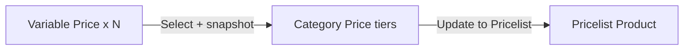

# Category Price — Requirement

**Modul:** Business Development · **Jira:** [ETM-16313](https://erpintegration.atlassian.net/browse/ETM-16313)  
**Wireframe:** https://claude.ai/artifact/CSgXVMhzsztTJqwpeD7f89 (layar D)  
**E2E final:** [`_meta/sot/variable-price-multi-tier-final-requirement.md`](../_meta/sot/variable-price-multi-tier-final-requirement.md) §2, §4, §6–9  
**Relates:** ETM-16312 · ETM-16314 · mirror validasi Percentage [ETM-16569](https://erpintegration.atlassian.net/browse/ETM-16569) · **[ETM-16668](https://erpintegration.atlassian.net/browse/ETM-16668)** · **[ETM-16835](https://erpintegration.atlassian.net/browse/ETM-16835)** · **[ETM-16882](https://erpintegration.atlassian.net/browse/ETM-16882)** (Applied Store Others Active) · **[ETM-16883](https://erpintegration.atlassian.net/browse/ETM-16883)** / **[ETM-16884](https://erpintegration.atlassian.net/browse/ETM-16884)** (dampak Pricelist) · **[ETM-17002](https://erpintegration.atlassian.net/browse/ETM-17002)** (optimasi Update to Pricelist)

---

## 0. Changelog

| Version | Date | Changes |
|---------|------|---------|
| 1.6 | 2026-11-05 | **TO-BE** ETM-17002: Update to Pricelist melewatkan baris yang tidak berubah, satu log per baris, chunk 500, popup = jumlah produk, progres tahan refresh, kunci per category. Poin 5, 7, dan 8 di luar perilaku ini |
| 1.5 | 2026-11-04 | **TO-BE** ETM-16882: tooltip Applied Store menyebut store platform dan Others Active (kalimat "Only platform stores can be selected" tidak dipakai); satu store hanya di satu Category Price; Category yang masih terikat store tidak bisa dihapus. Hapus saat store terikat sudah Inactive masih lolos — GAP-CP-07 (ETM-17053) |
| 1.4 | 2026-10-28 | **TO-BE** ETM-16882: Applied Store = platform + Others **Active**; NULL OK; mix OK. Update to Pricelist: Manual Price di Pricelist **tidak** ditimpa (stack — ETM-16884). Catatan: membalik sebagian ETM-16666 |
| 1.3 | 2026-10-28 | Cross-ref TO-BE ETM-16835: Max Value ikut snapshot band / edit lokal Percentage + hitung Pricelist |
| 1.2 | 2026-10-21 | Cross-ref TO-BE ETM-16668: auto-recalc nilai weight-related saat DnW default berubah; input manual category tidak tertimpa |
| 0.1 | 2026-10-07 | Draft AS-IS + TO-BE multi tier |
| 1.0 | 2026-10-09 | Full dari final: Variable Price Tiers, Select VP, Update from Master / to Pricelist |
| 1.1 | 2026-10-14 | Mirror Variable Price: Value Percentage band lokal ±9.999 + truncate 4dp (konsistensi ETM-16569 / 16562) |

---

## 1. Ringkasan

**AS-IS:** section *Margin Price Configuration* = satu set band by default price.  
**TO-BE:** diganti **Variable Price Tiers** — attach ≥1 Variable Price (snapshot band); boleh by Amount dan/atau by Weight; edit lokal OK; Update from Master / Update to Pricelist manual + konfirmasi.

Basic Information (Code, Category Name, Description, Show for all company) tetap. **Applied Store** → TO-BE ETM-16882 (§3.0). DataList Category selain Store List mengikuti Applied Store.

---

## 2. Acceptance Criteria

| ID | Kriteria | Status |
|----|----------|--------|
| A-01 | Section Variable Price Tiers menggantikan Margin Price Configuration; Basic Info tetap | **TO-BE** |
| A-02 | Tambah tier via **Select Variable Price** (searchable); opsi: Active + belum dipasang; tampil Code/Name/type badge | **TO-BE** |
| A-03 | Snapshot band editable lokal tanpa ubah master; tier edited → icon info oranye + tooltip | **TO-BE** |
| A-04 | Hapus tier → konfirmasi; master tidak berubah; opsi Select kembali | **TO-BE** |
| A-05 | Update from Master overwrite semua tier + konfirmasi sederhana + log | **TO-BE** |
| A-06 | Update to Pricelist: dialog keras + checkbox acknowledge; tombol merah disabled sampai dicentang | **TO-BE** |
| A-07 | Satu VP tidak bisa dipasang dua kali; hanya Active; by Weight pakai satuan `g` | **TO-BE** |
| A-08 | Edit band lokal Type **Percentage**: Value -9.999 … 9.999; ≥10.000 / ≤-10.000 ditolak; desimal truncate 4dp (sama master VP) | **TO-BE** |
| A-09 | Snapshot / edit lokal band Percentage menyertakan **Max Value** (aturan sama master VP ETM-16835); Amount → clear+disable | **TO-BE** |
| A-10 | Applied Store: store platform eligible **dan** store Others **Active**; Inactive Others tidak muncul; NULL / mix platform+Others boleh disimpan | **TO-BE** ETM-16882 |
| A-11 | Update to Pricelist: Manual Price di Pricelist tidak dihapus; Final = Default + User Set Margin + Category tier ([Pricelist §5](../businessdevelopment-pricelist-product/requirement.md)) | **TO-BE** ETM-16884 |
| A-12 | Tooltip Applied Store menyebut store platform dan store Others Active. Kalimat lama "Only platform stores can be selected" tidak dipakai | **TO-BE** ETM-16882 (TC ETM-17030) |
| A-13 | Satu store hanya boleh terikat ke satu Category Price. Pesan: "{nama store} has already been used. A store cannot be bound to multiple category prices." (contoh nama: Aeri's Store 2) | **TO-BE** ETM-16882 (TC ETM-17029) |
| A-14 | Category Price yang masih terikat store tidak bisa dihapus, satu baris maupun banyak sekaligus. Pesan: "Category Price cannot be deleted because it is still bound to Store {nama}. Please unbind the store first." Berlaku juga bila store itu kemudian Inactive | **TO-BE** ETM-16882 (TC ETM-17028, ETM-17032) |
| A-15 | Baris yang sudah ada: bandingkan margin, Final, Manual flag, dan snapshot tier setelah pembulatan 4 desimal. Semua sama: tidak ada UPDATE, tidak ada log, waktu ubah baris tidak berubah. Harga sama tetapi snapshot beda: hanya snapshot yang diganti (tanpa log, waktu ubah tidak naik). Harga berubah: UPDATE + tepat 1 log updated tipe update_to_pricelist | **TO-BE** ETM-17002 |
| A-16 | Tooltip **Last Update to Pricelist** di header kolom category pada Pricelist Product menunjuk waktu Update terakhir yang selesai, termasuk bila 0 baris berubah. Sumbernya penanda level category, bukan hanya log per baris | **TO-BE** ETM-17002 |
| A-17 | Setelah Update tanpa perubahan harga, Sync menemukan 0 baris karena waktu ubah baris tidak maju | **TO-BE** ETM-17002 |
| A-18 | Baris baru dari Update: tepat 1 log created tipe update_to_pricelist (nilai lama 0). Tidak ada log manual palsu dari event model. Edit manual di grid tetap 1 log tipe manual | **TO-BE** ETM-17002 |
| A-19 | Tulis massal; 500 produk per job; angka harga sama dengan rumus sebelum optimasi. Update kedua pada category yang sama ditolak dengan pesan jelas selama yang pertama berjalan | **TO-BE** ETM-17002 |
| A-20 | Angka popup = produk yang akan diproses (aktif, tanpa produk anak), bukan jumlah baris yang sudah ada. Kalimat "Manual margins will be preserved" dan checkbox persetujuan tetap. Progres x dari N atau persen, tetap ada setelah muat ulang halaman | **TO-BE** ETM-17002 |

---

## 3. Form Edit — Variable Price Tiers

Sidebar: jump-section · **Update from Master** · **Update to Pricelist** (merah) · **Save All**.

### 3.0 Applied Store (TO-BE · ETM-16882)

**AS-IS / historis ETM-16666:** dropdown hanya store **platform**; Others di-hide & ditolak server.  
**TO-BE:** revisi sebagian 16666.

| Aturan | Expected |
|--------|----------|
| Opsi dropdown | Store platform eligible **+** store tipe **Others** yang **Active** |
| Others Inactive | Tidak muncul / tidak bisa dipilih |
| NULL / kosong | Tetap boleh |
| Mix platform + Others | Boleh disimpan |
| Server | Menerima Others Active (tidak 422 “Store Field not found” ala 16666 untuk Others Active) |
| Store tidak eligible | Others Inactive atau store lain yang dikirim langsung (tidak ada di dropdown) ditolak: "Store Field not found." (TC ETM-17031) |
| Tooltip | Menyebut store platform dan store Others Active. Kalimat "Only platform stores can be selected" tidak dipakai (TC ETM-17030) |
| Satu store | Hanya boleh di satu Category Price. Pesan: "{nama store} has already been used. A store cannot be bound to multiple category prices." |
| Hapus | Masih terikat store → tidak bisa dihapus (satu baris atau banyak). Berlaku juga jika store kemudian Inactive |

**Dampak Pricelist (bukan AC penuh card ini):** Sync icon hanya jika category mengandung ≥1 platform; Others-only / NULL → calc Final tetap, tanpa Sync — [Pricelist ETM-16884](../businessdevelopment-pricelist-product/requirement.md). Future: Others → Unit Price SO — out of scope.

**TC historis:** TC-CP-002 / TC-CP-003 (Passed terhadap 16666) **disupersede** oleh TO-BE 16882 — perlu TC baru setelah deploy.

### 3.1 Select Variable Price

Pola Select Product PO. Placeholder **Select Variable Price**. Opsi hilang setelah dipasang; kembali setelah hapus tier. Empty: **"No Variable Price available"**. Setelah pilih: toast `"{Code} added. Click Save All to apply."`

### 3.2 Accordion tier

| Elemen | Isi |
|--------|-----|
| Label | Tier N |
| Judul | `{Code} — {Name}` + badge type |
| Snapshot | Tanggal-jam last sync |
| Hapus | Icon → dialog Remove |
| Isi | Band Start/End/Type/Value + **Max Value** (Percentage) + Unlimited (edit lokal) |

Edited lokal ≠ master → icon info oranye: *"This tier was edited in this Category Price, so it no longer matches the Variable Price master."*

**Max Value (ETM-16835):** ikut dari master saat Select / Update from Master. Edit lokal Percentage: enable Max Value; Amount: disable+clear. Aturan tanda/NULL/primary currency = [Variable Price §4.2.1](../businessdevelopment-variable-price/requirement.md). Dipakai saat **Update to Pricelist**.

Bantuan hitung di bawah daftar: contoh default 16.000 + weight 1.500 g → margin 8.500 / final 24.500.

### 3.3 Update from Master

Dialog: *"All tiers will be replaced with the current Variable Price master. Any changes made in this Category Price will be overridden."* Toast: "Tiers updated from master." Log Category.

### 3.4 Update to Pricelist

Dialog keras + checkbox *"I understand…"* wajib (A-06). Kalimat **Manual margins will be preserved** tetap. Toast: proses berjalan di background.

**Angka di popup (TO-BE ETM-17002, A-20):** jumlah **produk yang akan diproses** — produk aktif yang tidak punya produk anak — bukan jumlah baris Pricelist yang sudah ada. Layar juga mendapat jumlah baris yang sudah ada dan perkiraan baris baru, supaya teks tidak menyesatkan (contoh lama: popup menulis 21 padahal yang diproses 15.963). Checkbox persetujuan tetap mengunci tombol sampai dicentang.

**Progres:** selama jalan, halaman category ini menampilkan x dari N (atau persen). Angka tidak mundur. Muat ulang halaman tidak menghilangkan progres. Selesai: N dari N plus tepat satu notifikasi *"Update to Pricelist for category {nama} has been completed."* Ada job gagal: tampilan dan notifikasi menyebut jumlah yang gagal.

**Kunci per category:** Update kedua untuk category yang sama ditolak selama yang pertama belum selesai. Pesan: *"Update to Pricelist for category '{nama}' is currently in progress. Please wait until it completes."* (atau *"Update to Pricelist is currently in progress. Please wait."* bila kunci klik bentrok). Category lain boleh jalan bersamaan, progresnya tidak tertukar. Pemicu otomatis dari Variable Price memakai kunci yang sama: category yang sedang berjalan tidak didispatch ulang; halaman category terkait tetap menampilkan progresnya.

**Lewati yang tidak berubah (A-15).** Untuk baris yang sudah ada, hitung dengan rumus yang sama, lalu bandingkan setelah pembulatan 4 desimal: margin, Final, flag Manual, dan snapshot tier.

| Kondisi | Tulisan | Log | Waktu ubah baris |
|---------|---------|-----|------------------|
| Keempatnya sama | Tidak ada UPDATE | Tidak ada | Tidak berubah |
| Harga sama, snapshot beda | Hanya snapshot tier diganti | Tidak ada | Tidak naik |
| Margin atau Final beda | UPDATE harga + snapshot | Tepat 1 log **updated** / update_to_pricelist | Naik |

**Penanda Last Update (A-16):** tooltip **Last Update to Pricelist** di header kolom category (Pricelist Product) wajib menunjuk tanggal-jam Update terakhir yang **selesai**, juga saat 0 baris berubah. Log per baris saja tidak cukup, karena baris yang dilewati tidak menulis log. Perlu penanda level category (waktu selesai Update pada snapshot tier yang dipakai run itu).

**Sync (A-17):** Sync hanya mengambil baris yang belum pernah di-sync atau waktu ubahnya lebih baru dari sync terakhir. Update tanpa perubahan harga tidak menaikkan waktu ubah, jadi Sync berikutnya menemukan **0 baris**.

**Satu log per baris (A-18):**
- Baris **baru:** tepat 1 log **created** / update_to_pricelist, nilai lama 0, nilai baru = hasil hitung, user = yang menjalankan Update. Event model tidak boleh menambah log tipe manual untuk baris yang dibuat Update.
- Baris **berubah harga:** tepat 1 log **updated** / update_to_pricelist.
- Baris **ganda** (category + produk sama): yang dipertahankan baris Manual, atau baris pertama bila tidak ada Manual; sisanya hilang dari grid dan tepat 1 log **deleted** / duplicate.
- Edit manual di grid (ketik margin atau Final) tidak berubah: tetap 1 log tipe **manual**, karena tooltip "Margin edited by" membaca log itu. Waktu "Margin edited by" hanya berubah karena edit manual, bukan karena Update.
- Log yang sudah ada tidak diubah dan tidak dihapus.

**Tulis massal dan chunk (A-19):** baris baru, log, dan perubahan snapshot ditulis massal (bukan satu perintah Eloquent per produk). Satu job memproses **500** produk. Job gagal di tengah: transaksi job itu di-rollback (tidak ada baris setengah jadi); job lain tetap jalan; notifikasi gagal terkirim; Update ulang melengkapi sisa tanpa baris ganda.

**Rumus harga tidak berubah (ETM-16884):**
- **Manual = No:** Final = Default + semua tier, minimum 0. Cell User Set Margin tetap `-`.
- **Manual = Yes:** margin tetap angka user; Final = Default + margin user + semua tier, minimum 0. Flag Manual tetap.

**Contoh (Staging, category bertier +5.500):**

| Kasus | Hasil |
|-------|--------|
| Update kedua, tier dan Default tidak berubah | 0 baris harga berubah, waktu ubah baris sama, 0 log baru per baris. Tooltip Last Update pindah ke waktu Update yang baru. Sync berikutnya 0 baris |
| Harga sebuah produk sama, snapshot run ini beda (produk di luar band yang diubah) | Tidak ada log, waktu ubah tidak naik, snapshot baris menunjuk snapshot baru |
| HAWAT-Biru, Manual Yes, Default 7.000, margin user 2.000, tier naik dari +5.500 ke +6.500 | Margin tetap **2.000**. Final **15.500**. Tepat 1 log updated |
| HCD-1, Manual No, Default 30.000, tier +5.500 | Final **35.500**, cell `-`. Tier berubah dan harga ikut berubah: tepat 1 log |
| Produk belum punya baris | 1 baris baru + tepat 1 log created / update_to_pricelist. Bukan dua log |
| Hasil hitung negatif | Final **0**; tooltip menyebut Final disesuaikan ke 0 karena hasil negatif |

**Yang tetap (regresi):** isolasi company (Update satu company tidak mengubah company lain); hanya produk aktif tanpa produk anak; pembersihan baris ganda + log duplicate; notifikasi selesai dan gagal ke user yang menjalankan; snapshot lama dibersihkan setelah batch selesai **tanpa** job gagal, dan tidak boleh ada baris yang menunjuk snapshot terhapus atau kosong (tooltip Calculation tetap pecah per tier). Aturan stack Manual ETM-16884 tidak berubah.

**Di luar card — jangan dianggap perilaku sekarang:** antrean khusus (poin 5) dan lewati produk Default Price 0 (poin 7) tidak termasuk. Poin 8 (jangan simpan baris turunan; harga dihitung saat dibaca) menunggu keputusan Product.

Detail tampilan Pricelist & Sync platform-only: [Pricelist requirement §4–§5](../businessdevelopment-pricelist-product/requirement.md).

### 3.5 Auto-recalc weight (TO-BE ETM-16668)

Saat **System Product** mengubah Dimensions & Weight **default** (edit row default atau ganti radio default), nilai di Category Price / Pricelist yang **dihitung dari weight** ikut dihitung ulang memakai tier Category **saat itu**.

- **Scope:** hanya cell/baris yang punya value berbasis weight (bukan seluruh field category).
- **Manual input:** nilai Category yang diisi **manual** **tidak** tertimpa oleh sync weight ini.
- **Log:** perubahan nilai di Pricelist wajib masuk **Log Pricelist**.
- Trigger & detail: [Pricelist requirement §5.1](../businessdevelopment-pricelist-product/requirement.md) · card [ETM-16668](https://erpintegration.atlassian.net/browse/ETM-16668).

---

## 4. Aturan & validasi

- Beberapa VP by Amount dan/atau by Weight OK.
- Category tanpa tier diperbolehkan; Update to Pricelist → margin 0 (**GAP-CP-01** — konfirmasi dialog "no tiers").
- Validasi band lokal = AS-IS (range + Unlimited) **plus** mirror master Variable Price:
  - Type Percentage: Value **-9.999 … 9.999** (tolak di luar); Amount tidak kena batas.
  - Percentage desimal: truncate **4 dp**.
  - **Max Value** (ETM-16835): mirror master — NULL = no cap; cap hasil `% × default` sebelum SUM ke Pricelist.
- Tidak migrasi otomatis data margin lama.
- **ETM-16668:** auto weight sync **tidak** boleh override nilai Category yang diinput manual.

---

## 5. Contoh E2E (ringkas)

Category `SH-GARME` attach VP-AMT-RETAIL + VP-WGT-STD + VP-AMT-MKTPLACE → SKU-001 (16.000 / 1.500 g) setelah Update to Pricelist → margin **8.500**, final **24.500**. Tabel penuh: final §7.

---

## 6. Gap

| ID | Topik | Usulan |
|----|-------|--------|
| GAP-CP-01 | Category tanpa tier → margin 0 | Boleh + dialog sebut "no tiers" |
| GAP-CP-02 | Mass Update from Master di datalist | Pola icon massal seperti VP (card ada, wireframe belum) |
| GAP-CP-03 | Data margin AS-IS | Bersihkan saat go-live; tidak auto-migrate |
| GAP-CP-04 | Auto weight → Category/Pricelist (ETM-16668) | Sync dari DnW default; preserve manual; log Pricelist |
| GAP-CP-05 | Applied Store Others Active (ETM-16882) | Balik sebagian 16666; TC baru menggantikan TC-CP-002/003 |
| GAP-CP-06 | Copy dialog Update to Pricelist vs Manual stack | Selaras ETM-16884 |
| GAP-CP-07 | Hapus Category yang store-nya sudah Inactive (ETM-17053) | **TO-BE** ETM-16882 / TC ETM-17032: tetap tidak bisa dihapus selama masih terikat store. Kode sekarang hanya menolak jika store terikat masih **Active**, jadi Category dengan store Inactive masih bisa terhapus |
| GAP-CP-08 | Last Update saat 0 baris berubah (ETM-17002 A-16) | Penanda category sudah di-set: waktu ubah snapshot tier yang dipakai run itu, di akhir batch, termasuk bila 0 baris harga berubah. Tooltip header Pricelist Product masih membaca waktu log per baris tipe update_to_pricelist, jadi Update tanpa log baru tidak menggeser tooltip. Tooltip wajib membaca penanda category |

---

## Related

[knowledge-base.md](./knowledge-base.md) · [Variable Price](../businessdevelopment-variable-price/) · [Pricelist Product](../businessdevelopment-pricelist-product/)
