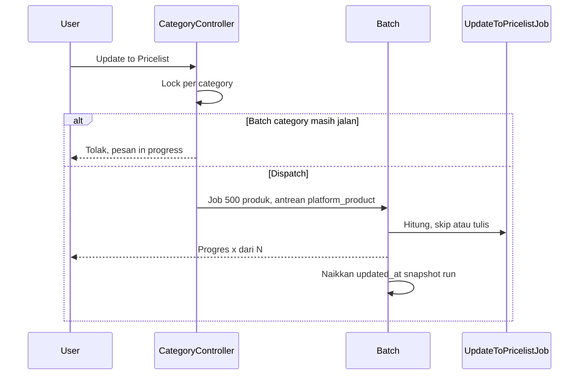

# Category Price — Technical

**FE AS-IS:** `src/pages/BusinessDevelopment/PricelistCategory/**`  
**BE AS-IS:** `PricelistCategoryController` · `PricelistCategory` · `PricelistCategoryMarginPrice` (`bd_pricelist_category_margin_prices`)  
**TO-BE:** ganti section margin tunggal → multi tier snapshot dari Variable Price (ETM-16313).  
**TO-BE weight sync:** [ETM-16668](https://erpintegration.atlassian.net/browse/ETM-16668) — consumer dari System Product DnW default change (bukan endpoint Category baru).  
**TO-BE Max Value:** [ETM-16835](https://erpintegration.atlassian.net/browse/ETM-16835) — snapshot `max_value` dari Variable Price; mirror enable/disable + calc ke Pricelist.  
**TO-BE Applied Store:** [ETM-16882](https://erpintegration.atlassian.net/browse/ETM-16882) — allow Active Others (+ platform); reverse partial ETM-16666 filter. Tooltip: platform + Others Active (drop "Only platform stores can be selected"). Satu store = satu category (`store()` / `update()`). Hapus (`destroy()`) menolak hanya store terikat `status = 1` — GAP-CP-07 / ETM-17053.  
**TO-BE Update to Pricelist vs Manual:** [ETM-16884](https://erpintegration.atlassian.net/browse/ETM-16884) — preserve `is_edited` + stack formula (lihat Pricelist technical).  
**TO-BE optimasi tulis/log/progres:** [ETM-17002](https://erpintegration.atlassian.net/browse/ETM-17002) — §5. Poin 5 (antrean khusus), poin 7 (skip Default Price 0), dan poin 8 (jangan simpan baris turunan) **bukan** perilaku ini.

---

## 1. AS-IS vs TO-BE

| Area | AS-IS | TO-BE |
|------|-------|-------|
| Margin UI | Satu set band di Form | Accordion tiers + Select Variable Price |
| Storage | `bd_pricelist_category_margin_prices` per category | Per-tier snapshot (+ pivot ke Variable Price id) |
| Update | N/A | Update from Master · Update to Pricelist |
| Weight sync | N/A | Auto dari DnW default (ETM-16668); skip manual category values |

Basic Information & DataList: tetap, kecuali **Applied Store** opsi store (ETM-16882). Flag helper “contains platform” untuk Sync Pricelist.

---

## 2. API (kontrak TO-BE)

| Method | Path (usulan) | Fungsi |
|--------|---------------|--------|
| POST | `…/pricelist-category/{id}/attach-variable-price` | Attach + copy bands snapshot |
| DELETE | `…/pricelist-category/{id}/tiers/{tierId}` | Remove tier |
| PATCH | `…/tiers/{tierId}/bands` | Edit lokal band |
| POST | `…/pricelist-category/{id}/update-from-master` | Overwrite semua tier dari master |
| POST | `…/pricelist-category/{id}/update-to-pricelist` | Recalc semua Pricelist rows category |

Audit log Category: attach/remove/edit tier, Update from Master, Update to Pricelist.  
Pricelist auto weight (ETM-16668): audit di **Log Pricelist**, bukan mengganti log Category.

---

## 3. FE

| Komponen | Catatan |
|----------|---------|
| Select Variable Price | Pola `PurchaseOrder/DatalistDetail` Select Product |
| Tier accordion | Badge type; snapshot datetime; orange info jika dirty vs master |
| Update to Pricelist | Tombol merah; checkbox gate; copy "Manual margins will be preserved" (ETM-16884). Angka popup = `count_pricelist_affected` (produk `status = 1` tanpa `productTree.children`), bukan jumlah baris. Juga `count_existing_pricelists`, `count_new_pricelists`, `update_progress` |
| Applied Store | Options: platform + Others Active; validate allow Others (ETM-16882). Tooltip menyebut platform dan Others Active. Store tidak eligible → "Store Field not found." Store sudah terpakai → "{nama} has already been used. A store cannot be bound to multiple category prices." |
| Band lokal Percentage | Validasi Value `-9999…9999` + truncate 4dp (mirror Variable Price / ETM-16569, 16562); **Max Value** enable + rules ETM-16835 |

---

## 4. Debt / gap

| ID | Item |
|----|------|
| G-01 | Pivot + snapshot schema belum ada |
| G-02 | Migrasi/bersih data band AS-IS |
| G-03 | Mass Update from Master datalist (opsional) |
| G-04 | Dirty detection tier vs master untuk icon oranye |
| G-05 | Share FormRequest/helper validasi Percentage dengan Variable Price |
| G-06 | **ETM-16668** — preserve manual category values saat weight sync |
| G-07 | **ETM-16835** — persist/edit Max Value on tier bands + pass to Pricelist calc |
| G-08 | **ETM-16882** — reopen Applied Store Others Active (FE list + BE validation) |
| G-09 | **ETM-16884** — UpdateToPricelistJob preserve manual + dialog copy |
| G-10 | **ETM-17053 / GAP-CP-07** — `destroy()` hanya memblokir store terikat Active; store Inactive masih bisa menghapus Category |
| G-11 | **ETM-17002 / GAP-CP-08** — `pricelistColumn()` Last Update masih `MAX(bd_pricelist_logs.updated_at)` tipe `update_to_pricelist`. Penanda category (`bd_pricelist_category_tier_snapshots.updated_at` snapshot run) belum dibaca tooltip |

---

## 5. Update to Pricelist (ETM-17002)

`PricelistCategoryController::updateToPricelist` · `ProcessUpdateToPricelistJob` (`CHUNK_SIZE = 500`) · `UpdateToPricelistJob` · `PricelistCategoryProgressService`.

**Banding (baris yang sudah ada), pembulatan 4 desimal:** `margin_price`, `final_price`, `tier_snapshot_id`. `is_edited` tidak ditulis ulang (Manual tetap Manual); target margin/Final dihitung dari flag itu, jadi keempat nilai sama berarti tidak ada UPDATE, tidak ada log, `updated_at` baris tidak berubah. Harga sama dan snapshot beda: `flushSnapshotUpdates` hanya mengisi `tier_snapshot_id` (tanpa log, tanpa `updated_at`). Harga beda: UPDATE + tepat 1 log `updated` / `update_to_pricelist`.

**Baris baru:** `DB::table('bd_pricelists')->insert` (bukan `Pricelist::create`), jadi `Pricelist::booted()` tidak menulis log manual. Job menulis tepat 1 log `created` / `update_to_pricelist`, nilai lama 0. `is_edited = 0`.

**Duplikat:** pertahankan `is_edited = 1`, else baris pertama; sisanya `deleted_at` + 1 log `deleted` / `duplicate`.

**Rumus:** Manual No → `max(0, default + tier)`. Manual Yes → margin user tetap, `max(0, default + user margin + tier)`.

**Konkurensi:** `Cache::lock` prefix `update_to_pricelist_atomic_lock_` (15 detik, hanya saat klik dispatch). Selama `job_batches` category itu belum selesai, `isUpdateRunning` menolak. Pesan: *"Update to Pricelist for category '{name}' is currently in progress. Please wait until it completes."* Lock klik gagal: *"Update to Pricelist is currently in progress. Please wait."* Variable Price yang memicu Update: bila category sedang jalan, return tanpa dispatch kedua.

**Progres:** opsi batch `total_products`; siaran `page-process-status.pricelist-category-{id}`; `show()` mengembalikan `update_progress` dari `job_batches` supaya refresh tidak menghilangkan indikator.

**Penanda Last Update:** di `finally` batch, `updated_at` snapshot run di-set ke sekarang (juga bila ada job gagal). Snapshot lama category di-`forceDelete` hanya jika batch **tanpa** failure. Tooltip header belum membaca penanda ini (GAP-CP-08).

### Invariants

- Company: job set `CompanyContext` dari company pemanggil; tidak menulis baris company lain.
- Hanya `products.status = 1` dan tanpa `productTree.children`.
- Satu produk satu baris hidup per category setelah cleanup duplikat.
- Harga (`margin_price`, `final_price`, `is_edited`) identik dengan rumus pra-optimasi untuk data yang sama.
- Tidak ada baris hidup yang `tier_snapshot_id`-nya menunjuk snapshot yang sudah dihapus, setelah run sukses.
- Log historis tidak diubah.

### Failure modes

- Exception di dalam job: `rollBack` transaksi job itu; `allowFailures` membiarkan job lain selesai; notifikasi gagal menyebut jumlah failed job; Update ulang mengisi yang belum ada tanpa menduplikasi (cocokkan `product_id`).
- Batch gagal sebagian: snapshot lama **tidak** dihapus, supaya baris yang belum pindah tidak menggantung ke snapshot hilang.
- 0 produk: tidak ada job; notifikasi selesai tetap satu kali; snapshot lama tetap dibersihkan.

---

## Related

[requirement.md](./requirement.md) · [Variable Price technical](../businessdevelopment-variable-price/technical.md)
