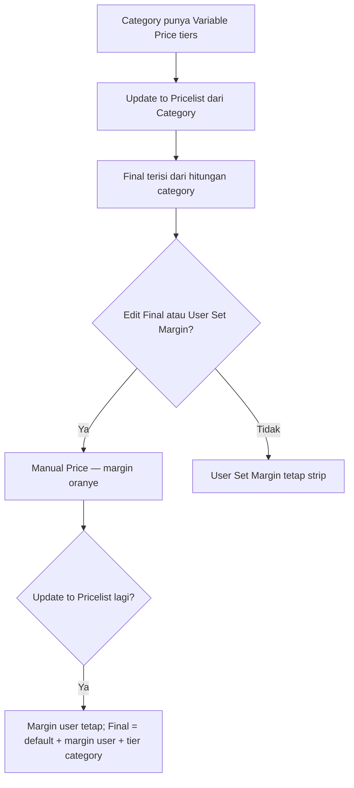

# Pricelist Product — Knowledge Base

## Apa itu

Daftar harga jual per produk per **Category Price**. Angka besar = **Final Price**; angka kecil di bawah = **User Set Margin** (hanya jika kamu edit manual; kalau belum → tampil `-`).

## Alur

## Kolom Weight

Setelah SKU. Ambil dari Dimension & Weight **primary** (gram). Kosong → **"No weight"** — aturan berat di-skip; aturan harga tetap jalan.

### Auto-update dari System Product (TO-BE ETM-16668)

Ubah weight DnW **default** (atau ganti radio default) → Weight + Final Category by Weight ikut terhitung ulang. Tercatat di **Log Pricelist**. **Manual Price** (oranye) **tidak** tertimpa.

## User Set Margin & hover (TO-BE ETM-16883)

- Belum edit manual → cell **`-`**. Detail hitungan tetap di **tooltip** (bukan hilang).
- Edit Final Price **atau** User Set Margin → keduanya **Manual Price**; angka margin **oranye**.
- Hover atas: *Click to edit Final Price*. Hover bawah: *Click to edit User Set Margin*.
- **Kosongkan / hapus** margin = **reset** → kembali `-`, Final ikut Category saja.
- Header nama category: hover → ringkasan tier + **Last Update to Pricelist** (waktu sukses terakhir).

## Sync ke platform (TO-BE ETM-16884)

Icon Sync (per baris & header kolom) hanya muncul jika Category punya minimal satu store **platform**. Category Applied Store kosong atau hanya **Others** → tidak ada Sync. **Sync All** hanya category ber-platform. Final tetap dihitung untuk Others / kosong.

## Tips

- Contoh non-manual: harga 16.000 + berat 1.500 g → Final **24.500**; User Set Margin `-`; pecahan di tooltip.
- Contoh Manual + Update Category: Default 10.000, margin user +2.000, tier category +1.500 → Final **13.500**; cell margin tetap **2.000** oranye.
- Edit di Pricelist **tidak** mengubah Category / Variable Price.
- **Advanced Filter → Manual Margin** (ETM-16861): **Yes** = ada Manual Price di baris; **No** = belum.

## Troubleshooting

| Gejala | Solusi |
|--------|--------|
| Angka lama setelah ubah Variable Price | Belum Update to Category / Update to Pricelist |
| User Set Margin masih angka padahal belum edit | Bug vs TO-BE ETM-16883 — seharusnya `-` |
| Manual hilang setelah Update to Pricelist | Bug vs TO-BE ETM-16884 — margin user harus tetap; Final boleh berubah |
| Tidak ada icon Sync | Category tanpa store platform (NULL/Others) — normal |
| Margin Weight = 0 / skipped | Isi weight DnW **default** di System Product |
| Mau daftar yang diedit manual | Advanced Filter **Manual Margin** Equals **Yes** |

Detail: [requirement.md](./requirement.md)
