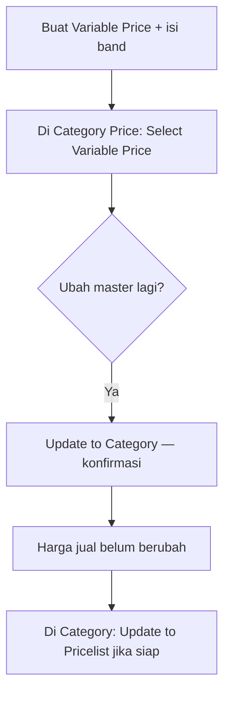

# Variable Price — Knowledge Base

## Apa itu

Master aturan margin (band) yang bisa dipakai banyak **Category Price**. Satu master hanya **berdasarkan harga** (by Amount) atau **berdasarkan berat** (by Weight). Butuh keduanya → buat dua master, pasang keduanya di Category.

## Kapan dipakai

- Mau aturan margin reusable (bukan isi ulang di tiap Category).
- Mau margin berdasarkan berat produk (gram) selain harga.

## Alur standar

## Glosarium singkat

| Istilah | Arti |
|---------|------|
| Band | Baris Start–End + Type + Value (+ **Max Value** jika Percentage) |
| Unlimited | Baris terakhir — berlaku dari Start ke atas |
| Snapshot | Salinan band di Category — tidak auto ikut ubah master |
| Max Value | Plafon hasil margin Type Percentage (mata uang primary). Kosong = tidak ada batas |

## Tombol penting

| Aksi | Efek |
|------|------|
| **Update to Category** | Timpa band di semua Category yang memakai master ini (termasuk edit lokal). Pricelist **tidak** ikut. |
| Mass Update (datalist) | Sama, untuk beberapa master tercentang. Nonaktif jika ada master yang belum dipakai Category. |

## Tips

- Value boleh **minus** (mengurangi harga jual).
- Kalau Type band **Percentage**, Value hanya boleh antara **-9.999** dan **9.999** (persen). Angka 10.000 ke atas / -10.000 ke bawah ditolak saat simpan.
- **Max Value** (TO-BE): hanya aktif jika Type = Percentage. Batasi hasil % × default price (contoh: default 1 jt · 50% · Max 250 rb → margin +250 rb, bukan +500 rb). Kosongkan kalau tidak mau plafon. Type Amount → Max Value mati & dikosongkan. Percentage minus → Max Value ikut negatif saat Save. Detail: [requirement §4.2.1](./requirement.md) · [ETM-16835](https://erpintegration.atlassian.net/browse/ETM-16835).
- Type bisa diganti selama belum dipakai Category (akan ada konfirmasi dan baris band dikosongkan); setelah dipakai terkunci — hover icon info untuk penjelasan.
- Hover **Used in Categories** untuk lihat Category mana yang memakai master.
- Setelah Update to Category, harga jual di Pricelist baru berubah kalau Category menjalankan **Update to Pricelist**.

## Troubleshooting

| Gejala | Solusi |
|--------|--------|
| Update to Category nonaktif | Master belum dipasang di Category mana pun — pasang dulu di Category Price |
| Type tidak bisa diganti | Sudah dipakai Category — buat master baru jika butuh type lain |
| Tooltip Type tidak muncul | Laporkan bug (ETM-16566) — seharusnya muncul saat hover icon info/gembok |
| Ganti Type Amount↔Weight tanpa konfirmasi / angka band aneh | Tidak boleh — harus konfirmasi + band kosong (ETM-16568) |
| Simpan Percentage 10.000+ ditolak | Normal — batas ±9.999% (ETM-16569) |
| Max Value tidak bisa diisi | Pastikan Type band = Percentage; Amount memang disabled |
| Margin % tetap “penuh” padahal sudah set Max | Cek Max Value tersimpan & Update to Category / to Pricelist sudah dijalankan |
| Desimal Percentage jadi angka aneh / hilang setelah Save | Bug pemisah desimal (ETM-16562) — seharusnya truncate 4 digit |
| Audit Log Start/End/Margin tampil `-` padahal 0/Unlimited | Bug Audit Log tier (ETM-16565) |
| Pricelist tidak berubah setelah Update to Category | Normal — lanjut Update to Pricelist di Category |

## Do / Don't

**Do:** satu type per master; cek Used in Categories sebelum mass Update.  
**Don't:** mengira ubah master langsung ubah harga jual; campur Amount+Weight dalam satu master.

Detail: [requirement.md](./requirement.md) · Wireframe: https://claude.ai/artifact/CSgXVMhzsztTJqwpeD7f89
