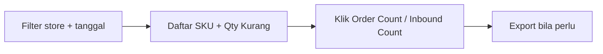

# Stock Shortage Monitoring — Knowledge Base

## 1. Apa itu

Report yang menjawab: **SKU mana yang kurang** untuk order yang masih nunggu di **Unassign Wave**, berapa kurangnya, order mana saja, dan inbound mana yang masih menyisakan stok.

**Menu:** Omni Channel → Report Omni → **Stock Shortage Monitoring** (`/omni/stock-shortage-monitoring`)

## 2. Alur singkat

## 3. Istilah

| Istilah | Arti |
|---------|------|
| **Total Qty Order** | Total kebutuhan SKU dari order di Unassign Wave (base unit) |
| **Avail** | Stok available di gudang Process store terkait |
| **Qty Kurang** | Kekurangan = max(0, Total − Avail) |
| **Coverage** | Persentase Avail terhadap Total (maks 100%) |
| **Inbound Count** | Jumlah inbound approved yang masih punya sisa stok |
| **Show only SKU with shortage** | Hanya tampilkan SKU yang Qty Kurang > 0 |

## 4. Bisa / tidak bisa

### Bisa
- Lihat agregat per SKU (bundle sudah dipecah ke komponen)
- Filter store, tanggal, sort, toggle shortage
- Buka modal daftar order / inbound per SKU
- Export datalist dan (idealnya) modal
- Cross-check Avail dengan Real Time Stock → By SKU (gudang Process store)

### Tidak bisa
- Mengubah stok atau order dari layar ini (read-only report)
- Menghitung order yang sudah masuk wave / sudah picking / shipped
- Mengurangi Qty Kurang dengan PO/inbound yang masih open (inbound open tidak menutup kekurangan)

## 5. Cara pakai

1. Pilih **Store** (disarankan 1 store dulu) + **Order Date**.
2. Baca summary: berapa SKU short, total qty short, order tertua.
3. Sort **shortage** untuk prioritas purchasing.
4. Toggle **Show only SKU with shortage** bila hanya mau yang kurang.
5. Klik **Order Count** → cek SO + qty (bundle bertanda From Bundle).
6. Klik **Inbound Count** → cek batch yang masih menyisakan Avail.
7. Bandingkan Avail dengan Real Time Stock gudang Process store.

## 6. Tips

- Bundle: yang tampil komponennya. Contoh qty bundle 5 × rasio 2 = **10** di komponen (bukan 20).
- Multi-store beda gudang → muncul banner; angka Avail digabung.
- Data di-cache **±5 menit** — order baru bisa belum muncul segera.
- Kalau export gagal / modal export tanpa progress: laporkan (ada card RE-OPEN terkait).

## 7. Troubleshooting

| Gejala | Solusi |
|--------|--------|
| SKU hilang setelah Send to Wave | Normal — order sudah keluar Unassign Wave |
| Qty komponen 2× lipat | Seharusnya sudah diperbaiki (ETM-16583); jika muncul lagi → bug regresi |
| Toggle shortage, counter tidak ikut | Seharusnya ikut (ETM-16593); jika tidak → regresi |
| Avail ≠ Real Time Stock | Cek Building = WH Process store yang sama; laporkan jika tetap beda |
| Data “basi” | Tunggu cache 5 menit atau ubah filter lalu reload |
| Export error | Cek Export History / progress; jangan refresh paksa di tengah job |

## Related

[requirement.md](./requirement.md) · [Unassign Wave](../omni-unassign-wave/) · [Real Time Stock](../supplychain-real-stock/)
