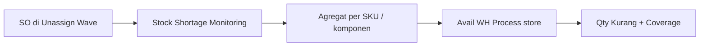

# Stock Shortage Monitoring — Requirement

**Modul:** Omni Channel / Report Omni · **Route:** `/omni/stock-shortage-monitoring`  
**Origin:** [ETM-16168](https://erpintegration.atlassian.net/browse/ETM-16168) · **Mockup:** https://claude.ai/artifact/Gm58SRuYh4eqR5KVx8gzxo  
**Relates (fix Done):** [ETM-16583](https://erpintegration.atlassian.net/browse/ETM-16583) · [ETM-16593](https://erpintegration.atlassian.net/browse/ETM-16593)  
**Relates (RE-OPEN / pantau):** export modal async [ETM-16304](https://erpintegration.atlassian.net/browse/ETM-16304); export datalist [ETM-16296](https://erpintegration.atlassian.net/browse/ETM-16296) / [ETM-16351](https://erpintegration.atlassian.net/browse/ETM-16351); Avail WH Process [ETM-16302](https://erpintegration.atlassian.net/browse/ETM-16302)

---

## 0. Changelog

| Version | Date | Changes |
|---------|------|---------|
| 1.0 | 2026-10-30 | Initial dari ETM-16168 + AS-IS kode (15–30 Okt 2026); bundle anti-duplikat 16583; toggle/pagination 16593 |

---

## 1. Ringkasan

Report **per SKU** dari order yang masih menunggu di Unassign Wave: total qty dibutuhkan, stok **Avail** di WH Process store terkait, **Qty Kurang**, Coverage, drill-down Order Count & Inbound Count, export.

Tujuan: purchasing / ops tahu SKU mana yang menahan order tanpa buka SO satu per satu.

---

## 2. Acceptance Criteria

| ID | Kriteria | Status |
|----|----------|--------|
| A-01 | Hanya SO approved/processed dengan `unassign_wave_status` not in queue / in queue; belum ada prepared/processed to out > 0 | **AS-IS** |
| A-02 | Order Send to Wave / Skip Processing / picking / shipped / void tidak masuk | **AS-IS** |
| A-03 | Bundle dipecah ke komponen (qty = bundle × BoM); header bundle tidak tampil; anak tree tidak dihitung 2× ([ETM-16583](https://erpintegration.atlassian.net/browse/ETM-16583)) | **AS-IS** |
| A-04 | Avail = stok available WH Process store order (`COALESCE(so.wh_process_id, store.warehouse_process_id)` + anak non-virtual, exclude scrap/void WIP) — selaras Real Time Stock By SKU gudang induk | **AS-IS** (pantau RE-OPEN 16302) |
| A-05 | Inbound Count = inbound approved yang masih menyisakan available di scope gudang | **AS-IS** |
| A-06 | Modal Order: total qty = Total Qty Order; urut tertua; label From Bundle jika dari komponen | **AS-IS** |
| A-07 | Modal Inbound: total Qty Avl = Avail baris | **AS-IS** |
| A-08 | Qty Kurang = max(0, Total Qty Order − Avail); Coverage = min(100, Avail/Total×100) 1 desimal | **AS-IS** |
| A-09 | Filter Store (multi), Order Date, Sort (shortage/oldest/quantity/sku), toggle **Show only SKU with shortage** | **AS-IS** |
| A-10 | Toggle shortage: jumlah baris **dan** counter/pagination ikut berubah ([ETM-16593](https://erpintegration.atlassian.net/browse/ETM-16593)) | **AS-IS** (verifikasi ulang jika regresi) |
| A-11 | Multi-store beda WH Process → banner peringatan scope gudang | **AS-IS** |
| A-12 | Export datalist + modal Order + modal Inbound (async + progress) | **AS-IS partial** — pantau RE-OPEN 16296/16304/16351 |
| A-13 | Agregasi server-side, pagination, modal lazy, cache dataset ~5 menit | **AS-IS** |
| A-14 | Data company-scoped (kecuali bypass company) | **AS-IS** |

---

## 3. Populasi order (wajib)

| Syarat | Nilai |
|--------|--------|
| `transaction_status` | `approved` **atau** `processed` |
| `unassign_wave_status` | `not in queue` **atau** `in queue` |
| Detail | Tidak ada baris dengan `prepared_to_out_quantity > 0` atau `processed_to_out_quantity > 0` |
| Soft delete | `deleted_at` null |
| Filter Store | `so.store_id` ∈ pilihan |
| Filter tanggal | `so.transaction_date` dalam range (default UI ~30 hari) |

---

## 4. Kolom datalist

| Kolom | Definisi |
|-------|----------|
| System Product | 1 baris = 1 SKU (komponen bundle / non-bundle). Link ke Product. |
| Order Count / oldest | Jumlah SO + tanggal order tertua (+ umur hari) |
| Total Qty Order | Σ qty base unit (komponen bundle = qty bundle × qty BoM `is_bom = 0`) |
| Avail | Σ `available_quantity` di WH Process terkait filter store |
| Inbound Count | Jumlah batch inbound approved yang masih punya sisa available |
| Qty Kurang | `max(0, Total Qty Order − Avail)` |
| Coverage | `min(100, Avail / Total Qty Order × 100)` % |

**Invariant:** footer modal Order = Total Qty Order; footer modal Inbound Qty Avl = Avail.

---

## 5. Filter & summary

| Kontrol | Perilaku |
|---------|----------|
| Store multi | Scope demand + WH Process Avail |
| Order date | Range transaksi SO |
| Sort by | shortage (default) / oldest / quantity / sku |
| Show only SKU with shortage | Hanya `qty_shortage > 0`; counter & pagination ikut |
| Summary cards | SKU in demand, SKU short, Qty short, orders waiting, oldest order |

**Banner:** >1 store dengan WH Process berbeda → Avail gabungan; sarankan filter 1 store untuk angka pasti.

---

## 6. Contoh (ETM-16583)

Bundle `SH-BUNDLE-LIPS-BEDAK-NEW` qty **5**, rasio komponen LIPS/BEDAK = **2** → Total Qty Order LIPS = **10**, BEDAK = **10** (bukan 20). Header bundle tidak muncul. Modal Order menampilkan SO + label From Bundle.

---

## 7. Gap / RE-OPEN

| ID | Topik | Catatan |
|----|-------|---------|
| GAP-SSM-01 | Origin masih RE-OPEN | ETM-16168 — tutup setelah AC + Error terkait Done |
| GAP-SSM-02 | Export datalist / modal | RE-OPEN 16296, 16351, 16304 — async progress wajib per AC origin |
| GAP-SSM-03 | Avail vs WH Process filter | RE-OPEN 16302 — cross-check Real Time Stock |
| GAP-SSM-04 | Cache 5 menit | Data baru bisa telat; dokumentasikan ke operator |
| GAP-SSM-05 | Pertanyaan origin §13 | Avail vs outstanding wave; kolom cover PO open; unit non-base; pill dari Unassign Wave — **belum** dijawab di card |

---

## Related

[knowledge-base.md](./knowledge-base.md) · [Unassign Wave](../omni-unassign-wave/) · [Real Time Stock](../supplychain-real-stock/)
