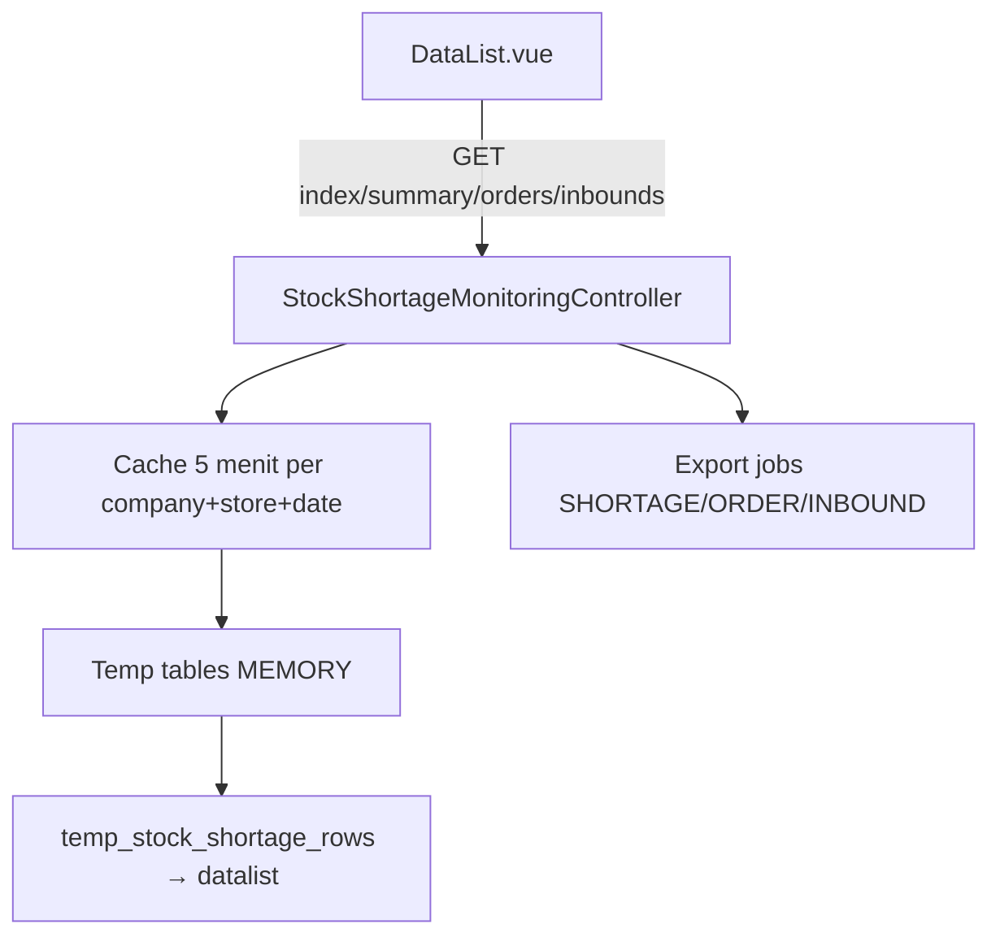

# Stock Shortage Monitoring — Technical

## 0. Changelog

| Version | Date | Changes |
|---------|------|---------|
| 1.0 | 2026-10-30 | Initial map dari `StockShortageMonitoringController` + FE DataList; notes ETM-16583/16593 |

---

## 1. Architecture

**Cache key:** `stock_shortage_monitoring_v5:` + hash(connection, company, stores, dateFrom/To, shortage_only). TTL **5 menit**.

---

## 2. File map

| Area | Path |
|------|------|
| BE controller | `Modules/OmniChannel/Http/Controllers/StockShortageMonitoringController.php` |
| Entity / policy | `Entities/StockShortageMonitoring.php` · export file entity |
| Jobs | `Jobs/StockShortageMonitoringExportJob.php` · `StockShortageDetailExportJob.php` |
| Routes | `Modules/OmniChannel/Routes/api.php` prefix `stock-shortage-monitoring` |
| FE | `olshoperp-frontend/src/pages/Omni/Report/StockShortageMonitoring/DataList.vue` |

---

## 3. API

| Method | Path | Fungsi |
|--------|------|--------|
| GET | `omnichannel/stock-shortage-monitoring` | Datalist per SKU |
| GET | `.../summary` | Kartu summary |
| GET | `.../{productId}/orders` | Modal Order Count |
| GET | `.../{productId}/inbounds` | Modal Inbound Count |
| GET | `.../export-file` · `export-excel` · `export-progress` | Export datalist (`menu=SHORTAGE`) |
| GET | `.../{productId}/orders/export*` | Export modal order |
| GET | `.../{productId}/inbounds/export*` | Export modal inbound |

Auth: `viewAny` StockShortageMonitoring (+ company scope).

---

## 4. Populasi & rumus (AS-IS)

**Orders** (`pendingOrdersQuery`):

- `unassign_wave_status` ∈ {not in queue, in queue}
- `transaction_status` ∈ {approved, processed}
- Tidak ada detail dengan `prepared_to_out_quantity > 0` OR `processed_to_out_quantity > 0`
- Filter `store_id`, `transaction_date` range
- WH parent: `COALESCE(so.wh_process_id, store.warehouse_process_id)`

**Demand lines:**

1. Non-bundle detail (bukan header BoM) **dan** `NOT EXISTS` detail tree dengan `parent_id` (anti double-count anak bundle — ETM-16583)
2. Bundle header → explode BoM `is_bom = 0`: `qty = SO qty × qty_per_bundle`

**Avail:** SUM `item_stock.available_quantity` di parent WH Process + child non-virtual (exclude scrap/void setting).

**Derived:** `qty_shortage = max(0, total − avail)`; `coverage = min(100, avail/total*100)`.

**Temp pipeline:** `temp_ssm_orders` → `temp_bundle_components` → `temp_ssm_demand_lines` → `temp_ssm_demand` → avail/inbound join → `temp_stock_shortage_rows`.

---

## 5. FE perilaku

| Kontrol | Param / catatan |
|---------|-----------------|
| Store multiselect | `store_ids[]` |
| Date range | default ~1 bulan |
| Sort | `sort_by`: shortage / oldest / quantity / sku |
| Toggle shortage | `shortage_only=true` — recordsFiltered harus ikut (ETM-16593) |
| Modal | Lazy GET orders/inbounds + pagination lokal |
| Export | ExportFileTable + progress endpoints per menu type |

---

## 6. Debt / gap

| ID | Item |
|----|------|
| G-01 | RE-OPEN export datalist/modal async (16296, 16351, 16304) |
| G-02 | RE-OPEN Avail WH Process scope (16302) |
| G-03 | Origin ETM-16168 masih RE-OPEN |
| G-04 | Cache 5m stale window — pertimbangkan invalidasi event-driven |
| G-05 | Pertanyaan origin: outstanding wave, cover PO open, pill Unassign Wave |

---

## Related

[requirement.md](./requirement.md) · Unassign Wave technical · Real Time Stock
