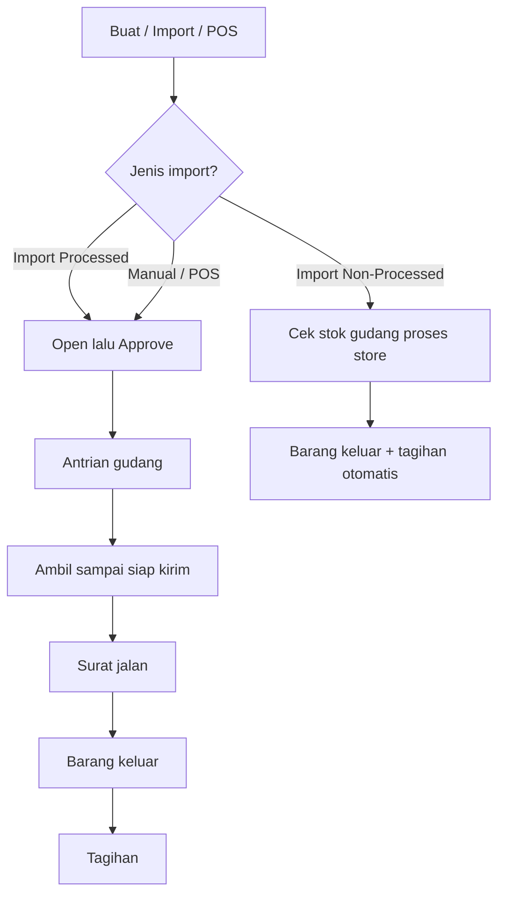

# Dev - Sales Order — Knowledge Base

**Siapa yang baca:** operator Busdev/Ops, support  
**Menu:** Business Development → **Dev - Sales Order**  
**Route:** `/businessdevelopment/sales-order-general`

Layar gabungan: **All Sales Order**. Marketplace: **Dev - Sales Platform**.  
Mode toko: **Fulfillment Mode** di master **Store** (**Processed** / **Non Processed**).

---

## 1. Apa itu & kenapa penting

**Dev - Sales Order** mencatat **pesanan penjualan internal** (telepon/WA, B2B, Excel, POS) — bukan sync Shopee/Lazada/TikTok.

Ada **dua jalur setelah import**, tergantung Fulfillment Mode store: masuk proses gudang penuh, atau langsung keluar barang + tagihan.

---

## 2. Kapan dipakai?

| Kebutuhan | Cara |
|-----------|------|
| Penjualan B2B / offline | Create manual → lengkapi customer & produk |
| Banyak order + proses gudang | **Import Processed** (store harus **Processed**) |
| Banyak order tanpa proses gudang | **Import Non-Processed** (store harus **Non Processed**) |
| Kasir toko | Point of Sales (jalur Non-Processed POS = nanti) |
| Lihat general + marketplace | **All Sales Order** (tombol import sama) |
| Unduh semua order di daftar | **Export All** → isi judul file dulu (lihat bawah) |

---

## 3. Alur kerja standar

**Keterangan langkah:**

1. **Create** — buat draft lalu buka edit.  
2. **Import Processed** — hasil **Open**; lanjut Approve → antrian gudang (sering perlu Unassign/Skip Wave).  
3. **Import Non-Processed** — sistem cek stok di gudang proses **store order itu**; jika OK buat barang keluar + tagihan otomatis (tanpa wave–ship).  
4. Store salah mode vs tombol → order itu gagal; order lain di file bisa lanjut.  
5. Template Excel **sama** untuk kedua tombol.  
6. Banyak order SKU sama dalam satu unggahan Non-Processed: kalau total stok gudang proses cukup, semuanya harus berhasil. Sistem tidak gagal hanya karena beberapa proses berebut batch masuk yang sama.

🎬 [Interactive demo akan ditambahkan di sini]

### Arti status (ringkas)

| Status | Artinya | Bisa diedit? |
|--------|---------|--------------|
| Draft | Baru disusun | Ya |
| Open | Siap review & approve (hasil Import Processed) | Ya |
| Rejected | Ditolak dari Open | Ya — buka dokumen, perbaiki, lalu set ke Draft/Open lagi |
| Approved | Disetujui / final (termasuk Non-Processed sukses) | Tidak (bisa Void atau Close) |
| Closed | Ditutup lewat **Close Doc** (setelah Approved) | Tidak |
| Void | Dibatalkan lewat **Void Doc** (setelah Approved; bisa ditolak jika sudah terkait outbound/invoice) | Tidak (bisa Duplicate) |

> **Jangan samakan Closed dengan Void.** Close = menutup dokumen yang sudah disetujui; Void = membatalkan dokumen yang sudah disetujui (aturan & tombolnya beda).

**Void saat order masih di antrian gudang (TO-BE · ETM-17110).** Kalau order masih di Wave dan belum diambil, **Void** atau **Void & Recreate** mengeluarkan order dari antrian itu. Stok yang tadinya ditahan kembali bisa dijual, sebesar qty yang dilepas. Contoh: ditahan 2, tersedia 8 → setelah void ditahan 0, tersedia 10. Kalau barang sudah diambil, pembatalan setelah pengambilan tetap seperti biasa.

---

## 4. Import Excel (operator)

### Dua tombol

| Tombol | Store harus | Setelah sukses |
|--------|-------------|----------------|
| **Import Processed** | **Processed** | Open → Approve → proses gudang |
| **Import Non-Processed** | **Non Processed** | Progress job (mirip Skip Wave) → outbound + invoice otomatis |

Atur mode di **Omni → Store → Fulfillment Mode** dulu.

### Template (kolom sama)

1. **Sheet 1** — tanggal, customer, store, referensi, kurir, tracking, SKU, qty, unit, harga.  
2. **Sheet 2** (opsional) — kolom **Other Cost/Disc Code** + Amount (biaya atau diskon tambahan per nomor referensi order).

> **Pantangan:** jangan pakai kode yang sama di master **Other Cost** dan **Other Discount**. Satu kolom template dipakai keduanya. Kalau kode bentrok di kedua master, order harus gagal import (aturan baru). Saat ini sistem bisa diam-diam memilih biaya — jangan andalkan itu; rapikan master dulu.

| Rule | Nilai |
|------|-------|
| Max SKU per order | **100** |
| Format | `.xlsx` / `.xls` |
| Gabung 1 order | Customer + Store + Tanggal + Platform Order ID + Shipper + Tracking |
| Store | Tipe **Others** + mode sesuai tombol |
| Rumus Excel | Ditolak |

Kolom template tetap sama. Cara baca **harga** berubah: titik atau koma bisa jadi desimal, bukan selalu ribuan.

### Harga di Excel

- `10000.6789` dibaca **Rp 10.000,6789** (bukan Rp 100.006.789). Qty 1000 → total **Rp 10.000.678,90**.
- Kalau sel punya titik **dan** koma, tanda **terakhir** adalah desimal (misalnya `10.000,6789` dan `10,000.6789` sama-sama Rp 10.000,6789).
- Satu titik dengan tepat 3 angka di belakang dan angka di depan pendek dibaca ribuan: `1.500` = 1500 (seribu lima ratus), `12.345` = 12345. `1234.567` tetap desimal (Rp 1.234,567).
- Lebih dari 4 angka di belakang koma/titik **ditolak**. Di log: `Price for SKU [X] exceeds maximum allowed decimal places (maximum 4 decimal places).`
- Sebelum pesanan jadi, sistem membandingkan jumlah tiap baris (sudah dibulatkan ke rupiah) dengan total header. Selisih 1 rupiah pun menggagalkan order. Log diawali `Rounding mismatch detected for Order`.
- Contoh dua SKU: **AKRCHRU** qty 3 harga `3333.3333` dan **AKRKAS** qty 3 harga `6666.6667`. Kedua hitungan sama-sama Rp 30.000,00, jadi order ini **lolos**.

### Jika import gagal

1. Cek **Import History** / log (Non-Processed: log progress mirip Skip Wave).  
2. Mismatch mode store ↔ tombol → ganti store/mode atau ganti tombol.  
3. Non-Processed stok kurang → seluruh order gagal; lihat SKU mana yang kosong.  
4. Banyak order dengan SKU yang sama di **Import Non-Processed**: kalau total stok gudang proses cukup, semuanya harus berhasil. Sistem memakai batch masuk berikutnya bila batch pertama sudah diambil proses lain. Pesan **No Stock Available** berarti stok di semua batch memang kurang.  
5. File sangat besar bisa stuck — pecah file (batasan sistem).

---

## 4b. Export All — judul file

**Export All** (**With Details** atau **Without Details**) meminta judul file dulu, supaya unduhan dan riwayat export mudah dikenali.

1. Klik **Export All** → **With Details** atau **Without Details**.
2. Dialog **Export File Name** terbuka. Field **File name** sudah terisi saran (boleh diganti, paling banyak 150 karakter). Contoh: `Dev - Sales Order - With Details Export 05-11-2026_15.06.00`.
3. Klik **Export**. Kalau field kosong, muncul **File name is required.** dan file tidak dibuat.
4. Nama itu yang terunduh (file Excel, atau zip bila hasilnya dipecah) dan yang tampil di riwayat export.
5. **Export Active Page Only** tidak membuka dialog — file langsung diproses.

Karakter yang tidak boleh di nama file diganti tanda minus. Contoh: `Laporan SO 05/11` tersimpan `Laporan SO 05-11`.

## 5. Yang sering bikin bingung

| Gejala | Penyebab umum | Solusi |
|--------|---------------|--------|
| Order gagal “mode” / fulfillment | Store Processed diunggah lewat Non-Processed (atau sebaliknya) | Samakan tombol dengan Fulfillment Mode store |
| Setelah Approve belum masuk gudang | Setting tidak auto-wave | Unassign / Skip Wave di SCM |
| Setelah Void, stok tetap ditahan atau order masih di Wave padahal belum diambil | Pelepasan dari Wave belum jalan | Seharusnya stok ditahan turun dan order keluar dari Wave (ETM-17110). Kalau sudah diambil, itu jalur void setelah picking |
| Invoice tidak muncul setelah Approve (Processed) | Memang tidak saat Approve | Tunggu outbound / settlement |
| Non-Processed gagal stok | Stok di hierarki gudang proses store kurang | Isi stok / kurangi qty / ganti store |
| Non-Processed **No Stock Available** padahal stok gudang masih ada di batch lain | Dulu beberapa proses bisa mengambil batch masuk yang sama | Seharusnya order tetap berhasil jika total stok cukup; sistem memakai batch berikutnya. Kalau masih gagal, stok di semua batch memang kurang |
| Sheet 2 cost/disc “aneh” / salah jadi biaya | Kode sama ada di Other Cost dan Other Discount | Ubah salah satu kode di master; re-import. Order harus gagal jika bentrok (aturan baru) |
| Create langsung ke edit | By design | Lengkapi di halaman edit |
| Ada tanda harga di bawah HPP / auto-approve gagal | Price Before VAT di bawah Benchmark COGS di line | Unhide kolom Price Before VAT + Benchmark; naikkan harga atau **approve manual**. Filter TO-BE: Error Flag **Below Benchmark COGS** |
| Harga jadi ratusan juta setelah import | Titik di `10000.6789` dulu dianggap ribuan | Seharusnya Rp 10.000,6789. Qty 1000 → total Rp 10.000.678,90. Kalau masih meledak, kirim file ke support |
| Baris ditolak “maximum 4 decimal places” | Harga punya lebih dari 4 angka di belakang koma/titik | Potong ke 4 angka desimal, lalu unggah ulang |
| Order gagal “Rounding mismatch” | Jumlah baris (ke rupiah) tidak sama dengan total header, walau selisih 1 rupiah | Samakan harga/qty supaya kedua total cocok. Contoh AKRCHRU + AKRKAS di atas saat ini cocok (Rp 30.000) |

---

## 5b. Error Flag Below Benchmark COGS (TO-BE)

Saat unit price sebelum pajak (nilai primary) di bawah Benchmark COGS yang tersimpan di baris SKU:

- Muncul tanda Error Flag **Below Benchmark COGS** (merah) di list order dan di baris SKU yang under  
- Bisa difilter lewat advanced filter Error Flag  
- Order **tidak ikut auto-approve terjadwal**; **approve manual tetap boleh**  
- Nilai Benchmark di order adalah **snapshot** — mengubah master COGS tidak mengubah order lama sampai detail dihapus & diisi ulang
- **TO-BE (Manual COGS):** snapshot = **COGS efektif** (Manual jika override aktif, else rumus) — sama seperti Sales Platform

Detail: [Benchmark COGS](../accounting-product-benchmark-price/knowledge-base.md).

---

## 6. Istilah → bahasa sehari-hari

| Istilah | Artinya |
|---------|---------|
| Fulfillment Mode | Di Store: **Processed** (lewat gudang) atau **Non Processed** (langsung keluar + tagih) |
| Import Processed / Non-Processed | Dua tombol upload Excel |
| Platform Order ID | Nomor referensi luar + kunci gabung baris |
| Wave | Antrian gudang sebelum ambil barang |
| Outbound | Bukti barang keluar |
| Other Cost/Disc Code | Satu kolom di Sheet 2 untuk kode biaya **atau** diskon tambahan — jangan duplikat lintas kedua master |

---

## 7. FAQ singkat

**Bedanya dengan All Sales Order?** Satu layar general + marketplace; tombol import sama.  
**POS ikut Non-Processed?** Belum — requirement berikutnya.  
**Max detail?** 100 baris per pesanan.  
**Harga `10000.6789`?** Dibaca Rp 10.000,6789, bukan ratusan juta. Lebih dari 4 angka desimal ditolak. `1.500` tetap seribu lima ratus.  
**Export All minta nama?** Ya, untuk **With Details** dan **Without Details**. Kosongkan **File name** → **File name is required.** **Export Active Page Only** tidak menanyakan nama.  
**Void order yang masih di Wave?** Stok yang ditahan kembali bisa dijual, dan order keluar dari antrian. Contoh: ditahan 2, tersedia 8 → setelah void ditahan 0, tersedia 10 (ETM-17110).

## Referensi

- [requirement.md](./requirement.md) · [technical.md](./technical.md) · [user-guide.md](./user-guide.md)  
- Store: [../omni-store-binding/knowledge-base.md](../omni-store-binding/knowledge-base.md)  
- ASO: [../all-sales-order/knowledge-base.md](../all-sales-order/knowledge-base.md)
