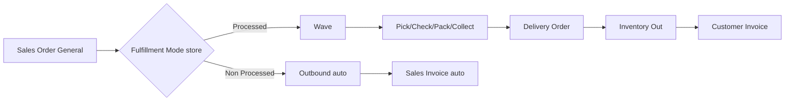
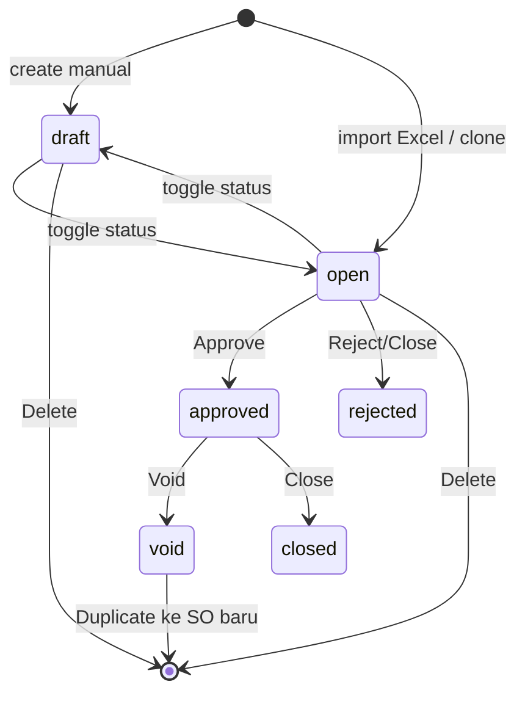
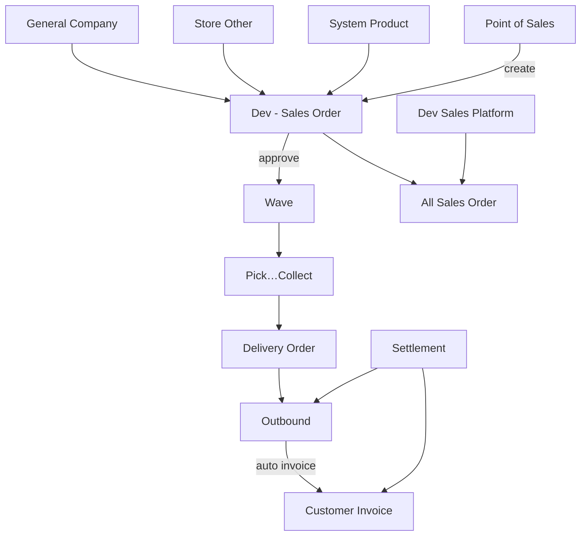

# Dev - Sales Order (Sales Order General) — Requirement Documentation

**Modul:** OmniChannel + BusinessDevelopment (+ SCM / Accounting hilir)  
**Type:** `type_sales_order = general`  
**UI route:** `/businessdevelopment/sales-order-general`  
**Audience:** PM, Ops, Finance, QA  
**SoT:** `busdev-sales-order-general-source-of-truth.md` v1.0 (21 Jul 2026) + Fulfillment Mode TO-BE (22 Jul 2026) + Sheet 2 OC/OD ambiguity (23 Jul 2026)

Window gabungan: [All Sales Order](../all-sales-order/requirement.md). Platform independen: [Dev - Sales Platform](../omni-sales-platform/requirement.md).  
Master flag: [Store — Fulfillment Mode](../omni-store-binding/requirement.md).  
**Related:** [ETM-16762](https://erpintegration.atlassian.net/browse/ETM-16762) (OC/OD SO → SI) · [ETM-16763](https://erpintegration.atlassian.net/browse/ETM-16763) · [ETM-17055](https://erpintegration.atlassian.net/browse/ETM-17055) (desimal, presisi, pembulatan import) · [ETM-17081](https://erpintegration.atlassian.net/browse/ETM-17081) (alokasi stok Import Non-Processed aman saat proses bersamaan) · [ETM-16768](https://erpintegration.atlassian.net/browse/ETM-16768) (judul file Export All)

---

## 0. Metadata & Changelog

| Version | Date | Author | Changes |
|---------|------|--------|---------|
| 3.9 | 2026-11-05 | QA - Yemima | Export All With/Without Details wajib judul file (dialog **Export File Name**); nama kosong ditolak; nama bersih jadi file unduhan dan baris riwayat. Export Active Page Only tanpa dialog. GAP-SOG-16 Open (ETM-16768) |
| 3.8 | 2026-11-05 | QA - Yemima | Import Non-Processed: beberapa order SKU sama yang diproses bersamaan tetap berhasil jika stok gudang cukup; kunci baris stok lalu ambil batch masuk FIFO berikutnya (ETM-17081) |
| 3.7 | 2026-11-04 | QA - Yemima | Import Price: titik/koma dibaca benar, maks. 4 desimal, pembulatan 4/2, rekonsiliasi sebelum SO dibuat (ETM-17055) |
| 3.6 | 2026-10-22 | QA - Yemima | Cross-ref TO-BE ETM-16762/16763: Other Cost/Discount di SO wajib jadi sumber carry ke SI |
| 3.5 | 2026-08-31 | QA - Yemima | Status: pisahkan Rejected (editable) vs Closed vs Void; koreksi tabel editable |
| 3.4 | 2026-08-12 | QA - Yemima | TO-BE snapshot **Benchmark COGS** = effective Manual COGS (§8.2 / GAP-BM-14 consumer) |
| 3.3 | 2026-08-11 | QA - Yemima | TO-BE Error Flag **Below Benchmark COGS** (§8.1); GAP-SOG-14 → GAP-BM-13 |
| 2.4 | 2026-07-09 | QA - Yemima | Bundle proporsi + benchmark COGS |
| 3.0 | 2026-07-22 | QA - Yemima | Rewrite dari SoT v1.0: datalist, status, import, ASO window, gap registry GAP-SOG-01…06 |
| 3.1 | 2026-07-22 | QA - Yemima | TO-BE: dual import **Import Processed** / **Import Non-Processed** + Fulfillment Mode store; GAP-SOG-07…12 |
| 3.2 | 2026-07-23 | QA - Yemima | Sheet 2: kode **Other Cost/Disc** ambigu (cost+discount sama) → order gagal import; GAP-SOG-13 |

---

## 1. Ringkasan Eksekutif

Sales Order General adalah dokumen penjualan **internal/manual** — order B2B, offline, telepon/WA, import Excel massal, dan POS — **bukan** hasil sync marketplace. Menu utama **Dev - Sales Order**; **All Sales Order** adalah window gabungan general + platform.

**Dua jalur fulfillment (TO-BE, dikunci oleh Store Fulfillment Mode):**

| Mode store | Import tombol | Setelah import sukses |
|------------|---------------|------------------------|
| **Processed** | **Import Processed** | Wave → pick/check/pack/collect → DO → Outbound → Invoice (seperti AS-IS) |
| **Non Processed** | **Import Non-Processed** | Lewati proses gudang; auto Outbound + Sales Invoice (approved) |

| Kebutuhan bisnis | Jawaban |
|------------------|--------|
| Catat penjualan B2B/offline | Header + detail System Product + customer General Company |
| Order massal dari spreadsheet | Import Excel 2 sheet — **dua tombol** Processed / Non-Processed |
| Picu proses gudang | Jalur Processed: Approve → wave → … → outbound |
| Order tanpa proses gudang | Jalur Non-Processed: import → stok check → OB + SI auto |
| Tagih & jurnal | Invoice otomatis saat outbound/settlement (Processed) atau auto saat import (Non-Processed) |
| Kasir toko | POS → SO General (Non-Processed POS = next requirement) |
---

## 2. Prasyarat

| Prerequisite | Sumber (Menu) | Catatan |
|---|---|---|
| Customer aktif | General Company | `company_type = general`, `is_customer = 1` |
| Store tipe General/Other | Store (Omni) | Platform `PL_OTHER`; menentukan warehouse proses + **Fulfillment Mode** |
| Produk aktif + unit | System Product / Master Unit | Detail line; produk PARENT tidak boleh |
| Shipper service aktif | Shipper Service | Import kosong → default `is_default_shipping_service = 1` |
| Fiscal period aktif | Accounting Setting | Transaction date dalam periode aktif |
| Order Process Setting | General Setting | `process_to_wave`, `instant_processing`, random SKU |
| Currency + exchange rate | Master Currency | Rate = 1 jika currency primary |
| (Opsional) Other Cost / Discount | Master Omni | Aktif + scope company |
| Stok cukup (kondisional) | SCM Stock | FIFO hanya jika `approve_with_validation = true` |

---

## 3. Siklus Status

| Status | Kondisi | Editable? | Tombol |
|---|---|---|---|
| draft | Default create manual; juga hasil buka ulang dokumen **rejected** di form | Ya | Save, toggle Open, Delete |
| open | Toggle dari draft; default hasil import (`is_import = 1`) | Ya | Save, toggle Draft, Approve, Reject/Close, Delete |
| approved | Approve dari open | Tidak | Void Doc, Close Doc |
| rejected | Reject dari open | Ya — form membuka sebagai Draft untuk perbaikan, lalu bisa set Open lagi | Save, toggle Draft/Open |
| closed | Close Doc dari approved | Tidak | — |
| void | Void Doc dari approved (bisa diblokir jika terkait outbound/invoice) | Tidak | Duplicate |

**Aturan:** Draft tidak bisa diapprove. Approve saat import masih berjalan diblokir. **Closed ≠ Void** (aksi & status terpisah).

---

## 4. Datalist

Endpoint: `POST omnichannel/sales-order/get?type=general` (ASO: `type=all`, engine kolom sama).

### 4.1 Kolom utama

| Kolom | Visible | Sumber | Keterangan |
|---|---|---|---|
| Trx. Code / Trx. Date | Ya | `code` + `transaction_date` | Link edit |
| Platform Order ID | Ya | `platform_order_id` | Opsional; referensi eksternal |
| Customer | Ya | `customer_id` | General Company |
| Store Name | Ya | `store_id` | General/Other |
| Shipper Service + Tracking | Ya | Shipper + other info | — |
| Processing Status | Ya | Proses gudang + ikon | Wave/pick/pack… |
| Product Amount | Ya | `grand_total_before_vat` | Setelah diskon, belum VAT/OC |
| Net Sales | Ya | `grand_total` | + VAT + other cost/discount |
| Trx. Status | Ya | `transaction_status` | — |
| Outbound / DO / Sales Invoice Code+Date | Ya | Relasi hilir | — |
| Buyer Notes | Ya | Notes | — |
| CURR. / Exchange / Product / COD / Your Ref. / Warehouse / Instant / Data Owner / Booking | Tidak | Berbagai | Column visibility |
| Error Flag | Kondisional | Error flags | Saat filter Failed Process (ASO) |

### 4.2 Fitur datalist

| Fitur | Keterangan |
|---|---|
| Carousel process status | Sales Request, Review, Processed, Shipment Ready, Delivered, Received, Completed, Return, Canceled — count cache ~10 menit; klik = filter |
| Advanced Filter / SearchBuilder | Termasuk tracking di other info |
| Import bulk + history + log | Excel 2 sheet; **dua tombol** Import Processed / Import Non-Processed; riwayat sesi; error per baris |
| Export template | Template Import Sales Order |
| Export All | **With Details** / **Without Details** wajib judul file di dialog **Export File Name** (§6.8). **Export Active Page Only** langsung, tanpa dialog |
| Create | Auto-create draft → redirect edit |
| (ASO saja) PillButtons | Failed Process, Failed Synchronize, Ready to Process, Sync Status; Recheck Failed Process |

---

## 5. Form & Field

### 5.1 Header

| Field | Wajib | Default | Validasi | Catatan |
|---|---|---|---|---|
| Transaction Date | Ya | Hari ini | Fiscal period aktif | — |
| Customer | Ya | Default API | General customer aktif; locked setelah ada detail | — |
| Store | Ya | Default API | Required | Warehouse proses |
| Currency | Ya | ID 1 | Locked setelah ada detail | — |
| Exchange Rate | Ya | 1 | Numeric min 1; =1 jika primary | — |
| Shipper Service | Ya | Default | Valid & aktif | — |
| With Quotation | Ya | 0 | Boolean | — |
| Platform Order ID | Tidak | — | Max 100; unique non-void | Grouping import |
| Tracking Number | Tidak | — | Max 100; unique non-void | — |
| Description / Your Ref. / COD / Attachment | Tidak | — | Max length / numeric ≥0 / extension | — |

### 5.2 Detail line

| Field | Wajib | Validasi |
|---|---|---|
| Product | Ya | Aktif, bukan PARENT, owned_by cocok; bundle header aktif |
| Qty | Ya | > 0, bilangan bulat |
| Unit | Ya | Primary/alt aktif |
| Price | Ya | Numeric ≥ 0. Import Excel: paling banyak 4 angka desimal (§6.3.4) |
| Sales Discount / Description | Tidak | Discount ≥ 0; desc max 150 |

Max **100** detail per SO (`max_child`).

### 5.3 Other Cost / Discount

Code exists + aktif + scope company/all-company; Amount numeric, ≠ 0, tidak negatif.

**TO-BE [ETM-16762](https://erpintegration.atlassian.net/browse/ETM-16762) / [ETM-16763](https://erpintegration.atlassian.net/browse/ETM-16763):** baris Other Cost / Discount di SO **wajib diwariskan ke Sales Invoice** (SI pertama; sekali saja). Create SI manual: editable seperti PO→PI. Detail: [Sales Invoice §5.3.1](../accounting-customer-invoice/requirement.md).

---

## 6. How It Works

### 6.1 Create manual

Create → ambil default values → **langsung POST draft** → redirect edit → isi header/detail/OC-OD → toggle Draft↔Open.

### 6.2 Approve

Set `approved`; simpan MA buffer & price history; lalu:

- `process_to_wave = OFF` → alokasi Random SKU langsung.
- `approve_with_validation = true` → validasi bundle, belum outbound, random SKU, FIFO, buat wave.
- **Default `approve_with_validation = false`:** tidak assign wave; user jalankan Unassign Wave / Skip Wave Process di SCM.

### 6.3 Import bulk (Excel 2 sheet)

Grouping 1 SO = Customer + Store + Transaction Date + Platform Order ID + Shipper Service Code + Tracking Number.

Kolom template sama antar jalur. Bedanya jalur: **tombol import** + gate **Fulfillment Mode** store ([Store](../omni-store-binding/requirement.md)). Harga desimal, presisi, dan rekonsiliasi pembulatan: §6.3.4.

| Tombol UI | Gate store | Hasil sukses |
|-----------|------------|--------------|
| **Import Processed** | Store Fulfillment Mode = **Processed** | Status **open**, `is_import = 1` — lanjut approve & wave seperti AS-IS |
| **Import Non-Processed** | Store Fulfillment Mode = **Non Processed** | Job: stok → Outbound + Sales Invoice **auto-approved**; SO tidak masuk wave |

- Order di file yang store-nya **mismatch** mode tombol → **gagal order itu saja**; order lain lanjut validasi.  
- Tombol yang sama wajib ada di [All Sales Order](../all-sales-order/requirement.md).

#### 6.3.1 Import Processed (AS-IS path + gate mode)

Alur: upload → history processing → validasi sinkron (+ gate Processed) → job per SO → recalculate stock → update history. Hasil: status **open**, `is_import = 1`, currency 1, rate 1, payment type 8. Fulfillment hanya lewat processing hingga shipped (bukan lompat OB/SI dari import).

#### 6.3.2 Import Non-Processed (TO-BE)

1. Validasi import existing + gate Non Processed.  
2. Cek stok per SKU di **hierarki WH process store order** — reuse fungsi seperti **Send to Default Waves** (multi-store = cek per store).  
3. Satu SKU stok kurang → **rollback seluruh order** + log group order → row → SKU.  
4. Generate **Outbound**: origin dalam hierarki parent WH process; trx date = **order date + 10 detik**; auto-approved.  
5. Generate **Sales Invoice**: trx date = **outbound date + 10 detik**; auto-approved.  
6. Sebelum commit final: cek **semua COA** di jurnal auto OB & SI — jika overlap period Cash/Bank Reconcile **Approved** → rollback order + pesan jelas (tautkan GAP-CBR-08; guard fitur ini meski period lock global belum ada).  
7. Error teknis tengah jalan → **auto-retry** seperti Skip Wave Process.  
8. UI progress: completion, %, log informatif (pola Skip Wave) — redesign UX.  
9. SO sukses: **Approved** + tidak eligible Unassign/Skip Wave / processing (DEV TODO terkait).

**Alokasi stok saat banyak order SKU sama (AS-IS, [ETM-17081](https://erpintegration.atlassian.net/browse/ETM-17081)).** Berlaku ketika satu unggahan punya beberapa order dengan SKU yang sama dan proses antrian berjalan bersamaan:

1. Order yang stok fisiknya cukup di gudang proses harus tetap berhasil dibuat dan disetujui. Order tidak gagal dengan pesan **No Stock Available** selama masih ada stok di batch masuk lain.
2. Pemilihan stok jalur ini aman saat proses berjalan bersamaan: baris stok dikunci selama persetujuan dan pembuatan barang keluar, di dalam transaksi database yang sama.
3. Jika batch masuk pertama (urut FIFO) sudah habis diambil order lain, sistem menilai ulang dan mengambil batch masuk berikutnya yang masih tersedia. Order tidak langsung gagal.

Contoh: dua order dalam satu file memakai SKU yang sama. Batch masuk pertama hanya cukup untuk order pertama. Order kedua tidak langsung gagal; sistem mengambil batch masuk berikutnya yang masih ada stok. Keduanya berhasil jika total stok gudang proses cukup.

Sheet 1 headers (exact, case-sensitive): Transaction Date, Customer Code, Store Name, Platform Order ID, Shipper Service Code, Tracking Number, System Product SKU, Qty, Unit, Price.

Sheet 2 headers (exact): **Platform Order ID**, **Other Cost/Disc Code**, **Amount**.

#### 6.3.3 Sheet 2 — Other Cost / Discount (satu kolom kode)

Kolom **Other Cost/Disc Code** dipakai bersama untuk master Other Cost **dan** Other Discount. Uniqueness kode hanya **per tabel master** — kode yang sama **boleh** ada di Other Cost dan Other Discount sekaligus.

| Kondisi kode di master | AS-IS (codebase) | TO-BE (keputusan produk) |
|------------------------|------------------|---------------------------|
| Hanya di Other Cost | Tipe = cost | Sama |
| Hanya di Other Discount | Tipe = discount | Sama |
| Ada di **keduanya** (kode sama) | Diam-diam pilih **cost** (`OtherCost` menang; discount diabaikan) — **bug / ambigu** | **Order terkait gagal import** — jangan tebak cost vs discount |
| Tidak ada di keduanya | Baris gagal + log | Sama |
| Ada tapi inactive | Baris gagal + log | Sama |

**Pesan error TO-BE (rekomendasi):**  
`Other Cost/Disc Code [{code}] matches both Other Cost and Other Discount. Resolve the duplicate code in master data or use a unique code.`

**Scope gagal:** order (grouping Platform Order ID / SO) yang memakai baris Sheet 2 ambigu tersebut gagal import; order lain dalam file yang valid boleh lanjut (selaras partial-per-order). AS-IS saat ini error Sheet 2 sering menandai sesi history failed secara luas — perbaikan behavior ikut GAP-SOG-13.

Batasan: max 100 detail/SO; `.xlsx/.xls`; tanpa hard cap total baris; 1 batch aktif; approve diblokir selama import Processed; formula Excel ditolak. POS/manual Non-Processed auto = **out of scope** fase ini.

#### 6.3.4 Harga desimal, presisi, dan rekonsiliasi pembulatan

Berlaku untuk **Import Processed** dan **Import Non-Processed**, termasuk tombol yang sama di [All Sales Order](../all-sales-order/requirement.md). Kartu: [ETM-17055](https://erpintegration.atlassian.net/browse/ETM-17055).

**Pemisah desimal (Price).** Kalau sel berisi koma dan titik, pemisah **terakhir** adalah desimal. Kalau hanya satu titik, itu desimal — kecuali tepat 3 digit mengikuti titik **dan** bagian bulat paling banyak 3 digit; itu ribuan (contoh `1.500` = 1500). Satu koma mengikuti pemisah desimal sistem (koma).

| Price di Excel | Dibaca |
|----------------|--------|
| `10000.6789` | Rp 10.000,6789 (bukan Rp 100.006.789) |
| `10.000,6789` atau `10,000.6789` | Rp 10.000,6789 (pemisah terakhir = desimal) |
| `1.500` atau `12.345` | 1500 atau 12345 (satu titik, tepat 3 digit di belakang, bagian bulat paling banyak 3 digit) |
| `1234.567` | Rp 1.234,567 (bagian bulat lebih dari 3 digit, jadi desimal) |

**Kasus A:** Price `10000.6789`, qty 1000 → harga satuan Rp 10.000,6789. Nilai akhir 2 desimal = Grand Total Rp 10.000.678,90 (bukan Rp 100.006.789.000,00).

**Presisi.** Price paling banyak 4 angka di belakang pemisah desimal. Lebih dari itu ditolak di fase validasi, sebelum SO dibuat: `Price for SKU [X] exceeds maximum allowed decimal places (maximum 4 decimal places).`

**Pembulatan.** Harga satuan dan total baris memakai 4 desimal. Nilai akhir finansial (grand total) memakai 2 desimal.

**Rekonsiliasi sebelum SO dibuat.** Sistem menjumlahkan total tiap baris yang sudah dibulatkan ke 2 desimal, lalu membandingkannya dengan total header (jumlah total baris 4 desimal, kemudian dibulatkan ke 2 desimal). Selisih — termasuk 1 rupiah — menggagalkan order di fase validasi. SO tidak dibuat. Log: `Rounding mismatch detected for Order [{platform_order_id}]: Accumulated row totals differ from header total by {diff}.`

**Kasus C** (data uji; kedua sisi sama, jadi order ini lolos):

| SKU | Qty | Price | Total baris 4 desimal | Dibulatkan 2 desimal |
|-----|-----|-------|------------------------|----------------------|
| AKRCHRU | 3 | 3333.3333 | 9999.9999 | 10000.00 |
| AKRKAS | 3 | 6666.6667 | 20000.0001 | 20000.00 |

Akumulasi baris = 30000.00. Header = 30000.00. Selisih 0 → tidak ditolak. Kalau kedua sisi beda, order gagal dengan log di atas.

### 6.4 Import detail per SO

Tab Detail (draft/open): 1 sheet Product ID/SKU, Qty, Unit, Unit Price; total tetap ≤ 100.

### 6.5 Fulfillment pasca-approve

1. Wave: reserved ↑, available ↓; `unassign_wave_status` → processed.  
2. Pick → Check → Pack → Collect (transfer virtual WH). Outbound auto di packing **off** (ETM-10761).  
3. Instant processing ON: scheduler auto pick→collect + auto DO.  
4. Delivery Order: butuh collecting; approve DO → transfer shipping-DO.  
5. Outbound (`OT…`): used ↑, reserved ↓; **trigger auto Customer Invoice** (jika belum ada) + jurnal outbound.

### 6.6 Finance

Approve SO **tidak** membuat invoice (kecuali POS). Invoice via: outbound approve, settlement, manual Sales Invoice, atau POS.

Settlement General: CSV Order ID, Date, Total + OC/OD → outbound + invoice + payment + jurnal.

### 6.7 Dampak stok

| Fase | available | reserved | used | Outstanding SO |
|---|---|---|---|---|
| Open/draft belum wave | — | — | — | Naik (ATS turun) |
| Wave assign | Turun | Naik | — | Keluar outstanding |
| Pick/Check/Pack | Pindah VH | — | — | — |
| Outbound approve | — | Turun | Naik | — |

ATS = On Hand − Outstanding SO − Reserved Out (recalculate async).

### 6.8 Export All — judul file wajib (AS-IS · ETM-16768)

**Export All** dengan **With Details** atau **Without Details** tidak langsung mengunduh. Sistem membuka dialog **Export File Name**.

| Elemen | Aturan |
|--------|--------|
| Field **File name** | Wajib. Maks. 150 karakter. Placeholder **Enter file name**. Terisi saran, contoh `Dev - Sales Order - With Details Export 05-11-2026_15.06.00` (pola nama menu + **With Details Export** atau **Without Details Export** + tanggal-jam `dd-mm-yyyy_HH.MM.SS`) |
| Tombol **Export** | Jalankan export memakai nama itu |
| Nama kosong | Ditolak di dialog dan di backend: **File name is required.** File tidak dibuat |
| Pembersihan | Karakter yang tidak boleh di nama file (kurang-dari, lebih-dari, titik dua, kutip, garis miring, garis miring terbalik, garis tegak, tanda tanya, bintang) diganti tanda minus. Spasi berlebih jadi satu spasi. Hasil dipotong 150 karakter |
| Unduhan | Nama bersih itu menjadi nama file: `.xlsx` untuk satu bagian, `.zip` bila export dipecah beberapa bagian |
| Riwayat export | File tercantum dengan nama itu. Kolom aksi mengikuti tipe export (**With Details** / **Without Details**), bukan diurai dari nama file |
| **Export Active Page Only** | Tetap export langsung, tanpa dialog ini |

**Contoh:** field dikosongkan lalu **Export** → **File name is required.** Isi `Laporan SO 05/11` → tersimpan `Laporan SO 05-11`.

Paritas: [All Sales Order](../all-sales-order/requirement.md) · [Dev - Sales Platform](../omni-sales-platform/requirement.md).

---

## 7. Validasi

### 7.1 Header

| # | Kondisi | Behavior |
|---|---|---|
| 1 | Date kosong / luar fiscal | Ditolak |
| 2 | Customer invalid | Ditolak |
| 3 | Store/currency/shipper/with_quotation kosong | Ditolak |
| 4 | Exchange ≠ 1 saat primary | Ditolak |
| 5 | Code duplikat per company | Ditolak |
| 6 | Platform Order ID / Tracking duplikat non-void | Ditolak |
| 7 | Edit status bukan draft/open | Diblokir |
| 8 | Ubah customer/tipe/currency setelah ada detail | Diblokir |

### 7.2 Detail

| # | Kondisi | Behavior |
|---|---|---|
| 9–10 | Qty nol/desimal; price negatif | Ditolak |
| 11–13 | Produk inactive/PARENT/bundle/unit inactive | Ditolak |
| 14 | Detail > 100 | Ditolak |

### 7.3 Approval

| # | Kondisi | Pesan / behavior |
|---|---|---|
| 15 | Draft | "This sales order is draft, you can't approve" |
| 16–18 | Final / import jalan / no detail | Diblokir |
| 19 | Produk inactive | "contains inactive product(s)" |
| 20 | Concurrent approve | "Approval process is in progress" |
| 21–22 | Validasi ON: stok kurang / sudah outbound | Insufficient Stock / has generated outbound |

### 7.4 Import

| # | Kondisi | Behavior |
|---|---|---|
| 23–24 | Header mismatch / file kosong | Sesi gagal |
| 25–29 | Formula / store non-Other / PO ID bentrok / SKU / unit | Baris gagal |
| 30–31 | Sheet 2 PO tidak di Sheet 1 / semua gagal | Gagal |
| 32 | **Import Processed** tapi store **Non Processed** (atau sebaliknya) | Order gagal; order lain lanjut (TO-BE) |
| 33 | Non-Processed: stok kurang di hierarki WH process store | Rollback seluruh order + log per SKU (TO-BE) |
| 34 | Non-Processed: COA jurnal OB/SI kena CBR Approved (overlap tanggal) | Rollback order + pesan lock (TO-BE) |
| 35 | Sheet 2: **Other Cost/Disc Code** cocok di Other Cost **dan** Other Discount | **TO-BE:** order terkait gagal import + log jelas. **AS-IS:** diam-diam jadi cost (GAP-SOG-13) |
| 36 | Price lebih dari 4 angka desimal | Baris ditolak di fase validasi: `Price for SKU [X] exceeds maximum allowed decimal places (maximum 4 decimal places).` |
| 37 | Akumulasi total baris (2 desimal) beda dari total header (2 desimal), termasuk selisih 1 rupiah | Order gagal di fase validasi; SO tidak dibuat. Log: `Rounding mismatch detected for Order [{platform_order_id}]: Accumulated row totals differ from header total by {diff}.` |
| 38 | Price `10000.6789` (satu titik, bukan pola ribuan) | Dibaca Rp 10.000,6789. Qty 1000 → Grand Total Rp 10.000.678,90 |
| 39 | Non-Processed: beberapa order SKU sama diproses bersamaan; batch FIFO pertama sudah diambil order lain, masih ada stok di batch berikutnya | Order tetap dibuat dan disetujui; sistem mengambil batch FIFO berikutnya. **No Stock Available** hanya jika stok di semua batch benar-benar kurang (ETM-17081) |

### 7.5 Void / Close / Delete

- **Delete** hanya untuk draft/open (dan alur pending sejenis).
- **Reject** dari open → status **rejected** (dokumen **masih bisa diedit**; form membuka sebagai Draft).
- **Close Doc** dari approved → status **closed** (terkunci; bukan Void).
- **Void Doc** dari approved → status **void** (bisa diblokir jika sudah terkait outbound/invoice); dari void bisa **Duplicate** (tracking/PO ID unik).

Jangan menyamakan Closed dengan Void di docs atau UI.

### 7.6 Export All

| # | Kondisi | Behavior |
|---|---|---|
| 40 | Export All With/Without Details, **File name** kosong setelah dibersihkan | Tolak. Pesan **File name is required.** (dialog dan backend). File tidak dibuat |
| 41 | **File name** terisi | Nama bersih (maks. 150) jadi nama file unduhan dan baris riwayat export |

**Export Active Page Only** tidak memakai aturan 40–41.

---

## 8. Relasi Menu Lain

| Menu | Peran |
|---|---|
| General Company / Store Other / Product / Unit / Shipper / OPS / OC-OD | Master wajib/opsional |
| Wave / Unassign / Skip Wave / Processing / Skip Processing / DO / Outbound / Failed Ship | Fulfillment |
| Customer Invoice / Settlement / Payment / Journal / Sales Return / SO reports | Finance & laporan |
| Point of Sales | Create SO retail + auto fulfill/invoice |
| **All Sales Order** | View gabungan; Create/Import pola General; PillButtons + Recheck |
| **Dev - Sales Platform** | Marketplace sync; tampil di ASO |

### 8.1 General vs Platform vs ASO

| Aspek | General | Platform | ASO |
|---|---|---|---|
| Sumber | Manual, import, POS | Sync marketplace | Gabungan view |
| Binding produk | Tidak | Wajib | Ikut tipe |
| Approval | Sinkron | Async queue | Ikut tipe |
| Import Excel | Ya — **Import Processed** & **Import Non-Processed** | Tidak | Ya (kedua tombol, pola General) |
| Edit | Luas draft/open | Mostly read-only | Tergantung tipe |

### 8.1 Error Flag **Below Benchmark COGS** (TO-BE — paritas Platform)

Shared Omni Error Flag engine. Improve flag `cogs-error`:

| Aspek | TO-BE |
|-------|--------|
| Label / filter | `Below Benchmark COGS` |
| Icon | `money-bill-trend-down` (merah) |
| Surfaces | Header datalist + baris detail SKU under |
| Compare | Price Before VAT → primary (× rate) `<` snapshot Benchmark COGS; `benchmark_cogs = 0` → no flag |
| Impact | Block schedule auto-approve only; manual approve OK |
| Capture | Flag/snapshot line tidak ikut master berubah; refresh via delete + reinsert detail |

Kanonik: [Benchmark COGS §6.5](../accounting-product-benchmark-price/requirement.md#65-error-flag-below-benchmark-cogs-to-be--improve-cogs-error) · **GAP-SOG-14** / **GAP-BM-13**.

### 8.2 Benchmark COGS snapshot — effective Manual COGS (TO-BE · GAP-BM-14)

| Aspek | TO-BE |
|-------|--------|
| Nilai snapshot | **Effective COGS** = Manual COGS jika override aktif, else rumus |
| Manual = 0 | Valid → snapshot 0 |
| Trigger | Create detail / import line / ganti `product_id` |
| Snapshot | Order lama tidak live-update saat Manual master berubah |
| Kanonik | [Benchmark §3.5](../accounting-product-benchmark-price/requirement.md#35-manual-cogs-override-to-be-v13) · sibling [Sales Platform §6.6](../omni-sales-platform/requirement.md#66-benchmark-cogs-snapshot--effective-manual-cogs-to-be--gap-bm-14) |

---

## 9. Gap Registry

| ID | Deskripsi | Dampak | Status |
|---|---|---|---|
| GAP-SOG-01 | Import ~2.000 baris stuck: parse sinkron di HTTP → timeout, progress 0% | User/dev tanpa sinyal jelas | Open |
| GAP-SOG-02 | History stuck `processing` sampai upload baru (stale cleanup) | Status misleading | Open |
| GAP-SOG-03 | Beberapa error gagalkan seluruh sesi — belum partial per order | Order valid ikut terblokir | Open |
| GAP-SOG-04 | Belum export failed re-importable; log row number belum konsisten | Perbaikan manual sulit | Open |
| GAP-SOG-05 | Bulk 5.000+ (parse async, 1 order=1 job, partial, export failed) belum penuh | Kapasitas target belum | In Progress |
| GAP-SOG-06 | History detail per SKU, bukan per order/group | Sulit bedakan order vs baris gagal | Open |
| GAP-SOG-07 | Dual import + gate Fulfillment Mode belum di UI/API | Ops belum bisa pisah jalur Processed / Non-Processed | Open (TO-BE) |
| GAP-SOG-08 | Non-Processed: generate OB+SI auto, anti-wave, status Approved | Order tanpa gudang belum bisa diimport jalur khusus | Open (TO-BE) |
| GAP-SOG-09 | Non-Processed: reuse stock check Send to Default Waves + rollback per order/SKU log | Risiko alokasi stok tidak konsisten dengan wave | Open (TO-BE) |
| GAP-SOG-10 | Non-Processed: CBR/period-lock semua COA jurnal OB+SI | Jurnal bisa menembus period ter-reconcile (lihat GAP-CBR-08) | Open (TO-BE) |
| GAP-SOG-11 | Non-Processed: auto-retry teknis + UI progress ala Skip Wave | UX/job gagal transient tanpa sinyal jelas | Open (TO-BE) |
| GAP-SOG-12 | Trx date OB = order+10s; SI = outbound+10s | Konsistensi timestamp hilir | Open (TO-BE) |
| GAP-SOG-13 | Sheet 2 `Other Cost/Disc Code`: jika kode ada di Other Cost **dan** Other Discount, AS-IS pilih cost diam-diam; TO-BE order harus gagal import + pesan ambigu | Order bisa dapat cost padahal user maksud discount (atau sebaliknya); data keuangan salah tanpa sinyal | Open (TO-BE fix) |
| GAP-SOG-14 | Error Flag Below Benchmark COGS (icon/tooltip/filter/detail) — shared dengan Platform/ASO; spec kanonik GAP-BM-13 | Ops sulit filter under-COGS di list General | Open (TO-BE) |
| GAP-SOG-15 | Snapshot Benchmark COGS = effective Manual COGS (GAP-BM-14 consumer) | Capture masih rumus mentah | Open (TO-BE) |
| GAP-SOG-16 | Nama file export sama bisa saling menimpa file (belum unik per export) — [ETM-16768](https://erpintegration.atlassian.net/browse/ETM-16768) | Dua export berjudul sama belum dijamin file-nya terpisah | Open |

---

## 10. FAQ

**Q: Beda Dev Sales Order vs ASO vs Platform?**  
A: General = internal. Platform = marketplace. ASO = gabungan monitoring; create/import ASO = pola General.

**Q: Create langsung ke edit?**  
A: By design — sistem buat draft + default dulu.

**Q: Import langsung Open?**  
A: Dianggap data lengkap, siap review/approve.

**Q: Setelah approve tidak masuk wave?**  
A: Default tanpa auto-wave — jalankan Unassign Wave / Skip Wave Process.

**Q: Kapan stok keluar / invoice?**  
A: Stok fisik saat outbound approve. Invoice saat outbound/settlement/manual/POS — bukan saat approve SO.

**Q: Store Shopee di import General?**  
A: Tidak — harus General/Other.

**Q: Import Processed vs Non-Processed?**  
A: Tombol mengikuti **Fulfillment Mode** di master Store. Processed = jalur gudang seperti sekarang. Non-Processed = lewati gudang; sistem buat Outbound + Sales Invoice otomatis (setelah stok & COA lolos). Template Excel sama.

**Q: Beberapa order Import Non-Processed SKU sama diproses bersamaan?**  
A: Kalau total stok di gudang proses cukup, order yang cukup itu harus berhasil. Sistem tidak gagal hanya karena proses lain sudah mengambil batch masuk pertama; batch berikutnya yang masih ada stok dipakai. Pesan **No Stock Available** berarti stok di semua batch memang kurang (ETM-17081, §6.3.2).

**Q: Sheet 2 — kode Other Cost dan Other Discount sama?**  
A: Kolom template satu (`Other Cost/Disc Code`). Uniqueness hanya per master. **TO-BE:** jika kode cocok di keduanya, order gagal import (jangan tebak). **AS-IS:** sistem memilih cost — jangan andalkan ini (GAP-SOG-13). Hindari kode duplikat lintas Other Cost & Other Discount.

**Q: Harga `10000.6789` atau koma di import?**  
A: Dibaca Rp 10.000,6789, bukan ratusan juta. Qty 1000 → Grand Total Rp 10.000.678,90. Paling banyak 4 angka desimal; lebih dari itu baris ditolak. `1.500` (titik + tepat 3 digit, bagian bulat pendek) tetap 1500. Detail §6.3.4 (ETM-17055).

**Q: Dua baris pecahan AKRCHRU dan AKRKAS (3 × 3333.3333 dan 3 × 6666.6667)?**  
A: Kedua cara hitung sama-sama Rp 30.000,00, jadi order lolos. Kalau akumulasi baris dan total header beda meski 1 rupiah, order gagal sebelum SO dibuat.

**Q: Max import?**  
A: 100 detail/SO; total baris tanpa hard cap tapi ~2.000 berisiko stuck (GAP-SOG-01).

**Q: Export All minta judul file?**  
A: Ya. **With Details** dan **Without Details** membuka dialog **Export File Name**. Kosongkan **File name** → **File name is required.** Saran awal boleh dipakai atau diganti (maks. 150 karakter). **Export Active Page Only** tidak menanyakan nama. Lihat §6.8 (ETM-16768).

---

## Related Documents

| Doc | Path |
|-----|------|
| Knowledge Base | [knowledge-base.md](./knowledge-base.md) |
| Technical | [technical.md](./technical.md) |
| User Guide | [user-guide.md](./user-guide.md) |
| All Sales Order | [../all-sales-order/](../all-sales-order/) |
| Dev Sales Platform | [../omni-sales-platform/](../omni-sales-platform/) |
