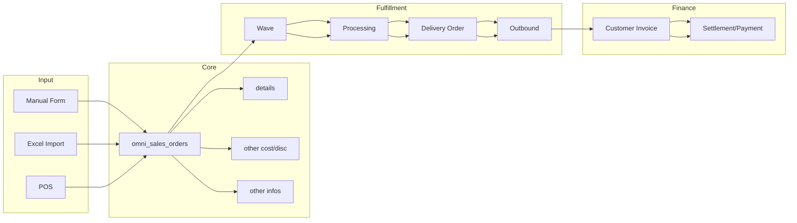
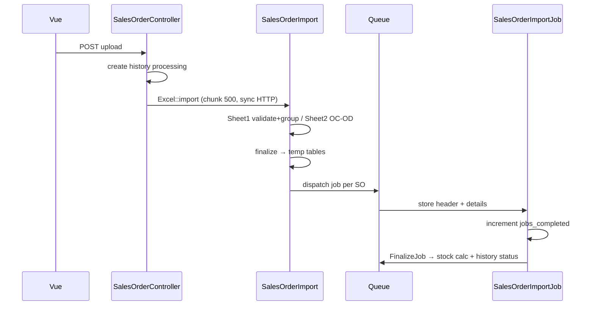

# Dev - Sales Order (Sales Order General) — Technical Documentation

**Type:** `type_sales_order = general`  
**UI:** `/businessdevelopment/sales-order-general`  
**API prefix:** `/api/omnichannel/sales-order/*`  
**Behavior:** [requirement.md](./requirement.md) v3.10  
**Stack:** Laravel 13 · Vue 3 · Horizon · MariaDB

> **3.10 (2026-11-05):** Void while still in Wave releases reserved — [requirement §6.7 / §7.5](./requirement.md); ETM-17110 (`8ef9876`). Same `SalesOrderApprovalController::handleVoid` path as Sales Platform. Canonical call site: [Sales Platform technical](../omni-sales-platform/technical.md).  
> **3.9 (2026-11-05):** Export All With/Without Details requires `export_filename` — [requirement §6.8](./requirement.md); ETM-16768. `SalesOrderController::exportExcelGeneral` + `SalesOrderGeneralExportExcelJob` (appends `.xlsx`). GAP-SOG-16 Open.  
> **3.8 (2026-11-05):** Import Non-Processed approve+outbound locks `scm_item_stocks` and re-allocates FIFO — [requirement §6.3.2](./requirement.md); ETM-17081 / PR #6695 (`97ad324`).  
> **3.7 (2026-11-04):** Import Price decimal normalize + max 4 dp + rounding reconciliation — [requirement §6.3.4](./requirement.md); ETM-17055 (fe69fd3).  
> **3.4 (2026-08-12):** TO-BE Benchmark COGS snapshot = effective Manual COGS — [requirement §8.2](./requirement.md#82-benchmark-cogs-snapshot--effective-manual-cogs-to-be--gap-bm-14); GAP-SOG-15 / GAP-BM-14.  
> **1.3 / 3.3 (2026-08-11):** TO-BE Error Flag Below Benchmark COGS — shared `ErrorFlag.vue` / `CanManageOrderDetailError` / `updateAutoApproveFlagForSalesOrder`; see [Benchmark technical §6.5–§6.6](../accounting-product-benchmark-price/technical.md#65-auto-approve-flag); GAP-SOG-14 / GAP-BM-13.

---

## 0. Changelog

| Version | Date | Changes |
|---------|------|---------|
| 3.10 | 2026-11-05 | Void in Wave: `handleVoid` → `WaveController::deleteDetailTransferWave` before `createTransferVoid` (ETM-17110). Stock effect lives in `ItemStockMutation::deleteTransferDetailRow` `is_wave` |
| 3.9 | 2026-11-05 | Export All: `export_filename` required; `export_type` drives history action (ETM-16768). GAP-SOG-16 Open |
| 3.8 | 2026-11-05 | Import Non-Processed: `validate(lock_stock: true)` + `getFulfillAfterFifo(lock_for_update: true)` inside the create transaction; FIFO re-allocate after wait (ETM-17081, PR #6695) |
| 3.7 | 2026-11-04 | Import Price: normalize dot/comma, reject more than 4 dp, reconcile 4-dp line vs 2-dp header before SO create; `hasOtherHeaderError` prefix `Column %` (ETM-17055) |
| 3.4 | 2026-08-12 | TO-BE Benchmark COGS snapshot = effective Manual COGS; GAP-SOG-15 / GAP-BM-14 |
| 1.3 | 2026-07-09 | Bundle / benchmark COGS file map |
| 3.0 | 2026-07-22 | Rewrite SoT v1.0: file map, import AS-IS, invariants, failure modes |
| 3.1 | 2026-07-22 | TO-BE: dual import channels + Non-Processed OB/SI pipeline; GAP-SOG-07…12 |
| 3.2 | 2026-07-23 | Sheet 2 OC/OD code ambiguity AS-IS vs TO-BE fail; GAP-SOG-13 |

---

## 1. Architecture Overview



`SalesOrderGeneral` extends `SalesOrder` — policy/menu scoping only. Shared table dengan Platform.

---

## 2. File Map

### Backend

| Role | Path |
|------|------|
| Entity | `Modules/OmniChannel/Entities/SalesOrder.php`, `…/SalesOrderDetail.php`, other cost/discount/info |
| Subclass policy | `Modules/BusinessDevelopment/Entities/SalesOrderGeneral.php` |
| CRUD / list / import API | `Modules/OmniChannel/Http/Controllers/SalesOrderController.php` |
| Approve | `Modules/OmniChannel/Http/Controllers/SalesOrderApprovalController.php` |
| Detail lines | `Modules/OmniChannel/Http/Controllers/SalesOrderDetailController.php` |
| Import orchestrator | `Modules/OmniChannel/Import/SalesOrderImport.php` |
| Sheet 1 / Sheet 2 | `SalesOrderImportSheet1.php`, `SalesOrderImportSheet2.php` |
| Detail import | `SalesOrderImportDetailImport.php` / `SalesOrderDetailImport.php` |
| Jobs | `SalesOrderImportJob`, `SalesOrderImportFinalizeJob`, `StoreSOBasedStockJob`, wave/skip processing jobs |
| History / log | `SalesOrderImportHistory`, `SalesOrderImportHistoryDetail`, `ImportSoLog` |
| Temp import | `SalesOrderImportTemHeader`, `SalesOrderImportTemDetail` |
| Config | `config/general.php` → `max_child`; `config/omni.php` → `approve_so.approve_with_validation` |
| Non-Processed generate / validate | `Modules/OmniChannel/Logics/SalesOrder/SalesOrderImportGenerateLogic.php`, `SalesOrderValidationLogic.php`, `SalesOrderGenerateRandomLogic.php` |
| FIFO stock lock | `app/Helpers/SupplyChain/WarehouseHelper.php` |
| Export All | `SalesOrderController::exportExcelGeneral` — `sanitizeExportFileName`; empty → `File name is required.` |
| Export jobs | `SalesOrderGeneralExportAllJob`, `SalesOrderGeneralExportExcelJob` (final `.xlsx`) |
| Export row / action | `Modules/OmniChannel/Entities/SalesOrderExportFile.php` (`file_name`, `export_type`); `getExportActionName` in `app/Helpers/MainHelper.php` |

### Frontend

| Role | Path |
|------|------|
| Datalist General | `olshoperp-frontend/src/pages/BusinessDevelopment/SalesOrderGeneral/DataList.vue` |
| Form / Detail | `Form.vue`, `DatalistDetail.vue` |
| ASO list | `…/Report/AllSalesOrder/DataList.vue` |
| PillButtons (ASO/SP) | `src/pages/Omni/SalesOrder/components/PillButtons.vue` |
| Import columns | `src/utils/imports.ts`, `ImportFileTable.vue` |

---

## 3. API Routes (import & list)

| Method | Path | Role |
|--------|------|------|
| POST | `omnichannel/sales-order/get?type=general` | Datalist |
| POST | `omnichannel/sales-order/upload?type=general` | Bulk import |
| GET | `omnichannel/sales-order/progress` | Import progress |
| GET | `omnichannel/sales-order/import-history` | History |
| GET | `omnichannel/sales-order/import-history-detail/{id}` | Success SO codes |
| GET | `omnichannel/sales-order/import-log` | Row errors (`id_table` = `general`) |
| GET | `omnichannel/sales-order/filter-process-status?type=general` | Carousel counts |
| GET | `omnichannel/sales-order/pill-count?type=…` | ASO/SP pills |
| POST | `omnichannel/sales-order/{id}/approve` | Approve |
| GET | `omnichannel/sales-order/export?type=general` | Template |
| POST | `omnichannel/sales-order/export-excel` | Export All (`type` bukan `platform`). Body `export_filename` wajib untuk With/Without Details. **Export Active Page Only** tidak lewat gerbang ini |
| GET | `omnichannel/sales-order/export-file` | Riwayat export menu `Sales Order`; kolom aksi dari `export_type` |

ASO list: `businessdevelopment/all-sales-order/get?type=all` (shared column engine).

---

## 4. Database — Key Tables

| Table | Role |
|-------|------|
| `omni_sales_orders` | Header (`type_sales_order`, `platform_order_id`, `transaction_status`, flags) |
| `omni_sales_order_details` | Lines; qty/price; `processed_to_out_quantity`, DO/invoice qty flags |
| `omni_sales_order_other_costs` / `_other_discounts` | OC/OD |
| `omni_sales_order_other_infos` | Tracking, COD, booking fields |
| `omni_sales_order_import_histories` | Import session + counters + `url_row_failed` |
| `omni_sales_order_import_history_details` | Success rows (SKU / SO code) |
| `omni_import_so_logs` | Row-level errors |

---

## 5. Import — AS-IS Flow



**Grouping key:** Customer + Store + Transaction Date + Platform Order ID + Shipper + Tracking.  
**SO status after import:** `open`, `is_import = 1`.  
**Progress:** ~95% jobs, ~5% `StoreSOBasedStockJob`.

Known AS-IS issues → [requirement §9](./requirement.md) GAP-SOG-01…06 (HTTP sync parse, log wipe, soft-delete PO ID, etc.).

### 5.1 Dual import channels + Non-Processed pipeline (TO-BE)

| Channel | UI label | Gate | Downstream |
|---------|----------|------|------------|
| `processed` | **Import Processed** | Store `fulfillment_mode = processed` | Existing import → open → wave path |
| `non_processed` | **Import Non-Processed** | Store `fulfillment_mode = non_processed` | Stock check (reuse Send to Default Waves / WH process hierarchy) → Outbound + Sales Invoice auto-approve |

**Non-Processed dates:** Outbound `trx_date = order_date + 10s`; Sales Invoice `trx_date = outbound_date + 10s`.  
**COA guard:** every COA on auto journals OB & SI vs Approved Cash/Bank Reconcile period overlap → rollback order (see GAP-CBR-08 / GAP-SOG-10).  
**Retry:** mirror Skip Wave Process technical retry.  
**UI:** Skip Wave–like progress/log `[VERIFY: CODEBASE]` until implemented.  
**Parity:** same two buttons on All Sales Order FE.

Store field: [omni-store-binding technical §5.1](../omni-store-binding/technical.md).

### 5.2 Sheet 2 — Other Cost/Disc Code ambiguity

**File:** `Modules/OmniChannel/Import/SalesOrderImportSheet2.php`  
**Header col 1:** `Other Cost/Disc Code` (shared).

**AS-IS resolve:**

```text
otherCost = OtherCost::where(code)…
otherDiscount = OtherDiscount::where(code)…
master = otherCost ?? otherDiscount
type = otherCost ? 'cost' : (otherDiscount ? 'discount' : null)
```

Jika **keduanya** ketemu → selalu `type = cost`; tidak ada error. Unique code hanya per tabel master (`uniqueCreate` di Other Cost / Other Discount controller masing-masing) — bentrok lintas master **dimungkinkan**.

**TO-BE (GAP-SOG-13):** jika `$otherCost && $otherDiscount` → fail order (Platform Order ID group) + `ImportSoLog` message ambigu; jangan assign type. Attach ke Sheet1 job hanya setelah resolve unambiguous.

**Invariant TO-BE:** INV-SOG-13 — Sheet 2 code must resolve to exactly one of {cost, discount} or the SO group fails.

### 5.3 Price decimal, precision, rounding (ETM-17055)

Same pre-step in `Modules/OmniChannel/Import/SalesOrderImportSheet1.php` (persist path) and `Modules/OmniChannel/Import/SalesOrderValidateDetailSheet.php` (validation path), then `parseNumber()` (precision 4; previously Sheet1 called `parseNumber($price, false)` → integer).

| Shape | Pre-step |
|-------|----------|
| Exactly one `,` and one `.` | Last separator is decimal. If `.` is last, strip `,` and rewrite `.` to `,` so `parseNumber` keeps it (system decimal is `,`). If `,` is last, strip `.`. |
| Exactly one `.` and no `,` | Treat as decimal (rewrite `.` to `,`) unless the fractional part is exactly 3 digits **and** the integer part is at most 3 digits — then leave the dot so `parseNumber` treats it as thousands (`1.500` → 1500, `12.345` → 12345, `1234.567` → 1234.567). |
| Other shapes | Unchanged; `parseNumber` (multiple `.` = thousand separator `.`). |

Precision guard (validation sheet only), before normalize: if the trailing group after the last `.` or `,` is longer than 4 digits, row fails with `Price for SKU [{sku}] exceeds maximum allowed decimal places (maximum 4 decimal places).`

Reconciliation in `Modules/OmniChannel/Logics/SalesOrder/SalesOrderImportValidationLogic.php` (phase `VALIDATING`, before the SO is generated), over product detail rows:

```text
line_4 = round(qty * price, 4)
accumulated = Σ round(line_4, 2)
header = round(Σ line_4, 2)
fail when abs(accumulated - header) > 0.0001
```

Log: `Rounding mismatch detected for Order [{platform_order_id}]: Accumulated row totals differ from header total by {diff}.` Order `is_valid = false`; no SO. Kasus C (AKRCHRU 3 × 3333.3333 and AKRKAS 3 × 6666.6667) is 30000.00 on both sides, so it passes. Kasus A: `10000.6789` × qty 1000 → unit 10000.6789; 2-dp money = 10000678.90.

`hasOtherHeaderError()` matches import-log `message LIKE 'Column %'` (prefix). It no longer uses leading-wildcard `'%missing in%'`. Missing-column text is `Column {names} is/are missing in {sheet}`.

### 5.4 Import Non-Processed stock lock (ETM-17081)

AS-IS for **Import Non-Processed** when queue workers share a SKU. Frontend unchanged. PR #6695, commit `97ad324`.

`SalesOrderImportGenerateLogic::createWithoutProcessing` opens `DB::transaction`, then:

`approveSalesOrder` → `SalesOrderValidationLogic::validate(lock_stock: true)` → `getFulfillAfterFifo(..., lock_for_update: true, reserved_quantities: allocated_stock_quantities)` in `app/Helpers/SupplyChain/WarehouseHelper.php`.

Under that flag the helper `lockForUpdate()`s candidate `scm_item_stocks` (`SELECT ... FOR UPDATE`), subtracts in-transaction qty via `applyReservedQuantitiesToLockedStocks`, then allocates FIFO with `allocateFifoStocksFromLockedRows`. `generateOutbound` consumes those selected rows in the **same** transaction.

`lock_for_update` defaults to `false`. Callers that omit it keep the previous read path. `validate(lock_stock: true)` and the helper both require an open transaction.

If another worker already took the first inbound batch, the waiting worker re-reads the locked rows and takes the next FIFO batch that still has quantity. That fallback does not depend on MySQL 1644. The outbound stock update still maps trigger 1644 to `No Stock Available for SKU {sku}` when no batch remains.

Random SKU: `SalesOrderGenerateRandomLogic` calls `validateDetail` for details created while locking is on, and merges those stocks into the selection. `getFifoProductRandomV2` receives `reserved_quantities` (and still locks its own candidate rows). Full `lock_for_update` on the import Non-Processed detail path is the main FIFO fulfill helper.

---

## 6. Invariants

| ID | Invariant |
|----|-----------|
| INV-SOG-01 | `count(details) ≤ 100` per SO |
| INV-SOG-02 | Qty integer `> 0`; price `≥ 0` |
| INV-SOG-03 | `platform_order_id` / tracking unique among non-void SO |
| INV-SOG-04 | Import Processed SO: `transaction_status = open` and `is_import = 1` |
| INV-SOG-05 | `isUpdatable`: true for draft/open/**rejected**; false for approved/processed/complete/closed/void |
| INV-SOG-06 | FE: `rejected` → radio status dibuka sebagai `draft` untuk perbaikan |
| INV-SOG-05 | `processed_to_out_quantity ≤ sales_order_quantity` per detail |
| INV-SOG-06 | Store platform for general = `PL_OTHER` |
| INV-SOG-07 | Draft never approved |
| INV-SOG-08 | ATS = on_hand − outstanding_so − reserved_out after recalculate |
| INV-SOG-09 | First outbound approve without existing invoice qty → exactly one auto-approved Customer Invoice |
| INV-SOG-10 | TO-BE: Import channel must match store `fulfillment_mode` or order fails (others continue) |
| INV-SOG-11 | TO-BE: Non-Processed success → SO approved + not eligible for wave/processing |
| INV-SOG-12 | TO-BE: Any SKU stock fail → entire order rolled back (no partial SO) |
| INV-SOG-13 | TO-BE: Sheet 2 code matching both OtherCost and OtherDiscount → SO group fails (no silent prefer) |
| INV-SOG-14 | Imported Price has at most 4 decimal places; a longer trailing fraction fails in VALIDATING and is not stored |
| INV-SOG-15 | Per order, `abs(Σ round(round(qty*price, 4), 2) − round(Σ round(qty*price, 4), 2))` is at most `0.0001`, else the order fails in VALIDATING and no SO is created |
| INV-SOG-16 | Import Non-Processed approve+outbound stock allocation under an active transaction uses `lock_stock` / `lockForUpdate`, so concurrent workers serialize on locked `item_stock` rows and re-allocate FIFO after the wait |
| INV-SOG-17 | Export All With/Without Details stores a non-empty `sanitizeExportFileName(export_filename)` (max 150) on `omni_sales_order_export_files.file_name`, and `getExportActionName` prefers `export_type` over the file name |
| INV-SOG-18 | TO-BE ETM-17110: Void or Void+Copy of a general (or platform) SO that still has an active Wave transfer detail calls `WaveController::deleteDetailTransferWave` after approve and before `createTransferVoid`. Reserved drops and available rises by the released base qty; the SO is no longer a wave member. Post-picking `createTransferVoid` still runs. No `WaveDetailSO` → no stock change |

---

## 7. Validation Highlights

- Header/detail/approve/import: inline di controller (lihat requirement §7).  
- Import Sheet1: formula reject; fiscal period; store `PL_OTHER`; cross-chunk PO/tracking index; Price dot/comma normalize then `parseNumber` at 4 dp (ETM-17055).  
- Import validate sheet: reject Price with more than 4 decimal places before parse.  
- Import validation logic: rounding reconciliation (INV-SOG-15) in VALIDATING; `hasOtherHeaderError()` is `LIKE 'Column %'`.  
- Import Non-Processed approve: `validate(lock_stock: true)` only inside the create transaction (INV-SOG-16, ETM-17081).  
- Export All: `SalesOrderController::exportExcelGeneral` rejects empty `sanitizeExportFileName(export_filename)` with `File name is required.` Final download `{file_name}.xlsx` via `SalesOrderGeneralExportExcelJob`. History action from `export_type` (ETM-16768, INV-SOG-17).  
- Import Sheet2: shared `Other Cost/Disc Code`; AS-IS prefers OtherCost when both match — TO-BE fail (GAP-SOG-13).  
- Soft-deleted SO still can block platform order ID on re-import if query does not exclude trashed — GAP related.  
- `bootImport` master lookup from **first chunk only** — risk for rows after chunk 500 (GAP capacity).

---

## 8. Frontend Behaviors

| Behavior | Notes |
|----------|-------|
| Create | `default-values` → POST create → redirect edit |
| Carousel | `filter-process-status?type=general` + filter `sales_order_process_status` |
| ASO upload | Still `upload?type=general` |
| Processing icons | `formatAvailabilityAndProcessStatus` (TransferSummary) |
| Import UI | Dual actions: **Import Processed** / **Import Non-Processed** + history/log (Non-Processed progress TO-BE Skip Wave–like) |
| Export File Name dialog | **Export All** With/Without Details sends `export_filename`. **Export Active Page Only** skips the dialog |

---

## 9. Failure Modes & Transaction Boundary

| Failure | Boundary / expected |
|---------|---------------------|
| HTTP timeout during parse | No jobs; history may stay `processing` until next upload (GAP-SOG-01/02) |
| Concurrent approve | Cache lock ~60s |
| Approve during import | Cache `so_general_import_{so_id}` |
| Rounding mismatch (INV-SOG-15) | Order fails in VALIDATING; temp header `is_valid = false`; SO is not generated |
| Concurrent Non-Processed workers, same SKU (INV-SOG-16) | Lock candidate stock rows, allocate FIFO, then outbound in the same transaction. After a wait, take the next inbound batch with remaining qty. MySQL 1644 is not the fallback; it still becomes `No Stock Available for SKU` only when no batch remains |
| Job fails mid-order | Soft-delete SO if detail errors after header created; PO ID may remain “taken” |
| Sheet2 error after Sheet1 | `parent->hasError` may not stop `finalize()` dispatch — verify/fix |
| Multiple FinalizeJob | Race on `jobs_completed` without finalize flag |

---

## 10. Data Lifecycle

| Flag / qty | Moves when |
|------------|------------|
| Outstanding SO | Open/approved pre-wave → wave moves to reserved |
| `prepared_to_do` / `processed_to_do` | DO create/approve |
| `processed_to_out` | Outbound approve → may trigger invoice qty |
| Settlement chain | Outbound → invoice → payment → journal if incomplete |
| `is_instant_processing` | Scheduler skip-processing eligibility |
| Void → Duplicate | Clone resets relations; new unique tracking / PO ID |
| Void while still in Wave | `deleteDetailTransferWave` then `createTransferVoid` in the same `handleVoid` transaction. Reserved released; wave membership removed; post-picking void transfer unchanged (ETM-17110) |

---

## 11. Tests & QA Notes

- No dedicated automated tests for `SalesOrderImport*` found at rewrite time — add feature tests for grouping, max 100, soft success, chunk lookup.  
- Staging repro: compare detail lines per `platform_order_id` after partial import (detail swap risk under parallel jobs).

---

## 12. Known Issues (GAP refs)

| GAP | Technical note |
|-----|----------------|
| GAP-SOG-01/05 | Move parse to queue; raise HTTP timeout workaround not enough |
| GAP-SOG-02 | Cleanup on upload only |
| GAP-SOG-03/06 | Order-level atomic failure + history detail per group |
| GAP-SOG-04 | Implement failed export; persist logs per `history_id` |
| GAP-SOG-07…12 | Dual import + Non-Processed OB/SI pipeline, CBR COA guard, Skip Wave UX/retry — see requirement §9 |
| GAP-SOG-13 | Sheet2: if both OtherCost & OtherDiscount match code → fail SO group (stop silent `$otherCost ?? $otherDiscount`) |
| GAP-SOG-14 / GAP-BM-13 | `cogs-error` UX Below Benchmark COGS — shared ErrorFlag + prevent_auto_approve helper |
| GAP-SOG-14 / GAP-BM-13 | `cogs-error` UX: `money-bill-trend-down`, filter label Below Benchmark COGS, FX primary helper shared with prevent_auto_approve |
| GAP-SOG-16 | Same export title is not unique per export (ETM-16768). Open. Do not treat a colliding name as accepted behaviour |

---

## Related

[requirement.md](./requirement.md) · [knowledge-base.md](./knowledge-base.md) · [user-guide.md](./user-guide.md) · [all-sales-order/technical.md](../all-sales-order/technical.md)
