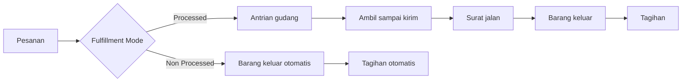
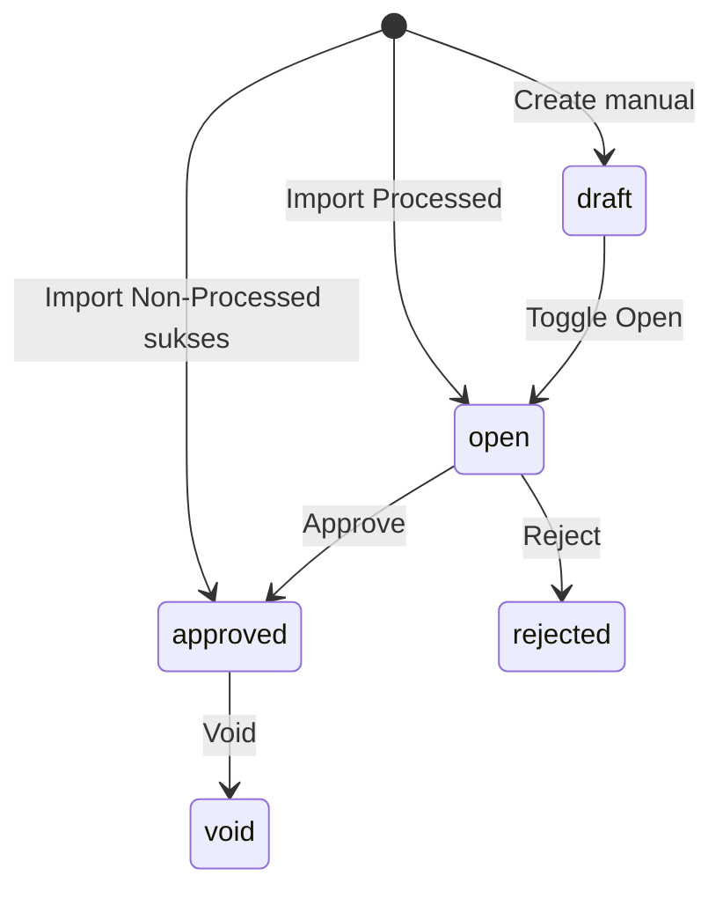

# Dev - Sales Order — Panduan Pengguna

**Siapa yang baca:** Busdev, ops, support, finance ops  
**Menu:** Business Development → **Dev - Sales Order**  
**Untuk apa:** Mencatat pesanan penjualan **internal** (bukan dari marketplace)

Sebelum import massal, atur **Fulfillment Mode** di menu **Store**: **Processed** atau **Non Processed**.

---

## 1. Apa Itu & Kenapa Penting

Dev - Sales Order mencatat pesanan dari telepon, WA, B2B, Excel, atau kasir — **bukan** sync Shopee/Lazada/TikTok.

Dari sini pesanan bisa masuk proses gudang penuh, atau (untuk toko Non Processed) langsung keluar barang dan tagihan. Data yang salah membuat stok “boleh dijual” dan tagihan ikut salah.

---

## 2. Overview Flow & Proses Bisnis

**Versi teks:**

1. Pesanan dibuat (manual, **Import Processed**, **Import Non-Processed**, atau POS).  
2. **Processed:** Approve → antrian gudang → ambil–kemas → surat jalan → barang keluar → tagihan.  
3. **Non Processed (import):** cek stok → barang keluar + tagihan otomatis (tanpa wave–ship).  
4. Settlement / pembayaran menyelesaikan rekonsiliasi bila dipakai.

🎬 [Interactive demo akan ditambahkan di sini]

### Siklus status

| Status | Artinya | Bisa diubah? |
|--------|---------|--------------|
| **Draft** | Baru disusun | Ya |
| **Open** | Siap approve (hasil Import Processed) | Ya |
| **Rejected** | Ditolak dari Open | Ya — perbaiki lalu set Draft/Open lagi |
| **Approved** | Final (termasuk Non-Processed sukses) | Tidak (bisa Void atau Close) |
| **Closed** | Ditutup lewat **Close Doc** (setelah Approved) | Tidak |
| **Void** | Dibatalkan lewat **Void Doc** (setelah Approved) | Tidak (bisa Duplicate) |

> Closed dan Void **bukan** status yang sama — tombol dan artinya berbeda.  
> **TO-BE:** Kalau order masih di Wave lalu di-Void, stok yang di-reserve harus kembali available (ETM-17110).

---

## 3. Sebelum Mulai (Flow Sebelum)

- [ ] Customer aktif (General Company).  
- [ ] Store tipe **Others** dengan **Fulfillment Mode** yang tepat.  
- [ ] Produk & satuan aktif.  
- [ ] Kurir / shipper (atau default).  
- [ ] Periode pembukuan aktif.  
- [ ] Non-Processed: stok cukup di gudang proses store.

🎬 [Interactive demo akan ditambahkan di sini]

---

## 4. Setelah Selesai (Flow Sesudah)

**Setelah Approve (Processed):** pesanan terkunci → sering perlu Unassign/Skip Wave → proses gudang → surat jalan → barang keluar → tagihan.

**Setelah Import Non-Processed sukses:** barang keluar + tagihan sudah dibuat otomatis; pesanan tidak masuk antrian gudang.

🎬 [Interactive demo akan ditambahkan di sini]

---

## 5. Yang Perlu Diperhatikan

- Kalau kamu pakai **Import Processed** untuk store **Non Processed** (atau sebaliknya), order itu gagal — samakan tombol dengan mode store.  
- Kalau kamu isi Sheet 2 dengan kode yang sama di master **Other Cost** dan **Other Discount**, order itu **gagal import** — rapikan kode di master dulu (satu kolom template dipakai keduanya).  
- Kalau kamu **Approve saat Draft** / import masih jalan, sistem menolak.  
- Kalau qty nol/desimal, produk induk, atau lebih dari 100 baris SKU, sistem menolak.  
- Kalau cell Excel berisi rumus, baris ditolak.  
- Kalau kamu isi harga `10000.6789`, sistem baca **Rp 10.000,6789** (bukan ratusan juta). Qty 1.000 → total **Rp 10.000.678,90**.  
- Kalau harga punya lebih dari 4 angka di belakang koma atau titik, baris ditolak. Pesan di log: harga SKU itu melebihi 4 angka desimal.  
- Kalau kamu tulis `1.500` (titik dan tepat 3 angka di belakang, angka di depan pendek), sistem baca **seribu lima ratus**, bukan satu koma lima.  
- Kalau jumlah tiap baris (dibulatkan ke rupiah) tidak sama dengan total pesanan — walau selisihnya 1 rupiah — pesanan **tidak jadi dibuat**.  
- Kalau Non-Processed stok SKU kurang, **seluruh order** gagal — cek log SKU mana.  
- Kalau kamu mengunggah banyak order **Import Non-Processed** dengan SKU yang sama sekaligus, dan total stok di gudang proses cukup, semua order itu harus berhasil. Sistem tidak gagal hanya karena beberapa proses mengambil batch stok yang sama. Kalau masih muncul **No Stock Available**, stok di semua batch memang kurang.  
- Kalau Non-Processed kena akun yang sudah di-rekonsiliasi untuk tanggal itu, order digagalkan dengan pesan jelas.  
- Kalau kamu mengira tagihan muncul saat Approve jalur Processed — tunggu outbound/settlement.  
- POS memakai jalur Non-Processed otomatis: **belum** di fase ini.
- Kalau kamu **Export All** (**With Details** atau **Without Details**) tanpa mengisi **File name**, sistem menolak dengan **File name is required.** **Export Active Page Only** tidak menanyakan nama.
- Kalau kamu **Void** (atau **Void & Recreate**) order yang masih mengantri di gudang dan belum diambil, order keluar dari antrian itu dan stok yang ditahan kembali bisa dijual. Contoh: ditahan 2, tersedia 8 → setelah void ditahan 0, tersedia 10. Kalau barang sudah diambil, pembatalan setelah pengambilan tetap berjalan.

---

## 6. Langkah-Langkah (Step by Step)

### A. Buat manual

1. Buka Dev - Sales Order → **Create**.  
2. Lengkapi customer, store, produk.  
3. Open → **Approve** → lanjut gudang di SCM bila perlu.

### B. Import Processed

1. Pastikan store = **Processed**.  
2. Download template → isi tanpa rumus. Harga boleh memakai titik atau koma sebagai desimal (contoh `10000.6789` = Rp 10.000,6789).  
3. Klik **Import Processed** → pantau history/log.  
4. Review SO Open → Approve → proses gudang.

### C. Import Non-Processed

1. Pastikan store = **Non Processed**.  
2. Template sama.  
3. Klik **Import Non-Processed**.  
4. Pantau progress/completion/log (mirip Skip Wave).  
5. Order sukses: outbound + invoice otomatis.

### D. Kasir (POS)

Ikuti Point of Sales. Jalur Non-Processed penuh dari POS = requirement berikutnya.

### E. Export All

1. Klik **Export All** → **With Details** atau **Without Details**.
2. Di dialog **Export File Name**, isi atau ubah **File name**. Saran sudah terisi, misalnya `Sales Order General - With Details Export 05-11-2026_15.06.00` (paling banyak 150 karakter).
3. Klik **Export**. Kalau nama kosong, muncul **File name is required.**
4. File yang terunduh memakai nama itu. Nama yang sama tampil di riwayat export.
5. Dua export dengan judul yang sama tetap jadi dua file terpisah. Masing-masing baris riwayat mengunduh datanya sendiri.
6. **Export Active Page Only** tidak membuka dialog.

🎬 [Interactive demo akan ditambahkan di sini]

---

## 7. Tips & Hal yang Sering Bikin Bingung

- Kolom template Excel tetap sama — bedanya jalur hanya tombol + mode store. Cara baca harga desimal ikut aturan di atas.  
- Sheet 2 pakai satu kolom **Other Cost/Disc Code** — jangan duplikat kode antara master biaya dan diskon tambahan.  
- Satu file bisa multi-store; tiap order dicek ke gudang proses **store-nya sendiri**.  
- All Sales Order punya **tombol import yang sama**.  
- Platform Order ID di General = referensi kamu, bukan nomor Shopee.  
- Kalau harga jual sebelum pajak di bawah **Benchmark COGS**, order bisa punya Error Flag **Below Benchmark COGS** dan tidak ikut auto-approve — **approve manual tetap boleh**. Tanda itu mengikuti data baris SKU (snapshot); ubah master COGS tidak mengubah order lama sampai baris detail diganti.  
- Harga `10000.6789` dengan qty 1.000 harus tampil **Rp 10.000.678,90**, bukan ratusan miliar. Lebih dari 4 angka di belakang koma ditolak.  
- Dua baris pecahan **AKRCHRU** (qty 3, harga `3333.3333`) dan **AKRKAS** (qty 3, harga `6666.6667`) jumlahnya pas Rp 30.000, jadi pesanan itu lolos. Kalau total baris dan total pesanan beda, unggahan order itu gagal.
- Kalau **Export** di dialog **Export File Name** ditolak, isi judul dulu. Contoh `Laporan SO 05/11` tersimpan `Laporan SO 05-11`. Dua export dengan judul sama tetap dua file terpisah; masing-masing baris riwayat mengunduh datanya sendiri.
- **Void saat order masih di antrian gudang:** stok yang ditahan kembali bisa dijual, sebesar jumlah yang dilepas. Order tidak lagi ada di antrian itu.

---

## 8. Referensi

| Untuk | Dokumen |
|-------|---------|
| Aturan QA | [requirement.md](./requirement.md) |
| Troubleshooting | [knowledge-base.md](./knowledge-base.md) |
| Teknis | [technical.md](./technical.md) |
| Store Fulfillment Mode | [../omni-store-binding/user-guide.md](../omni-store-binding/user-guide.md) |
| All Sales Order | [../all-sales-order/user-guide.md](../all-sales-order/user-guide.md) |
