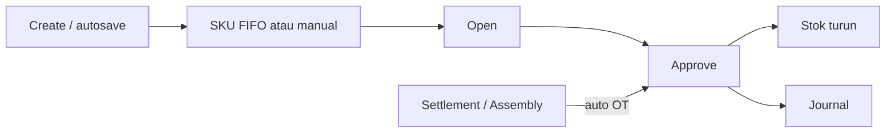
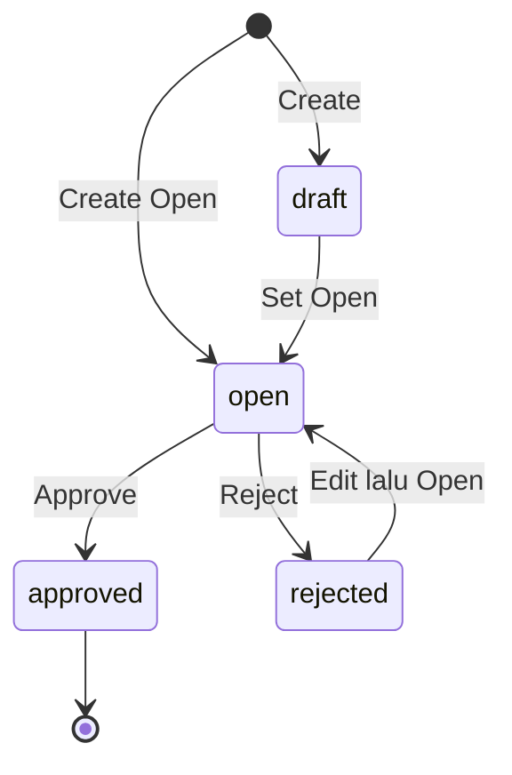
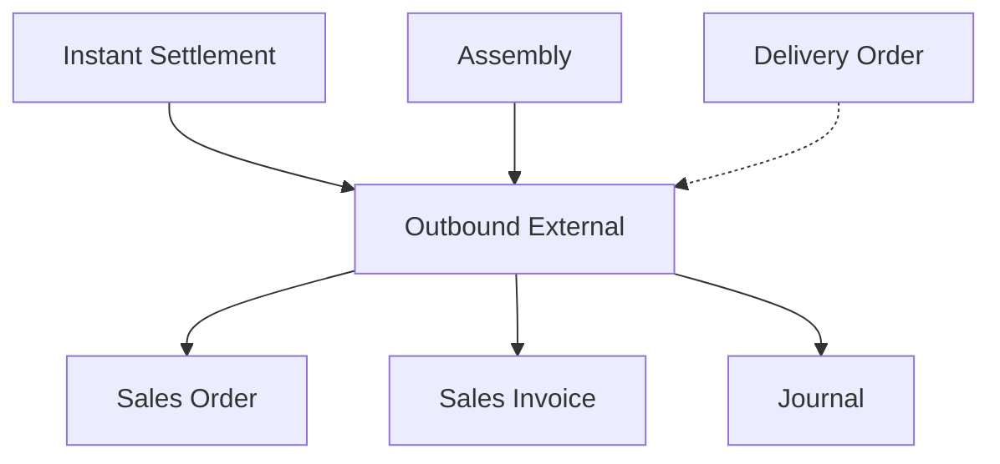

# Outbound External — Requirement Documentation

**Modul:** Supply Chain  
**UI route:** `/supplychain/mutation-outbound`  
**Kode:** prefix `OT`  
**Audience:** PM, Operations, QA  
**SoT:** `supplychain-mutation-outbound-source-of-truth.md` v1.0 (11 Oct 2026)

---

## 0. Metadata & Changelog

| Version | Date | Author | Changes |
|---------|------|--------|---------|
| 1.0–1.2 | 2026-06 ~ 07 | QA - Yemima | Draft auto + cross-ref Settlement / Assembly / Unit |
| 2.0 | 2026-10-11 | QA - Yemima | Rewrite dari SoT v1.0; type SO/Other; FIFO/manual; journal; gaps DO & approve |

---

## 1. Ringkasan Eksekutif

**Outbound External** mencatat pengeluaran barang dari gudang dan menggerakkan stok serta jurnal saat approve. Dua tipe UI: **Sales Order** (dari WH **3PL**) dan **Other** (pemakaian operasional; origin **bukan** 3PL).

Dokumen bisa auto-generate + auto-approve dari Instant Settlement atau Assembly (read-only di menu ini).

| Kebutuhan | Jawaban |
|-----------|---------|
| Keluarkan stok order dari 3PL | Type Sales Order |
| Pemakaian internal tanpa SO | Type Other |
| Pembukuan stok turun | Auto journal saat approve |
| Generate massal marketplace | Instant Settlement → OT |

---

## 2. Prasyarat

| Prasyarat | Sumber | Catatan |
|-----------|--------|---------|
| Privilege create / update / delete / approval | Gate | |
| Fiscal period terbuka | Fiscal Period | |
| Warehouse sesuai tipe | Master Warehouse | SO → 3PL; Other → non-3PL (UI) |
| Stok available | Item Stock | |
| Product COA Group | Inventory + COGS / OpEx / WIP | Sebelum approve |
| Type SO: order eligible | Sales Order | Shipping 3PL |

---

## 3. Siklus Status

Void belum ada. Unapprove bukan fitur produksi (§6.7).

| Status | Editable? | Delete? | Approve? |
|--------|-----------|---------|----------|
| Draft | Ya | Ya | Tidak |
| Open | Ya | Ya | Ya |
| Rejected | Ya | Ya* | Tidak sampai Open |
| Approved | Tidak | Tidak | — |

Generate Settlement/Assembly → langsung Approved.

---

## 4. Datalist

Create (autosave last trx bila ada), Show deleted, column show/hide, Export **with / without details**, Global Search, Advanced Filter.

| Kolom | Isi |
|-------|-----|
| Trx Code \| Date | `OT…` |
| Building Origin | Other / 3PL sesuai tipe |
| Description | Free text / teks generate |
| Qty | Akumulasi detail |
| Trx Ref | Multi SO atau Assembly |
| DO Status | **AS-IS:** Prepared / Processed / `-`. **Intended:** nomor DO multi — GAP-OB-01 |
| Trx Status | draft / open / rejected / approved |
| Action | Show/Edit + Print selalu; Approve jika Open; Delete Draft/Open. Platform/POS: approve/delete/print disembunyikan |

**Advanced Filter fields:** Trx Date, Code, Product, Building Origin, Description, Qty, Trx Ref, DO Status, Trx Status, Created/Updated By/At.  
**Operators:** text (equals, contains, …); date/number (equals, between, …).

---

## 5. Form & Field

| Field | Wajib | Aturan |
|-------|-------|--------|
| Code | Auto | OT |
| Date | Ya | Tidak future; fiscal period |
| Type | Ya | Sales Order (`sales order general`) \| Other — lock setelah ada detail |
| Origin | Ya | SO: 3PL; Other: non-3PL |
| Description | Opsional | |

Detail Other: Select Product (FIFO), Modal Use/Bulk Use (manual stock id), Import (FIFO), Group/Detail View.  
Detail SO: outstanding SO di 3PL origin; multi SO per OT.

**Contoh pensil:** inbound 1.500 + 500 → outbound 1.700 → Group: 1.700; Detail: 1.500 + 200.

---

## 6. How It Works

### 6.1 Autosave create

Ada last OT → default warehouse + type → POST → edit. Belum pernah → isi required manual.

### 6.2 FIFO vs manual

| Input | Is FIFO |
|-------|---------|
| Select Product / Import / fulfill | Ya |
| Modal Use / Bulk Use | Tidak |

### 6.3 Approve — stok & jurnal

Cr **Inventory**. Dr: Other → **Operational Expense**; Sales Order → **COGS**; Assembly ref → **WIP**.  
Conditional auto Sales Invoice jika detail ref SO Detail tanpa invoice qty.

### 6.4 Generate lain

| Sumber | Description AS-IS |
|--------|-------------------|
| Assembly | `Auto generated from Assembly {code}` |
| Settlement | `Auto Generated From Transfer {code}` |

### 6.5 Approve block (pending discussion)

Other manual & general/internal (tanpa header ref blocking) bisa approve. Header ref Sales Order + authorized → error related SO. Platform/POS: tombol approve disembunyikan. Settlement job bypass. → GAP-OB-03.

### 6.6 Unapprove

Staging/production: **tidak boleh**. Endpoint hanya `local`/`development`. Delete Instant Settlement boleh revert OT generate.

### 6.7 DO Status

AS-IS status qty; intended nomor DO multi header + per SKU detail → GAP-OB-01.

---

## 7. Validasi

| ID | Kondisi | Behavior |
|----|---------|----------|
| V-OB-01 | Tanggal future | Transaction date cannot be greater than today |
| V-OB-02 | Approve tanpa detail | doesn't have any detail data |
| V-OB-03 | Import jalan | Updating process is in progress… |
| V-OB-04 | Approve related SO | Can't approve… related with Sales Order |
| V-OB-05 | Delete related SO | Can't delete… related with Sales Order |
| V-OB-06 | Unapprove non-local | Cannot do such action… |
| V-OB-07–09 | Import format / row | Template 4 kolom; `Row N:` SKU/qty/unit/stock… |

Import kolom: Product ID \| System Product SKU \| Qty/Outbound Qty \| Unit.

---

## 8. Relasi Menu Lain

| Menu | Relasi |
|------|--------|
| Instant Settlement | Generate/approve OT; delete revert |
| Assembly | OT Other dari WIP |
| Sales Order / DO | Ref & qty |
| Sales Invoice | Auto conditional |
| Product COA / Journal | Jurnal approve |

---

## 9. Gaps

| ID | Deskripsi | Status |
|----|-----------|--------|
| GAP-OB-01 | DO nomor multi intended vs Prepared/Processed AS-IS | Pending Decision |
| GAP-OB-02 | 3PL filter UI-only | Open |
| GAP-OB-03 | Approve platform vs general — need discussion | Pending Discussion |
| GAP-OB-04 | Unapprove non-prod only | Resolved |
| GAP-OB-05 | Radio hanya sales order general | Open |

---

## 10. FAQ

**Q: Other vs Sales Order?** Other = internal tanpa order; SO = stok order dari 3PL.  
**Q: Create langsung edit?** Autosave last trx.  
**Q: Group vs Detail?** Agregat SKU vs pecahan stock id (contoh pensil).  
**Q: Edit OT Settlement?** Tidak — auto-approved.  
**Q: Unapprove?** Tidak di staging/prod; hapus via delete settlement bila OT dari settlement.

---

## Related Documents

| Doc | Path |
|-----|------|
| Knowledge Base | [knowledge-base.md](./knowledge-base.md) |
| Technical | [technical.md](./technical.md) |
| User Guide | [user-guide.md](./user-guide.md) |
| Instant Settlement | [../accounting-settlement-upload/](../accounting-settlement-upload/) |
| Assembly | [../supplychain-assembly/](../supplychain-assembly/) |
