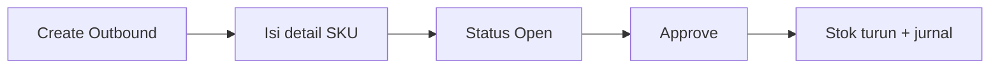
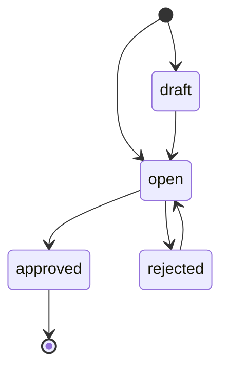

# Outbound External — Panduan Pengguna

**Siapa yang baca:** warehouse, ops, support  
**Menu:** Supply Chain → Outbound External  
**Kode dokumen:** dimulai dengan `OT`

---

## 1. Apa Itu & Kenapa Penting

Outbound External dipakai untuk **mencatat barang keluar dari gudang**. Setelah di-approve, stok berkurang dan sistem membuat jurnal persediaan.

Pakai tipe **Sales Order** kalau barang keluar untuk order (hanya dari gudang 3PL). Pakai tipe **Other** kalau pemakaian internal tanpa order — misalnya stok ATK diambil departemen.

---

## 2. Overview Flow & Proses Bisnis

**Versi teks:**

1. Buat dokumen Outbound (sering otomatis mengikuti gudang & tipe terakhir).
2. Pilih tipe Sales Order atau Other, isi gudang asal.
3. Tambah produk (pilih SKU, modal stok, atau import).
4. Set Open → Approve.
5. Stok dan jurnal terbarui.

Dokumen dari Instant Settlement atau Assembly sudah otomatis approved — tidak perlu (dan tidak bisa) diedit di sini.

### Status

| Status | Artinya | Bisa diubah? |
|--------|---------|--------------|
| Draft | Baru / belum siap approve | Ya |
| Open | Siap di-approve | Ya |
| Rejected | Ditolak; edit lalu Open lagi | Ya |
| Approved | Final; stok & jurnal sudah jalan | Tidak |

---

## 3. Sebelum Mulai

- Akses menu Outbound External.
- Tahu tipe: Sales Order (3PL) atau Other (bukan 3PL).
- Ada stok available di gudang yang dipilih.
- Akun produk (COA) sudah di-setup agar jurnal tidak gagal.
- Periode akuntansi terbuka.

🎬 [Interactive demo akan ditambahkan di sini]

---

## 4. Setelah Selesai

- Cek stok di Real Time Stock / Stock History.
- Untuk order: cek Sales Invoice bila sistem membuat otomatis.
- OT dari settlement yang salah → perbaiki lewat alur Instant Settlement (bukan unapprove di menu ini).

---

## 5. Yang Perlu Diperhatikan

- Kalau tanggal di masa depan, sistem menolak.
- Kalau belum ada baris detail, approve ditolak.
- Kalau import masih jalan, tunggu dulu sebelum approve.
- Kalau dokumen terikat Sales Order tertentu, approve/hapus bisa ditolak dengan pesan terkait Sales Order.
- Unapprove **tidak tersedia** di staging/production.
- Kolom DO Status saat ini menampilkan status Prepared/Processed, belum daftar nomor DO.
- Setelah ada baris detail, tipe Sales Order / Other tidak bisa diganti.

---

## 6. Langkah-Langkah

1. Buka **Supply Chain → Outbound External**.
2. Klik **Create** (bisa langsung masuk edit jika sudah pernah ada transaksi).
3. Isi tanggal; pilih **Sales Order** atau **Other**; pilih gudang asal.
4. Tambah produk:
   - Select Product (sistem bantu ambil batch / FIFO), atau
   - Available Products → Use / Bulk Use (pilih stock id manual), atau
   - Import Excel (kolom Product ID, SKU, Qty, Unit).
5. Ganti **Group View** / **Detail View** untuk cek agregat vs pecahan stock.
6. Pastikan status **Open** → **Approve**.
7. Opsional: Print atau Export daftar (with/without details).

🎬 [Interactive demo akan ditambahkan di sini]

---

## 7. Tips & Hal yang Sering Bikin Bingung

**Contoh Group vs Detail:** pensil masuk 1.500 lalu 500; outbound 1.700 → Group tampil 1.700; Detail pecah 1.500 + 200.

**Other untuk ATK:** beli buku masuk stok → HRD minta → buat OT Other dari gudang biasa (bukan 3PL).

**Create langsung ke edit:** normal — menyalin gudang & tipe terakhir. Belum pernah ada OT → isi form dulu.

**OT Settlement tidak bisa diedit:** sudah auto-approved; itu sengaja.

---

## 8. Referensi

| Butuh | Buka |
|-------|------|
| Aturan & gap | [requirement.md](./requirement.md) |
| Operator / troubleshoot | [knowledge-base.md](./knowledge-base.md) |
| API / kode | [technical.md](./technical.md) |
