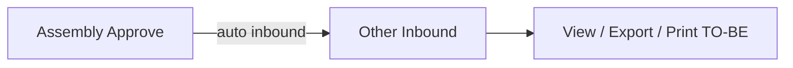
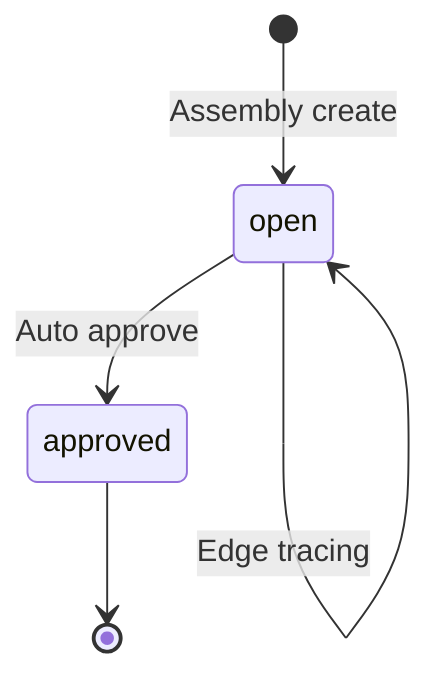

# Other Inbound — Requirement Documentation

**Modul:** Supply Chain  
**UI route:** `/supplychain/other-inbound`  
**Audience:** PM, Operations, QA  
**SoT:** `supplychain-other-inbound-source-of-truth.md` v1.0 (11 Oct 2026)  
**Jira gaps:** [ETM-16440](https://erpintegration.atlassian.net/browse/ETM-16440) · [ETM-16441](https://erpintegration.atlassian.net/browse/ETM-16441)

---

## 0. Metadata & Changelog

| Version | Date | Author | Changes |
|---------|------|--------|---------|
| 1.x | 2026-06 | QA - Yemima | Draft auto |
| 2.0 | 2026-10-11 | QA - Yemima | Rewrite dari SoT: view-only, Assembly-only generator, gaps bulk/print |

---

## 1. Ringkasan Eksekutif

**Other Inbound** menampilkan inbound **non-PO** (AS-IS: `supplier_id` null). Saat ini hanya hasil **Assembly** (auto-create + auto-approve FG). Tidak muncul di Purchase Inbound.

Menu **view/monitoring only** — ubah data di **Assembly**.

---

## 2. Prasyarat

| Prasyarat | Sumber |
|-----------|--------|
| Privilege view | Gate |
| Assembly approve (happy path) | Assembly |
| WH finish good | Warehouse Setting |

---

## 3. Siklus Status

Happy path: Open → Approved (sistem). Edge gagal generate: boleh tetap **Open** untuk tracing — **tidak** boleh edit/approve/delete dari menu ini.

---

## 4. Datalist

Tanpa kolom Supplier / Item Stock Status (beda PI). Trx Ref = **Assembly**.

| Kontrol | Intended | AS-IS |
|---------|----------|-------|
| Create | Tidak ada | Route leftover |
| Export with/without details | Hanya Other Inbound | MATCH |
| Bulk Delete / Approve | Tidak ada | Masih ada — GAP-OI-01 / ETM-16440 |
| Print dokumen | Standar seperti PI | Belum — GAP-OI-02 / ETM-16441 |
| Row delete/approve/print | Off | MATCH BE |

---

## 5. Form / Show

Header disabled. Detail: Assembly Reference, SKU, qty, COLLI. Tidak ada Save operasional. Ubah di Assembly.

GAP-OI-03: Open detail masih writable via shared API.

---

## 6. How It Works

1. Assembly approve → inbound supplier null + description `Auto generated from Assembly {code}` → auto-approve.  
2. List Other Inbound = supplier null; PI = supplier not null — tidak overlap.  
3. Export scoped other-only.  
4. Print TO-BE setara PI.

---

## 7. Validasi (intended)

| ID | Behavior |
|----|----------|
| V-OI-01 | Tidak bulk approve/delete |
| V-OI-02 | Tidak edit/approve/delete dari menu ini |
| V-OI-03 | Export hanya Other Inbound |

---

## 8. Relasi

| Menu | Relasi |
|------|--------|
| Assembly | Origin generate |
| Purchase Inbound | Sibling; data tidak overlap |

---

## 9. Gaps

| ID | Deskripsi | Status |
|----|-----------|--------|
| GAP-OI-01 | Bulk delete/approve + API mutate | Open — ETM-16440 |
| GAP-OI-02 | Print standar PI | Open — ETM-16441 |
| GAP-OI-03 | Detail Open writable | Open — scope ETM-16440 |
| GAP-OI-04 | Route create leftover | Open |

---

## 10. FAQ

**Q: Kenapa tidak Create?** Auto dari Assembly.  
**Q: Beda PI?** PI dari PO + supplier.  
**Q: Status Open?** Tracing saja; tetap view-only.  
**Q: Export ikut PI?** Tidak.

---

## Related Documents

| Doc | Path |
|-----|------|
| Knowledge Base | [knowledge-base.md](./knowledge-base.md) |
| Technical | [technical.md](./technical.md) |
| User Guide | [user-guide.md](./user-guide.md) |
| Assembly | [../supplychain-assembly/](../supplychain-assembly/) |
