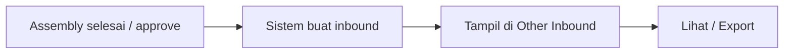

# Other Inbound — Panduan Pengguna

**Menu:** Supply Chain → Other Inbound

---

## 1. Apa Itu & Kenapa Penting

Other Inbound menampilkan **barang masuk gudang yang dibuat otomatis** — saat ini dari **Assembly** — bukan dari pembelian (Purchase Order). Dipakai untuk memantau dan mengekspor dokumen itu. Perubahan data dilakukan di Assembly.

---

## 2. Overview Flow

**Versi teks:** 1) Assembly di-approve. 2) Sistem membuat inbound finish goods. 3) Dokumen muncul di Other Inbound. 4) Kamu lihat atau export; koreksi lewat Assembly.

### Status

| Status | Arti |
|--------|------|
| Approved | Normal setelah Assembly sukses |
| Open | Kadang muncul jika generate belum selesai — untuk penelusuran; jangan diubah dari sini |

---

## 3. Sebelum Mulai

- Akses menu Other Inbound.
- Untuk data baru: Assembly terkait sudah dijalankan.

---

## 4. Setelah Selesai

Tidak ada langkah approve di menu ini. Lanjut pantau stok / proses gudang lain sesuai kebutuhan.

---

## 5. Yang Perlu Diperhatikan

- Tidak ada tombol Create yang dipakai operasional.
- Jangan memakai Bulk Delete / Bulk Approve jika masih terlihat (sedang diperbaiki).
- Print dokumen standar sedang ditambahkan (setara Purchase Inbound).
- Data ini tidak muncul di Purchase Inbound.

---

## 6. Langkah-Langkah

1. Buka **Supply Chain → Other Inbound**.  
2. Cari dokumen (kode / Assembly di Trx Ref).  
3. Buka untuk melihat detail.  
4. Export bila perlu (with/without details).  
5. Perlu ubah isi → klik referensi **Assembly**.

🎬 [Interactive demo akan ditambahkan di sini]

---

## 7. Tips

**Beda dengan Purchase Inbound:** PI untuk barang dari PO + supplier; Other Inbound untuk hasil Assembly tanpa supplier.

**Status Open:** boleh dibiarkan untuk tracing; jangan approve/hapus dari sini.

---

## 8. Referensi

| Doc | Link |
|-----|------|
| Requirement | [requirement.md](./requirement.md) |
| Knowledge Base | [knowledge-base.md](./knowledge-base.md) |
| Technical | [technical.md](./technical.md) |
