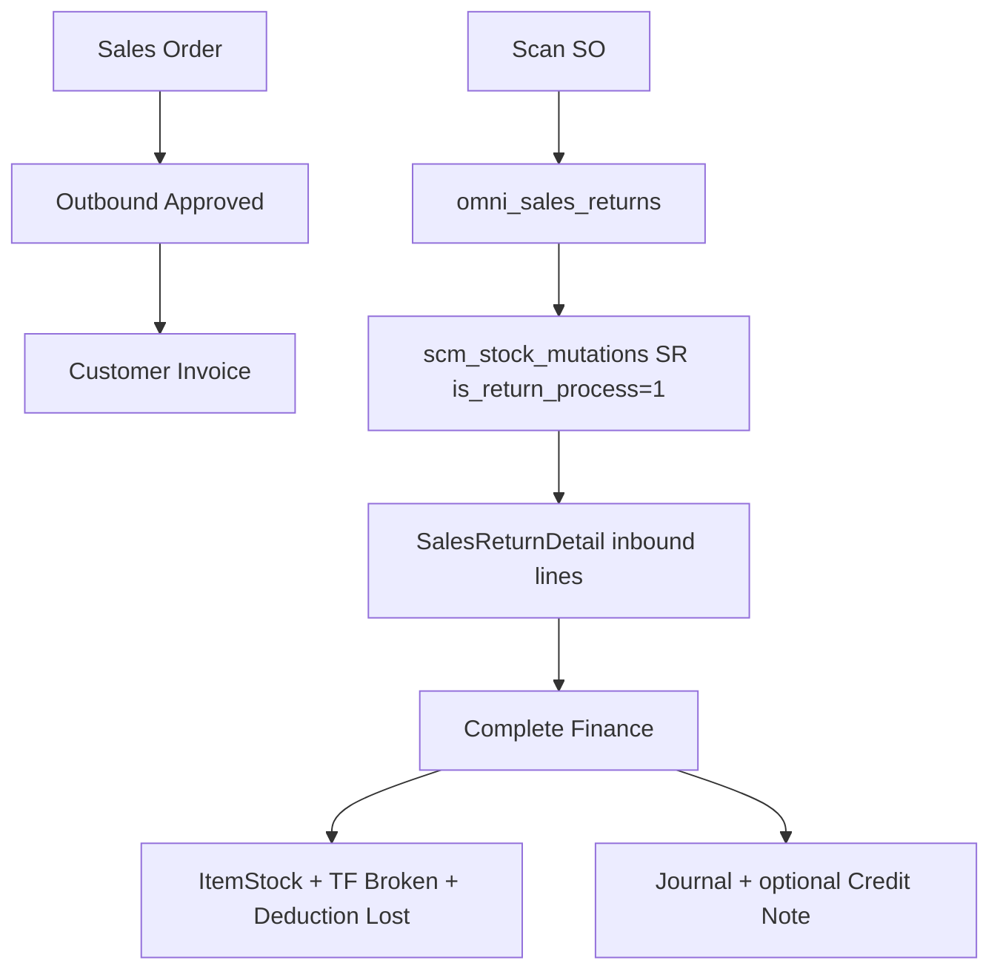
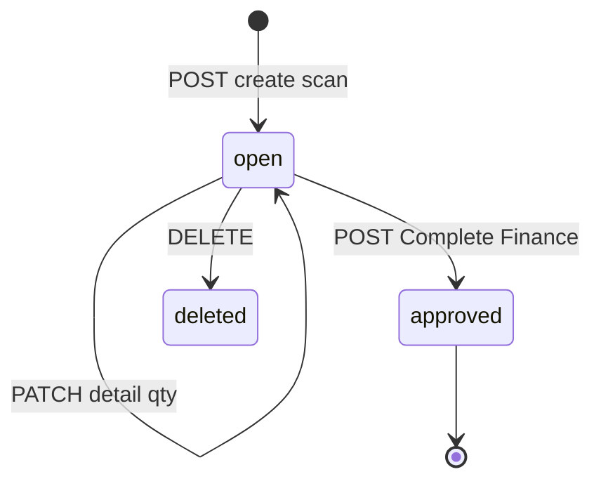
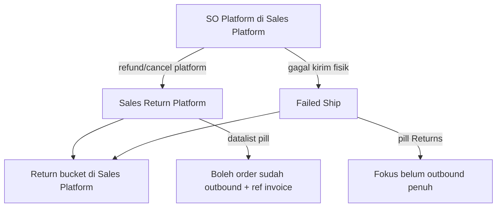

# Sales Return — Requirement Documentation

**Modul:** Supply Chain (SCM) + Finance Accounting — **satu fitur, dua menu**  
**Audience:** PM, Operations (Gudang), Finance, QA, Support, Developer  
**Status:** AS-IS verified against codebase per 2026-07-05

| Menu | Route UI | Persona |
|------|----------|---------|
| **Sales Return** (SCM) | `/supplychain/sales-returns` | Team Gudang — scan, input qty |
| **Sales Return Approval** (Accounting) | `/accounting/sales-return` | Team Finance — review harga/COGS, Complete |

**API base:** `{VITE_API_URL}accounting/sales-returns` · Datalist platform: `omnichannel/sales-returns`  
**Prefix transaksi:** `SR-` · Platform layer: `SRP` (`omni_sales_returns`)

**PM source:** `sales-return-requirement.md` (Notion, Live) · Perubahan COGS 7 Mei 2026

**Finance layer doc:** [accounting-sales-return/requirement.md](../accounting-sales-return/requirement.md)

---

## 0. Metadata & Changelog

| Version | Date | Author | Changes |
|---------|------|--------|---------|
| 2.7 | 2026-11-12 | QA - Yemima | Koreksi GAP-SR-16 (SCM §7.4): jalur pembuat SI setelah retur ada (daftar baris SI, impor SI, auto-generate SI, impor Settlement) sudah mengurangi qty yang diretur, jadi skenario SI baru approve setelah retur Unbilled dibuat hanya mungkin lewat API langsung. Yang terbukti: Complete tidak punya gate status SI, sehingga retur Unbilled lama yang SI-nya sudah approve (18 di Staging) bisa di-Complete tanpa pembalik Sales/AR. Deskripsi header SR tidak bisa diedit lewat aplikasi (update hanya menerima transaction_date) |
| 2.6 | 2026-11-12 | QA - Yemima | GAP-SR-16 dilengkapi kronologi dan skenario (SCM §7.4): SI yang masih Open ditolak saat Create Return, sehingga tidak masuk Billed maupun Unbilled. Retur Unbilled tidak punya pembalik Sales/AR bila SI baru approved setelah retur dibuat, atau bila retur lama (definisi lama, dibuat sebelum 10 Nov 2026) masih Open. Staging 12 Nov 2026: 64 dari 66 retur Unbilled (97,0%) bertaut SI approved, 18 di antaranya masih Open. Dicatat sebagai gap docs; belum ada card Jira. ETM-17064 / ETM-17291 |
| 2.5 | 2026-11-12 | QA - Yemima | Jurnal retur Unbilled (belum ada SI) hanya mengembalikan sisi barang: Return Inventory (D) / COGS (K) (+ Expense / Inventory bila Lost). Tanpa Sales (D) / AR (K): belum ada penjualan atau piutang yang tercatat untuk dibalik. Parity Purchase Return Unbilled (Unbilled Goods (D) / Persediaan (K), tanpa Hutang Usaha dan Debit Note). GAP-SR-16: cabang kode jurnal Sales/AR untuk Unbilled masih ada tetapi bernilai 0. Docs lama menyebut Sales/AR (definisi Unbilled lama = SI belum dibayar). ETM-17064 / TC ETM-17291 |
| 2.4 | 2026-11-04 | QA - Yemima | Export All: tanpa rincian 1 baris per dokumen; dengan rincian 1 baris per SKU. Harga/COGS menu gudang = 0. Dokumen tanpa detail tetap 1 baris (angka masih 0, kontrak `-` = GAP-SR-15). Kolom Show/Hide belum dihormati (GAP-SR-14 / ETM-17067) |
| 2.3 | 2026-11-04 | QA - Yemima | Baris SKU Restock+Lost+Broken = 0 tetap tersimpan; cek minimal satu qty hanya saat Complete (ETM-17054) |
| 2.2 | 2026-11-04 | QA - Yemima | Billed = ada SI / Unbilled = belum SI (bukan AR); GAP-SR-13 / ETM-17064 |
| 1.0 | 2026-06-19 | QA - Yemima | Initial draft AS-IS codebase |
| 2.0 | 2026-07-05 | QA - Yemima | Full rewrite: merge PM requirement, D&W COGS 7 Mei, dual-menu flow, gaps §19–§21 |
| 2.1 | 2026-07-15 | QA - Yemima | Relasi Sales Platform (Return bucket, flow vs Failed Ship) |

---

## 1. Ringkasan Eksekutif

**Sales Return** memproses pengembalian barang dari customer setelah order **sudah outbound & invoiced** (settled). Berbeda dari [Failed Ship](../supplychain-failed-ship/requirement.md) yang untuk order gagal kirim **sebelum** SI & Outbound.

| Kebutuhan Bisnis | Bagaimana SR Menjawab |
|------------------|----------------------|
| Traceability SO → Outbound → Return | Lines auto dari outbound; pivot `omni_sales_return_detail_has_mutations` |
| Restock / rusak / hilang | Tiga qty per SKU: Restock, Broken, Lost |
| Kontrol finance | Gudang save qty → Finance **Complete** → stok + jurnal |
| Platform refund/cancel | Pill **Sales Return Platform** + Sync API |
| Billed vs Unbilled | `accounting_type` dari **keberadaan Sales Invoice** (bukan status AR/payment); parity Purchase Return |

### 1.1 Arsitektur data (AS-IS)



| Layer | Table / Entity | Role |
|-------|----------------|------|
| Platform | `omni_sales_returns`, `omni_sales_return_details` | Header/detail dari SO platform |
| Inbound mutation | `scm_stock_mutations` (`Accounting\SalesReturn`) | `is_return_process=1`, `return_type=platform`, code `SR` |
| Detail | `Accounting\SalesReturnDetail` | Restock/broken/lost per outbound line |
| Pivot | `omni_sales_return_detail_has_mutations` | Link omni detail ↔ outbound ↔ inbound detail |

**Legacy V1** (`RETURN_TYPE_SYSTEM`, import/export multi-SO): routes **commented out** — bukan scope aktif.

---

## 2. Prasyarat & General Rules

| Rule | AS-IS validation | Pesan error |
|------|------------------|-------------|
| Outbound approved | `processed_to_out_quantity > 0` per detail | `{code} has not been processed to outbound, please use Failed Ship` |
| Invoice complete | `processed_to_invoice_quantity > 0` | `{code} has not been fully processed to invoice` / pending invoice |
| Product bound | `product_id` not empty | `{sku} is not binded to system product` |
| **IDR only** | `current_primary_currency_id == currency_id` | `…linked to Sales Invoice in foreign currency… Please use manual settlement…` |
| Pending payment | `prepared_to_payment_amount == 0` | `{code} has pending payment for invoice {code}…` |
| Pending return | `prepared_to_return_quantity > 0` | Redirect ke existing SR (success message) |
| Fully returned | all qty prepared | `This Sales Order is already fully processed to Sales Return.` |

**PM vs AS-IS — AR Unapproved:** PM menyebut AR unapproved block. Code **tidak** cek status AR document secara eksplisit; yang dicek: invoice processed, pending payment, foreign currency (GAP-SR-01).

**Failed Ship vs SR:**

| Kondisi order | Menu |
|---------------|------|
| Shipped, **belum** SI & Outbound | [Failed Ship](../supplychain-failed-ship/requirement.md) |
| **Sudah** SI & Outbound | **Sales Return** |

---

## 3. Perubahan COGS — 7 Mei 2026 (Agreement)

| Aspek | Before | After (AS-IS code) |
|-------|--------|---------------------|
| Nilai persediaan return | Stock ID inbound date **terbaru** | **Average** total nilai outbound ÷ total qty outbound |
| Stock ID hasil return | — | **1 Stock ID** per detail line (restock+broken+lost share same `ItemStock`) |

**Implementasi BE** (`SalesReturnController@createDetail` L459–471):

```
total_cogs = Σ (outbound_qty × item_stock.each_price_before_vat)
average_price = total_cogs / total_outbound_qty
each_price_before_vat on return detail = average_price
```

**Rule 1 — 1 Stock ID:** `SalesReturnDetail::generateItemStock()` creates **one** `ItemStock` per inbound detail; broken transfer & lost deduction reference same stock.

**GAP-SR-02:** Tooltip FE Return COGS masih menyebut *"most recent Stock ID date"* (`DetailTable.vue` L77) — **tidak match** BE average (7 Mei 2026).

---

## 4. PART 1 — Menu Sales Return (SCM)

**Route:** `/supplychain/sales-returns`  
**Komponen:** `SCM/SalesReturn/DataList.vue` + shared `@Accounting/Return/SalesReturn/*`

### 4.1 Header Section (Scan)

| Field | Rules AS-IS |
|-------|-------------|
| **Scan Order** | `sales_order_code` — match `code`, `platform_order_id`, atau `platform_return_id` |
| **Select WH Location** | Required; filter `is-return`, `has-scrap`, level under building, non-virtual |
| **Select CCTV Location** | Required; master location |
| **Reset** | Clear WH + Location ke null (`ActionButtons.vue`) |
| **Sync** | Bulk platform sync → `POST omnichannel/sales-returns/sync` |

**Preferensi user:** `localStorage` keys `return-warehouse-{companyId}`, `return-location-{companyId}` — persist antar session ✓

**Tooltip WH (PM):** ✓ implemented via WarehouseSelect props

### 4.2 Datalist — Kolom

**API:** `GET/POST omnichannel/sales-returns?from_scm=true`  
**Komponen:** `SalesReturnPlatformTable.vue`

| # | Kolom PM | Field BE / FE | Visible default |
|---|----------|---------------|-----------------|
| 1 | Sales Order | `order_formatted` | ✓ |
| 2 | Order Date | `order_deadline_formatted` | ✓ |
| 3 | Store Name / Buyer | `customer_formatted` | ✓ |
| 4 | Shipper / Tracking | `shipping_info_formatted` | ✓ |
| 5 | Return Shipper / Tracking | `return_shipping_formatted` | ✓ (PM: hidden default — **AS-IS visible**) |
| 6 | Total SKU / Qty | `total_quantity_formatted` | ✓ |
| 7 | Return Location | `warehouse_destination_formatted` | ✓ |
| 8 | 3PL Reference | `warehouse_origin_formatted` | ✓ |
| 9 | CS Type / Reason | `reason_formatted` | ✓ |
| 10 | Order Status | `order_status_formatted` | ✓ |
| 11 | Return Platform Status | `return_status_formatted` | ✓ |
| 12 | SR Code / Date | `transaction_code_formatted` | ✓ |
| 13 | Type Billed/Unbilled | `accounting_type` | ✓ |
| 14 | Outbound ref | `outbound_reference_formatted` | ✓ |
| 15 | Sales Invoice ref | `invoice_reference_formatted` | ✓ |
| 16 | AR ref | via invoice join | Partial — no dedicated AR column (GAP-SR-03) |
| 17 | Generated Trx (Credit Note) | — | **Not in datalist** (GAP-SR-04) |
| 18 | SR Status | `return_status_formatted` / mutation status | ✓ |
| 19 | Created By / At | `created_by_formatted` | ✓ |

**List filter default:** SO detail harus **full outbound** (`processed_to_out_quantity = sales_order_quantity_in_base_unit`).

### 4.3 Pill — Sales Return Platform

| PM | AS-IS |
|----|-------|
| Order refund/cancelled dari platform | Toggle section `platformOpen` di DataList |
| Belum ada SR | `without_used=true` → `stock_mutation_id IS NULL` |
| Outbound approved | Default query full outbound |
| Count dengan separator | `GET omnichannel/sales-returns/count` |

### 4.4 Bulk Select

| PM rule | AS-IS |
|---------|-------|
| Multi order → 1 SR | **Not implemented** in active scan flow — **1 SO per scan** (GAP-SR-05) |
| Same store (platform) | N/A — V1 commented |
| Same customer (internal) | N/A |
| IDR blocking message | ✓ at create validation |

---

## 5. PART 2 — Halaman Edit/Proses

**Route SCM:** `/supplychain/sales-returns/edit/:id`  
**Route Finance:** `/accounting/sales-return/edit/:id` (same components, different props)

### 5.1 Section Order Details

**Komponen:** `Header.vue` — read-only disclosure

| Field PM | AS-IS |
|----------|-------|
| Order No, Buyer, Notes, Return Type, SR Status | ✓ |
| Return WH, Returned By/Location | ✓ |
| SR No + timestamp | ✓ |
| Shipping info, Packing, Pickup | **Partial** — not all PM fields in Header (GAP-SR-06) |
| Return Shipper / Return Tracking editable | **Not in Header** — datalist only (GAP-SR-07) |

### 5.2 Product Detail — Return Table

**Header:** `Sales Return No: SR-… | created_at`

| Kolom SCM | Field | Validasi |
|-----------|-------|----------|
| Product | image + SKU + name | Auto from outbound |
| Product Qty | `return_quantity` | Order qty |
| Restock Qty | `quantity` | Whole number |
| Lost Items | `lost_quantity` | Whole number |
| Broken Items | `broken_quantity` | Whole number |
| Total SR Qty | computed | ≤ returnable; FE: `Total return qty can't exceed…` |
| Unit | product unit | — |

**Returnable max:**

```
outbound_qty_in_base - prepared_to_return_qty - processed_to_return_qty
```

**Auto-save:** debounce ~1200ms → `PATCH …/details/{id}`

**SCM toast after save:** `Return data saved. Waiting for Finance team to review and complete the approval process.` ✓

**Baris qty 0 (ETM-17054):** satu baris SKU dengan Restock = 0, Lost = 0, dan Broken = 0 tetap auto-save sebagai 0. Pesan `Total return quantity must be greater than 0 to save this document.` tidak dipakai lagi. Save hanya menolak bilangan non-bulat dan total yang melebihi qty yang masih bisa diretur. Cek "minimal satu qty lebih dari 0" ada di level dokumen, saat Finance Complete (§7.2).

**Contoh:** SO dua SKU. SKU A Restock 2; SKU B Restock 0, Lost 0, Broken 0. Kedua baris tersimpan, Complete boleh. Jika semua baris 0/0/0, save tetap sukses dan Complete ditolak.

**Kolom Finance** (`with_price=1`): Order Price/COGS, Return Price/COGS — lihat [accounting-sales-return](../accounting-sales-return/requirement.md).

### 5.3 Action Buttons

| Tombol | SCM (`fromScm=true`) | Finance (`fromScm=false`) |
|--------|----------------------|---------------------------|
| Back to Datalist | ✓ → `/supplychain/sales-returns` | ✓ → `/accounting/sales-return` |
| Edit Qty | ✓ (auto-save) | ✓ |
| **Complete** | ❌ hidden | ✓ when `can_approve` |
| Delete | ✓ if not approved | ✓ |

---

## 6. Status Lifecycle (AS-IS)



| Status | Used? | Notes |
|--------|-------|-------|
| **open** | ✓ | Default on create |
| **approved** | ✓ | After Finance Complete |
| draft, rejected, processed, complete, void, closed | ❌ | Constants exist; not in active flow |

**No reject button** in active UI (legacy `ApprovalDialog` unused).  
**Auto-approve:** command `salesreturn:auto-approve` + config `omni_sales_return_configurations`.

---

## 7. PART 3 — Completion Flow & Generated Transactions

### 7.1 POV Gudang (SCM)

Setelah save qty → status tetap **open** → menunggu Finance. Tidak ada Complete.

### 7.2 POV Finance — Complete (`POST …/approve`)

**Validasi approve:**

| Rule | Message |
|------|---------|
| Not already approved | `This data and its properties already approved…` |
| Min 1 qty lebih dari 0 (level dokumen, bukan per baris) | `Please enter at least one restock quantity, broken quantity, or lost quantity` |
| Lost > 0 needs Return Expense COA | `Cannot approve. Return Expense COA is not configured…` |
| Product active + COA group | `SKU {sku} is inactive` / `Please check COA group…` |
| `description` max 150 | optional approval note |

**Sub-proses on approve** (`SalesReturnDetail::generateStock`):

| Outcome | Generated transaction |
|---------|----------------------|
| **Restock** (+ broken + lost total) | `ItemStock` at Return WH (`available_quantity`) |
| **Broken Items** | Auto **Transfer Internal** → Scrap WH (`PROCESS_TYPE_SCRAP`) — auto-approved |
| **Lost Items** | Auto **Stock Deduction** (`PROCESS_TYPE_LOST`, inventory adjustment) — auto-approved |

**Partial remainder:** jika masih ada `available_quantity_in_base_unit` → `platform_return->duplicate()` untuk SR baru.

### 7.3 Jurnal (AS-IS — `JournalProcess::stockSalesReturnAutoJournal`)

| Type | Jurnal |
|------|--------|
| **UNBILLED** | J1: Return Inventory (D) / COGS (K) · J2: Expense (D) / Inventory (K) if Lost. **Tanpa** Sales (D) / AR (K): belum ada SI (GAP-SR-16, kronologi di §7.4) |
| **BILLED** | J1: **Credit Note** (D) / AR (K) · J2: Return Inventory (D) / COGS (K) · J3: Expense if Lost |

**Credit Note (billed):** auto jika baris **sudah punya SI** → `generateCreditNoteFromReturn` (parity Purchase Return billed → Debit Note). **Bukan** syarat payment/AR. Gap code: GAP-SR-13 / [ETM-17064](https://erpintegration.atlassian.net/browse/ETM-17064). Lihat [Credit Note](../accounting-credit-note/README.md).

**PM Completion Summary Dialog:** `Sales Return Processed` dengan breakdown + Print Summary — **not implemented** (GAP-SR-08).

### 7.4 GAP-SR-16 — Kronologi dan skenario (Unbilled vs status Sales Invoice)

**Status:** gap dicatat di docs (keputusan QA 12 Nov 2026); belum ada card Jira. Diverifikasi dari kode `origin/dev` (12 Nov 2026) dan data Staging (baca saja).

**Aturan klasifikasi di kode**

| Tahap | Perilaku |
|-------|----------|
| Create Return (`SalesReturnLogic::store`) | Tiap baris SO dinilai dari `invoiced_quantity` = `prepared_to_invoice_quantity` (SI sudah dibuat tetapi belum approve, status Open) + `processed_to_invoice_quantity` (SI sudah approve). Nilai > 0 → baris **Billed**; 0 → **Unbilled**. Satu SO yang sebagian barisnya sudah ber-SI menghasilkan dua dokumen retur (Billed dan Unbilled). Penilaian per **baris SO**, bukan per qty. |
| Pengaman SI Open (`validateDetails`) | Pembuatan retur **ditolak** bila ada baris SO dengan `prepared_to_invoice_quantity` > 0: `<SO> has pending invoice, please complete it first`. Jadi SI yang masih Open tidak pernah menjadi Billed maupun Unbilled. Retur baru bisa dibuat setelah SI di-approve (→ Billed) atau dihapus (→ Unbilled). |
| Tipe tersimpan | `omni_sales_returns.accounting_type` diisi **sekali** saat Create Return. Tidak dihitung ulang saat Complete. |
| Complete (`SalesReturnLogic::approve` → `ItemStockMutation::approveReturn` → `stockSalesReturnAutoJournal`) | **Tidak ada gate status SI.** Yang dicek hanya: periode fiskal, minimal satu qty, gudang tujuan, produk aktif, COA group, Return Expense COA (bila ada Lost), dan `can_approve`. Jurnal mengikuti **tipe tersimpan**, bukan status SI pada saat Complete. Billed → Credit Note + jurnal sisi barang. Unbilled → hanya Return Inventory (D) / COGS (K). |

**Skenario berurutan**

| # | Skenario | Kronologi | Hasil di sistem | Status |
|---|----------|-----------|-----------------|--------|
| S1 | Unbilled normal | 1) SO sudah outbound, belum ada SI. 2) Create Return → Unbilled. 3) Complete. | Jurnal hanya Return Inventory (D) / COGS (K), tanpa CN. Contoh SR-5V10Z5K7 (GL-EAMIDFM6LEYK): 2.000 / 2.000. | Benar, bukan gap |
| S2 | Billed normal | 1) SI sudah approve. 2) Create Return → Billed. 3) Complete. | Credit Note otomatis + jurnal sisi barang. | Benar, bukan gap |
| S3 | SI masih Open saat Create Return | 1) SI dibuat (mis. hasil Instant Settlement), status Open. 2) User Create Return. 3) Sistem menolak. 4) SI di-approve lalu Create Return lagi → Billed; atau SI dihapus lalu Create Return → Unbilled. | Tidak ada baris yang masuk dua tipe sekaligus. | Aman menurut kode; belum diuji langsung di aplikasi |
| S4 | SO campuran | 1) SO punya dua baris: A sudah SI approved, B belum SI. 2) Create Return. | Dua dokumen: Billed (A) dan Unbilled (B), masing-masing dijurnal sesuai tipe. | Sesuai desain. Catatan: bila SI baru mencakup sebagian qty satu baris (mis. 3 dari 5), seluruh qty retur baris itu masuk Billed dan nilai CN dihitung harga SI × qty retur, bisa melebihi qty yang benar-benar di-SI. Staging: 0 retur kasus ini |
| S5 | SI muncul **setelah** retur Unbilled dibuat | 1) Hari 1: Create Return pada SO tanpa SI → Unbilled (Open). 2) Hari 2: SI dibuat dan di-approve untuk baris SO yang sama. 3) Hari 3: Complete. | Bila terjadi: tipe tetap Unbilled → jurnal hanya Return Inventory / COGS, tanpa CN. Penjualan (K) / Piutang (D) dari SI **tidak dibalik** karena Complete tidak mengecek SI. | **Tertutup di jalur normal.** Daftar pilihan baris SI (`invoicable()`), impor SI, auto-generate SI, dan impor Settlement (lewat `CustomerInvoiceHelper::extractOrderDetails`) semuanya mengurangi qty yang sudah diretur (`invoicable_quantity_in_base_unit`); impor Settlement juga menolak SO yang punya SI atau Outbound pending. Satu celah: pemanggilan API langsung tambah/ubah item SI (`CustomerInvoiceDetailItemController`) hanya menghitung sisa qty invoice, tanpa mengurangi qty retur. Staging: 0 retur kasus ini; belum direproduksi |
| S6 | Retur Unbilled **lama** (definisi lama) masih Open | 1) 30 Apr–4 Nov 2026: Create Return pada SO yang SI-nya sudah approve (belum dibayar) → saat itu disebut Unbilled. 2) 10 Nov 2026 16:05: ETM-17064 (`d40ec8e`) mengubah definisi (Unbilled = belum ada SI); harga jurnal Sales/AR tidak lagi dibaca dari SI. 3) Retur lama itu di-Complete sekarang. | Tipe tersimpan tetap Unbilled → jurnal hanya Return Inventory / COGS (nilai Sales/AR = 0), tanpa CN. Sales/AR dari SI approved **tidak dibalik**. Sebelum 10 Nov retur seperti ini dibalik lewat jurnal retur. | **Gap (data transisi)**; terbukti ada di Staging: 18 retur. Complete tidak menolaknya karena tidak ada gate status SI. Deskripsi header SR tidak bisa diedit lewat aplikasi (`SalesReturnController::update` hanya meneruskan `transaction_date`), jadi penandaan data hanya bisa lewat patch data oleh Dev |

**Data Staging (12 Nov 2026, 107 retur berdokumen, baca saja)**

| Tipe retur | Status | Retur | SI approved penuh | Tanpa SI | SI Open | SI sebagian qty |
|------------|--------|-------|-------------------|----------|---------|-----------------|
| Billed | Approved | 34 | 34 | 0 | 0 | 0 |
| Billed | Open | 7 | 7 | 0 | 0 | 0 |
| Unbilled | Approved | 48 | 46 | 2 | 0 | 0 |
| Unbilled | Open | 18 | 18 | 0 | 0 | 0 |
| **Total** | | **107** | **105 (98,1%)** | **2 (1,9%)** | **0** | **0** |

- Retur Unbilled berdokumen: 66. Bertaut SI approved: 64 (97,0%). Tanpa SI: 2 (3,0%), yaitu SR-5V10M3C7 dan SR-5V10Z5K7 (dibuat 11 Nov 2026, sesuai definisi baru).
- 46 retur Unbilled Approved yang ber-SI tidak ada yang berubah/di-Complete setelah 10 Nov 16:05 (0 dari 46; acuan `updated_at`), jadi jurnalnya masih memakai logika lama.
- 18 retur Unbilled Open yang SI-nya sudah approve dibuat 30 Apr–4 Nov 2026. Contoh: SR-5UYFKQ24 (SO-5UYF6TAH), SR-5U9O0HSD (SO-5U1VSXC7), SR-5TWF1RTE (SO-96884IAB), SR-5TR81R6K (SO-5TR7MQ2W), SR-5TP16YE1 (SO-5TNWUJ5C).
- SI dibuat setelah retur: 0 dari 107. SI Open pada baris retur: 0 dari 107.
- Reproduksi: ambil `omni_sales_returns` (+ `omni_sales_return_details.order_detail_id`) yang punya `stock_mutation_id`, lalu bandingkan dengan `omni_sales_order_details.processed_to_invoice_quantity` / `prepared_to_invoice_quantity` / `sales_order_quantity_in_base_unit` dan `accounting_customer_invoice_detail_items.created_at`.

**Dampak cabang kode Sales/AR (DEV-SR-09)**

| Kondisi kode | Retur Unbilled baru tanpa SI (S1) | Retur dengan SI sudah approve (S6; S5 hanya lewat API langsung) |
|--------------|-----------------------------------|----------------------------------------|
| Sekarang: cabang jalan, harga dibaca dari atribut yang tidak ada → 0 | Benar (kebetulan) | Tidak ada pembalik Sales/AR |
| Atribut harga "diperbaiki" tanpa mengubah desain | **Salah**: Sales (D) / AR (K) tertulis dengan harga SO padahal tidak pernah ada SI | Pembalik muncul, tetapi harganya dari SO, bukan dari SI |
| Cabang dibuang | Benar (disengaja) | Tetap tanpa pembalik; perlu keputusan di bawah |

**Keputusan yang belum ada (untuk S6, dan S5 bila ada jalur API langsung):** Create Return sudah punya gate SI Open, tetapi Complete belum punya gate SI. Pilihan: (a) gate di Complete yang menolak retur Unbilled bila ada baris yang SI-nya sudah approve, dengan pesan yang jelas; (b) tipe dihitung ulang saat Complete (SI sudah approve → perlakukan sebagai Billed + CN); (c) retur lama dibatalkan lalu dibuat ulang. Belum diputuskan; di luar lingkup ETM-17064 / ETM-17291.

---

## 8. Delete Rules

| Action | When | Effect |
|--------|------|--------|
| **Delete** | Not approved (`ensureMutationNotApprovedOrApproving`) | Revert `prepared_to_return_quantity`; clear pivot; soft-delete mutation |

Messages: `Data already approved.` · `Data approval process is in progress. Please wait a moment.`

**Void / Close:** tidak ada endpoint aktif.

---

## 9. Import / Export / Print

| Feature | AS-IS |
|---------|-------|
| **Export datalist** | ✓ `omnichannel/sales-returns/export-*` — chunk 5000. Kontrak baris: §9.1 (ETM-17067, reopen ETM-10609) |
| **Import** | ❌ V1 routes commented |
| **Print** | Seeder SCM `print=1` but **no UI** (GAP-SR-09) |

Berlaku untuk **kedua menu**: Supply Chain `/supplychain/sales-returns` dan Accounting `/accounting/sales-return`. Standar grain mengikuti [Order Processing Trace SOT §6](../_meta/sot/order-processing-trace-source-of-truth.md).

### 9.1 Export All — Without Details vs With Details

| Mode | Grain | Isi |
|------|-------|-----|
| **Without Details** (header) | **1 baris Excel = 1 dokumen** Sales Return, sama dengan baris datalist | Kolom ringkasan dokumen saja. Tidak ada kolom rincian per SKU |
| **With Details** (item, flattened) | **1 baris Excel = 1 baris detail SKU**. Dokumen dengan N SKU menghasilkan N baris | Kolom header **diulang** di setiap baris. Kolom detail menyusul sebelum Description |

**Kolom detail (With Details):** System Product SKU, System Product Name, Product Variant, Order Price, Order COGS, Product Qty, Return Price, Return COGS, Outstanding Qty, Restock Qty, Lost Items, Broken Items, Total Return Qty, Unit.

**Harga / COGS per menu:** menu Supply Chain menulis Order Price, Order COGS, Return Price, dan Return COGS sebagai **0** (`with_price` false; proses export juga memaksa 0 bila nama menu memuat SCM). Kolomnya tetap ada. Menu Accounting mengisi nilainya.

**Dokumen tanpa baris detail:** tetap **1 baris** (bukan hilang). Kontrak [ETM-10609](https://erpintegration.atlassian.net/browse/ETM-10609): seluruh kolom detail terisi `-`. AS-IS setelah `fe26ea765`: SKU, Product Name, Variant, dan Unit sudah `-`; kolom **angka** (harga, COGS, qty) masih **0** — GAP-SR-15, masih terbuka di [ETM-17067](https://erpintegration.atlassian.net/browse/ETM-17067).

**Contoh:** satu dokumen berisi 2 SKU (`HOME-DEC-CORTRAYWOOD` dan `TECH-ACC-MULTICARDREADER`).

| Opsi | Hasil yang benar |
|------|------------------|
| Without Details | 1 baris header |
| With Details | 2 baris. Trx. Code, pembeli, dan kolom header lain sama di kedua baris; tiap baris membawa satu SKU beserta qty dan harga |

### 9.2 Show/Hide Column pada export (TO-BE)

Export **wajib** mengikuti visibilitas kolom datatable yang sedang aktif. Kolom yang user sembunyikan lewat **Show/Hide Column** (`visible = false`) **tidak boleh** muncul di header maupun sel Excel. Standar yang sama dengan export mature, ref `TC-OPL-16144-02`.

**AS-IS di dev:** backend **tidak** menerima dan **tidak** menyaring `hidden_columns` / `visible_columns`. Kolom yang disembunyikan (misalnya Assignee atau Trx. Ref) tetap ada di file. **TO-BE / known gap** GAP-SR-14, terikat [ETM-17067](https://erpintegration.atlassian.net/browse/ETM-17067). Grain §9.1 sudah jalan di `fe26ea765`; filter kolom belum.

---

## 10. Stock Impact Timeline

| Phase | Stock effect |
|-------|--------------|
| Create (open) | `prepared_to_return_quantity` ↑ — blocks qty |
| Edit qty | Adjust prepared counters + invoice `prepared_to_amount_return` |
| Approve | +ItemStock restock; broken→scrap TF; lost→deduction; `processed_to_return_quantity` finalized |

---

## 11. Validasi & Notifikasi Lengkap

| Kondisi | Notifikasi (exact / near-exact) |
|---------|--------------------------------|
| Missing SO code | `Please input Sales Order Code` |
| Missing WH | `Please select Warehouse Location` |
| Missing location | `Please select CCTV Location` |
| SO not found | `Unable to find sales order` |
| No outbound | `…has not been processed to outbound, please use Failed Ship` |
| Pending invoice | `…has pending invoice, please complete it first` |
| Not invoiced | `…has not been fully processed to invoice` |
| Foreign currency | `…linked to Sales Invoice in foreign currency…` |
| Pending payment | `…has pending payment for invoice…` |
| Pending SR exists | `There is a pending sales return for this order…` |
| Fully processed | `This Sales Order is already fully processed to Sales Return.` |
| Total SR > Product Qty | `Total return qty can't exceed the original ordered qty.` (FE) / `Total quantity exceed returnable quantity` (BE) |
| Satu baris SKU qty 0 (save) | Tersimpan normal sebagai 0. Pesan `Total return quantity must be greater than 0 to save this document.` tidak dipakai lagi (ETM-17054) |
| Seluruh dokumen qty 0 (Complete) | `Please enter at least one restock quantity, broken quantity, or lost quantity` |
| Sync in progress | `Sync Sales Return Platform is being processed…` |

---

## 12. Do's & Don'ts

| ✅ Do | ❌ Don't |
|-------|----------|
| Pastikan order sudah outbound + invoice sebelum scan | Pakai SR untuk order pre-outbound (gunakan Failed Ship) |
| Biarkan baris SKU 0/0/0 tersimpan bila SKU lain diretur; pastikan dokumen punya minimal 1 qty sebelum Complete | Complete saat seluruh Restock, Broken, dan Lost dokumen = 0 |
| Set Return Expense COA jika ada Lost Items | Approve tanpa COA group produk |
| Finance Complete setelah gudang save | Gudang klik Complete (hidden di SCM) |
| Foreign currency → manual settlement | Force SR untuk order non-IDR |

---

## 13. Acceptance Criteria (QA smoke)

1. Scan valid SO → create SR open + omni header  
2. Datalist platform pill shows count + full-outbound filter  
3. Edit restock/broken/lost → auto-save + SCM waiting toast, termasuk satu baris SKU 0/0/0 pada SO multi-SKU  
4. Total SR qty capped at returnable  
5. SCM tidak lihat Complete; Finance lihat Complete  
6. Approve → ItemStock + journals + optional Credit Note (billed)  
7. Broken → auto TF scrap; Lost → auto deduction + expense journal  
8. Delete open SR reverts prepared qty  
9. Foreign currency SO blocked at create  
10. COGS uses average outbound price (7 Mei 2026 rule)  
11. Complete ditolak jika seluruh dokumen qty 0 (`Please enter at least one restock quantity, broken quantity, or lost quantity`)
12. Export Without Details = 1 baris per dokumen; With Details = 1 baris per SKU (header diulang). Menu gudang: harga/COGS = 0. Dokumen tanpa detail tetap 1 baris (angka masih 0, kontrak `-` = GAP-SR-15). Kolom yang di-hide belum hilang dari Excel (GAP-SR-14 / ETM-17067)

---

## 14. Relasi Menu

| Menu | Relasi |
|------|--------|
| [Failed Ship](../supplychain-failed-ship/requirement.md) | Pre-outbound / shipping failures; qty FS mengurangi room return |
| [Sales Platform](../omni-sales-platform/requirement.md) | SO marketplace sumber return; Return bucket + Failed Ship Status |
| [All Sales Order](../all-sales-order/requirement.md) | Monitoring gabungan general + platform |
| [Sales Order](../sales-order-general/requirement.md) | SO internal / Dev Sales Order |
| [Customer Invoice](../accounting-customer-invoice/) | Price, tax, billed/unbilled |
| [Credit Note](../accounting-credit-note/README.md) | Auto-generated billed returns |
| [Warehouse Setting](../supplychain-setting/) | Return Location WH |
| [Sales Return Configuration](../omni-global-setting/) | Auto-approve duration |

### Relasi Sales Platform (detail)



| Aspek | Peran Sales Return vs SP |
|-------|--------------------------|
| Eligibility | Platform return biasanya setelah outbound (`processed_to_out_quantity`); jika belum outbound → arahkan Failed Ship |
| Feedback SP | Memicu bucket **Return**; status dokumen SR independen dari Invoice Status di detail SP |
| Sync | `POST omnichannel/sales-returns/sync` menarik retur dari marketplace ke daftar platform |
| Qty | Tidak melebihi outbound residual setelah FS + return prepared/processed |

Canonical SP: [omni-sales-platform/requirement.md §7.1](../omni-sales-platform/requirement.md).

---

## 19. Gaps — PM vs AS-IS

| ID | Topik | PM | AS-IS | Status |
|----|-------|-----|-------|--------|
| GAP-SR-01 | AR unapproved block | Explicit AR check | Invoice/payment checks only | **Partial** |
| GAP-SR-02 | COGS tooltip Finance | Average outbound (7 Mei) | BE ✓; FE tooltip still "latest Stock ID date" | **UI drift** |
| GAP-SR-03 | AR column datalist | Dedicated column | Not present | **Not implemented** |
| GAP-SR-04 | Generated Trx / CN column | Datalist column | Not present | **Not implemented** |
| GAP-SR-05 | Bulk multi-order → 1 SR | Supported | 1 SO per scan | **Not implemented** |
| GAP-SR-06 | Order Details fields | Full PM list | Partial in Header | **Partial UI** |
| GAP-SR-07 | Return Shipper/Tracking edit | Editable internal | Not on edit form | **Not implemented** |
| GAP-SR-08 | Completion Summary dialog | Picking-list pattern | No dialog | **Not implemented** |
| GAP-SR-09 | Print Summary | Footer Print | No print UI | **Not implemented** |
| GAP-SR-10 | Reject flow | — | No reject button | **Not implemented** |
| GAP-SR-11 | Return Shipper column default hidden | Hidden | Visible default | **UI differs** |
| GAP-SR-12 | Status processed/complete | — | Jump open→approved | **By design AS-IS** |
| GAP-SR-13 | Definisi Billed/Unbilled | Billed = ada SI; Unbilled = belum SI (parity PR) | Code memakai `processed_to_payment_amount > 0` | **Open** [ETM-17064](https://erpintegration.atlassian.net/browse/ETM-17064) |
| GAP-SR-14 | Export hormati Show/Hide Column | Kolom tersembunyi tidak ada di header maupun sel Excel (TC-OPL-16144-02) | Backend tidak menerima/menyaring `hidden_columns` / `visible_columns` | **TO-BE** [ETM-17067](https://erpintegration.atlassian.net/browse/ETM-17067) |
| GAP-SR-15 | Dokumen tanpa detail: kolom detail `-` | Semua kolom detail `-` (kontrak ETM-10609) | Teks (SKU, nama, varian, unit) `-`; angka harga/qty `0` | **TO-BE** [ETM-17067](https://erpintegration.atlassian.net/browse/ETM-17067) |
| GAP-SR-16 | Jurnal Unbilled tanpa Sales/AR | Unbilled (belum ada SI) hanya Return Inventory (D) / COGS (K); parity Purchase Return Unbilled | Kode masih punya cabang Sales (D) / AR (K) untuk Unbilled; sejak ETM-17064 nilainya 0 sehingga baris tidak tertulis (hasil benar karena kebetulan). Akibat nyata: retur Unbilled lama yang SI-nya sudah approve tidak punya pembalik Sales/AR dan tidak punya CN, dan Complete tidak menolaknya (tidak ada gate status SI); Staging 12 Nov: 64 dari 66 retur Unbilled (97,0%), 18 masih Open. Kronologi: §7.4 | **Open** (dicatat sebagai gap docs; belum ada card Jira) |

---

## 20. Dev Follow-ups

| ID | Item | Hint |
|----|------|------|
| DEV-SR-01 | Update Return COGS tooltip to average | `DetailTable.vue` L77 |
| DEV-SR-02 | AR unapproved explicit check | `validateDetails()` |
| DEV-SR-03 | Completion Summary dialog | Finance approve success handler |
| DEV-SR-04 | Print Summary | New blade/component |
| DEV-SR-05 | Return shipper/tracking on edit form | Header or new section |
| DEV-SR-06 | Bulk multi-order create | New API + FE selection |
| DEV-SR-07 | Export buang kolom yang di-hide | GAP-SR-14 — terima dan saring kolom Show/Hide |
| DEV-SR-08 | Baris tanpa detail: angka jadi `-` | GAP-SR-15 — jangan tulis 0 pada kolom detail |
| DEV-SR-09 | Buang cabang jurnal Sales/AR pada retur Unbilled | GAP-SR-16 — jurnal Unbilled cukup Return Inventory / COGS. Belum ada card; keputusan penanganan S5/S6 dulu (§7.4) |

---

## 21. Pending Items — Major

| ID | Severity | Stakeholder | Pertanyaan | AS-IS |
|----|----------|-------------|------------|-------|
| **P-SR-01** | 🔴 Major | **Finance + Dev** | **Completion Summary + Print** wajib? (GAP-SR-08/09) | Approve success tanpa dialog breakdown |
| **P-SR-02** | 🔴 Major | **PM + Ops** | **Bulk 1 SR = multi order** masih roadmap? (GAP-SR-05) | Scan single SO only |
| **P-SR-03** | 🟡 Medium | **Finance** | **AR unapproved** — perlu cek eksplisit? (GAP-SR-01) | Invoice processed + no pending payment |
| **P-SR-04** | 🟡 Medium | **End user** | **Return Shipper/Tracking** editable internal? (GAP-SR-07) | Datalist/platform API only |
| **P-SR-05** | 🟡 Medium | **QA** | Kolom **Generated Credit Note** di datalist? (GAP-SR-04) | CN exists post-approve, tidak tampil di list |

**Confirmed OK:**

- COGS average outbound (7 Mei 2026) ✓ BE  
- 1 Stock ID per return detail ✓  
- Dual menu SCM/Finance split ✓  
- IDR-only enforcement ✓  
- Failed Ship routing pre-outbound ✓

---

## Related Documents

| Doc | Path |
|-----|------|
| Finance layer | [../accounting-sales-return/requirement.md](../accounting-sales-return/requirement.md) |
| Knowledge Base (Gudang) | [knowledge-base.md](./knowledge-base.md) |
| Technical | [technical.md](./technical.md) |
| Failed Ship | [../supplychain-failed-ship/requirement.md](../supplychain-failed-ship/requirement.md) |
